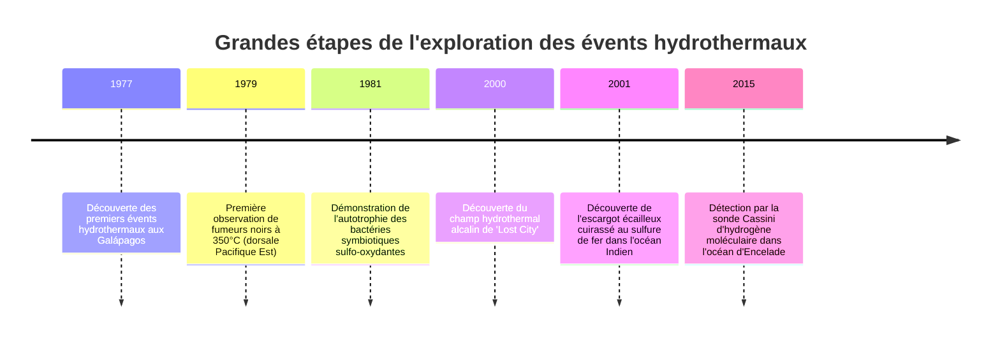
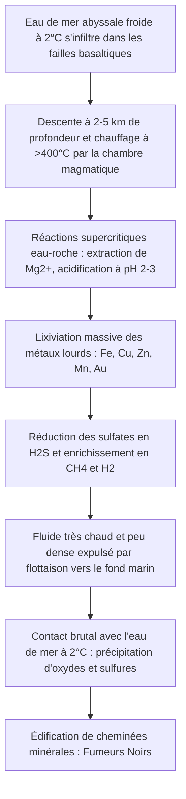

Pendant des siècles, la biologie a reposé sur un dogme incontesté : toute forme de vie complexe sur Terre dépend de la lumière solaire via la photosynthèse. Ce paradigme a été pulvérisé en 1977 par le submersible habité *Alvin* sur le rift des Galápagos, à 2 500 mètres sous la surface de l'océan Pacifique.

Dans l'obscurité totale et sous une pression écrasante de 250 atmosphères, les océanographes découvrirent d'immenses cheminées minérales crachant des fluides noirs surchauffés à plus de 350°C (les fumeurs noirs). Autour d'elles grouillait une communauté florissante : vers tubicoles géants de deux mètres aux branchies pourpres, crabes albinos et palourdes démesurées.

Cette découverte a révélé l'existence des **écosystèmes chimiosynthétiques**, alimentés non par des photons solaires, mais par l'énergie géothermique et chimique issue des entrailles de la Terre.



---

## 1. Géophysique et géochimie de la circulation hydrothermale

Les sources hydrothermales se développent le long des dorsales médio-océaniques divergentes où le magma mantellique pénètre à faible profondeur.



1. **Infiltration et percolation** : L'eau océanique froide s'infiltre dans les fractures de la croûte océanique basaltique.
2. **Métamorphisme de haute température** : Sous plus de 400°C et des pressions extrêmes, le magnésium précipite, libérant des protons ($H^+$) et créant une solution hyperacide (pH 2 à 3).
3. **Lixiviation métallique** : Ce fluide corrosif dissout fer, cuivre, zinc et or.
4. **Précipitation et cheminées** : Au contact de l'eau abyssale froide et alcaline, les sulfures métalliques précipitent instantanément sous forme d'un panache noir minéralisé qui construit la cheminée.

---

## 2. Biochimie de la chimiosynthèse

Les micro-organismes chimiolithoautotrophes exploitent l'énergie libre de Gibbs ($\Delta G^\circ$) libérée par l'oxydation de composés inorganiques :

### Réactions clés :
- **Oxydation du sulfure d'hydrogène** :
  $$H_2S + 2O_2 \rightarrow SO_4^{2-} + 2H^+ \quad (\Delta G^\circ = -792\text{ kJ/mol})$$
- **Oxydation du dihydrogène** :
  $$2H_2 + O_2 \rightarrow 2H_2O \quad (\Delta G^\circ = -474\text{ kJ/mol})$$
- **Méthanotrophie aérobie** :
  $$CH_4 + 2O_2 \rightarrow CO_2 + 2H_2O \quad (\Delta G^\circ = -820\text{ kJ/mol})$$

```mermaid
graph LR
    subgraph Photosynthèse
        Lumiere[Photons solaires] --> Chl[Système photosynthétique]
        Chl --> ATP1[ATP + NADPH]
        CO2_1[CO2] + ATP1 --> Bio1[Biomasse carbonée]
    end

    subgraph Chimiosynthèse
        Inorg[Donneurs d'électrons: H2S, H2, CH4] --> ETS[Chaîne respiratoire membranaire]
        ETS --> ATP2[Force proton-motrice -> ATP + NADH]
        CO2_2[CO2] + ATP2 --> Bio2[Biomasse carbonée]
    end
```

Les archées et bactéries thermophiles primitives fixent le carbone via le **cycle réducteur des acides tricarboxyliques (rTCA)**, beaucoup plus économe en ATP que le cycle de Calvin.

---

## 3. Adaptations extrêmophiles et origines de la vie

- **Riftia pachyptila** : Le ver tubicole ne possède aucun tube digestif. Son trophosome abrite des milliards de bactéries chimiotrophes. Une hémoglobine géante transporte simultanément l'oxygène et le sulfure toxique ($H_2S$) sans inhibition cellulaire.
- **Chrysomallon squamiferum** : L'escargot écailleux synthétise une armure de nanoparticules de sulfure de fer (gréigite $Fe_3S_4$ et pyrite) pour dissiper les chocs des prédateurs.
- **L'origine de la vie aux évents alcalins** : La théorie de Russell et Lane montre que le gradient de protons naturel ($\Delta \text{pH} \approx 4$) entre les fluides basiques de type *Lost City* (pH 9-11) et l'océan hadéen acide (pH 5-6) a agi comme une pile bioénergétique primitive ayant engendré les premiers protocellules.
