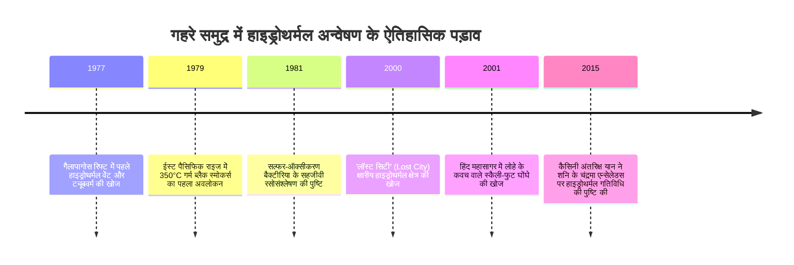

शताब्दियों तक जीव विज्ञान में यह अकाट्य सिद्धांत माना जाता रहा कि पृथ्वी पर सभी जटिल जीवन प्रकाश संश्लेषण के माध्यम से प्रत्यक्ष या अप्रत्यक्ष रूप से सूर्य की ऊर्जा पर निर्भर करता है। यह धारणा 1977 में पूरी तरह ध्वस्त हो गई, जब प्रशांत महासागर में गैलापागोस रिफ्ट पर मानवयुक्त पनडुब्बी *एल्विन (Alvin)* ने 2,500 मीटर की गहराई में गोता लगाया।

पूर्ण अंधकार और सैकड़ों वायुमंडलीय दबाव के बीच, वैज्ञानिकों ने विशाल खनिज चिमनियों को 350°C से अधिक गर्म काले खनिज युक्त तरल पदार्थ उगलते देखा (ब्लैक स्मोकर्स)। इनके चारों ओर दो मीटर लंबे लाल पंखों वाले ट्यूबवर्म, सफेद केकड़े और विशाल क्लैम का एक समृद्ध नखलिस्तान फल-फूल रहा था।

इस खोज ने **रसोसंश्लेषण आधारित पारिस्थितिकी तंत्र (Chemosynthetic Ecosystems)** के अस्तित्व को सिद्ध किया—जो सूर्य के प्रकाश से नहीं, बल्कि पृथ्वी के आंतरिक भूगर्भीय अकार्बनिक रसायनों से ऊर्जा प्राप्त करते हैं।



---

## 1. समुद्र तल पर हाइड्रोथर्मल परिसंचरण की भूभौतिकी

हाइड्रोथर्मल वेंट मुख्य रूप से मध्य-महासागरीय कटकों (Mid-Ocean Ridges) की विवर्तनिक प्लेट सीमाओं पर बनते हैं जहाँ मैग्मा महासागरीय पर्पटी के समीप होता है।

```mermaid
flowchart TD
    A[2°C ठंडा समुद्री जल बेसाल्ट की दरारों में प्रवेश करता है] --> B[2-5 किमी गहराई तक उतरकर मैग्मा द्वारा >400°C तक अत्यधिक गर्म होना]
    B --> C[अति-क्रांतिक जल-चट्टान अभिक्रिया: Mg2+ निष्कासन और तीव्र अम्लीकरण pH 2-3]
    C --> D[भारी धातुओं का भारी निक्षालन: Fe, Cu, Zn, Mn, Au]
    D --> E[सल्फेट का H2S में अपचयन और CH4 व H2 गैसों का संवर्धन]
    E --> F[अत्यधिक गर्म और कम घनत्व वाला तरल उत्प्लावकता से ऊपर उठता है]
    F --> G[2°C ठंडे समुद्री जल से मिलन: धातु सल्फाइड का तत्काल अवक्षेपण]
    G --> H[खनिज चिमनियों (ब्लैक स्मोकर्स) का निर्माण]
```

---

## 2. रसोसंश्लेषण (Chemosynthesis) की जैव रसायन

केमोलिथोऑटोट्रॉफ़िक सूक्ष्मजीव अकार्बनिक अणुओं के ऑक्सीकरण से उत्पन्न गिब्स मुक्त ऊर्जा ($\Delta G^\circ$) का उपयोग ATP और NADH के संश्लेषण में करते हैं:

### प्रमुख रेडॉक्स अभिक्रियाएँ:
- **हाइड्रोजन सल्फाइड का ऑक्सीकरण**:
  $$H_2S + 2O_2 \rightarrow SO_4^{2-} + 2H^+ \quad (\Delta G^\circ = -792\text{ kJ/mol})$$
- **आणविक हाइड्रोजन का ऑक्सीकरण**:
  $$2H_2 + O_2 \rightarrow 2H_2O \quad (\Delta G^\circ = -474\text{ kJ/mol})$$
- **मीथेन का ऑक्सीकरण**:
  $$CH_4 + 2O_2 \rightarrow CO_2 + 2H_2O \quad (\Delta G^\circ = -820\text{ kJ/mol})$$

```mermaid
graph LR
    subgraph प्रकाश संश्लेषण
        धूप[सूर्य का प्रकाश] --> क्लोरोप्लास्ट[प्रकाश तंत्र]
        क्लोरोप्लास्ट --> ATP1[ATP + NADPH]
        CO2_1[CO2] + ATP1 --> जैव1[ग्लूकोज और बायोमास]
    end

    subgraph रसोसंश्लेषण
        अकार्बनिक[H2S / H2 / CH4] --> ईटीएस[इलेक्ट्रॉन परिवहन श्रृंखला]
        ईटीएस --> ATP2[प्रोटॉन प्रेरक बल -> ATP + NADH]
        CO2_2[CO2] + ATP2 --> जैव2[कोशिकीय बायोमास]
    end
```

---

## 3. चरम अनुकूलन और जीवन की उत्पत्ति

- ***Riftia pachyptila***: विशालकाय ट्यूबवर्म के पास न मुंह होता है, न पेट और न ही आंतें। वे अपने आंतरिक अंग 'ट्रोफोसोम' में अरबों बैक्टीरिया को पालते हैं और एक विशाल हीमोग्लोबिन अणु की सहायता से ऑक्सीजन और जहरीली $H_2S$ गैस को सुरक्षित रूप से पहुंचाते हैं।
- ***Chrysomallon squamiferum***: स्कैली-फुट घोंघा शिकारी केकड़ों से बचाव के लिए अपने खोल और पैरों की परतों में आयरन सल्फाइड (ग्रीगाइट और पाइराइट) के नैनोकणों का कवच बनाता है।
- **क्षारीय वेंट में जीवन की उत्पत्ति**: लॉस्ट सिटी प्रकार के क्षारीय वेंट (pH 9-11) और प्राचीन अम्लीय महासागर (pH 5-6) के बीच प्राकृतिक प्रोटॉन प्रवणता ($\Delta \text{pH} \approx 4$) ने एक प्राकृतिक भू-रासायनिक बैटरी की तरह काम किया, जिसने जीवन के प्रारंभिक चयापचय को ऊर्जा प्रदान की।
