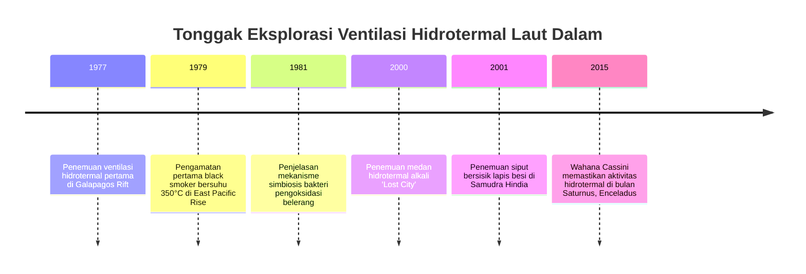
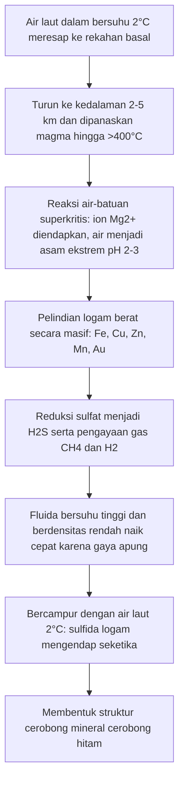

Selama berabad-abad, biologi meyakini doktrin bahwa seluruh kehidupan kompleks di Bumi sepenuhnya ditopang oleh energi sinar matahari melalui fotosintesis. Doktrin tersebut terbantahkan pada tahun 1977 ketika kapal selam riset berawak *Alvin* menyelam hingga kedalaman 2.500 meter di Galapagos Rift.

Di kedalaman laut yang gelap gulita dan bertekanan ratusan atmosfer, para ilmuwan menemukan cerobong mineral menjulang tinggi yang menyemburkan fluida hitam pekat bersuhu lebih dari 350°C (*black smoker*). Di sekelilingnya, hidup ekosistem subur: cacing tabung raksasa sepanjang dua meter, kepiting putih, dan kerang raksasa.

Penemuan ini membuktikan keberadaan **ekosistem kemosintetik**—komunitas hayati yang tidak digerakkan oleh foton matahari, melainkan oleh energi kimia anorganik dari perut Bumi.



---

## 1. Geofisika Sirkulasi Hidrotermal Bawah Laut

Ventilasi hidrotermal terbentuk di batas lempeng tektonik divergen (pematang tengah samudra) tempat magma naik dekat ke kerak samudra.



1. **Perkolasi**: Air laut dingin merembes melalui celah kerak samudera.
2. **Reaksi Ekstrem**: Dekat kantong magma, fluida mencapai suhu >400°C, melepaskan proton ($H^+$) sehingga menjadi sangat asam (pH 2-3).
3. **Pelarutan Logam**: Cairan asam melarutkan tembaga, seng, besi, dan emas, serta mengubah sulfat menjadi hidrogen sulfida ($H_2S$).
4. **Pembentukan Cerobong**: Saat fluida menyembur dan bersentuhan dengan air laut dingin, mineral sulfida mengendap secara kilat membentuk cerobong batuan.

---

## 2. Biokimia Kemosintesis

Mikroba kemolitotrof mengoksidasi senyawa anorganik dan memanfaatkan energi bebas Gibbs ($\Delta G^\circ$) untuk mensintesis ATP dan NADH:

### Reaksi Redoks Utama:
- **Oksidasi Hidrogen Sulfida**:
  $$H_2S + 2O_2 \rightarrow SO_4^{2-} + 2H^+ \quad (\Delta G^\circ = -792\text{ kJ/mol})$$
- **Oksidasi Gas Hidrogen**:
  $$2H_2 + O_2 \rightarrow 2H_2O \quad (\Delta G^\circ = -474\text{ kJ/mol})$$
- **Oksidasi Metana Aerobik**:
  $$CH_4 + 2O_2 \rightarrow CO_2 + 2H_2O \quad (\Delta G^\circ = -820\text{ kJ/mol})$$

```mermaid
graph LR
    subgraph Fotosintesis
        Matahari[Cahaya Matahari] --> Foto[Fotofosforilasi]
        Foto --> ATP1[ATP + NADPH]
        CO2_1[CO2] + ATP1 --> Bio1[Gula & Biomassa]
    end

    subgraph Kemosintesis
        Anorganik[H2S / H2 / CH4] --> ETS[Rantai Transpor Elektron]
        ETS --> ATP2[Gradien Proton -> ATP + NADH]
        CO2_2[CO2] + ATP2 --> Bio2[Biomassa Seluler]
    end
```

---

## 3. Adaptasi Ekstremofil dan Asal Usul Kehidupan

- ***Riftia pachyptila***: Cacing tabung raksasa tidak memiliki mulut maupun saluran pencernaan. Organ trofosomnya menampung miliaran bakteri yang diberi makan melalui hemoglobin raksasa khusus yang mampu mengikat oksigen dan racun $H_2S$ secara bersamaan.
- ***Chrysomallon squamiferum***: Siput bersisik mengendapkan nanokristal besi sulfida (greigit dan pirit) pada cangkang dan sisik kakinya sebagai baju zirah pelindung dari capit kepiting pemangsa.
- **Hipotesis Ventilasi Alkali**: Gradien proton alami ($\Delta \text{pH} \approx 4$) antara semburan alkali jenis *Lost City* (pH 9-11) dan laut purba asam (pH 5-6) berfungsi sebagai baterai alami yang memicu metabolisme organik pertama di Bumi purba.
