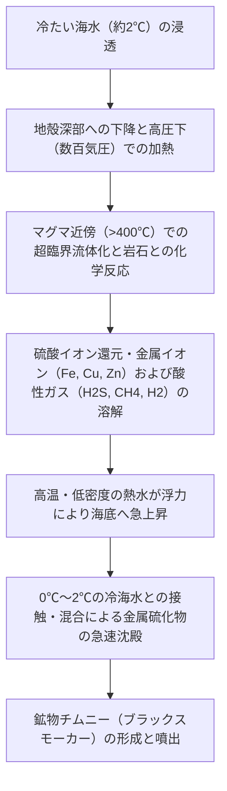
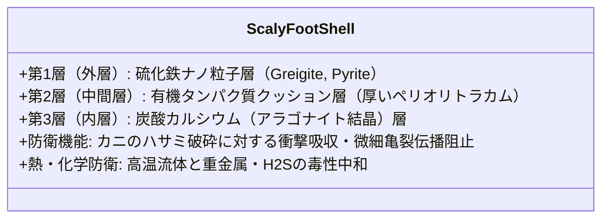
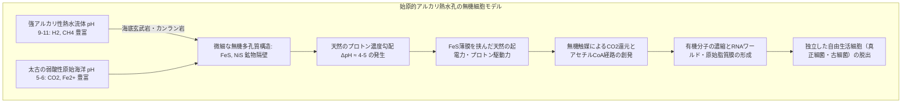
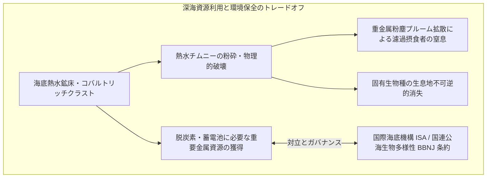
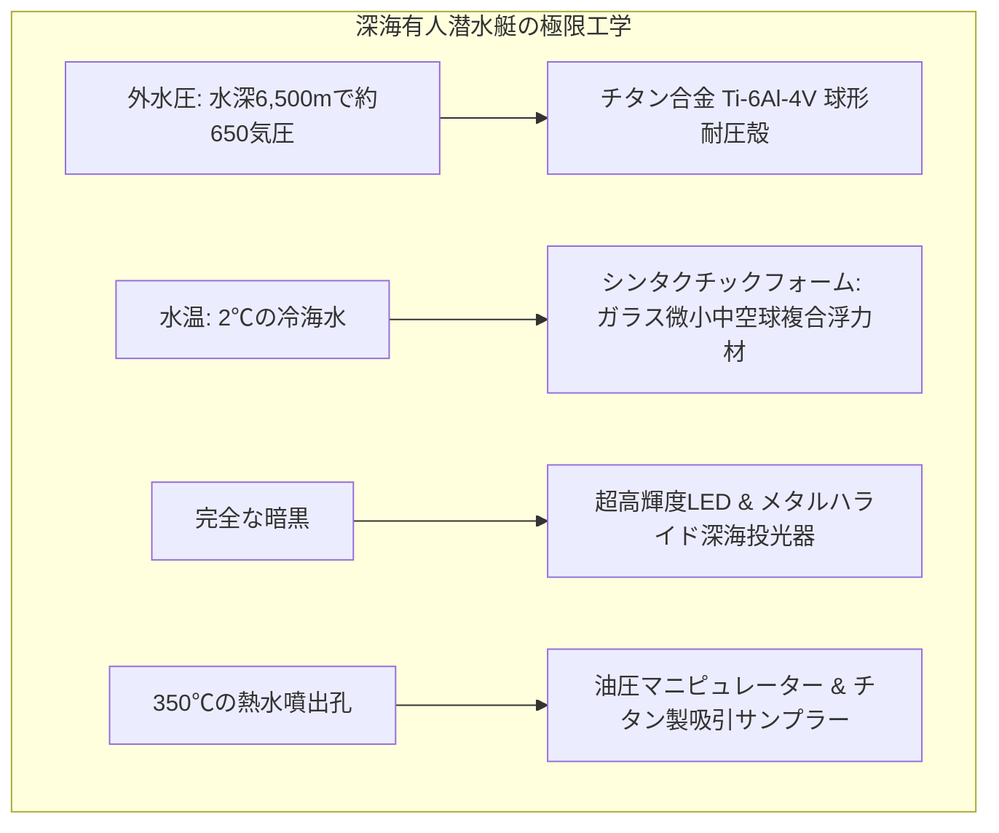
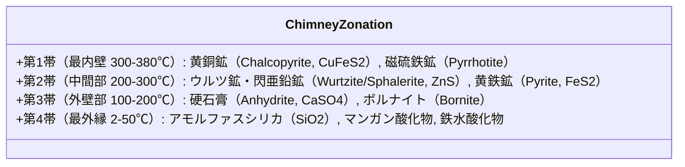
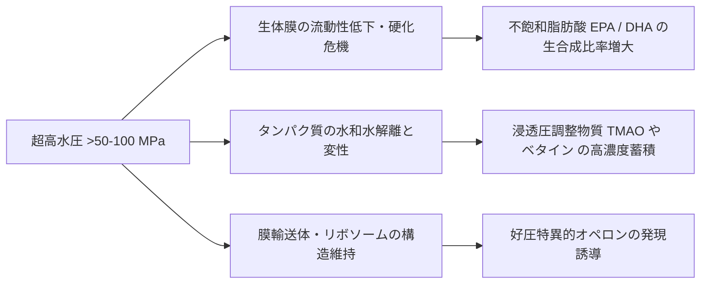
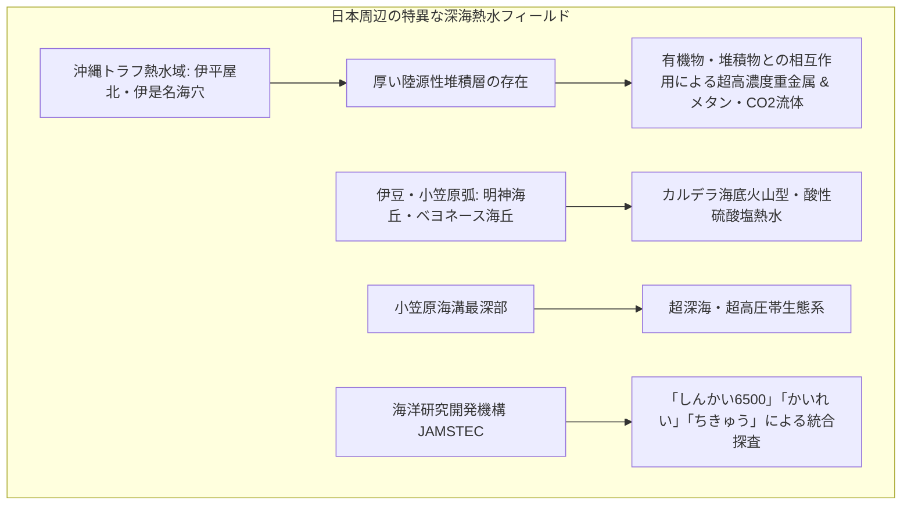

地球上の生命はすべて「太陽の光エネルギー」に依存している――かつて生物学の不可侵の公理とされたこのドグマは、1977年、太平洋ガラパゴス沖の水深約2,500mにおいて粉々に打ち砕かれました。

アメリカの有人潜水調査艇「アルビン号」が目撃したのは、太陽光が1ミリも届かない漆黒の深海底で、摂氏300度を超える黒煙（ブラックスモーカー）を噴き上げる鉱物チムニーの周囲に、巨大なチューブワーム（ハオリムシ）や純白のカニ、巨大シロウリガイが密集する、まるで異世界のオアシスでした。

この発見は、光合成に一切依存せず、地球深部から湧き出る無機化学物質（硫化水素やメタン、水素）を酸化して有機物を生み出す**「化学合成生態系（Chemosynthetic Ecosystem）」**の実在を証明し、生物学のみならず地球科学、生命の起源論、そしてアストロバイオロジー（宇宙生物学）に地殻変動的なパラダイムシフトをもたらしました。

本稿では、深海熱水噴出孔の地質学的メカニズムから、化学合成の分子生化学、極限環境生物の驚異的な適応戦略、地球最初の生命が熱水孔で誕生したとする最新学説、さらには氷に覆われた木星衛星エウロパや土星衛星エンケラドスにおける生命探査まで、深海と生命の神秘を多角的に徹底解明します。

---

## 1. 深海熱水活動の地球物理と地質学

### 1.1 熱水循環系（Hydrothermal Circulation）のメカニズム

深海熱水噴出孔は、主にプレートの中央海嶺（Mid-Ocean Ridge）や背弧海盆（Back-Arc Basin）など、マントルからマグマが地殻浅部まで上昇しているプレート拡大境界に形成されます。

熱水循環系の駆動プロセスは以下の4段階で進行します。



1. **海水の涵養（Recharge）**:
   冷たい海水（約2℃）が海底玄武岩の割れ目（フラクチャー）から地下数キロメートルの深度まで浸透します。
2. **水-岩石反応と高温変成**:
   マグマ溜まりの近傍（350℃〜450℃以上、圧力200〜400気圧）に達した海水は超臨界に近い状態となり、玄武岩と激しく化学反応を起こします。海水中のマグネシウムイオン（$Mg^{2+}$）が岩石中のケイ酸塩と反応してブルーサイト等の鉱物に取り込まれ、代わりにプロトン（$H^+$）が放出されてpHが2〜3という極端な強酸性に変化します。
3. **金属とガスの溶脱**:
   強酸性・超高温となった流体は、玄武岩から鉄（$Fe$）、銅（$Cu$）、亜鉛（$Zn$）、マンガン（$Mn$）、金、銀などの重金属を大量に溶脱（リーチング）します。同時に、硫酸イオン（$SO_4^{2-}$）は還元されて硫化水素（$H_2S$）となり、メタン（$CH_4$）や水素（$H_2$）などの還元性ガスが多量に溶け込みます。
4. **海底への噴出とチムニー形成**:
   高温流体は周囲の冷水に比べて密度が著しく小さいため、強力な浮力によって一気に海底へと急上昇し、チムニー（煙突状の鉱物構造物）を通じて深海へと噴出します。

---

### 1.2 ブラックスモーカーとホワイトスモーカーの違い

熱水噴出孔には、噴出流体の温度や化学組成、下層地質の違いによって複数のタイプが存在します。

| 項目 | ブラックスモーカー（Black Smoker） | ホワイトスモーカー（White Smoker） | アルカリ熱水孔（Lost City型） |
| :--- | :--- | :--- | :--- |
| **代表温度** | 300℃ 〜 400℃以上 | 100℃ 〜 300℃ | 40℃ 〜 90℃ |
| **pH** | 強酸性（pH 2 〜 3） | 酸性〜中性（pH 3 〜 5） | 強アルカリ性（pH 9 〜 11） |
| **煙の正体** | 磁硫鉄鉱・黄銅鉱・閃亜鉛鉱などの**金属硫化物微粒子** | シリカ（$SiO_2$）、硬石膏（$CaSO_4$）、バリウム鉱物 | 炭酸塩（カルサイト・アラゴナイト）、水酸化マグネシウム |
| **主熱源** | マグマ（火山性） | 熱水の混合・冷却流体 | **蛇紋岩化反応**（非マグマ性・発熱化学反応） |
| **溶存ガス** | $H_2S$, $CO_2$, $CH_4$, 金属イオン過剰 | シリカ過剰、低温硫黄化合物 | $H_2$, $CH_4$ 極めて富裕、$CO_2$・重金属は極めて希薄 |
| **代表地域** | 東太平洋海嶺、大西洋中央海嶺TAG熱水域 | ガラパゴス、沖縄トラフ | 大西洋中央海嶺アトランティス山塊 |

アルカリ熱水孔（ロストシティ型）は、カンラン岩と海水が反応して蛇紋岩になる発熱化学反応（蛇紋岩化反応：Serpentinization）によって生じるもので、生命誕生の現場として現在最も有力視されています。

---

## 2. 化学合成（Chemosynthesis）の生化学メカニズム

### 2.1 光合成と化学合成の比較エネルギー学

地上の生態系を支える植物の光合成は、太陽光の光子エネルギーを利用して水（$H_2O$）を分解し、二酸化炭素（$CO_2$）を糖類に還元固定します。

一方、深海熱水噴出孔の一次生産者である**化学合成細菌（Chemoautotrophic Bacteria）および古細菌（Archaea）**は、地球内部から供給される還元性無機化合物（電子供与体）を酸化する際に生じる化学ギブス自由エネルギー（$\Delta G^\circ$）を利用して、ATPと還元力（NADH/NADPH）を生成します。

```mermaid
graph LR
    subgraph 光合成
        Sun[太陽光エネルギー] --> Chl[葉緑体・光化学系]
        H2O[水 H2O] -->|酸化| O2[酸素 O2]
        Chl --> ATP1[ATP + NADPH]
        CO2_1[CO2] + ATP1 --> Sugar1[有機物・糖類]
    end

    subgraph 化学合成
        Inorg[無機還元物質 H2S, H2, CH4] --> ChemSys[呼吸鎖・電子伝達系]
        O2_2[電子受容体 O2, NO3-, SO4 2-] -->|還元| Prod[H2O, N2, S0]
        ChemSys --> ATP2[ATP + NADH]
        CO2_2[CO2] + ATP2 --> Sugar2[有機物・生体高分子]
    end
```

---

### 2.2 主要な化学合成代謝経路と熱力学

深海熱水域で利用される主要な化学酸化反応と、標準状態におけるギブス自由エネルギー変化（$\Delta G^\circ$）は以下の通りです。

#### (1) 硫黄酸化（Sulfur Oxidation）
最も広範にみられる代謝であり、チューブワームやシロウリガイの共生菌が行います。

$$H_2S + 2O_2 \rightarrow SO_4^{2-} + 2H^+ \quad (\Delta G^\circ = -792\text{ kJ/mol})$$

$$2H_2S + O_2 \rightarrow 2S^0 + 2H_2O \quad (\Delta G^\circ = -418\text{ kJ/mol})$$

生じた単体硫黄（$S^0$）は細菌の細胞内・外に顆粒として蓄積され、必要に応じてさらに硫酸まで完全酸化されます。

#### (2) 水素酸化（Hydrogen Oxidation）
超好熱菌や始原的な古細菌によって広く用いられる反応です。

$$2H_2 + O_2 \rightarrow 2H_2O \quad (\Delta G^\circ = -474\text{ kJ/mol})$$

嫌気的環境では、硫酸還元菌が水素を電子供与体として利用します。

$$4H_2 + SO_4^{2-} + 2H^+ \rightarrow H_2S + 4H_2O \quad (\Delta G^\circ = -152\text{ kJ/mol})$$

#### (3) メタン酸化（Methanotrophy）
深海熱水域や冷湧水域（Cold Seeps）に豊富に存在するメタンを利用します。

好気的メタン酸化：
$$CH_4 + 2O_2 \rightarrow CO_2 + 2H_2O \quad (\Delta G^\circ = -820\text{ kJ/mol})$$

嫌気的メタン酸化（AOM: Anaerobic Oxidation of Methane）：
メタン酸化古細菌（ANME）と硫酸還元細菌の共生コンソーシアムによって駆動されます。
$$CH_4 + SO_4^{2-} \rightarrow HCO_3^- + HS^- + H_2O \quad (\Delta G^\circ = -16.6\text{ kJ/mol})$$

---

### 2.3 炭素固定経路：カルビン回路と逆TCA回路

化学合成菌が二酸化炭素から有機物を合成する経路には、主に2つの代表的な生化学回路が存在します。

```mermaid
flowchart TD
    subgraph カルビン・ベンソン回路
        C1[CO2] --> C2[Rubisco酵素による固定]
        C2 --> C3[3-ホスホグリセリン酸]
        C3 --> C4[多大なATP・NADPHを消費]
        C4 --> C5[糖新生・バイオマス]
    end

    subgraph 逆TCA（rTCA）回路
        T1[CO2 + クエン酸回路の逆回転] --> T2[ATPクエン酸リアーゼ]
        T2 --> T3[フェレドキシン依存性還元]
        T3 --> T4[カルビン回路に比べ極めて高エネルギー効率]
        T4 --> T5[アセチルCoA合成]
    end
```

熱水噴出孔の超好熱性細菌（*Aquificales*目など）やイプシロンプロテオバクテリア（現*Campylobacterota*）は、**逆TCA回路（Reductive TCA Cycle）**を用いています。逆TCA回路は、クエン酸回路（好気呼吸の代謝系）をそっくり逆方向に回転させて二酸化炭素を有機物に変換する経路であり、カルビン回路（Rubisco依存）よりもはるかにエネルギー効率が高く、原始地球の熱水環境で最初に誕生した炭素固定系であると考えられています。

---

## 3. 熱水オアシスの極限環境生物と驚異の共生系

### 3.1 リフティア・パキプティラ（Riftia pachyptila）：消化管を捨てた巨大ハオリムシ

東太平洋海嶺の水深2,500mに群生するチューブワーム（*Riftia pachyptila*）は、成長すると体長1.5〜2メートルに達しますが、**口も、胃も、腸も、肛門も一切持ちません**。


#### 驚異の生化学適応：
1. **多機能ヘモグロビン**:
   通常の動物にとって、硫化水素（$H_2S$）はチトクロムcオキシダーゼを阻害する猛毒です。しかしリフティアの血液中には、通常の脊椎動物の数十倍の大きさを誇る巨大ヘモグロビン（分子量約350万Daの24量体および分子量40万Daの分子）が存在し、**酸素（$O_2$）と硫化水素（$H_2S$）を異なる活性部位で同時に強固に結合**して安全に輸送します。これにより、血液中の毒性を中和しつつ、体内の共生菌に双方の原料を効率よく届けています。
2. **栄養体（トロフォソーム）**:
   体腔の大部分を占める特殊な組織で、数千億個もの細胞内共生硫黄酸化細菌が充填されています。共生菌が固定した炭素化合物を宿主が直接受け取ることで、獲物を捕食することなく極めて高いバイオマスを維持しています。

---

### 3.2 スケーリーフット（ウロコフネタマガイ）：金属の鎧を纏う奇跡の巻貝

インド洋のカイレイ熱水域（水深約2,400m）で2001年に発見されたスケーリーフット（*Chrysomallon squamiferum*）は、**地球上で唯一、自らの骨格（貝殻および足の鱗）に硫化鉄（グライジャイト $Fe_3S_4$ および黄鉄鉱 $FeS_2$）のナノ結晶をバイオミネラリゼーション（生物鉱化）する生物**です。



この3層構造は、軍事用装甲板や極限環境用複合材料の生体模倣（バイオミメティクス）研究の対象として、世界中の材料工学者から熱狂的な注目を集めています。

---

### 3.3 超好熱菌（Hyperthermophiles）の極限耐熱分子機構

熱水チムニーの壁面や熱水プルーム中には、摂氏100度を超える温度で増殖する超好熱菌が生息しています。現在知られている増殖上限温度の記録は、日本の「しんかい6500」が採取した古細菌 *Methanopyrus kandleri* Strain 116 の**122℃（加圧条件下）**です。

| 耐熱機構 | 分子生物学的・生化学的戦略 |
| :--- | :--- |
| **生体膜の安定化** | エーテル結合型脂質、テトラエーテル脂質の単分子膜構造（架橋型）、シクロペンタン環の導入 |
| **DNAの熱変性防止** | **逆DNAジャイレース（Reverse DNA Gyrase）**によるDNAの正の超らせん化（陽性スーパートーション導入） |
| **タンパク質の熱変性防止** | 疎水性コアの極小化、表面塩橋（Salt Bridge）の多重ネットワーク化、プロリン残基の増加 |
| **低分子耐熱物質の蓄積** | 環状2,3-ジホスホグリセリン酸（cDPG）やマンノシルグリセリン酸などの適合溶質がDNA・酵素を保護 |

---

## 4. 生命の起源論：アルカリ熱水噴出孔仮説

「最初の生命はどこで生まれたのか？」――これは現代科学最大の問いの一つです。かつて提唱されたダーウィンの「温暖な小さな池」説やユーリー・ミラーの放電実験（原始大気雷モデル）は、初期地球の酸化還元状態や紫外線分解の観点から多くの批判に直面しました。

現在、生化学・熱力学・地球惑星科学が一致して最有力視しているのが、マイケル・ラッセル（Michael Russell）やニック・レーン（Nick Lane）らが提唱・発展させた**「アルカリ熱水噴出孔（Alkaline Hydrothermal Vent）起源説」**です。



### 4.1 自然界が作った「天然のATP合成エンジン」
あらゆる現生生物（細菌からヒトまで）は、細胞膜を挟んだプロトン濃度勾配（プロトン駆動力 $\Delta p$）を利用してATP合成酵素を回転させ、生体エネルギー通貨ATPを生産しています。

$$\Delta p = \Delta \Psi - \frac{2.3 RT}{F} \Delta \text{pH}$$

約40億年前の冥王代の海洋は、大気中の高濃度二酸化炭素が溶け込んで弱酸性（pH 5〜6）でした。一方、カンラン岩の蛇紋岩化反応によって湧き出るアルカリ熱水は強アルカリ性（pH 9〜11）でした。

ロストシティ型熱水孔の微小な無機多孔質（数マイクロメートルの硫化鉄・炭酸塩キャビティ）では、**内側がアルカリ性、外側が酸性という、現生細胞と全く同一のプロトン濃度勾配（$\Delta \text{pH} \approx 4$）が鉱物膜を挟んで天然に維持されていた**のです。生命は最初からポンプを持っていたのではなく、**地球が用意した天然のプロトン勾配を借用して生化学を開始した**と考えられます。

---

## 5. アストロバイオロジー：地球外海洋生命の探索

深海熱水噴出孔の存在は、太陽系内の他の天体における生命探査の指針を根本から書き換えました。太陽から遠く離れ、地表がマイナス百数十度の極寒に閉ざされた木星や土星の衛星であっても、**潮汐加熱（Tidal Heating）**によって内部に液体の海（内部海）と熱水活動が存在すれば、化学合成生態系が繁栄し得ることが明らかになったのです。


### 5.1 エンケラドス（土星衛星）とエウロパ（木星衛星）
- **エンケラドス**:
  NASAの土星探査機「カッシーニ」は、南極付近の氷の割れ目（タイガーストライプ）から宇宙空間に噴出する氷の噴煙（プルーム）を通過観測しました。その結果、水蒸気、塩類、有機物微粒子に加え、**分子状水素（$H_2$）とナノシリカ粒子**が検出されました。ナノシリカの生成には摂氏90度以上の熱水が岩石と反応することが不可欠であり、エンケラドスの海底に現在進行形で熱水活動が存在することが決定的に証明されました。
- **エウロパ**:
  厚さ十数キロメートルの氷殻の下に、地球の全海水を合わせた量の2倍以上におよぶ巨大な内部海が存在します。NASAの探査機「エウロパ・クリッパー」が氷殻の厚さや海水の化学組成の解明に向けた探査を進めています。

---

## 6. 海底資源開発と深海環境保全の葛藤

深海熱水活動域は、純粋な科学研究の対象にとどまらず、銅、鉛、亜鉛、金、銀、コバルト、インジウムなどの戦略金属を高品位で含有する**海底熱水鉱床（Seafloor Massive Sulfides: SMS）**の宝庫でもあります。



熱水噴出孔生態系は、地球表面積のわずか0.001%未満という極めて狭小で孤立したパッチ状の環境に存在しており、そこに棲息する生物種の80%以上がその地域特有の固有種です。一度鉱床採掘によってチムニー群が粉砕されれば、数千年をかけて育まれた生態系が不可逆的な絶滅に追い込まれる危険があります。国際海底機構（ISA）による探査規則の策定や、海洋保護区（MPA）の設定など、国際的な法秩序の確立が急務となっています。

---

---

## 8. 深海探査技術と超高圧工学の極限

深海熱水噴出孔の探査と生態系サンプリングは、人類の材料科学と機械工学の極限に挑むフロンティアです。



### 8.1 耐圧殻の物理学と真球度
水深6,500mでは、1平方センチメートルあたり約650kgの荷重（爪の上に大型乗用車が乗るのと同等の圧力）が加わります。この巨大な等方圧縮応力に耐えるため、日本の「しんかい6500」や米国の「アルビン号」の耐圧殻は、高強度・耐食性に優れたチタン合金（$Ti\text{-}6Al\text{-}4V$）を削り出して作られた真球形状を採用しています。

殻の座屈（Buckling）を防ぐため、直径2mの球体における真球度（真の球からのズレ）はわずか0.5mm以下という超精密加工が施されています。

### 8.2 シンタクチックフォーム（浮力材）
深海潜水艇は重いバッテリーや耐圧殻を抱えながら、水中で中性浮力を維持する必要があります。従来の油や気体ではなく、強靭なエポキシ樹脂の中に微小な中空ガラス球（マイクロバルーン、直径数十〜数百ミクロン）を高密度に充填した**「シンタクチックフォーム（Syntactic Foam）」**が用いられます。これにより、深海の超高圧下でも押しつぶされることなく、比重0.5〜0.6の強力な浮力を発揮し続けます。

---

## 9. 熱水チムニーの鉱物累帯構造と沈殿熱力学

ブラックスモーカーチムニーの断面を観察すると、同心円状の美しい鉱物累帯構造（Mineral Zonation）が現れます。これは、350℃を超える強酸性熱水と、2℃の弱アルカリ性冷海水がチムニーの多孔質鉱物壁を通して接触・拡散する際に生じる急激な温度勾配と化学ポテンシャル勾配によって引き起こされます。



### 9.1 沈殿反応の熱力学的平衡
硬石膏（$CaSO_4$）は、通常の塩類とは異なり**逆溶解度（温度が上昇すると溶解度が減少する特性）**を示します。海水中のカルシウムイオン（$Ca^{2+}$）と熱水中の硫酸イオン（$SO_4^{2-}$）は、150℃以上の高温領域で瞬時に沈殿し、チムニーの初期骨格（「仮枠」）を形成します。

$$Ca^{2+} + SO_4^{2-} \rightarrow CaSO_4 \downarrow \quad (\text{150℃以上で沈殿促進})$$

この硬石膏の枠組みの内側を高温の金属硫化流体が流れることで、より溶解度の低い銅・鉄硫化物（黄銅鉱）が内壁に析出し、頑丈な金属パイプラインが完成するのです。

---

## 10. ピエゾフィル（好圧菌）の超高圧生化学適応

深海底に生きる微生物は、高温だけでなく、数十から数百メガパスカル（MPa）に及ぶ静水圧に晒されています。高圧下では、分子の体積変化を伴う化学平衡や立体配座変化が強く影響を受けます。

ルシャトリエの原理により、体積減少（$\Delta V < 0$）を伴う反応が高圧下で促進され、体積膨張（$\Delta V > 0$）を伴う反応は阻害されます。

$$\left(\frac{\partial \ln K}{\partial P}\right)_T = -\frac{\Delta V^\circ}{RT}$$



### 10.1 膜脂質の超流動性維持
通常の細菌を深海高圧環境に置くと、生体膜のリン脂質二重層が圧密されてゲル化（硬化）し、膜タンパク質の機能が麻痺します。好圧菌（*Shewanella violacea* や *Colwellia* など）は、炭素鎖に二重結合を多数持つ**高度多価不飽和脂肪酸（EPA: エイコサペンタエン酸、DHA: ドコサヘキサエン酸）**を高比率で膜脂質に組み込みます。二重結合の折れ曲がり構造が立体障害を生み出すことで、数百気圧の圧力下でも膜の柔軟性と流動性を維持しています。

### 10.2 ピエゾライト（Piezolyte）とタンパク質保護
深海魚や好圧生物の細胞内には、**トリメチルアミン-N-オキシド（TMAO）**をはじめとするオスモライト（浸透圧調節物質兼適合溶質）が極めて高濃度に蓄積されています。TMAOは水分子のネットワークを強固に秩序化し、高圧下でもタンパク質の周囲から水和殻が奪われるのを防ぎ、酵素の三次元活性構造を変性から保護しています。深海魚の生息可能深度の限界（水深約8,400m）は、細胞内のTMAO濃度が限界値に達することによって物理的に決定されていることが判明しています。

---

## 11. エクストレモザイム（極限酵素）とバイオテクノロジー革命

熱水噴出孔の超好熱菌や好圧菌から発見された酵素群「エクストレモザイム（Extremozymes）」は、現代の分子生物学、製薬工学、工業バイオテクノロジーに計り知れない技術革新をもたらしました。

| 極限酵素 | 起源生物 | 特性・至適条件 | 産業・医学応用 |
| :--- | :--- | :--- | :--- |
| **KOD DNAポリメラーゼ** | *Thermococcus kodakarensis*（鹿児島湾熱水孔） | 至適温度85℃、超高速伸長力・極めて高い正確性 | 超高速高精度PCR試薬、次世代シーケンス（NGS） |
| **Pfu DNAポリメラーゼ** | *Pyrococcus furiosus* | 95℃での長い半減期、校正機能（$3'\rightarrow 5'$エキソヌクレアーゼ） | 遺伝子クローニング、変異導入実験 |
| **耐熱性アミラーゼ・プルラナーゼ** | 超好熱古細菌 | 100℃以上の強酸性下でも失活しない | デンプンの高効率糖化、コーンシロップ・バイオエタノール製造 |
| **深海好圧プロテアーゼ・リパーゼ** | 深海ピエゾフィル | 低温・高塩分・高圧下で活性維持 | 医薬品合成、冷水用高機能洗剤、バイオレメディエーション |

特にPCR（ポリメラーゼ連鎖反応）技術における耐熱性DNAポリメラーゼの実用化は、COVID-19の遺伝子診断から法医学捜査、ゲノム編集まで、21世紀のバイオ医療インフラの根幹を支えています。

---

## 12. 日本近海における深海熱水研究の最前線

日本列島周辺の海域は、太平洋プレート、フィリピン海プレート、北米プレート、ユーラシアプレートの4つのプレートがひしめき合う、世界で最も地質学的活動が活発な変動帯です。そのため、沖縄トラフや伊豆・小笠原弧、南部マリアナ海溝など、世界的にも稀有な個性を持つ熱水フィールドが密集しています。



### 12.1 沖縄トラフ堆積物被覆熱水系
大西洋中央海嶺や東太平洋海嶺の熱水孔の多くは露出した玄武岩の上に直接形成されますが、沖縄トラフはアジア大陸から長年供給された数千メートルに及ぶ厚い陸源性堆積物に覆われています。
熱水流体がこの有機物に富んだ堆積層を通過する際、有機熱分解が起こり、通常の熱水系を桁違いに上回るアンモニア、メタン、二酸化炭素、そして金や銀、鉛、亜鉛などの貴金属・有用金属が高濃度に濃縮されます。

### 12.2 人工チムニー養殖と深海熱水発電
日本の研究チーム（JAMSTECや東京大学等）は、熱水噴出孔を人工的に掘削し、金属硫化物を効率的に沈殿させてチムニーを「養殖」する鉱石回収実験や、熱水流体と周囲の冷海水の温度差（$\Delta T \approx 300\text{℃}$）を利用したゼーベック効果による**深海熱電発電（Hydrothermal Thermoelectric Generation）**の実証実験に世界で初めて成功しました。これは深海長期観測ステーションの自立電源としても期待されています。

## 13. まとめ：深海が教える生命の普遍性

深海熱水噴出孔の研究は、私たちに「生命とは何か」という根本的な問いを突きつけます。

1. **エネルギーの独立性**: 生命は太陽光がなくとも、惑星深部の地質学的エネルギー（熱と無機還元力）だけで壮大な生態系を構築できる。
2. **生命誕生の必然性**: 地球の岩石と水が反応する熱水孔は、熱力学的に有機物を合成し、プロトン勾配を生み出す必然の場であった。
3. **宇宙における生命**: 熱水生態系の解明は、太陽系の氷衛星や銀河系の系外惑星における地球外生命発見の最も確かな道標となっている。

暗黒の深海で噴き上がる熱水チムニーは、地球の鼓動そのものであり、生命の過去・現在・未来を照らし出す原初の光なのです。
