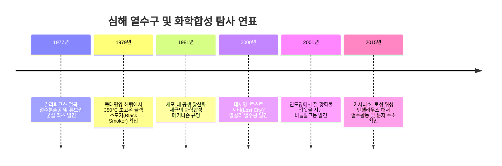
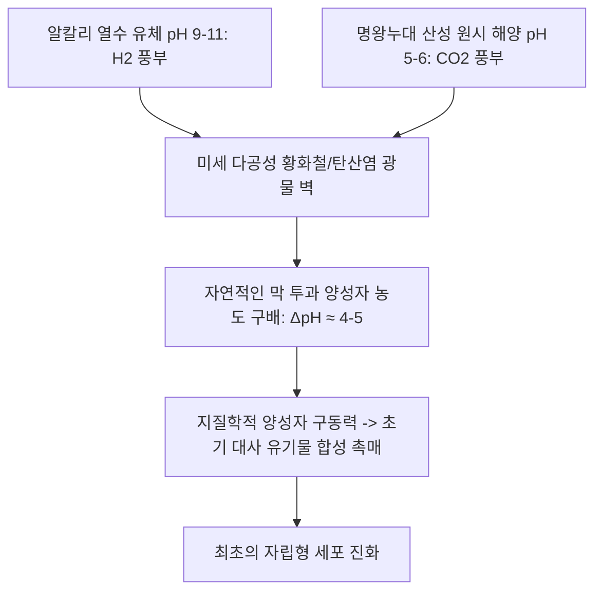

지구상의 모든 생명체는 태양의 빛에너지에 의존한다는 생물학의 오랜 도그마는 1977년 동태평양 갈라파고스 열곡 수심 2,500m 해저에서 철저히 깨졌습니다.

미국의 유인 잠수정 '앨빈(Alvin)호'가 발견한 것은 한 줄기 햇빛도 닿지 않는 암흑 속에서 350°C가 넘는 검은 연기(블랙 스모커)를 뿜어내는 광물 굴뚝 주변으로 거대한 관벌레(튜브웜)와 눈먼 게, 조개들이 빼곡히 번성하는 경이로운 오아시스였습니다.

이 발견은 태양광 대신 지구 내부의 무기 화학물질(황화수소, 수소, 메탄)을 산화시켜 에너지를 얻는 **화학합성 생태계(Chemosynthetic Ecosystem)**의 실재를 증명하며 생물학과 지구과학, 천체생물학에 거대한 혁명을 일으켰습니다.



---

## 1. 심해 열수 순환의 지구물리학 및 지질학적 메커니즘

열수분출공은 주로 판의 발산 경계인 중앙해령(Mid-Ocean Ridge)이나 배호분지(Back-Arc Basin)에서 마그마가 해양 지각 얕은 곳까지 상승할 때 형성됩니다.

```mermaid
flowchart TD
    A[2°C의 차가운 해수가 해저 현무암 균열로 침투] --> B[수 킬로미터 하강하여 마그마 인근에서 400°C 이상 가열]
    B --> C[초임계 수-암석 반응: Mg2+ 침전 제거 및 강산성화 pH 2-3]
    C --> D[지각 암석으로부터 중금속 Fe, Cu, Zn, Mn 등 대량 용출]
    D --> E[황산염 환원으로 H2S 생성, CH4 및 H2 가스 포화]
    E --> F[고온 저밀도 열수가 부력으로 해저를 향해 급상승]
    F --> G[0-2°C의 차가운 해수와 접촉 혼합: 금속 황화물 침전]
    G --> H[광물 굴뚝(블랙 스모커) 형성 및 열수 플룸 분출]
```

1. **해수 침투 및 하강**: 2°C의 차가운 해수가 현무암 단열대를 따라 해저 지하 2~5km까지 침투합니다.
2. **고온 수-암석 변성 반응**: 마그마방 근처에서 400°C 이상의 초임계 상태에 도달하며, 마그네슘 이온($Mg^{2+}$)이 점토광물로 침전되고 수소 이온($H^+$)이 방출되어 pH 2~3의 극강산성 유체로 변합니다.
3. **금속 용출 및 가스 농축**: 산성 유체는 주변 암석에서 구리, 철, 아연, 금, 망간 등을 녹여내며 황산염을 황화수소($H_2S$)로 환원시킵니다.
4. **침전 및 굴뚝 형성**: 가벼워진 열수가 해저로 분출될 때 2°C의 해수와 급격히 혼합되면서 황화광물이 순간적으로 침전되어 원통형 굴뚝을 쌓아 올립니다.

---

## 2. 화학합성의 생화학 및 열역학적 기초

화학독립영양미생물(Chemoautotrophs)은 무기 환원물질이 산화될 때 발생하는 깁스 자유에너지 변화($\Delta G^\circ$)를 이용해 ATP와 환원력(NADH)을 생산합니다.

### 핵심 화학 산화 반응:
1. **황화수소 산화** (관벌레 및 조개 공생균의 핵심 반응):
   $$H_2S + 2O_2 \rightarrow SO_4^{2-} + 2H^+ \quad (\Delta G^\circ = -792\text{ kJ/mol})$$
2. **분자 수소 산화** (초호열균 및 고세균):
   $$2H_2 + O_2 \rightarrow 2H_2O \quad (\Delta G^\circ = -474\text{ kJ/mol})$$
3. **메탄 산화**:
   $$CH_4 + 2O_2 \rightarrow CO_2 + 2H_2O \quad (\Delta G^\circ = -820\text{ kJ/mol})$$

```mermaid
graph LR
    subgraph 광합성
        Sun[태양광] --> PS[엽록체 광화학계]
        PS --> ATP1[ATP + NADPH]
        CO2_1[CO2] + ATP1 --> Sugar1[유기물 합성]
    end

    subgraph 화학합성
        ChemInorg[H2S / H2 / CH4] --> ETS[전자전달계]
        ETS --> ATP2[양성자 구동력 -> ATP + NADH]
        CO2_2[CO2] + ATP2 --> Sugar2[유기물 합성]
    end
```

탄소 고정 경로에서 심해 초호열균은 식물의 캘빈 회로보다 에너지 효율이 훨씬 뛰어난 **환원적 TCA 회로(rTCA 회로)**를 선호합니다. 이는 원시 지구에서 가장 먼저 출현한 탄소 고정 시스템으로 여겨집니다.

---

## 3. 극한 환경 생물의 놀라운 공생 적응

### 3.1 자이언트 튜브웜(*Riftia pachyptila*): 소화관을 버린 생존자
성체 관벌레는 2미터까지 자라지만 **입, 위, 장, 항문이 전혀 없습니다**. 체강의 대부분을 차지하는 '영양체(Trophosome)'에 수천억 마리의 황산화 박테리아를 기르고 있습니다.
- **다기능 거대 헤모글로빈**: 보통 동물에게 황화수소($H_2S$)는 치명적인 독소이지만, 리프티아의 특수 거대 헤모글로빈은 산소($O_2$)와 황화수소를 서로 다른 결합 부위에 동시에 안전하게 결합시켜 체내 공생균에게 전달합니다.

### 3.2 비늘발고둥(*Chrysomallon squamiferum*): 금속 갑옷을 두른 복족류
인도양 해저에서 발견된 비늘발고둥은 지구상에서 유일하게 **황화철(그레이자이트 $Fe_3S_4$ 및 황철석 $FeS_2$) 나노 결정을 골격과 비늘에 생체 광물화**하는 동물입니다. 이 외골격은 포식성 게의 집게발 공격을 분산시키는 천연 복합 장갑 구조를 지니고 있습니다.

---

## 4. 알칼리 열수구 생명 기원 가설

현대 생화학과 행성과학에서 가장 유력한 가설은 생명이 '따뜻한 작은 연못'이 아닌 **알칼리성 열수분출공(로스트 시티형)**에서 탄생했다는 것입니다.



40억 년 전 초기 지구 해양은 산성(pH 5~6)이었고, 감람암의 사문암화 반응으로 분출된 알칼리 열수는 pH 9~11이었습니다. 미세한 광물 미세 구멍 사이에서 현대 세포막과 완전히 동일한 **천연 양성자 구동력($\Delta \text{pH} \approx 4$)**이 유지되었으며, 이것이 생명 에너지 대사의 모태가 되었습니다.

---

## 5. 외계 해양 행성 탐사와 심해 생태계 보전

토성 위성 엔셀라두스의 얼음 분출 플룸에서 분자 수소($H_2$)와 실리카 나노입자가 검출됨으로써, 태양계 외곽의 얼음 위성 내부 바다에도 지구와 동일한 열수 생태계가 존재할 가능성이 확정되었습니다.
동시에 심해 열수광상은 고품위 구리, 아연, 희토류의 보고로서 채굴 위협에 직면해 있습니다. 극히 제한된 면적에 고유종이 밀집된 열수 생태계를 보전하기 위해 국제해저기구(ISA)와 유엔 BBNJ 조약을 통한 국제적 보전 관리가 절실합니다.
