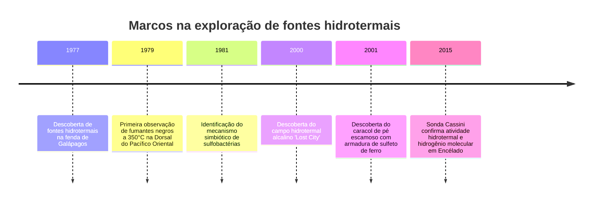
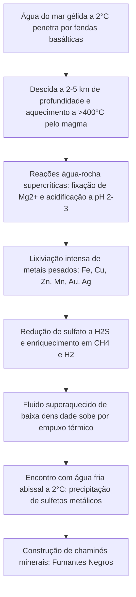

Durante séculos, a biologia considerava axiomático que toda a vida complexa na Terra dependia invariavelmente da luz solar através da fotossíntese. Esse dogma ruiu espetacularmente em 1977, quando o submersível tripulado *Alvin* desceu a 2.500 metros na Fenda de Galápagos.

Na escuridão total do fundo oceânico, sob pressões de centenas de atmosferas, os cientistas encontraram chaminés minerais que expeliam fluidos negros a mais de 350°C. Ao redor delas proliferava um oásis exuberante de vermes tubulares gigantes, caranguejos albinos e moluscos de proporções surpreendentes.

A descoberta comprovou a existência dos **ecossistemas quimiossintéticos**—comunidades sustentadas não por fótons solares, mas pela energia química inorgânica gerada no interior da Terra.



---

## 1. Geofísica da circulação hidrotermal oceânica

As fontes hidrotermais desenvolvem-se nos limites divergentes de placas tectônicas (dorsais meso-oceânicas), onde o magma ascende próximo à crosta.



1. **Infiltração**: A água fria do oceano profundo penetra quilômetros na crosta basáltica.
2. **Reação a alta temperatura**: Próximo à câmara magmática (400°C), a água perde magnésio e libera prótons ($H^+$), tornando-se extremamente ácida (pH 2 a 3).
3. **Extração de metais**: O fluido corrosivo dissolve metais pesados e reduz sulfatos a sulfeto de hidrogênio ($H_2S$).
4. **Precipitação**: Ao emergir e misturar-se com a água a 2°C, os sulfetos de ferro e cobre precipitam instantaneamente, erguendo chaminés rochosas.

---

## 2. Bioquímica da quimiossíntese

As bactérias quimiolitotróficas aproveitam a energia livre de Gibbs ($\Delta G^\circ$) liberada na oxidação de compostos inorgânicos para produzir ATP e NADH:

### Principais reações redox:
- **Oxidação do sulfeto de hidrogênio**:
  $$H_2S + 2O_2 \rightarrow SO_4^{2-} + 2H^+ \quad (\Delta G^\circ = -792\text{ kJ/mol})$$
- **Oxidação do hidrogênio molecular**:
  $$2H_2 + O_2 \rightarrow 2H_2O \quad (\Delta G^\circ = -474\text{ kJ/mol})$$
- **Metanotrofia aeróbia**:
  $$CH_4 + 2O_2 \rightarrow CO_2 + 2H_2O \quad (\Delta G^\circ = -820\text{ kJ/mol})$$

```mermaid
graph LR
    subgraph Fotossíntese
        Luz[Fótons solares] --> Foto[Fotofosforilação]
        Foto --> ATP1[ATP + NADPH]
        CO2_1[CO2] + ATP1 --> Bio1[Glicose e biomassa]
    end

    subgraph Quimiossíntese
        Inorg[Doadores inorgânicos H2S / H2] --> ETS[Cadeia transportadora de elétrons]
        ETS --> ATP2[Força próton-motriz -> ATP + NADH]
        CO2_2[CO2] + ATP2 --> Bio2[Biomassa celular]
    end
```

---

## 3. Adaptações extremófilas e o berço da vida

- ***Riftia pachyptila***: O verme tubular gigante não possui boca, estômago ou ânus. Seu órgão interno (trofossomo) abriga bilhões de bactérias simbiontes nutridas por uma hemoglobina gigante capaz de transportar oxigênio e sulfeto tóxico sem sofrer envenenamento.
- ***Chrysomallon squamiferum***: O caracol de pé escamoso incorpora nanopartículas de sulfetos de ferro (greigita e pirita) em sua concha e escamas dérmicas, constituindo uma armadura natural contra predadores.
- **Origem da vida em fontes alcalinas**: O gradiente natural de prótons ($\Delta \text{pH} \approx 4$) entre fontes básicas como *Lost City* (pH 9-11) e o oceano antigo ácido (pH 5-6) funcionou como uma pilha química natural que impulsionou o metabolismo primordial antes do surgimento das membranas lipídicas celulares ativas.
