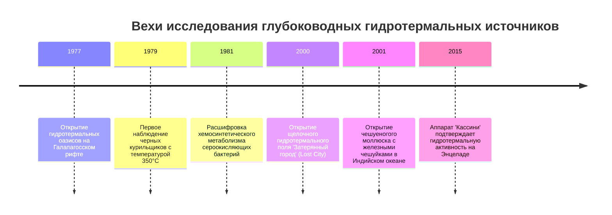
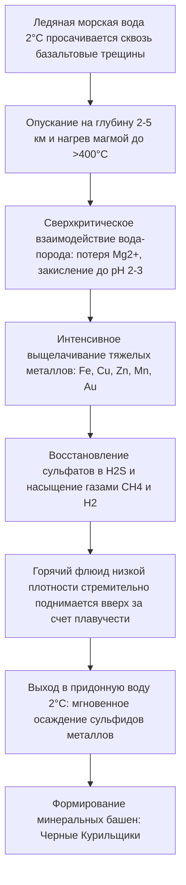

До конца 1970-х годов в биологии царила непреложная догма: любая сложная жизнь на Земле абсолютно зависит от солнечного света и фотосинтеза. Этот постулат был опровергнут в 1977 году, когда американский обитаемый подводный аппарат «Элвин» (Alvin) погрузился на глубину 2500 метров в районе Галапагосского рифта.

В вечной тьме, при давлении в 250 атмосфер ученые обнаружили гигантские минеральные трубы, извергающие перегретые до 350°C черные минеральные растворы («черные курильщики»). Вокруг них кипела жизнь: двухметровые трубчатые черви с ярко-красными щупальцами, белые крабы и гигантские моллюски.

Это открытие доказало реальность существования **хемосинтетических экосистем**, черпающих первичную энергию не из солнечного излучения, а из геохимических недр планеты.



---

## 1. Геофизика гидротермальной циркуляции океана

Гидротермальные жерла формируются вдоль границ расхождения тектонических плит (в срединно-океанических хребтах), где магматический очаг залегает близко к океаническому дну.



---

## 2. Биохимия хемосинтеза

Хемолитоавтотрофные микроорганизмы окисляют неорганические молекулы и используют свободную энергию Гиббса ($\Delta G^\circ$) для синтеза АТФ и НАДФН:

### Ключевые биохимические реакции:
- **Окисление сероводорода**:
  $$H_2S + 2O_2 \rightarrow SO_4^{2-} + 2H^+ \quad (\Delta G^\circ = -792\text{ кДж/моль})$$
- **Окисление водорода**:
  $$2H_2 + O_2 \rightarrow 2H_2O \quad (\Delta G^\circ = -474\text{ кДж/моль})$$
- **Аэробное окисление метана**:
  $$CH_4 + 2O_2 \rightarrow CO_2 + 2H_2O \quad (\Delta G^\circ = -820\text{ кДж/моль})$$

```mermaid
graph LR
    subgraph Фотосинтез
        Свет[Фотоны Солнца] --> Хл[Хлоропласты]
        Хл --> ATP1[АТФ + НАДФН]
        CO2_1[CO2] + ATP1 --> Орг1[Органические сахара]
    end

    subgraph Хемосинтез
        Неорг[H2S / H2 / CH4] --> ЭТЦ[Дыхательная цепь мембраны]
        ЭТЦ --> ATP2[Протонный градиент -> АТФ + НАДН]
        CO2_2[CO2] + ATP2 --> Орг2[Клеточная биомасса]
    end
```

---

## 3. Экстремофильные адаптации и зарождение жизни

- ***Riftia pachyptila***: У гигантских вестиментифер полностью редуцированы рот и пищеварительная система. Они питаются за счет эндосимбиотических бактерий трофосомы, транспортируя сероводород с помощью гигантского полимерного гемоглобина без интоксикации организма.
- ***Chrysomallon squamiferum***: Чешуеногий брюхоногий моллюск синтезирует наночастицы сульфидов железа (грейгит и пирит) прямо в своей раковине и склеритах ноги, создавая уникальную металлическую броню.
- **Щелочные гидротермальные источники и происхождение жизни**: Разность pH между щелочными гидротермальными водами (pH 9–11) и кислым первичным океаном (pH 5–6) создавала естественный протонный градиент ($\Delta \text{pH} \approx 4$) в микропористых перегородках, послуживший первоначальным двигателем предбиологической эволюции.
