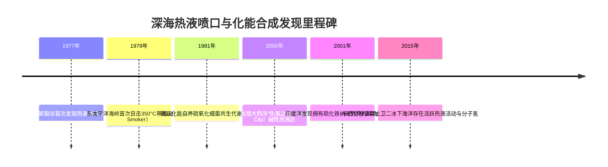
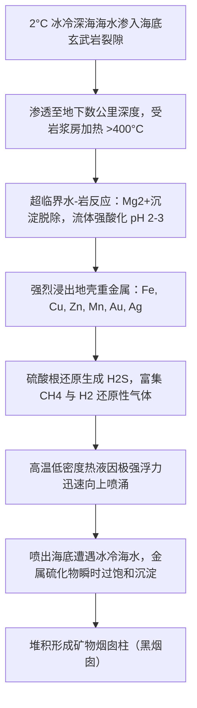
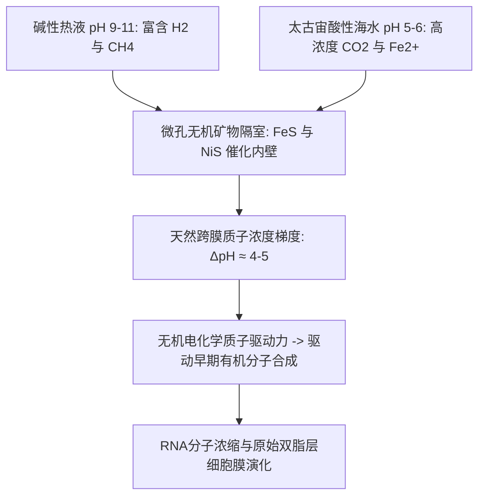

在地球生物学的传统观念中，太阳光是一切复杂生命的能量源泉。然而1977年，美国阿尔文号（Alvin）载人深潜器在东太平洋加拉帕戈斯裂谷水深2500米的海底，颠覆了这一长期确立的公理。

在那里，漆黑冰冷、压力高达数百个大气压的海底，喷涌着超过350°C黑烟的矿物烟囱周围，繁衍着茂密的巨型管状蠕虫、纯白色的深海蟹和巨大的盲虾。这标志着**化能合成生态系统（Chemosynthetic Ecosystem）**的发现——生命完全依靠地球内部释放的无机化学能量茁壮成长。



---

## 1. 深海热液循环的地质学与地球物理机制

深海热液喷口主要形成于大洋中脊（Mid-Ocean Ridge）和弧后盆地（Back-Arc Basin）等板块张裂构造边界。



热液循环过程可分为四个关键阶段：
1. **下渗涵养**：冰冷海水沿玄武岩张性裂缝渗透至地下数公里。
2. **高温水岩反应**：海水在接近地幔岩浆房处被加热至400°C以上，处于近超临界状态。海水中的镁离子（$Mg^{2+}$）沉淀为绿泥石等粘土矿物，置换出氢离子（$H^+$），使流体急剧酸化至pH 2〜3。
3. **金属浸出与气体生成**：强酸热液从玄武岩中强烈溶解铜、铁、锌、金等金属离子，同时将硫酸根还原为硫化氢（$H_2S$）。
4. **海底喷出与烟囱沉积**：高温热液因浮力喷出海底，与2°C富氧冰冷海水混合，溶解的金属硫化物微粒瞬间沉淀，凝结为中空的矿物烟囱。

---

## 2. 化能合成的生物化学机制与热力学

化能自养微生物（Chemoautotrophs）利用无机物氧化反应释放的吉布斯自由能（$\Delta G^\circ$）合成ATP与还原力（NADH），进而固定二氧化碳。

### 主要化能代谢反应：
1. **硫化氢氧化**（管虫和蛤类共生菌的核心代谢）：
   $$H_2S + 2O_2 \rightarrow SO_4^{2-} + 2H^+ \quad (\Delta G^\circ = -792\text{ kJ/mol})$$
2. **分子氢氧化**（古菌与超嗜热菌）：
   $$2H_2 + O_2 \rightarrow 2H_2O \quad (\Delta G^\circ = -474\text{ kJ/mol})$$
3. **好氧甲烷氧化**：
   $$CH_4 + 2O_2 \rightarrow CO_2 + 2H_2O \quad (\Delta G^\circ = -820\text{ kJ/mol})$$

```mermaid
graph LR
    subgraph 光能自养
        Sun[光子能量] --> PS[光系统分解水]
        PS --> ATP1[ATP + NADPH]
        CO2_1[CO2] + ATP1 --> Organic1[葡萄糖等有机物]
    end

    subgraph 化能自养
        ChemInorg[H2S / H2 / CH4] --> ETS[膜电子传递链]
        ETS --> ATP2[质子动力势 -> ATP + NADH]
        CO2_2[CO2] + ATP2 --> Organic2[细胞生物质]
    end
```

在碳固定途径中，深海超嗜热菌普遍采用**还原性三羧酸循环（rTCA循环）**。与植物使用的卡尔文循环（Calvin Cycle）相比，rTCA循环具有更高的能量利用效率，被普遍认为是原始地球上最早出现的自养代谢路径。

---

## 3. 极端环境生物的共生与生存绝技

### 3.1 巨型管虫（*Riftia pachyptila*）：完全退化消化道的生存大师
成体管虫长达2米，但**完全没有嘴、胃、肠和肛门**。其生存完全依赖体腔内特化的“营养体（Trophosome）”组织中密集的共生硫氧化细菌。
- **巨型双功能血红蛋白**：管虫拥有极其庞大的血红蛋白分子，能够同时以高亲和力结合氧气（$O_2$）和剧毒的硫化氢（$H_2S$），既解除了硫化物对宿主呼吸链的毒害，又将其安全高效地输送给共生菌。


### 3.2 鳞角腹足蜗牛（*Chrysomallon squamiferum*）：金属装甲的奇迹
生活在印度洋热液区的鳞角腹足蜗牛，是地球上已知唯一将**硫化铁纳米晶体（铁黄铁矿与白铁矿）**整合进生物骨骼的外骨骼生物。其外壳呈现三层复合结构：
1. **外层**：硫化铁纳米颗粒层，硬度极高且能吸收冲击。
2. **中层**：厚实的有机角质蛋白层，吸收应变能量并阻止裂纹扩展。
3. **内层**：碳酸钙（霰石）层，提供结构刚性。

---

## 4. 生命起源的碱性热液孔假说

现代天体生物学与地球生物化学的最核心假说认为：地球上的原始细胞生命起源于**碱性热液喷口（如“失落之城”型）**，而非达尔文所谓的“温暖小水塘”。



40亿年前的原始海洋因富含溶解二氧化碳而呈弱酸性（pH 5〜6），而橄榄岩蛇纹石化反应释放的碱性流体呈强碱性（pH 9〜11）。微观多孔的硫化铁矿物薄壁两侧，自发维持着与现代细胞完全相同的**天然跨膜质子浓度梯度（$\Delta \text{pH} \approx 4$）**。生命最初并非主动泵出质子，而是借用了地质化学提供的现成质子动力势驱动最初的代谢反应。

---

## 5. 地球外海洋世界与深海采矿的挑战

- **地外生命探索**：卡西尼号飞越土卫二（Enceladus）冰裂缝羽流时，直接检测到了分子氢（$H_2$）和纳米二氧化硅粒子，证实了其冰下海洋存在活跃的高温热液反应，成为寻找外星微生物的最优候选目标。
- **深海采矿与保护**：海底热液沉积物富含铜、锌、金、银及稀有战略金属。然而，热液生物群落占海洋面积不足0.001%，特有物种率超80%。深海采矿可能造成不可逆的灭绝风险，亟需国际海底管理局（ISA）建立严谨的国际环境治理法规。
