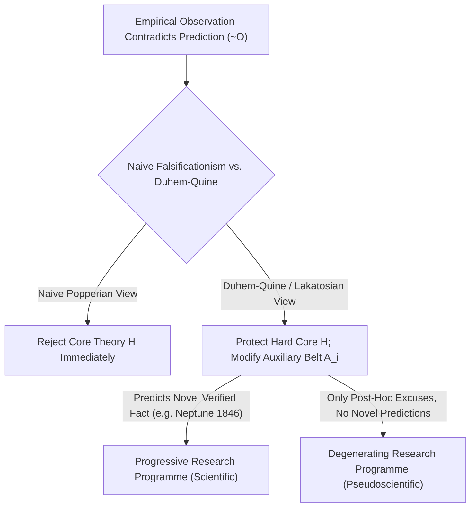
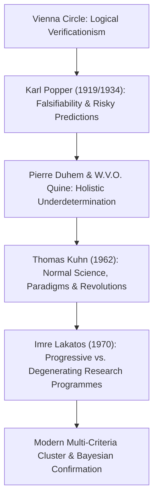

## مقدمة: إشراقة فيينا عام 1919 — ميلاد مشكلة الفصل (Demarcation Problem)

في حياتنا اليومية غالباً ما نعامل كلمة «علم» بوصفها مرادفاً لـ«الحقيقة المطلقة المثبتة بالوقائع». غير أن كثيراً من المذاهب التي تدّعي العلمية — مثل التنجيم، والمعالجة المثلية، والخيمياء، ونظريات المؤامرة — تتباهى هي الأخرى بامتلاك آلاف «الشواهد التجريبية المؤيدة»: فالمنجّم يستطيع دائماً أن يستخرج من خريطة الأبراج تفسيراً لما حدث لك بالأمس، وصاحب نظرية المؤامرة يفسر حتى الغياب التام للأدلة بأنه البرهان الأقوى على مدى إحكام إخفاء المؤامرة! <strong>أين يقع إذن الحد الإبستمولوجي الفاصل بين العلم التجريبي الحقيقي والعلم الزائف (Pseudoscience)؟</strong> في فلسفة العلوم تُعرف هذه المسألة المحورية باسم <strong>مشكلة الفصل أو التمييز (The Demarcation Problem / *Abgrenzungsproblem*)</strong>.

في مطلع القرن العشرين حاولت <strong>حلقة فيينا (الوضعية المنطقية Logical Positivism)</strong> بقيادة موريتس شليك ورودولف كارناب رسم هذا الحد عبر <strong>مبدأ القابلية للتحقق (Verificationism)</strong>: لا تكون القضية ذات معنى علمي إلا إذا أمكن التحقق من صدقها نهائياً بالتجربة الحسية. لكن هذا المعيار اصطدم سريعاً <strong>بمشكلة الاستقراء التي طرحها ديفيد هيوم</strong>: فكل قانون علمي هو قضية كلية من الشكل $orall x\, P(x)$ («جميع البجع أبيض» أو «جميع الكتل تخضع لقانون الجذب العام»). ومهما رصدنا من ملايين البجعات البيضاء، فإن المشاهدات المنتهية لا تستطيع أبداً أن تبرهن استنباطياً على صدق قضية كلية تشمل ما لا نهاية له من الحالات! ولو اشترطنا التحقق الكامل لطُردت حتى ميكانيكا نيوتن من حظيرة العلم.

في 29 مايو 1919، وأثناء كسوف كلي للشمس في جزيرة برينسيبي، قاس الفلكي البريطاني آرثر إدنغتون انحناء ضوء النجوم المارّ بمحاذاة قرص الشمس، مؤكداً التنبؤ الكمي الجريء للنسبية العامة لألبرت أينشتاين ($1.75$ ثانية قوسية مقابل $0.875$ وفق نيوتن). في فيينا عاش الشاب ذو السبعة عشر ربيعاً <strong>كارل بوبر (Karl Popper)</strong> هذا الحدث كإشراقة فكرية كبرى: فقد أدرك أن عظمة نظرية أينشتاين لا تكمن في قدرتها على تفسير وقائع معروفة سلفاً، بل في شجاعتها على تقديم <strong>تنبؤ محفوف بالمخاطر (Risky Prediction)</strong> لو كذّبته المشاهدة لانهارت النظرية بأكملها على الفور!

---

## 1. الثورة الكوبرنيكية لكارل بوبر: اللاتماثل المنطقي بين التحقق والتكذيب

في عام 1934 طرح بوبر في كتابه الشهير *منطق الكشف العلمي* (*Logik der Forschung*) <strong>معيار القابلية للتكذيب أو التفنيد (Falsifiability Criterion)</strong>: إن ما يجعل النظرية علمية ليس عصمتها عن الخطأ، بل على العكس تماماً، <strong>قابليتها لأن تصطدم بالتجربة وتُدحض</strong>!
يرتكز هذا المعيار على <strong>اللاتماثل المنطقي المطلق بين التحقق والتكذيب</strong> في منطق المحمولات:
- لا يمكن لأي عدد منتهٍ من المشاهدات المؤيدة $O_1, O_2, \dots, O_n$ أن يثبت استنباطياً صحة نظرية كلية $T$ (لأن استنتاج $T$ من $T \implies O$ و$O$ يقع في المغالطة الصورية المعروفة بـ*إثبات التالي*).
- في المقابل، يكفي <strong>مثال مضاد واحد فقط</strong> موثوق $
eg O$ (كرؤية بجعة سوداء واحدة في أستراليا) لكي نستنتج يقينياً وبصرامة تامة عبر قاعدة <strong>رفع التالي (Modus Tollens)</strong> من $T \implies O$ و$
eg O$ النتيجة الحتمية $
eg T$ (بطلان النظرية $T$)!

لذلك أعلن بوبر: تكون النظرية علمية إذا وفقط إذا كانت تحظر وقوع أحداث معينة قابلة للرصد، أي إذا كانت مجموعة <strong>مكذّباتها المحتملة (Potential Falsifiers)</strong> غير خالية. وإنما كان التنجيم علماً زائفاً لأنه يصوغ نبوءاته بغموض مطاط يسمح بتأويل أي حدث يقع لاحقاً لصالحه — <strong>فالنظرية التي تفسر كل ما يمكن أن يحدث لا تفسر في الحقيقة شيئاً على الإطلاق، ومحتواها المعلوماتي التجريبي يساوي صفراً!</strong> والعلم عند بوبر يتقدم عبر سلسلة لا تنتهي من <strong>الحدوس والتفنيدات (Conjectures and Refutations)</strong>؛ أما النظريات التي تصمد أمام أقسى الاختبارات فلا تصبح «حقائق مبرهنة» أبداً، بل تكتسب درجة عالية من <strong>التعزيز (Corroboration)</strong>.

$$
\text{Modus Tollens:} \quad \frac{T \implies O, \quad \neg O}{\therefore \neg T}
$$

$$
\text{Duhem-Quine Holistic Conjunction:} \quad \big( H \land A_1 \land A_2 \land \dots \land A_n \land C_{\text{init}} \big) \implies O
$$

$$
\neg O \implies \neg H \lor \neg A_1 \lor \neg A_2 \lor \dots \lor \neg A_n \lor \neg C_{\text{init}}
$$

---

## 2. أزمة التكذيب الساذج: أطروحة دوهيم-كواين واكتشاف كوكب نبتون

رغم أناقة معيار بوبر منطقياً، فإن مواجهته بالتاريخ الفعلي للفيزياء كشفت عن عقبة كأداء: <strong>لو التزم العلماء حرفياً بالتكذيب الساذج، لوُئدت جميع النظريات العلمية الكبرى في مهدها!</strong>

صاغ الفيزيائي الفرنسي بيير دوهيم (1906) والفيلسوف الأمريكي ويلارد فان أورمان كواين (1951) <strong>أطروحة دوهيم-كواين (Duhem-Quine Thesis / نقص التحديد الكلياني)</strong>: في الممارسة العلمية الفعلية، لا يمكن لأي فرضية نظرية أساسية $H$ (مثل قانون الجذب العام لنيوتن $F = G m_1 m_2 / r^2$) أن تستلزم <strong>بمفردها</strong> تنبؤاً رصدياً $O$! فلحساب موقع كوكب في سماء الغد لا بد من ضمّ $H$ إلى حزمة كبيرة من <strong>الفرضيات المساعدة (Auxiliary Hypotheses)</strong> $A_1, A_2, \dots, A_n$ (مثل: «لا يوجد في المجموعة الشمسية سوى سبعة كواكب»، «الفضاء بين الكواكب خالٍ من الاحتكاك»، «التلسكوب خالٍ من الزيغ البصري») بالإضافة إلى الشروط الابتدائية $C_{	ext{init}}$.
وبالتالي، عندما تتناقض المشاهدة مع التنبؤ ($
eg O$)، فإن قاعدة Modus Tollens تخبرنا فقط بأن العطف الكلي $(H \land A_1 \land \dots \land A_n \land C_{	ext{init}})$ كاذب! أما المنطق الصوري وحده <strong>فعاجز تماماً عن إخبارنا ما إذا كان الخطأ يكمن في النواة النظرية $H$ أم في إحدى الفرضيات المساعدة $A_i$</strong>!

وأروع مثال في تاريخ العلم هو <strong>اكتشاف كوكب نبتون عام 1846</strong>: ففي مطلع القرن التاسع عشر انحرف المدار المرصود لكوكب أورانوس بشدة عن حسابات ميكانيكا نيوتن ($
eg O$). فهل أعلن الفيزيائيون فوراً بطلان قانون نيوتن؟ كلا على الإطلاق! بل تمسّك الفرنسي أوربان لوفيريه والإنجليزي جون كوتش آدامز بنواة نيوتن $H$، وعدّلا الفرضية المساعدة $A_1$ بافتراض وجود كوكب ثامن مجهول وراء أورانوس وحسبا موقعه. وفي 23 سبتمبر 1846 وجّه يوهان غوتفريد غاله تلسكوب مرصد برلين نحو الإحداثيات التي حسبها لوفيريه، فعثر على كوكب <strong>نبتون</strong> على بُعد أقل من درجة واحدة! وهكذا تحول ما بدا تكذيباً لنيوتن إلى أعظم انتصار له. على العكس من ذلك، عندما حاول لوفيريه لاحقاً تفسير التقدم الشاذ لحضيض عطارد ($43''$ في القرن) بافتراض كوكب داخلي وهمي سماه «فولكان»، باءت محاولته بالفشل — وهذه المرة كان لا بد فعلاً من استبدال نواة نيوتن $H$ بالنسبية العامة لأينشتاين.

---

## 3. نماذج كون الإرشادية، وبرامج أبحاث لاكاتوس، والمعايير متعددة الأبعاد الحديثة

لإنقاذ العقلانية العلمية وتفسير التاريخ الفعلي للعلوم، خطت فلسفة العلوم في النصف الثاني من القرن العشرين ثلاث خطوات حاسمة:
1. <strong>*بنية الثورات العلمية* لتوماس كون (1962)</strong>: أوضح كون أنه خلال فترات <strong>العلم العادي (Normal Science)</strong> لا يسعى العلماء إلى تكذيب <strong>نموذجهم الإرشادي (Paradigm)</strong>، بل ينشغلون بـ«حل الألغاز» (*Puzzle-solving*). وتُركن الشذوذات جانباً حتى يتفاقم تراكمها فيولّد <strong>أزمة (Crisis)</strong> عميقة ويظهر نموذج منافس، وعندها ينفجر <strong>تحول النموذج الإرشادي (الثورة العلمية)</strong>.
2. <strong>*منهجية برامج الأبحاث العلمية* لإمري لاكاتوس (MSRP, 1970)</strong>: قدّم لاكاتوس تركيباًبقرياً يجمع بين بوبر وكون؛ فوحدة التقييم العلمي ليست فرضية معزولة، بل <strong>برنامج أبحاث (Research Programme)</strong> يتطور تاريخياً ويتألف من <strong>نواة صلبة (Hard Core)</strong> غير قابلة للمساس، يحيط بها <strong>حزام واقٍ من الفرضيات المساعدة (Protective Belt)</strong> يتعدل باستمرار لامتصاص الصدمات التجريبية. فكيف نميز إذن بين العلم والعلم الزائف؟ يجيب لاكاتوس: المعيار هو ما إذا كانت تعديلات الحزام الواقي <strong>تقدمية (Progressive)</strong> أم <strong>متقهقرة/انتكاسية (Degenerating)</strong>!
   - <strong>برنامج الأبحاث التقدمي (العلم الحقيقي)</strong> يعدّل فرضياته المساعدة بحيث لا يفسر الشذوذات القديمة فحسب، بل <strong>يتنبأ بوقائع جديدة غير مسبوقة (Novel Facts)</strong> تتأكد تجريبياً (مثل اكتشاف نبتون).
   - <strong>برنامج الأبحاث المتقهقر (العلم الزائف)</strong> يكتفي بترقيعات بعدية (<strong>تعديلات *Ad hoc*</strong>) لحفظ ماء الوجه دون أن ينجح أبداً في تقديم تنبؤ جديد واحد قابل للاختبار!
3. <strong>التشابه العائلي والتحديات المعاصرة</strong>: بعد أن بيّن لاري لودان (1983) استحالة وجود شرط واحد ضروري وكافٍ، يعتمد فلاسفة العلم المعاصرون مثل ماسيمو بيليوتشي ومارتن مانر <strong>نماذج عنقودية متعددة المعايير («التشابه العائلي» عند فيتغنشتاين)</strong> مدمجة مع <strong>نظرية التأكيد البايزية</strong>. وفي مواجهة <strong>أزمة التكرار (Replication Crisis)</strong> ($p$-hacking والتسجيل المسبق للأبحاث في علم النفس والطب الحيوي) والسجالات حول نظرية الأوتار والأكوان المتعددة، يظل إرث بوبر ولاكاتوس البوصلة الحاسمة لحماية النزاهة العلمية.

| التيار الفلسفي | معيار الفصل (Demarcation) | التعامل مع الشذوذ الرصدي ($
eg O$) | نقاط القوة والحدود التاريخية |
| :--- | :--- | :--- | :--- |
| <strong>الوضعية المنطقية (حلقة فيينا)</strong> | <strong>القابلية للتحقق</strong>: الرد إلى جمل الملاحظة الحسية | استحالة برهنة القوانين الكلية استقرائياً | يستبعد الميتافيزيقا لكنه ينهار أمام معضلة الاستقراء لهيوم |
| <strong>التكذيب الساذج (بوبر 1934)</strong> | <strong>القابلية للتكذيب</strong>: مكذبات محتملة وتنبؤات خطرة | Modus Tollens $
eg O \implies 
eg T$ يدحض النظرية فوراً | يكشف اللاتماثل المنطقي لكنه يصطدم بأطروحة دوهيم-كواين |
| <strong>التاريخانية والنماذج (كون 1962)</strong> | <strong>حل الألغاز داخل النموذج الإرشادي (Paradigm)</strong> | العلم العادي يؤجل الشذوذات حتى وقوع الأزمة | واقعي تاريخياً لكنه يفتح الباب للنسبوية وعدم القابلية للمقايسة |
| <strong>برامج الأبحاث (لاكاتوس 1970)</strong> | <strong>برنامج تقدمي مقابل متقهقر</strong> (التنبؤ بوقائع جديدة) | حماية النواة الصلبة وتعديل الحزام الواقي | يميز بدقة بين الكشف العلمي (نبتون) والترقيع الزائف (*Ad hoc*) |
| <strong>النماذج العنقودية والبايزية الحديثة</strong> | <strong>تعدد المعايير + معامل بايز + القابلية للتكرار</strong> | تحديث بايزي وتسجيل مسبق لمنع التلاعب الإحصائي | المعيار المعتمد في القضاء العلمي (*Kitzmiller*) والعلم المفتوح |

$$
P(H \mid E) = \frac{P(E \mid H)\,P(H)}{P(E \mid H)\,P(H) + P(E \mid \neg H)\,P(\neg H)}, \qquad \frac{P(H \mid E)}{P(\neg H \mid E)} = \text{BF}_{10}(E) \cdot \frac{P(H)}{P(\neg H)}
$$

$$
\text{Popper Corroboration:} \quad C(H, E) = \frac{P(E \mid H) - P(E)}{P(E \mid H) + P(E) - P(E \land H)}
$$
