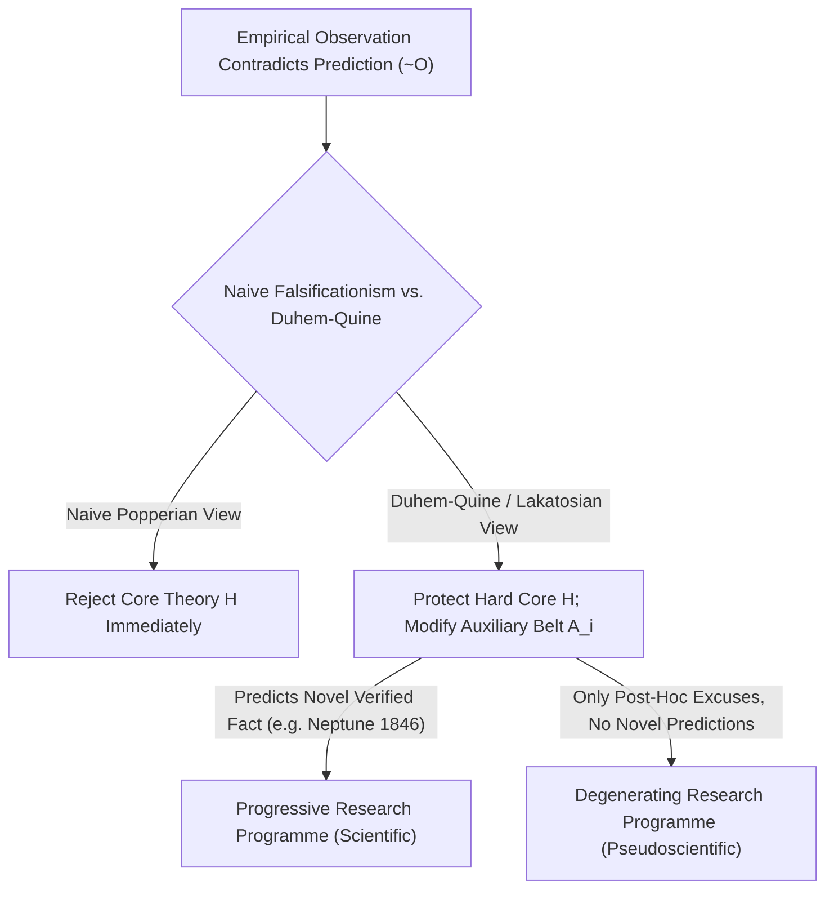
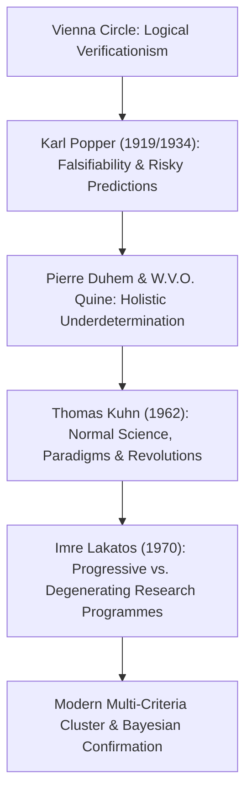

## Einleitung: Die Wiener Erkenntnis von 1919 — Die Geburt des Abgrenzungsproblems

Im Alltag setzen wir „Wissenschaft“ oft mit „durch Fakten bewiesener absoluter Wahrheit“ gleich. Doch zahlreiche Lehren, die für sich selbst Wissenschaftlichkeit beanspruchen — wie Astrologie, Homöopathie, Alchemie oder geschichtsphilosophische Verschwörungstheorien —, verweisen ebenfalls stolz auf Tausende „empirische Bestätigungen“: Ein Astrologe findet im Horoskop mühelos eine Erklärung für das gestrige Missgeschick, und ein Verschwörungstheoretiker deutet selbst das völlige Fehlen von Beweisen als ultimativen Beleg dafür, wie perfekt die Verschwörung vertuscht wird. <strong>Wo genau verläuft also die erkenntnistheoretische Grenze zwischen echter Erfahrungswissenschaft (Empirical Science) und Pseudowissenschaft (Pseudoscience)?</strong> In der Wissenschaftsphilosophie nennt man diese Schlüsselfrage das <strong>Abgrenzungsproblem (Demarcation Problem)</strong>.

Zu Beginn des 20. Jahrhunderts versuchte der <strong>Wiener Kreis (Logischer Empirismus / Positivismus)</strong> um Moritz Schlick und Rudolf Carnap, diese Grenze durch das <strong>Verifikationskriterium</strong> zu ziehen: Ein Satz sei genau dann wissenschaftlich sinnvoll, wenn er sich durch empirische Beobachtungssätze endgültig als wahr erweisen (*verifizieren*) lasse. Doch dieses Kriterium scheiterte sofort am <strong>Induktionsproblem von David Hume</strong>: Naturgesetze sind Allsätze der Form $orall x\, P(x)$ („Alle Schwäne sind weiß“ oder „Alle Massen gehorchen dem Gravitationsgesetz“). Selbst Milliarden beobachteter weißer Schwäne können einen Allsatz über unendlich viele Raumzeitpunkte niemals deduktiv beweisen! Würde man strenge Verifizierbarkeit verlangen, müsste man selbst die Newtonsche Mechanik aus der Wissenschaft verbannen.

Am 29. Mai 1919 vermaß der britische Astronom Arthur Eddington während einer totalen Sonnenfinsternis auf der Insel Príncipe die Lichtablenkung von Sternen am Sonnenrand und bestätigte Albert Einsteins kühne Vorhersage der Allgemeinen Relativitätstheorie von $1{,}75$ Bogensekunden. Der damals 17-jährige Wiener Student <strong>Karl Raimund Popper</strong> erlebte diesen Moment als intellektuelle Erweckung: Er erkannte, dass die Größe von Einsteins Theorie nicht darin lag, bekannte Tatsachen im Nachhinein zu deuten, sondern darin, eine <strong>hochriskante Vorhersage (Risky Prediction)</strong> zu wagen, bei deren Scheitern die gesamte Theorie sofort widerlegt gewesen wäre!

---

## 1. Karl Poppers kopernikanische Wende: Die logische Asymmetrie zwischen Verifikation und Falsifikation

Im Jahr 1934 veröffentlichte Popper in seinem Hauptwerk *Logik der Forschung* das berühmte <strong>Kriterium der Falsifizierbarkeit (Falsifiability Criterion)</strong>: Wissenschaft zeichnet sich nicht durch Unfehlbarkeit aus, sondern im Gegenteil dadurch, dass ihre Sätze <strong>an der Erfahrung scheitern können (widerlegbar sind)</strong>!
Dieses Prinzip beruht auf der fundamentalen <strong>logischen Asymmetrie zwischen Verifikation und Falsifikation</strong> in der Prädikatenlogik:
- Keine noch so große Zahl positiver Beobachtungen $O_1, O_2, \dots, O_n$ kann eine universelle Theorie $T$ deduktiv beweisen (der Schluss von $T \implies O$ und $O$ auf $T$ ist der formale Fehlschluss der *Bejahung des Nachsatzes*).
- Hingegen genügt ein <strong>einziges</strong> gesichertes Gegenbeispiel $
eg O$ (etwa ein einziger schwarzer Schwan in Australien), um mittels der zwingenden Schlussregel des <strong>Modus Tollens</strong> aus $T \implies O$ und $
eg O$ deduktiv exakt auf $
eg T$ (die Falschheit der Theorie $T$) zu schließen!

Popper formulierte daher: Ein theoretisches System ist genau dann empirisch-wissenschaftlich, wenn es bestimmte denkbare Beobachtungsereignisse verbietet, wenn also die Klasse seiner <strong>potenziellen Falsifikatoren (Potential Falsifiers)</strong> nicht leer ist. Astrologie ist deshalb Pseudowissenschaft, weil sie ihre Aussagen so vage und dehnbar formuliert, dass buchstäblich jedes denkbare Ereignis als Bestätigung verbucht werden kann — <strong>eine Theorie, die alles erklärt, erklärt in Wahrheit gar nichts; ihr empirischer Informationsgehalt ist null!</strong> Wissenschaft schreitet laut Popper durch einen endlosen evolutionären Prozess von <strong>Vermutungen und Widerlegungen (Conjectures and Refutations)</strong> voran; Theorien, die strengsten Tests standhalten, sind niemals „bewiesen“, sondern besitzen lediglich einen hohen <strong>Bewährungsgrad (Corroboration)</strong>.

$$
\text{Modus Tollens:} \quad \frac{T \implies O, \quad \neg O}{\therefore \neg T}
$$

$$
\text{Duhem-Quine Holistic Conjunction:} \quad \big( H \land A_1 \land A_2 \land \dots \land A_n \land C_{\text{init}} \big) \implies O
$$

$$
\neg O \implies \neg H \lor \neg A_1 \lor \neg A_2 \lor \dots \lor \neg A_n \lor \neg C_{\text{init}}
$$

---

## 2. Die Krise des naiven Falsifikationismus: Die Duhem-Quine-These und die Entdeckung des Neptun

So bestechend Poppers Falsifikationskriterium logisch auch war — als Wissenschaftshistoriker es mit der realen Geschichte der Physik konfrontierten, stießen sie auf ein gravierendes Problem: <strong>Hätten sich Physiker tatsächlich an den naiven Falsifikationismus gehalten, wäre jede große wissenschaftliche Theorie bereits in ihrer Geburtsstunde verworfen worden!</strong>

Der französische Physiker Pierre Duhem (1906) und der US-amerikanische Philosoph Willard Van Orman Quine (1951) formulierten die berühmte <strong>Duhem-Quine-These (Holistische Unterbestimmtheit)</strong>: Eine isolierte Kernhypothese $H$ (wie Newtons Gravitationsgesetz $F = G m_1 m_2 / r^2$) kann niemals im Alleingang eine beobachtbare Vorhersage $O$ implizieren! Um die Bahn eines Planeten am Nachthimmel zu berechnen, muss man $H$ zwingend mit einem ganzen Bündel von <strong>Hilfshypothesen (Auxiliary Hypotheses)</strong> $A_1, A_2, \dots, A_n$ (z. B. „Es gibt im Sonnensystem nur sieben Planeten“, „Der interplanetare Raum ist frei von Reibung“, „Das Teleskop hat keinen Abbildungsfehler“) sowie Randbedingungen $C_{	ext{init}}$ verknüpfen.
Tritt nun eine widersprechende Beobachtung $
eg O$ auf, so beweist der Modus Tollens lediglich, dass die Gesamtkonjunktion $(H \land A_1 \land \dots \land A_n \land C_{	ext{init}})$ falsch ist! Die reine Logik verrät uns <strong>niemals, ob der Fehler in der Kerntheorie $H$ oder in einer der Hilfshypothesen $A_i$ steckt</strong>!

Das berühmteste Beispiel der Wissenschaftsgeschichte ist die <strong>Entdeckung des Planeten Neptun im Jahr 1846</strong>: Anfang des 19. Jahrhunderts wich die beobachtete Bahn des Uranus massiv von den Berechnungen der Newtonschen Mechanik ab ($
eg O$). Erklärten die Astronomen daraufhin Newtons Gravitationsgesetz für falsifiziert? Keineswegs! Urbain Le Verrier in Frankreich und John Couch Adams in England hielten eisern am Kern $H$ fest und modifizierten stattdessen die Hilfshypothese $A_1$, indem sie einen achten, noch unentdeckten Planeten jenseits des Uranus postulierten und dessen Position berechneten. Am 23. September 1846 richtete Johann Gottfried Galle in Berlin sein Teleskop auf den berechneten Punkt — und entdeckte keine $1^\circ$ entfernt den <strong>Neptun</strong>! Eine scheinbare Widerlegung wurde zum größten Triumph der Newtonschen Physik. Als Le Verrier später jedoch versuchte, die anomale Periheldrehung des Merkur ($43''$ pro Jahrhundert) analog durch einen hypothetischen Planeten „Vulkan“ zu erklären, scheiterte er — hier musste tatsächlich der Newtonsche Kern $H$ durch Einsteins Allgemeine Relativitätstheorie ersetzt werden.

---

## 3. Kuhns Paradigmen, Lakatos’ Forschungsprogramme und moderne Mehrkriterien-Modelle

Um die Rationalität der Wissenschaft zu retten und zugleich der realen Wissenschaftsgeschichte gerecht zu werden, vollzog die Wissenschaftsphilosophie drei entscheidende Schritte:
1. <strong>Thomas S. Kuhns *Die Struktur wissenschaftlicher Revolutionen* (1962)</strong>: Kuhn zeigte, dass Wissenschaftler in Phasen der <strong>Normalwissenschaft (Normal Science)</strong> keineswegs versuchen, ihr eigenes <strong>Paradigma</strong> zu falsifizieren, sondern innerhalb des Paradigmas „Rätsel lösen“ (*Puzzle-solving*). Einzelne Anomalien werden toleriert oder geparkt; erst wenn sich Anomalien zu einer tiefen <strong>Krise</strong> verdichten und ein neues Paradigma bereitsteht, kommt es zu einem radikalen <strong>Paradigmenwechsel (wissenschaftliche Revolution)</strong>.
2. <strong>Imre Lakatos’ *Methodologie wissenschaftlicher Forschungsprogramme* (MSRP, 1970)</strong>: Lakatos verband Popper und Kuhn zu einer brillanten Synthese. Die Einheit wissenschaftlicher Bewertung ist kein isolierter Satz, sondern ein historisch wachsendes <strong>Forschungsprogramm (Research Programme)</strong>. Es besteht aus einem unangreifbaren <strong>harten Kern (Hard Core)</strong> und einem flexiblen <strong>Schutzgürtel aus Hilfshypothesen (Protective Belt)</strong>, der den Kern gegen Anomalien abschirmt. Wie unterscheidet man nun Wissenschaft von Pseudowissenschaft? Lakatos’ Antwort lautet: Entscheidend ist, ob die Modifikationen des Schutzgürtels <strong>progressiv</strong> oder <strong>degenerativ</strong> sind!
   - Ein <strong>progressives Forschungsprogramm (echte Wissenschaft)</strong> modifiziert seine Hilfshypothesen so, dass nicht nur alte Anomalien erklärt, sondern <strong>völlig neue, unerwartete Tatsachen (Novel Facts) vorhergesagt</strong> und empirisch bestätigt werden (wie die Vorhersage des Neptun).
   - Ein <strong>degeneratives Forschungsprogramm (Pseudowissenschaft)</strong> reagiert auf Gegenbeispiele ausschließlich im Nachhinein mit <strong>Ad-hoc-Ausreden</strong>, ohne jemals neue prüfbare Vorhersagen zu liefern!
3. <strong>Familienähnlichkeit und moderne Herausforderungen</strong>: Nachdem Larry Laudan (1983) gezeigt hatte, dass kein einzelnes notwendiges und hinreichendes Kriterium existiert, vertreten moderne Philosophen wie Massimo Pigliucci und Martin Mahner mehrdimensionale <strong>Cluster-Modelle (Familienähnlichkeit nach Wittgenstein)</strong> in Verbindung mit der <strong>Bayesschen Bestätigungstheorie</strong>. In den heutigen Debatten um die <strong>Replikationskrise</strong> ($p$-Hacking, HARKing und *Registered Reports* in Psychologie und Medizin) sowie um die Prüfbarkeit von Stringtheorie und Multiversum bleibt die Linie von Popper zu Lakatos das unverzichtbare Fundament wissenschaftlicher Integrität.

| Philosophische Strömung | Abgrenzungskriterium | Umgang mit Anomalien ($
eg O$) | Stärken & Historische Grenzen |
| :--- | :--- | :--- | :--- |
| <strong>Logischer Empirismus (Wiener Kreis)</strong> | <strong>Verifizierbarkeit</strong>: Rückführbarkeit auf Beobachtungssätze | Allsätze sind induktiv nicht beweisbar | Schließt Metaphysik aus, scheitert aber am Humeschen Induktionsproblem |
| <strong>Naiver Falsifikationismus (Popper 1934)</strong> | <strong>Falsifizierbarkeit</strong>: Existenz potenzieller Falsifikatoren | Modus Tollens $
eg O \implies 
eg T$ verwirft Theorie | Erklärt logische Asymmetrie, scheitert aber an der Duhem-Quine-These |
| <strong>Historismus & Paradigmen (Kuhn 1962)</strong> | <strong>Rätsellösungskompetenz im Paradigma</strong> | Normalwissenschaft ignoriert Anomalien bis zur Krise | Historisch realistisch, birgt jedoch Gefahr des Relativismus |
| <strong>Forschungsprogramme (Lakatos 1970)</strong> | <strong>Progressives vs. degeneratives Programm</strong> (*Novel Facts*) | Harter Kern geschützt; Schutzgürtel wird progressiv angepasst | Unterscheidet brillante Rettung (Neptun) exakt von faulen Ad-hoc-Ausreden |
| <strong>Moderne Cluster- & Bayes-Modelle</strong> | <strong>Multikriterielles Profil + Bayes-Faktor + Reproduzierbarkeit</strong> | Bayessches Updating & Präregistrierung gegen $p$-Hacking | Maßstab in Gerichtsurteilen (*Kitzmiller*) und moderner Replikationsforschung |

$$
P(H \mid E) = \frac{P(E \mid H)\,P(H)}{P(E \mid H)\,P(H) + P(E \mid \neg H)\,P(\neg H)}, \qquad \frac{P(H \mid E)}{P(\neg H \mid E)} = \text{BF}_{10}(E) \cdot \frac{P(H)}{P(\neg H)}
$$

$$
\text{Popper Corroboration:} \quad C(H, E) = \frac{P(E \mid H) - P(E)}{P(E \mid H) + P(E) - P(E \land H)}
$$
