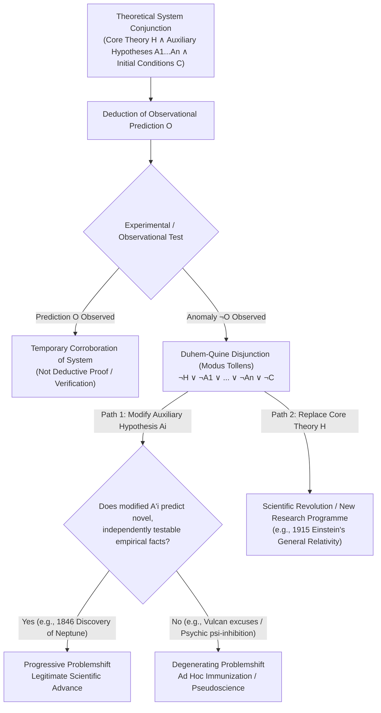
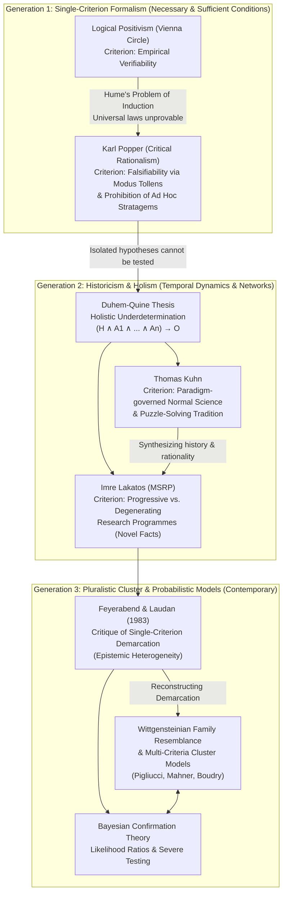

## Introduction: Why the Boundary Between Science and Pseudoscience Matters

In contemporary civilization, the adjective "scientific" functions far beyond a mere disciplinary taxonomy; it operates as the premier badge of <strong>epistemic authority</strong> and institutional trustworthiness. Whether in formulating public health mandates, adjudicating climate policy, determining the admissibility of expert testimony in courts of law, designing public school curricula, or allocating billions of dollars in research funding, drawing a principled boundary between legitimate science and its counterfeit imitators carries profound practical, ethical, and political consequences. When purveyors of astrology, homeopathy, young-earth creationism, intelligent design, anti-vaccine conspiracies, or "quantum mysticism" cloak their doctrines in the vocabulary of empirical inquiry, they do so precisely to appropriate the hard-won epistemic prestige of the natural sciences without submitting to their rigorous methodological constraints.

Within the philosophy of science, the quest to establish rigorous criteria distinguishing empirical science from non-science—and more acutely, from <strong>pseudoscience</strong> (non-scientific doctrines that masquerade as genuinely scientific)—is known as the <strong>Demarcation Problem</strong> (German: *Abgrenzungsproblem*, a term coined by Karl Popper). At first glance, common sense might suggest that the distinction is straightforward: science relies on objective empirical facts, observation, and experiment, whereas pseudoscience relies on dogma, superstition, or wishful thinking. Yet the moment we subject this naive intuition to historical and logical scrutiny, the boundary begins to blur in deeply unsettling ways.

Practitioners of astrology and homeopathy routinely point to vast archives of empirical observations, patient testimonials, and historical correlations to "confirm" their claims. Freudian and Adlerian psychoanalysts invoke thousands of clinical case studies as empirical proof of their theories. Conversely, a close examination of the history of our most triumphant exact sciences—such as Newtonian celestial mechanics, relativistic cosmology, or quantum field theory—reveals that whenever experimental measurements directly contradicted fundamental theoretical predictions, great scientists frequently refused to abandon their cherished theories. Instead, they blamed faulty instruments, invoked invisible planets, or invented unobservable fields to shield their equations from refutation. If we apply an overly simplistic rule—such as "science is what matches the data" or "scientists immediately discard a theory the moment an observation contradicts it"—we risk condemning Newton and Einstein as pseudoscientists while granting scientific status to any clever charlatan capable of retroactively fitting curves to data.

This article provides a comprehensive, rigorous philosophical examination of the Demarcation Problem across more than a century of epistemological inquiry. We begin with David Hume's Problem of Induction and the Logical Positivists' Verificationism, move through Karl Popper's 1919 Vienna epiphany and the formal logic of <strong>falsifiability</strong>, and confront the devastating challenge posed by the <strong>Duhem-Quine Thesis</strong> (holistic underdetermination), illustrated vividly by the 1846 discovery of Neptune versus the failed search for the planet Vulcan. We then trace the post-Popperian revolution through Thomas Kuhn's <strong>paradigms and normal science</strong>, Imre Lakatos's <strong>Methodology of Scientific Research Programmes (MSRP)</strong>, Paul Feyerabend's epistemological anarchism, and Larry Laudan's critique of single-criterion demarcation, before arriving at contemporary <strong>Wittgensteinian family resemblance / multi-criteria cluster models</strong>, Bayesian confirmation theory, courtroom battles (*McLean* and *Kitzmiller*), the modern <strong>Replication Crisis</strong> ($p$-hacking and HARKing), and the heated debate over non-empirical assessment in String Theory and Multiverse cosmology.

---

## Chapter 1: The Problem of Induction and Logical Positivism's Verificationism

### 1.1 Baconian Inductivism and Hume's Skeptical Guillotine

From the dawn of the Scientific Revolution in the seventeenth century, the prevailing philosophical orthodoxy held that science is defined by the <strong>inductive method</strong> championed by Francis Bacon. According to naive inductivism, the scientist begins with unprejudiced, theory-neutral observations of particular facts in nature (e.g., observing swan $a_1$ is white, swan $a_2$ is white, $\dots$, swan $a_n$ is white), generalizes from this finite collection of singular observation statements to a universal law of nature ($\forall x (\text{Swan}(x) \to \text{White}(x))$: "All swans are white"), and subsequently accumulates further positive instances to verify the law.

However, in the eighteenth century, the Scottish philosopher <strong>David Hume</strong> (*A Treatise of Human Nature*, 1739; *An Enquiry Concerning Human Understanding*, 1748) exposed a fatal logical abyss at the heart of inductive inference—now universally known as the <strong>Problem of Induction</strong>. Hume demonstrated that no finite number of singular observation statements, no matter how large or varied, can ever logically entail (deductively prove) an unrestricted universal generalization covering all of space and time, nor even justify a probabilistic inference about a single unobserved future instance.

To infer from "The sun has risen every morning in recorded history" to "The sun will rise tomorrow," one must presuppose an additional hidden premise: the <strong>Principle of the Uniformity of Nature</strong> (that the unobserved future will resemble the observed past, and that nature's regularities are invariant). How can this principle itself be justified?
1. It cannot be established <strong>a priori</strong> (by pure deductive logic), because its negation—"Nature's laws will abruptly change tomorrow"—involves no formal self-contradiction.
2. Nor can it be established <strong>a posteriori</strong> (by appeal to experience), by arguing that "The Principle of Uniformity has always worked in the past, so it will continue to work in the future." For that argument is itself an inductive inference that presupposes the very uniformity it seeks to prove, collapsing into a vicious <strong>circular argument (*petitio principii*)</strong>.

Consequently, if the scientific status of a theory depends on its being inductively *proven* or *verified* by empirical data, then all universal laws of physics, chemistry, and biology lack rational justification.

### 1.2 The Vienna Circle and the Verifiability Criterion of Meaning

In the 1920s and 1930s, inspired by Ernst Mach's empiricism and the new symbolic logic of Gottlob Frege, Bertrand Russell, and Ludwig Wittgenstein's *Tractatus Logico-Philosophicus*, a group of philosophers, physicists, and mathematicians gathered around Moritz Schlick, Rudolf Carnap, Otto Neurath, and Hans Reichenbach to form the <strong>Vienna Circle</strong> (*Wiener Kreis*), spearheading the movement known as <strong>Logical Positivism</strong> (or Logical Empiricism).

The primary ambition of the Vienna Circle was to purge philosophy of speculative Hegelian and Heideggerian metaphysics and place human knowledge on a firm scientific foundation. Their primary weapon was the <strong>Verifiability Theory of Meaning</strong> (Verificationism). Leaving aside purely analytic truths (tautologies of logic and mathematics, which are true by definition but say nothing about the empirical world), the Logical Positivists asserted that a synthetic proposition is cognitively <strong>meaningful</strong> if and only if it is <strong>empirically verifiable</strong>—that is, capable of being conclusively proved true (or reduced to) finite sets of basic sensory observation statements ("protocol sentences" or *Protokollsätze*).

Under this criterion, demarcation was framed as a semantic boundary between <strong>meaningful science</strong> and <strong>meaningless non-science</strong>. Statements of traditional metaphysics ("The Absolute Spirit realizes itself in history"), theology, or esoteric pseudoscience were dismissed not merely as false, but as literal nonsense (pseudo-statements or *Scheinsätze*) devoid of cognitive content.

Yet Verificationism quickly imploded under the weight of Hume's Problem of Induction. Consider Newton's law of universal gravitation:

$$\forall x \forall y \left( F = G \frac{m_x m_y}{r^2} \right)$$

or the statement "All electrons have a charge of $-1.602 \times 10^{-19}\text{ C}$." Because such universal laws quantify over an infinite domain of past, present, and future spacetime events ($\forall x$), they can <strong>never be conclusively verified</strong> by any finite set of observation statements $O_1 \land O_2 \land \dots \land O_n$. If conclusive verifiability is the criterion of meaning, then every universal law of natural science is rendered just as "meaningless" as Heideggerian metaphysics!

Recognizing this disaster, Carnap and Reichenbach retreated from strict *verifiability* to probabilistic <strong>confirmability</strong> (inductive logic), arguing that scientific statements are those whose probability can be raised by favorable empirical evidence. Yet even this retreat faced insurmountable technical barriers: within standard measure-theoretic probability, the prior and posterior probability of an unrestricted universal statement $\forall x\, P(x)$ over an infinite universe of discourse relative to any finite body of evidence $E$ remains strictly zero ($P(\forall x\, P(x) \mid E) = 0$).

---

## Chapter 2: Karl Popper's Copernican Revolution—Vienna 1919 and Falsifiability

### 2.1 The 1919 Vienna Epiphany: Einstein vs. Marx, Freud, and Adler

While the Vienna Circle struggled to rescue inductive verification, a young Austrian philosopher operating on the periphery of the Circle—and soon dubbed its "official opposition"—approached the problem from a radically different direction. <strong>Karl Raimund Popper (1902–1994)</strong> rejected both inductivism and the positivist conflation of the demarcation problem with the problem of linguistic meaning. For Popper, metaphysical statements can be entirely meaningful (and historically often served as the fertile soil from which scientific theories grew, such as ancient atomism). The true philosophical problem was not separating sense from nonsense, but demarcating <strong>empirical science</strong> from <strong>non-science and pseudoscience</strong>.

Popper's intellectual breakthrough crystallized in <strong>Vienna during the tumultuous year of 1919</strong>, following the collapse of the Austro-Hungarian Empire. As a seventeen-year-old student deeply engaged in leftist politics, social work, and theoretical physics, Popper was immersed in four competing intellectual systems, all of which claimed the mantle of "science":
1. Karl Marx's <strong>theory of history</strong> (historical materialism),
2. Sigmund Freud's <strong>psychoanalysis</strong>,
3. Alfred Adler's <strong>individual psychology</strong> (Popper personally worked with Adler in his social guidance clinics for working-class children in Vienna), and
4. Albert Einstein's <strong>General Theory of Relativity</strong>.

What struck Popper about Marxism, Freudianism, and Adlerian psychology was their apparent <strong>inexhaustible explanatory power</strong>. Adherents of these systems saw confirming instances everywhere: the world was overflowing with "verifications" of their theories. Whatever happened in politics or clinical practice could immediately be interpreted to fit the theory.

Popper famously illustrated this with two diametrically opposed human behaviors: imagine a man who pushes a small child into a river with the intention of drowning the child; and imagine another man who sacrifices his own life by jumping into the raging river to save the child.
- According to <strong>Freud</strong>, the first man suffered from repression (e.g., of some component of his Oedipus complex or Thanatos drive), while the second man had achieved successful *sublimation* of those very same drives.
- According to <strong>Adler</strong>, the first man suffered from deep feelings of inferiority and needed to prove to himself that he dared to commit a crime, while the second man also suffered from feelings of inferiority and needed to prove to himself that he was brave enough to rescue the child.

Popper could not conceive of *any* possible human behavior that could not be seamlessly explained by both theories. In 1919, Popper reported to Adler a clinical case of a child that did not seem to fit Adlerian principles at all. Without even examining the child, Adler effortlessly analyzed the case in terms of inferiority feelings. When a bewildered Popper asked how he could be so sure, Adler replied, "Because of my thousandfold experience." Popper could not help retorting: <strong>"And with this new case, I suppose, your experience has become thousand-and-one-fold!"</strong> What converts took to be the greatest strength of these theories—their ability to explain *everything*—was in reality their fatal weakness. Because they were compatible with every conceivable state of affairs, they actually ruled out nothing.

Contrast this with the dramatic event of <strong>May 29, 1919</strong>, when British astronomer <strong>Sir Arthur Eddington</strong> led an expedition to the island of Príncipe off the coast of West Africa (alongside Andrew Crommelin's expedition to Sobral, Brazil) to observe a total solar eclipse and test <strong>Albert Einstein's General Theory of Relativity</strong>. From his 1915 field equations,

$$R_{\mu\nu} - \frac{1}{2} R g_{\mu\nu} = \frac{8\pi G}{c^4} T_{\mu\nu}$$

Einstein had derived a bold, quantitative prediction: a ray of starlight grazing the limb of the Sun would be deflected inward by the curvature of spacetime by an angle of precisely

$$\Delta \theta = \frac{4GM_{\odot}}{c^2 R_{\odot}} \approx 1.75\text{ arcseconds}$$

(twice the deflection of $\approx 0.875''$ predicted by treating light as Newtonian corpuscles subject to inverse-square gravity). By photographing the background stars framing the eclipsed Sun and comparing their apparent positions with night-time photographs of the same star field taken months earlier, Eddington could subject Einstein's prediction to a direct empirical test.

What thrilled Popper was not merely that Eddington's measurements corroborated Einstein's prediction, but the <strong>extreme logical risk</strong> Einstein had taken. Einstein's theory stuck its neck out: it declared unambiguously that if starlight deflection were measured to be $0''$ or $0.875''$, then General Relativity would be <strong>refuted (falsified)</strong>. Every good scientific theory, Popper realized, is a <strong>prohibition</strong>: it forbids certain observable states of affairs from occurring. The more a theory forbids, the more it tells us about the empirical world. A theory that is not refutable by any conceivable event is non-scientific. Irrefutability is not a virtue of a theory (as people often think), but a vice. Thus, Popper formulated his famous demarcation criterion in *Logik der Forschung* (1934; *The Logic of Scientific Discovery*, 1959): <strong>the criterion of the scientific status of a theory is its falsifiability, or refutability, or testability.</strong>

### 2.2 The Logical Asymmetry Between Verification and Falsification

Popper's brilliance lay in anchoring his demarcation criterion in a pristine, unassailable fact of deductive formal logic: the <strong>logical asymmetry between verification and falsification</strong>.

Let $T$ represent a universal scientific theory (e.g., $\forall x (P(x) \to Q(x))$), and let $O$ represent a singular observation statement deduced from $T$ (given initial conditions). Thus we have the conditional premise $T \to O$.

Suppose we conduct an experiment and observe that the prediction $O$ holds true. If we attempt to argue from $T \to O$ and $O$ to the conclusion that $T$ is true, we commit the elementary formal fallacy of <strong>Affirming the Consequent</strong>:

$$\frac{T \to O \quad , \quad O}{\therefore T} \quad \text{(Logically Invalid: Fallacy of Affirming the Consequent)}$$

Because a false theory can easily entail true consequences, no amount of positive observations $O_1, O_2, \dots, O_n$ can ever deductively prove $T$. Induction is deductively invalid.

Now suppose instead that our observation contradicts the prediction: we observe $\neg O$ (a counterexample, such as a single black swan: $\exists x (\text{Swan}(x) \land \neg\text{White}(x))$). From the conditional premise $T \to O$ and the negated consequent $\neg O$, classical deductive logic yields the conclusion $\neg T$ (that the universal theory $T$ is false) with 100% deductive validity via <strong>Modus Tollens</strong> (*modus tollendo tollens*):

$$\frac{T \to O \quad , \quad \neg O}{\therefore \neg T} \quad \text{(Logically Valid: Modus Tollens)}$$

Herein lies the profound asymmetry: <strong>universal statements can never be deductively derived from singular observation statements, but they can be deductively contradicted (refuted) by singular observation statements.</strong> By replacing inductive verification with deductive falsification via *Modus Tollens*, Popper claimed to solve Hume's Problem of Induction entirely. Science does not use induction at all! Science progresses through bold, imaginative <strong>Conjectures</strong> (universal hypotheses freely invented by the human intellect to solve problems) followed by relentless, severe attempts at <strong>Refutations</strong> (deductive empirical tests).

### 2.3 Basic Statements, Degrees of Falsifiability, Corroboration, and Verisimilitude

To prevent widespread misunderstandings of Popper's philosophy, four technical concepts in his system must be precisely delineated:

1. <strong>Falsifiability vs. Actual Falsification</strong>: Calling a theory "falsifiable" does *not* mean it has been proven false! Rather, it means the theory possesses the logical property that it is *capable* of clashing with possible empirical observations. Formally, Popper defines <strong>basic statements</strong> (*Basissätze*) as singular existential statements asserting that an observable event occurs in a specified individual region of space and time. A theory $T$ is scientific (empirically falsifiable) if and only if it divides the class of all possible basic statements into two <strong>non-empty</strong> subclasses: first, those with which $T$ is consistent (permitted events); and second, those which $T$ contradicts (forbidden events), which Popper terms the class of <strong>potential falsifiers</strong> ($\text{Falsifiers}(T) \neq \emptyset$). Pseudoscientific theories have an empty class of potential falsifiers ($\text{Falsifiers}(T) = \emptyset$).

2. <strong>Empirical Content and Degrees of Falsifiability</strong>: For Popper, the empirical content of a theory is directly proportional to its degree of falsifiability—that is, how much it forbids. A tautology like "Tomorrow it will either rain or not rain" ($p \lor \neg p$) has a logical probability of $1.0$, zero potential falsifiers, and zero empirical content. A vague astrological horoscope ("You will face a challenge this month, but inner strength will guide you") has near-zero falsifiability. By contrast, a precise quantitative law like Einstein's gravitational lensing equation forbids almost every conceivable measurement except a razor-thin interval around $1.75''$. Therefore, <strong>science seeks theories with the lowest logical probability and the highest empirical content (highest falsifiability)</strong>.

3. <strong>Corroboration (*Bewährung*) vs. Confirmation</strong>: When a highly falsifiable theory survives severe, risky experimental attempts to refute it, Popper refuses to say that the theory is "verified" or even probabilistically "confirmed" (since for Popper, inductive probability of universal laws remains zero). Instead, he says the theory has demonstrated its fitness by surviving severe tests—it is <strong>corroborated</strong> (*bewährt*). Corroboration is strictly a backward-looking appraisal report on a theory's past performance in withstanding critical tests; it offers no inductive guarantee of future survival. Every scientific theory remains forever tentative and fallible (<strong>Fallibilism</strong>).

4. <strong>Verisimilitude (*Wahrheitsähnlichkeit* / Truthlikeness)</strong>: If all theories are fallible conjectures and even Newton's mechanics was eventually superseded, how can we speak of scientific progress toward truth? Drawing on Alfred Tarski's semantic theory of truth, Popper introduced the concept of <strong>verisimilitude</strong> (truthlikeness). Let a theory's *truth content* $Ct_T(A)$ be the class of all true logical consequences of $A$, and its *falsity content* $Ct_F(A)$ be the class of its false consequences. Theory $T_2$ (e.g., General Relativity) is closer to the truth (has higher verisimilitude) than theory $T_1$ (e.g., Newtonian gravity) if $T_2$ has a greater truth content without having a greater falsity content (or has smaller falsity content while retaining the truth content). Even though we can never know with absolute certainty that we have reached the final truth, critical error-elimination allows science to asymptotically approach truth via theories of ever-increasing verisimilitude.

---

## Chapter 3: The Collapse of Naive Falsificationism—The Duhem-Quine Thesis and Auxiliary Hypotheses

### 3.1 The Logical Structure of Holistic Underdetermination

Popper's falsificationism offered an austere, heroic, and logically pristine vision of science: propose a bold hypothesis $H$, deduce an observational prediction $O$, and if experiment yields $\neg O$, execute *Modus Tollens* and throw $H$ into the dustbin of history.

Yet as philosophers and historians of science scrutinized the actual logical architecture of scientific testing, a devastating flaw emerged in this "naive falsificationism." This critique was pioneered by the French physicist and historian <strong>Pierre Duhem (1861–1916)</strong> in *La théorie physique: son objet et sa structure* (1906) and radicalized by the American logician and philosopher <strong>Willard Van Orman Quine (1908–2000)</strong> in his landmark essay "Two Dogmas of Empiricism" (1951). Together, their insight is known as the <strong>Duhem-Quine Thesis</strong> (or <strong>Holistic Underdetermination</strong>).

Duhem pointed out an elementary logical truth about physics: <strong>an isolated theoretical hypothesis $H$ can never, by itself, entail any testable observational prediction $O$.</strong>

Suppose $H$ consists of Newton's three laws of motion and the inverse-square law of universal gravitation ($F = G m_1 m_2 / r^2$). Can you deduce from $H$ alone where the planet Uranus will appear in the night sky tomorrow at midnight ($O$)? Absolutely not. To derive the observable prediction $O$, you must conjoin the main hypothesis $H$ with a vast bundle of <strong>auxiliary hypotheses</strong> ($A_1, A_2, \dots, A_n$), background theories (including optical theories governing how your telescope works and how light refracts through Earth's atmosphere), and specific <strong>initial and boundary conditions</strong> ($C_{\text{init}}$):
- $A_1$: The solar system contains only the Sun and a specific number of known planets (Mercury, Venus, Earth, Mars, Jupiter, Saturn, Uranus), and no unknown massive bodies exist beyond Uranus.
- $A_2$: No non-gravitational forces (such as electromagnetic forces or drag from an interplanetary ether) significantly act on the planets.
- $A_3$: The masses and orbital elements assigned to Jupiter and Saturn are accurate.
- $A_4$: The optical theory of our telescope and atmospheric refraction corrections contain no systematic distortions.
- $C_{\text{init}}$: The initial positions and velocities of Uranus measured at time $t_0$ were accurate.

Thus, the true deductive premise is not $H \to O$, but a massive <strong>conjunction</strong>:

$$(H \land A_1 \land A_2 \land \dots \land A_n \land C_{\text{init}}) \to O$$

Now, suppose we point our telescope at the sky and observe $\neg O$: Uranus is *not* at the predicted position! What does *Modus Tollens* deductively entail? By De Morgan's laws of formal logic, negating a conjunction yields a <strong>disjunction</strong>:

$$\frac{(H \land A_1 \land A_2 \land \dots \land A_n \land C_{\text{init}}) \to O \quad , \quad \neg O}{\therefore \neg(H \land A_1 \land A_2 \land \dots \land A_n \land C_{\text{init}}) \equiv \neg H \lor \neg A_1 \lor \neg A_2 \lor \dots \lor \neg A_n \lor \neg C_{\text{init}}}$$

This logical result shatters naive falsificationism. When an observation $\neg O$ contradicts a theoretical prediction, <strong>deductive logic tells us only that *at least one* component in the entire theoretical bundle is false, but it is logically incapable of telling us *which* component is the culprit!</strong> The arrow of *Modus Tollens* strikes the corporate body of the theory as a whole, leaving it completely ambiguous whether the core hypothesis $H$ is false ($\neg H$) or whether one of the auxiliary assumptions $A_i$ or initial conditions $C_{\text{init}}$ has failed ($\neg A_i$).

As Quine famously generalized this in 1951: *"Our statements about the external world face the tribunal of sense experience not individually but only as a corporate body."* Human knowledge forms an interconnected <strong>Web of Belief</strong>. And from this follows a startling corollary: <strong>any core hypothesis $H$ can be permanently saved ("immunized") from refutation in the face of any recalcitrant empirical evidence whatsoever, provided we are willing to make sufficiently drastic adjustments to the auxiliary hypotheses ($A_1, \dots, A_n$) elsewhere in the web.</strong> Consequently, Duhem concluded, a purely logical *Experimentum Crucis* (crucial experiment) that unambiguously refutes a single isolated hypothesis is an impossibility.

### 3.2 A Tale of Two Planetary Anomalies: The Discovery of Neptune (1846) vs. The Planet Vulcan

Nowhere is the philosophical drama of the Duhem-Quine Thesis more vividly illustrated than in two nineteenth-century crises in Newtonian celestial mechanics.

#### Case 1: The Anomalous Orbit of Uranus and the Discovery of Neptune (1846)

Following William Herschel's discovery of Uranus in 1781, astronomers tracked its orbit for decades and attempted to reconcile its path with Newton's laws of motion and universal gravitation ($H$), taking into account gravitational perturbations from the giant planets Jupiter and Saturn. By the 1830s and 1840s, a glaring discrepancy ($\neg O$) was undeniable: Uranus was systematically deviating from its predicted Newtonian orbit by amounts far exceeding observational error.

Had nineteenth-century astronomers practiced naive falsificationism, they would have declared: *"Prediction $O$ failed! By Modus Tollens, Newton's law of universal gravitation $H$ is falsified and must be discarded!"* Instead, the French mathematician <strong>Urbain Le Verrier</strong> and the British astronomer <strong>John Couch Adams</strong> independently refused to question Newton's gravitational law $H$. Instead, they shifted the blame of *Modus Tollens* onto the <strong>auxiliary hypothesis $A_1$</strong> (the assumption that only seven planets existed and no unknown massive body orbited beyond Uranus).

Assuming $H$ to be strictly true and $A_1$ to be false, Le Verrier and Adams solved the inverse perturbation problem, calculating the exact mass, orbit, and sky coordinates that a hypothetical eighth trans-Uranian planet ($A'_1$) would need to possess in order to cause Uranus's orbital deviations. On September 23, 1846, Johann Gottfried Galle at the Berlin Observatory pointed his telescope to the exact coordinates specified by Le Verrier—and within one degree of the predicted spot, he discovered the planet <strong>Neptune</strong>! What looked initially like a refutation of Newtonian physics became, through the bold modification of an auxiliary hypothesis, Newton's greatest empirical triumph.

#### Case 2: The Anomalous Perihelion Precession of Mercury and the Phantom Planet Vulcan

Emboldened by his triumph with Neptune, Le Verrier turned his attention to another persistent planetary anomaly: the orbit of <strong>Mercury</strong>, the innermost planet. Due to gravitational tugs from the other planets, the perihelion of Mercury's elliptical orbit (its point of closest approach to the Sun) slowly precesses around the Sun. However, when Le Verrier summed all the Newtonian perturbations from every known planet, the observed precession rate exceeded the Newtonian theoretical prediction by a stubborn discrepancy of approximately <strong>$43\text{ arcseconds per century}$</strong> ($43''/\text{century}$).

Once again facing an observational refutation $\neg O$, Le Verrier applied the exact same Duhemian strategy that had just succeeded with Uranus: he held Newton's gravitational law $H$ sacrosanct and blamed the auxiliary assumption $A_1$ (that no unknown matter existed inside Mercury's orbit). In 1859, Le Verrier postulated the existence of an intra-Mercurial planet—or a ring of tiny asteroids—orbiting very close to the Sun, which he named <strong>Vulcan</strong>.

For the next fifty-six years, astronomers around the globe hunted for Vulcan during total solar eclipses. Amateur and professional astronomers repeatedly claimed sightings of Vulcan, only for subsequent observations to fail to confirm them. When a single planet Vulcan could not be found, astronomers invented further auxiliary patches: perhaps Vulcan was a diffuse cloud of cosmic dust invisible to telescopes (which should then cause specific zodiacal light polarization, which also failed to appear); perhaps the Sun's interior mass distribution was oblate; or perhaps, as Asaph Hall proposed, the exponent $2$ in Newton's inverse-square law $F = G m_1 m_2 / r^2$ was actually $2.00000016$!

None of these auxiliary rescues worked. Vulcan did not exist. The anomaly was resolved only in November 1915, when <strong>Albert Einstein</strong> abandoned the core hypothesis $H$ itself—replacing Newtonian absolute space and instantaneous action-at-a-distance gravity with the curved spacetime geometry of General Relativity—and demonstrated from first principles, without a single adjustable parameter or hypothetical planet, that relativistic spacetime curvature around the Sun adds precisely <strong>$43\text{ arcseconds per century}$</strong> to Mercury's perihelion advance.

Look closely at the profound philosophical puzzle raised by these two episodes:
- In 1846, Le Verrier saved Newton's law $H$ from refutation by inventing an unseen planet (Neptune)—and we celebrate this as <strong>brilliant science</strong>.
- In 1859, Le Verrier saved Newton's law $H$ from refutation by inventing an unseen planet (Vulcan)—which turned out to be a dead end.
- Meanwhile, when a parapsychologist's ESP experiment fails to show telepathy ($\neg O$), and the parapsychologist saves the ESP hypothesis $H$ by claiming that *"the skeptical electromagnetic aura of the laboratory observer inhibited the psychic psi-field"* (inventing an auxiliary hypothesis $A_k$), we condemn this as <strong>textbook pseudoscience</strong>.

If all three moves share the exact same formal logical structure—redirecting *Modus Tollens* away from $H$ onto an auxiliary hypothesis $A_i$—how can we demarcate legitimate scientific defense from pseudoscientific evasion?

---

## Chapter 4: Popper's Methodological Rules and Thomas Kuhn's *The Structure of Scientific Revolutions*

### 4.1 Popper's Ban on *Ad Hoc* Hypotheses and Immunizing Stratagems

To be fair to Karl Popper, he was never a naive falsificationist. Even in *Logik der Forschung* (1934), Popper explicitly acknowledged that from a purely logical standpoint, any theory can always be rescued from falsification by introducing auxiliary hypotheses or redefining terms—a maneuver he called a <strong>"conventionalist twist"</strong> or <strong>"immunizing stratagem"</strong> (German: *konventionalistischer Dreh* / *Immunisierungsstrategie*).

Because pure deductive logic cannot prevent a dogmatist from endlessly patching a falsified theory, Popper argued that falsifiability must be supplemented by a <strong>methodological rule</strong>: scientists must pledge never to save a theory via auxiliary modifications that *reduce* or fail to increase the empirical content (degree of falsifiability) of the theoretical system.

Specifically, Popper distinguished between two types of auxiliary modifications:
1. <strong>Content-increasing (Acceptable) Auxiliary Hypotheses</strong>: When Le Verrier postulated Neptune to save Newton's physics, his auxiliary hypothesis specified exact orbital parameters and sky coordinates where a new optical object could be independently observed. This *increased* the degree of falsifiability of the system by creating bold new potential falsifiers.
2. <strong>*Ad Hoc* Hypotheses (Forbidden)</strong>: An auxiliary hypothesis is <strong>ad hoc</strong> ("for this specific purpose") if it is introduced solely after the fact to explain away a particular refutation $\neg O$ without generating any new, independently testable predictions. When a conspiracy theorist explains the complete absence of evidence for a global conspiracy by asserting that *"the conspirators are so omnipotent that they erased all traces of the evidence,"* or when an astrologer excuses a failed forecast by blaming *"unforeseen karmic interference,"* the auxiliary hypothesis decreases the testability of the system and has zero independent empirical support.

### 4.2 Thomas Kuhn's Historical Challenge: Paradigms, Normal Science, and Puzzle-Solving

While Popper tried to shore up falsificationism with methodological prohibitions against *ad hoc* maneuvers, a far more radical challenge emerged in 1962 with the publication of <strong>Thomas S. Kuhn's (1922–1996)</strong> landmark book, <strong>*The Structure of Scientific Revolutions*</strong>.

Trained as a theoretical physicist before turning to the history of science, Kuhn examined how real scientific communities actually behave across history. What he found flatly contradicted Popper's normative portrait of scientists as ruthless critical rationalists constantly trying to falsify their own fundamental theories. According to Kuhn, during the vast majority of its history—periods he termed <strong>Normal Science</strong>—a mature scientific community operates within a shared <strong>Paradigm</strong>. (In his 1969 Postscript, Kuhn clarified that "paradigm" encompasses two senses: first, a *disciplinary matrix* of shared symbolic generalizations, metaphysical commitments, and values; and second, *exemplars*, concrete problem-solutions that students learn in textbooks and laboratories).

During Normal Science, scientists <strong>do not attempt to test or falsify the reigning paradigm</strong>. On the contrary, the foundational laws of the paradigm are held dogmatically as the unquestioned precondition for doing research at all! Normal science consists instead of <strong>"puzzle-solving"</strong>: applying the paradigm's rules and exemplars to bring ever more detailed phenomena into alignment with the theory, measuring constants to higher decimal places, and resolving residual mathematical or experimental ambiguities.

Crucially, Kuhn observed that when a scientist working in Normal Science encounters an experimental discrepancy ($\neg O$), the failure is <strong>never treated as a Popperian falsification of the paradigm</strong>. Instead, it is treated as a personal failure of the scientist or the experimental apparatus—just as a chess player who fails to solve a chess puzzle blames their own skill rather than the rules of chess! If an observational discrepancy stubbornly resists solution by the best practitioners, it is still not called a "falsifying counterinstance"; it is merely labeled an <strong>Anomaly</strong> and often shelved for future generations, in the confident expectation that the paradigm will eventually find a way to assimilate it.

Only when anomalies accumulate to the point where they persistently frustrate fundamental applications or strike at the heart of the paradigm's exemplars does the community enter a period of professional insecurity known as <strong>Crisis</strong>. Even during a crisis, Kuhn insisted, scientists <strong>never reject an existing paradigm simply because it is confronted with anomalies; a paradigm is declared invalid only if an alternate candidate is available to take its place.</strong> When a rival paradigm emerges that resolves the crisis, the transition from the old paradigm to the new one is a non-cumulative <strong>Scientific Revolution (Paradigm Shift)</strong>. Because rival paradigms carry different conceptual vocabularies, different standards of what counts as a legitimate scientific explanation, and even different perceptual experiences of data (the <strong>theory-ladenness of observation</strong>), Kuhn argued that competing paradigms exhibit <strong>Incommensurability</strong>—meaning there is no purely neutral, algorithmic logical proof that compels conversion from one paradigm to another.

### 4.3 Kuhn's Demarcation Criterion: The Puzzle-Solving Tradition

How, then, did Kuhn address the Demarcation Problem? At the historic 1965 International Colloquium in the Philosophy of Science in London (published in 1970 as *Criticism and the Growth of Knowledge*), Kuhn directly confronted Popper on the case of <strong>astrology</strong>.

Both Popper and Kuhn agreed that astronomy is a science and astrology is a pseudoscience, yet their diagnoses of *why* were diametrically opposed:
- <strong>Popper</strong> argued that astrology is pseudoscientific because astrologers make their predictions so vague and elastic that they evade falsification.
- <strong>Kuhn</strong> countered that historically, during the Renaissance and Early Modern period, astrologers made countless concrete, specific predictions (about royal deaths, military outcomes, and weather)—and <strong>those predictions repeatedly and visibly failed!</strong> Astrologers had no shortage of falsifications. What made astrology non-scientific, Kuhn argued, was the way astrologers responded to those failures: they pointed out that the heavens are vastly complex, that casting a natal chart requires knowing the exact minute of birth and exact planetary longitudes (which were imperfectly known), and therefore no individual failure could be used as a research puzzle to systematically revise the astrological theory itself.

In short, for Kuhn, <strong>what astrology lacked was not falsifications, but a "puzzle-solving tradition" (Normal Science)</strong>. Astronomers treated every tiny discrepancy in a planet's position as a constructive research puzzle driving refinements in instrumentation, refraction tables, and perturbation mathematics. Astrologers had rules to apply, but no puzzles to solve, and therefore no mechanism for cumulative normal-scientific progress. For Kuhn, <strong>it is precisely the existence of a rigorous Normal-Scientific puzzle-solving tradition—not Popperian falsification tests—that demarcates science from pseudoscience.</strong>

---

## Chapter 5: Imre Lakatos and the Methodology of Scientific Research Programmes (MSRP)

### 5.1 Synthesizing Popper and Kuhn: From Isolated Theories to Research Programmes

Kuhn's sociological and historical realism sent shockwaves through philosophy, but to Popperians, Kuhn's invocation of "paradigm conversion," "gestalt switches," and community consensus smelled dangerously of irrationalism and relativism—reducing scientific revolutions to a matter of "mob psychology."

The philosopher who brilliantly bridged the gulf between Popper's normative logical rigor and Kuhn's historical realism was the Hungarian mathematician and philosopher <strong>Imre Lakatos (1922–1974)</strong>, who had survived the Nazi occupation and escaped Soviet Hungary after the 1956 revolution to join Popper at the London School of Economics. In his masterwork, *"Falsification and the Methodology of Scientific Research Programmes"* (1970), Lakatos developed <strong>Sophisticated Methodological Falsificationism</strong>, universally known as the <strong>Methodology of Scientific Research Programmes (MSRP)</strong>.

Lakatos recognized that both naive falsificationism and Kuhn's critique shared a false premise: they treated a scientific theory as a static, isolated structure tested at a single point in time. Instead, Lakatos argued, <strong>the fundamental unit of mature scientific appraisal is not an isolated hypothesis $T$, but a "Scientific Research Programme"—a dynamic historical sequence of evolving theories $T_1, T_2, T_3, \dots, T_n$ bound together by a shared core and heuristic Continuity.</strong>

### 5.2 Hard Core, Protective Belt, and Negative/Positive Heuristics

According to Lakatos, every Scientific Research Programme consists of four interdependent structural components:

1. <strong>The Hard Core (*Harter Kern*)</strong>:
   The fundamental theoretical postulates and laws that define the identity of the research programme.
   - In <strong>Newtonian Gravitational Mechanics</strong>, the hard core consists of the three laws of dynamics ($F=ma$, etc.) and the law of universal gravitation ($F=Gm_1m_2/r^2$).
   - In <strong>Copernican Astronomy</strong>, the hard core is the postulate that the Earth and planets revolve around a stationary Sun while the Earth rotates on its axis daily.
   - In <strong>Marxist Economics</strong>, the hard core is the doctrine of surplus value extraction and the inevitable immiseration of the proletariat under capitalism.
   By an explicit methodological decision of the programme's protagonists, <strong>the Hard Core is treated as irrefutable</strong>. Anomalies are never permitted to strike the hard core directly.

2. <strong>The Protective Belt of Auxiliary Hypotheses (*Schutzgürtel*)</strong>:
   Surrounding the rigid hard core is a flexible, constantly evolving buffer zone of auxiliary hypotheses, initial conditions, observational theories, and specific models ($A_1, A_2, \dots, A_n$). <strong>It is this Protective Belt that must bear the full brunt of empirical tests (*Modus Tollens*)</strong>. Whenever an observational anomaly ($\neg O$) arises, scientists systematically adjust, replace, or sophisticate the auxiliary hypotheses in the protective belt in order to defend and insulate the hard core.

3. <strong>The Negative Heuristic (*Negative Heuristik*)</strong>:
   The methodological directive forbidding scientists from directing the arrow of *Modus Tollens* at the hard core: *"Do not touch the hard core; redirect all empirical refutations toward the protective belt!"*

4. <strong>The Positive Heuristic (*Positive Heuristik*)</strong>:
   Far from being a mere defensive shield, a great research programme possesses a proactive, constructive strategic plan—the <strong>Positive Heuristic</strong>—which consists of a partially articulated set of suggestions or hints on *how* to change and develop the "refutable variants" of the research programme, how to modify and sophisticate the protective belt, and how to digest anomalies.
   For example, when Newton constructed his planetary programme, he did not wait passively for anomalies to pile up. His positive heuristic laid out a planned sequence of increasingly realistic mathematical models:
   - *Model $T_1$*: A fixed point-mass Sun and a single point-mass planet (yielding Kepler's ellipses). This model was immediately "refuted" by the third law of motion (since the Sun and planet must orbit their common center of gravity), so Newton moved to:
   - *Model $T_2$*: Sun and planet orbiting their common barycenter.
   - *Model $T_3$*: Replacing point masses with extended symmetric spheres (requiring the invention of integral calculus to prove the shell theorem).
   - *Model $T_4$*: Introducing gravitational perturbations among multiple planets ($n$-body approximations) and spinning oblate spheroids.
   Because scientists are guided by a powerful Positive Heuristic, they rightly ignore minor observational counterexamples ("refutations") in the early stages, confident that future iterations of the protective belt will resolve them.

### 5.3 Progressive vs. Degenerating Research Programmes

If every research programme—both Newtonian physics and Freudian psychoanalysis—is permitted to protect its Hard Core by continually modifying its Protective Belt of auxiliary hypotheses, how does Lakatos solve the Demarcation Problem?

Lakatos shifts the criterion of demarcation from the static logical property of a single theory to the <strong>historical trajectory (or "problemshift") of the sequence of theories $T_1 \to T_2 \to T_3 \dots$ generated as the protective belt is modified over time</strong>. He distinguishes strictly between two kinds of trajectories:

- <strong>A Progressive Research Programme (Progressive Problemshift)</strong>:
  A sequence of theories $T_1, T_2, \dots, T_{i+1}$ is <strong>theoretically progressive</strong> if each new theory $T_{i+1}$ (formed by modifying the protective belt of $T_i$) has *excess empirical content* over its predecessor $T_i$—that is, if $T_{i+1}$ not only explains everything $T_i$ successfully explained (plus the anomaly that prompted the modification), but also <strong>predicts some novel, hitherto unexpected empirical fact (a *novel fact*)</strong>. Furthermore, the programme is <strong>empirically progressive</strong> if some of this excess empirical content is actually <strong>corroborated</strong>—meaning the novel predictions actually lead to the discovery of genuine new facts in nature!
  *Historical Exemplar*: Le Verrier's modification of the Newtonian protective belt to account for Uranus's orbit predicted a stunning <strong>novel fact</strong>—the existence, mass, and exact location of a new planet, Neptune—which Galle's telescope then empirically corroborated. Einstein's general relativity explained Mercury's perihelion and simultaneously predicted novel facts like gravitational light bending ($1.75''$), gravitational redshift, and time dilation.

- <strong>A Degenerating Research Programme (Degenerating Problemshift)</strong>:
  A research programme is <strong>degenerating</strong> if its auxiliary belt is modified only *post hoc* (after the fact) via <strong>ad hoc</strong> stratagems, linguistic redefinitions, or parameter-tweaking designed solely to accommodate known anomalies without predicting any novel, independently testable facts—or if the occasional novel predictions it does attempt are repeatedly refuted by experiment. In a degenerating programme, theory always lags behind the facts, endlessly inventing excuses for why its predictions failed.
  *Historical Exemplars*: Marxism after 1917 (which continually invented *ad hoc* auxiliary excuses—such as Lenin's theory of imperialism—to explain why workers in advanced industrial nations saw rising living standards instead of the predicted socialist revolution, and why revolutions occurred in agrarian Russia and China instead); astrology; creation science; and late nineteenth-century ether theories or the Vulcan hypothesis.

Here, Lakatos provides a breathtakingly powerful resolution to the Demarcation Problem: <strong>What distinguishes genuine science from pseudoscience (or decaying science) is not that science never uses auxiliary hypotheses to protect its core, nor that science immediately surrenders to a single negative experiment. Rather, in a genuine, progressive scientific research programme, defensive modifications of the protective belt consistently open up new empirical horizons and lead to the discovery of stunning novel facts; whereas in a pseudoscientific (degenerating) programme, auxiliary modifications serve solely as sterile, post-hoc linguistic armor that yields zero new empirical discoveries.</strong>

Moreover, Lakatos overthrown "instant rationality": you cannot judge a research programme by a single snapshot at a single moment in time. A budding programme must be treated leniently while it develops its protective belt, and a scientific research programme is conclusively eliminated only when a rival <strong>super-programme</strong> emerges that explains all the previous observational successes of the old programme while displaying superior heuristic power by predicting and corroborating excess novel facts.

---

## Chapter 6: Beyond a Single Criterion—Feyerabend, Laudan, and Multi-Criteria Cluster Models

### 6.1 Paul Feyerabend's Epistemological Anarchism

Even as Lakatos constructed his majestic synthesis, his close friend and intellectual sparring partner <strong>Paul Feyerabend (1924–1994)</strong> pushed the historical critique of methodological rules to its ultimate extreme. In his provocative classic <strong>*Against Method: Outline of an Anarchistic Theory of Knowledge* (1975)</strong>, Feyerabend advocated <strong>Epistemological Anarchism</strong>.

Through a virtuoso historical case study of Galileo's defense of Copernican heliocentrism in the early seventeenth century, Feyerabend argued that Galileo violated *every single methodological rule* later laid down by inductivists, positivists, Popperians, and even Lakatosians. At the time Galileo championed Copernicus, the Tower Argument (that a stone dropped from a tower falls straight down to its base rather than landing hundreds of yards west on a rapidly rotating Earth) and naked-eye observations of the unchanging apparent brightness of Mars and Venus constituted powerful empirical refutations of heliocentrism. To save Copernicanism, Galileo introduced bold *ad hoc* hypotheses (circular inertia), relied on an instrument—the early spyglass telescope—for which he lacked a valid optical theory of celestial magnification and which produced notorious optical artifacts on Earth, and employed brilliant rhetorical persuasion and propaganda until the new physics could slowly be built over the next century.

Feyerabend concluded that <strong>there is not a single methodological rule, however plausible or firmly grounded in epistemology, that was not violated at some time or another to achieve genuine scientific progress.</strong> If you demand strict universal rules fixed in advance, the only principle that does not inhibit progress is: <strong>"Anything goes."</strong>

### 6.2 Larry Laudan and "The Demise of the Demarcation Problem" (1983)

While few philosophers embraced Feyerabend's full-blown anarchism, his demonstration of the historical diversity of scientific methods paved the way for <strong>Larry Laudan's (1941–2022)</strong> influential 1983 paper, <strong>*"The Demise of the Demarcation Problem."*</strong>

Laudan traced over two millennia of philosophical attempts—from Aristotle's requirement of apodictic demonstration from necessary first principles, through nineteenth-century inductivism, to twentieth-century verificationism and Popperian falsificationism—to find a set of <strong>individually necessary and jointly sufficient conditions</strong> that cleanly separate all science from all non-science. Every single attempt, Laudan argued, had failed for two fundamental reasons:

1. <strong>The Epistemic Heterogeneity of Science</strong>: The disciplines we rightly recognize as sciences—quantum electrodynamics, synthetic organic chemistry, evolutionary paleontology, plate tectonics, epidemiology, and cognitive neuroscience—employ vastly different methodologies, forms of inference (deduction, statistical modeling, inference to the best explanation / abduction, historical reconstruction), and modes of testing. No single formal rule captures them all.
2. <strong>The Flaw of Falsifiability as a Status Badge</strong>: Laudan pointed out an absurd consequence of Popper's criterion. If being *falsifiable* is what makes a claim *scientific*, then the claim that *"The Earth is flat"* or *"The Earth is 6,000 years old and all fossils were deposited in a single global Noachian Flood"* is eminently falsifiable—in fact, it has been tested and overwhelmingly <strong>falsified</strong> by geology! Under a strict reading of Popper, Flat-Earth theory and Flood Geology would have to be classified as <strong>"scientific" (albeit false scientific)</strong> theories!

Laudan famously concluded that the Demarcation Problem is a philosophical pseudo-problem that ought to be abandoned. Instead of asking the semantic labels question (*"Is claim $X$ 'scientific' or 'pseudoscientific'?"*), we should simply ask the direct evidential question: <strong>*"Is claim $X$ well-supported by reliable empirical evidence and sound reasoning, or is it empirically unwarranted?"*</strong>

### 6.3 The Modern Renaissance: Wittgensteinian Family Resemblance, Cluster Models, and Bayesianism

Did Laudan actually kill the Demarcation Problem? In the twenty-first century, a vibrant new generation of philosophers of science—led by <strong>Massimo Pigliucci</strong>, <strong>Maarten Boudry</strong>, <strong>Martin Mahner</strong>, <strong>Sven Ove Hansson</strong>, and <strong>Mario Bunge</strong> (captured in the landmark 2013 anthology *Philosophy of Pseudoscience: Reconsidering the Demarcation Problem*)—has demonstrated that Laudan threw the baby out with the bathwater.

Laudan committed the classic <strong>continuum fallacy (or essentialist fallacy)</strong>: he assumed that a philosophical distinction is valid *only* if it can be defined by strict Aristotelean necessary-and-sufficient conditions with zero gray areas. Yet almost no complex concept in human language, biology, or social reality—from "biological species" and "health" to "democracy" and "art"—admits of strict necessary and sufficient conditions!

To place demarcation on a rigorous modern footing, contemporary philosophers draw upon <strong>Ludwig Wittgenstein's</strong> celebrated concept of <strong>Family Resemblance</strong> (*Familienähnlichkeit*, from *Philosophical Investigations*, 1953) and cognitive science's theory of <strong>Cluster Concepts</strong>. As Wittgenstein showed with the concept of a "game" (*Spiel*—board games, card games, Olympic sports, children's ring-around-the-rosy), there is no single essential feature shared by all games and only games; instead, we see *"a complicated network of similarities overlapping and cries-crossing,"* just like the build, facial features, eye color, and gait shared among members of a human family.

Accordingly, <strong>Science</strong> and <strong>Pseudoscience</strong> are best understood not as separated by a single razor-thin line, but as occupying multi-dimensional regions in an epistemic space defined by a <strong>cluster of overlapping criteria</strong>:

1. <strong>Empirical Testability and Falsifiability in Principle</strong>: Does the system make risky predictions that expose its claims to empirical refutation, or is it hermetically sealed in vague language?
2. <strong>Lakatosian Progressiveness vs. Degeneration</strong>: Over time, does the research programme generate novel predictions, solve puzzles, and expand empirical knowledge, or does it remain frozen around an ancient dogma defended by endless *ad hoc* immunization?
3. <strong>External Consistency (Consilience of Inductions)</strong>: Does the theory cohere with well-established laws in adjacent scientific disciplines? For example, <strong>Homeopathy</strong> asserts that diluting a substance in water sequentially until not a single molecule of the original solute remains ($10^{-60}$, far beyond Avogadro's number $6.022 \times 10^{23}$) makes the remedy *more* potent because "water retains a memory." For homeopathy to be true, vast swaths of foundational physics, quantum chemistry, thermodynamics, and pharmacology would have to be radically false—yet homeopaths offer zero theoretical or experimental framework to replace physical chemistry.
4. <strong>Parsimony (Occam's Razor) and Mechanistic Plausibility</strong>: Does the theory propose coherent causal mechanisms rather than invoking miraculous or inscrutable agencies whenever explanation fails?
5. <strong>Methodological and Institutional Norms (Mertonian Norms & Peer Review)</strong>: Does the community practice *Organized Skepticism*, open data sharing, independent replication, and rigorous peer review, or does it bypass scientific scrutiny by appealing directly to public gullibility, ideological tribalism, and conspiracy theories about "mainstream academic suppression"?

Pigliucci visualizes this via a continuous multi-dimensional landscape mapping <strong>Theoretical Understanding</strong> (vertical/horizontal axis) against <strong>Empirical Knowledge</strong> (the other axis):
- In the upper-right quadrant sit <strong>established hard sciences</strong> (particle physics, evolutionary biology, chemistry), rich in both deep mathematical/mechanistic theory and vast empirical data.
- In the lower-left corner sit <strong>clear-cut pseudosciences</strong> (astrology, homeopathy, creationism,ufology, parapsychology), bankrupt in both coherent theoretical mechanisms and reliable empirical evidence.
- In the middle lie fascinating <strong>borderlands (fringe or proto-sciences)</strong>: fields like SETI (Search for Extraterrestrial Intelligence), evolutionary psychology, or string theory, which score high on some dimensions while currently struggling on others.

Furthermore, modern formal epistemology integrates Popperian and Lakatosian insights into <strong>Bayesian Confirmation Theory</strong>. By Bayes's Theorem, the posterior probability of a hypothesis $H$ given empirical evidence $E$ (relative to background knowledge $B$) is:

$$P(H \mid E, B) = \frac{P(E \mid H, B)\, P(H \mid B)}{P(E \mid B)} = \frac{P(E \mid H, B)\, P(H \mid B)}{P(E \mid H, B)\, P(H \mid B) + P(E \mid \neg H, B)\, P(\neg H \mid B)}$$

Bayesianism illuminates *why* Popper's risky predictions and Lakatos's novel facts carry such immense epistemic weight:
- Suppose hypothesis $H$ predicts a <strong>novel, risky fact $E$</strong>—an event that is strictly implied by $H$ ($P(E \mid H, B) \approx 1$) but would be extraordinarily improbable or miraculous if $H$ were false ($P(E \mid \neg H, B) \approx 0$, such as starlight bending by $1.75''$ or a new planet appearing at Galle's exact coordinates). Then the denominator $P(E \mid B)$ is very small, the Bayes factor $\frac{P(E \mid H, B)}{P(E \mid \neg H, B)}$ is huge, and observing $E$ drives the posterior probability $P(H \mid E, B)$ sharply upward!
- Conversely, when a pseudoscientist constructs an *ad hoc* hypothesis $H_{\text{ad hoc}}$ *after* already observing $E$ just to accommodate $E$, or makes a prediction $E$ so vague that it would occur anyway ($P(E \mid \neg H, B) \approx 1$), the Bayes factor approaches $1$, and the prior probability $P(H_{\text{ad hoc}} \mid B)$ of a contrived excuse is tiny—yielding negligible confirmation!

---

## Chapter 7: Comprehensive Comparison of Philosophical Demarcation Models

The following table synthesizes the structural differences, treatments of anomalies, and limitations across the five major philosophical frameworks of demarcation:

| Philosophical Framework & Proponents | Fundamental Unit of Appraisal | Core Demarcation Criterion | Response to Observational Anomaly ($\neg O$) | Characterization of Pseudoscience | Primary Limitations & Criticisms |
| :--- | :--- | :--- | :--- | :--- | :--- |
| <strong>Logical Positivism</strong> (Schlick, Carnap, Vienna Circle) | Isolated propositions / sentences | <strong>Verifiability / Confirmability</strong> (Reducibility to sensory protocol statements) | Lowers the inductive degree of confirmation of the proposition | Cognitively meaningless pseudo-statements (*Scheinsätze*), indistinguishable from metaphysics | Universal laws ($\forall x\, P(x)$) cannot be conclusively verified by finite observations, accidentally excluding theoretical physics |
| <strong>Falsificationism (Critical Rationalism)</strong> (Karl Popper) | Theoretical system ($T$) | <strong>Falsifiability (Testability)</strong> (Possessing a non-empty class of potential falsifiers; risky predictions) | Deductive refutation of $T$ via *Modus Tollens*; strict methodological ban on *ad hoc* rescues | Irrefutable systems compatible with every conceivable event; relies on immunizing stratagems (Psychoanalysis, Astrology) | Vulnerable to the Duhem-Quine thesis (holism); historically inaccurate, as great scientists do not abandon theories upon first refutation |
| <strong>Historical Paradigm Theory</strong> (Thomas Kuhn) | Paradigm (Disciplinary Matrix + Exemplars) | Existence of a <strong>Normal-Scientific "Puzzle-Solving Tradition"</strong> | Treated not as a falsification of the paradigm, but as a research <strong>puzzle</strong> (or shelved anomaly) until a severe Crisis triggers a Paradigm Shift | Practices that lack a daily puzzle-solving tradition to use failures for systematic refinement (e.g., Astrology) | Overemphasizes incommensurability and sociological consensus, risking epistemic relativism regarding scientific progress |
| <strong>Methodology of Scientific Research Programmes (MSRP)</strong> (Imre Lakatos) | Research Programme (Historical series of theories $T_1, T_2, \dots, T_n$) | <strong>Progressive vs. Degenerating Problemshift</strong> (Prediction and corroboration of *novel facts*) | *Negative Heuristic* shields the <strong>Hard Core</strong>; anomaly is absorbed by modifying the <strong>Protective Belt</strong> guided by the *Positive Heuristic* | Degenerating programmes that only patch their protective belt *post hoc* via *ad hoc* excuses without predicting novel facts | Cannot deliver "instant rationality" (a degenerating programme might theoretically stage a comeback in the future) |
| <strong>Multi-Criteria Cluster / Family Resemblance & Bayesianism</strong> (Pigliucci, Mahner, Boudry, Bayesian epistemologists) | Multidimensional cluster of theory, practice, and community norms | <strong>Overlapping Cluster Indicators</strong> (Testability, progressiveness, external consilience, parsimony, institutional replicability, Bayes factor) | Evaluated via Bayesian updating of core vs. auxiliary likelihoods, independent replication, and meta-analysis | Clusters scoring near zero across theoretical coherence, external consilience with established science, and empirical rigor | Accepts fuzzy borderlands (fringe/proto-science) rather than a single sharp binary line; requires case-by-case domain analysis |

---

## Chapter 8: Contemporary Battlegrounds—Courtrooms, the Replication Crisis, and the Frontiers of Physics

Far from being an esoteric debate confined to academic philosophy journals, the Demarcation Problem stands at the epicenter of three urgent twenty-first-century controversies.

### 8.1 Philosophy of Science on the Witness Stand: *McLean v. Arkansas* (1982) and *Kitzmiller v. Dover* (2005)

In the United States, the constitutional battle over whether "Creation Science" and "Intelligent Design (ID)" may be taught alongside evolutionary biology in public school science classrooms forced federal judges to render explicit legal rulings on the Demarcation Problem.

In <strong>*McLean v. Arkansas Board of Education* (1982)</strong>, examining Arkansas Act 590 (which mandated "balanced treatment" for Creation Science and evolution), philosopher of science <strong>Michael Ruse</strong> testified as an expert witness alongside paleontologist Stephen Jay Gould. Relying heavily on Ruse's philosophical testimony, Judge William Overton struck down the law, explicitly codifying five essential criteria of science in Section IV(C) of his ruling:
1. It is guided by natural law;
2. It has to be explanatory by reference to natural law;
3. It is testable against the empirical world;
4. Its conclusions are tentative, i.e., are not necessarily the final word; and
5. <strong>It is falsifiable (Popper's criterion).</strong>

Because Creation Science invoked supernatural intervention and treated Genesis as an unalterable, infallible dogma, Judge Overton ruled it was religion masquerading as science. (Intriguingly, this ruling sparked a famous philosophical debate between Larry Laudan and Michael Ruse: Laudan argued that many specific claims of Young-Earth Creationism—such as a 6,000-year-old Earth and a global flood—*are* testable and falsifiable, and have simply been <strong>overwhelmingly falsified</strong>; what makes creationism pseudoscientific is not the logical untestability of its specific claims, but the <strong>dogmatic, degenerating refusal of creationists to revise their hard core</strong> after those claims were refuted!).

Twenty-three years later, in <strong>*Kitzmiller v. Dover Area School District* (2005)</strong>, proponents of <strong>Intelligent Design</strong> attempted to circumvent *McLean* by stripping out explicit references to God or Genesis and arguing instead that complex biological structures like the bacterial flagellum exhibit "irreducible complexity" that requires an unspecified "intelligent designer." Following expert testimony by philosopher of science Robert Pennock and biologist Kenneth Miller, Judge John E. Jones III issued a landmark 139-page ruling declaring Intelligent Design unconstitutional pseudoscience. Judge Jones emphasized two pillars of modern philosophy of science:
1. <strong>Methodological Naturalism</strong>: The foundational ground rule of science since the seventeenth century that restricts scientific explanations to testable natural causes and laws (since invoking supernatural or non-natural agency acts as a "science-stopper" that can explain anything and therefore predicts nothing).
2. <strong>Lack of a Progressive Research Programme</strong>: ID proponents failed to publish peer-reviewed empirical research or generate a positive research programme yielding novel predictions, relying purely on a negative rhetorical strategy ("whatever evolution cannot yet fully explain proves a designer").

### 8.2 The Replication Crisis: Degenerating Practices Inside Mainstream Science

A second, deeply sobering arena of the Demarcation Problem emerged in the 2010s—not from fringe charlatans outside academia, but from <strong>within peer-reviewed mainstream empirical science itself</strong> (most notably in social psychology, biomedical preclinical research, behavioral economics, and cognitive neuroscience): the <strong>Replication Crisis</strong>.

In 2015, the Open Science Collaboration led by Brian Nosek published a landmark study in *Science* attempting to replicate 100 experimental studies published in three top-tier psychology journals. Whereas 97% of the original studies had reported statistically significant positive effects ($p < 0.05$), only <strong>36% to 39%</strong> of the rigorous replications achieved statistically significant results, with average effect sizes cut in half. Similar alarming failures to replicate landmark preclinical cancer studies were reported by researchers at Amgen (only 6 of 53 landmark studies replicated) and Bayer.

When we examine the methodological pathologies driving the Replication Crisis through the lens of Popper, Duhem-Quine, and Lakatos, we discover that perverse academic incentives ("publish or perish") had institutionalized <strong>pseudoscientific immunization strategies inside normal science</strong>:

1. <strong>$p$-Hacking and Researcher Degrees of Freedom</strong>:
   In Null Hypothesis Significance Testing (NHST), researchers seeking to achieve the magic threshold of $p < 0.05$ frequently exploit "researcher degrees of freedom"—collecting a bit more data after peeking at results, selectively dropping "outlier" subjects, trying multiple dependent variables, or adjusting covariates until a spurious correlation crosses $p < 0.05$. In Duhem-Quine terms, this is equivalent to silently testing dozens of auxiliary models against random noise and reporting only the winning combination, inflating false-positive rates to unacceptable levels.
2. <strong>HARKing (Hypothesizing After the Results are Known)</strong>:
   Coined by Norbert Kerr (1998), HARKing occurs when a researcher conducts an exploratory data-dredging expedition, finds an unexpected statistical correlation by sheer chance, and then writes the paper as if they had deduced that exact hypothesis *in advance* from a theoretical model! Look at what HARKing does in Lakatosian terms: <strong>it counterfeits a "novel prediction" (progressive problemshift) out of a purely *post hoc* accommodation!</strong> By disguising *post hoc* curve-fitting as a risky Popperian prediction, HARKing short-circuits the logic of severe testing.
3. <strong>Publication Bias (The File-Drawer Problem)</strong>:
   Because academic journals historically strongly favored publishing "exciting, positive confirmations" while rejecting negative results (failed replications or refutations), falsifying counterinstances ($\neg O$) were systematically buried in researchers' file drawers. When refutations are hidden from public view, Popperian error-elimination is paralyzed.

In response, the modern <strong>Open Science movement</strong> has engineered institutional reforms that directly operationalize Popperian and Lakatosian philosophy of science—most notably <strong>Preregistration</strong> and <strong>Registered Reports</strong>. Under the Registered Reports publishing format, researchers must submit their theoretical hypothesis, exact experimental protocol, sample size determination (statistical power analysis), and statistical analysis code for peer review <strong>before a single data point is collected</strong>. The journal grants *In-Principle Acceptance (IPA)* based solely on the rigor and severity of the test design. Once locked in, the researcher cannot engage in HARKing or $p$-hacking, and the journal guarantees publication regardless of whether the hypothesis is corroborated or refuted. This demonstrates a profound philosophical lesson: <strong>demarcation is not merely a logical property of sentences, but an institutional architecture designed to prevent human beings from fooling themselves.</strong>

### 8.3 The Frontiers of Fundamental Physics: String Theory and the Multiverse Debate

Perhaps the most intellectually fascinating battleground over the Demarcation Problem today lies at the apex of theoretical physics: the fierce debate over <strong>Superstring Theory (M-Theory)</strong> and the <strong>Cosmological Multiverse</strong>.

For over four decades, String Theory has stood as the leading candidate to unify Einstein's General Relativity with Quantum Mechanics. Yet the characteristic energy scale at which stringy quantum-gravity effects become directly observable—the Planck scale ($E_P = \sqrt{\hbar c^5 / G} \approx 1.22 \times 10^{19}\text{ GeV}$)—is roughly fifteen orders of magnitude higher than the maximum energy reachable by the Large Hadron Collider ($\sim 1.4 \times 10^4\text{ GeV}$). Furthermore, the compactification of string theory's extra spatial dimensions (Calabi-Yau manifolds with fluxes) yields the famous <strong>String Landscape</strong> containing upwards of $10^{500}$ distinct metastable vacua, each corresponding to a universe with different low-energy physical constants and particle spectra. Combined with eternal cosmic inflation, this leads to the <strong>Multiverse hypothesis</strong>: our observable universe is merely one causal patch among an infinity of unobservable universes, and fundamental constants like the cosmological constant $\Lambda$ take their observed values simply because of <strong>anthropic selection</strong> (if $\Lambda$ were much larger, galaxies and observers could not exist).

Critics from within physics and philosophy—such as Peter Woit (*Not Even Wrong*, borrowing Wolfgang Pauli's devastating dismissal of untestable theories), Lee Smolin (*The Trouble with Physics*), Jim Baggott (*Farewell to Reality: How Modern Physics Has Betrayed the Search for Scientific Truth*), and Sabine Hossenfelder (*Lost in Math*)—charge that String Theory and Multiverse cosmology have crossed the Popperian-Lakatosian demarcation line:
- With $10^{500}$ vacua and adjustable supersymmetry-breaking parameters, string theory can accommodate virtually any low-energy observation, rendering its class of potential falsifiers empty.
- Other universes in the multiverse lie permanently beyond our cosmological event horizon, making them unobservable in principle.
- After forty years, the programme has failed to make a single corroborated, unique, quantitative <strong>novel empirical prediction</strong> (for instance, supersymmetric partner particles hoped for at the LHC have repeatedly failed to appear, prompting *ad hoc* upward revisions of the SUSY energy scale).

Conversely, leading physicists like Sean Carroll and philosopher of science <strong>Richard Dawid</strong> (*String Theory and the Scientific Method*, 2013) argue that clinging to naive Popperian falsifiability is outdated and inadequate for twenty-first-century fundamental physics. Dawid proposes a framework of <strong>Non-Empirical Theory Assessment</strong>, arguing that within a Bayesian framework, the probability of a theory can be rationally increased even in the absence of direct empirical data through three meta-level arguments:
1. <strong>The No-Alternatives Argument (NAA)</strong>: Despite decades of intense effort by thousands of brilliant physicists, no coherent alternative mathematical framework capable of unifying quantum mechanics and gravity at all orders of perturbation theory has been found.
2. <strong>Unexpected Explanatory Connections (UEC)</strong>: String theory repeatedly yields deep, unforeseen theoretical unifications—such as the microscopic derivation of Bekenstein-Hawking black hole entropy ($S = A / 4G\hbar$) and the AdS/CFT holographic duality—that were never built into its initial postulates.
3. <strong>The Meta-Inductive Argument from Past Science (MIA)</strong>: Historically in the Standard Model of particle physics (e.g., the prediction of the Higgs boson or charm quark), theories strongly constrained by mathematical consistency and no-alternatives arguments regularly turned out to be empirically confirmed once collider technology caught up.

In a high-profile 2014 *Nature* commentary titled *"Cosmology: Defend the integrity of physics,"* cosmologists George Ellis and Joe Silk pushed back forcefully against Dawid and Carroll, warning that elevating "mathematical beauty" and "lack of known alternatives" to replacements for empirical falsifiability threatens to undermine the very epistemic authority that protects science against pseudoscientific encroachment in the public sphere.

---

## Conclusion: From a Single Silver Bullet to the Architecture of Intellectual Integrity

Where, then, does the boundary between science and pseudoscience lie?

Our journey from the Vienna of 1919 to the frontiers of twenty-first-century physics and metascience yields a nuanced yet uncompromising answer:

1. <strong>There is no single, timeless formal algorithm (necessary and sufficient condition) that can judge an isolated sentence in a vacuum.</strong> As Duhem and Quine proved, theories confront experience only as holistic networks interwoven with auxiliary hypotheses; and as Kuhn and Lakatos demonstrated, tenaciously defending a theoretical core through auxiliary adjustments is often an essential feature of great science—not a symptom of pseudoscience.
2. <strong>Nevertheless, the demarcation between science and pseudoscience is real, robust, and indispensable.</strong> It resides not in a static logical snapshot, but in a <strong>multi-dimensional cluster of epistemic virtues</strong> and in the <strong>temporal dynamics of a research programme</strong>:
   - Does the enterprise take genuine <strong>empirical risks</strong> by specifying what observations would count against it (<strong>Falsifiability / Severe Testing</strong>)?
   - When anomalies force adjustments to the protective belt of auxiliary hypotheses, do those modifications generate <strong>novel, independently testable empirical predictions</strong> that lead to new discoveries (<strong>Lakatosian Progressiveness</strong>), or do they consist solely of sterile, *post hoc* excuses designed to immunize a sacred dogma (<strong>Degeneration</strong>)?
   - Does the theory respect <strong>external consilience</strong> with the vast interconnected web of established physical, chemical, and biological knowledge?
   - Does the community institutionalize ruthless self-correction—through methodological naturalism, statistical rigor, preregistration, open data, and independent <strong>replication</strong>—to counteract human confirmation bias?

In his famous 1974 Caltech commencement address on *"Cargo Cult Science,"* Nobel laureate <strong>Richard P. Feynman</strong> captured the deepest ethical core of the Demarcation Problem in words that echo Popper and Lakatos:

> *"The first principle is that <strong>you must not fool yourself</strong>—and you are the easiest person to fool. So you have to be very careful about that. After you've not fooled yourself, it's easy not to fool other scientists."*

Pseudoscience is, at bottom, the systematization of self-deception: an intellectual fortress engineered so that its believers can never discover they are wrong. Science, by contrast, is humanity's greatest collective invention for overcoming our innate desire to be right—a dynamic, fallible, self-correcting research programme that advances toward deeper verisimilitude precisely because it dares to place its most cherished ideas in jeopardy before the tribunal of the empirical world.

---

## References

1. <strong>Popper, Karl R.</strong> (1934 / 1959). *Logik der Forschung*. Vienna: Julius Springer. (English translation: *The Logic of Scientific Discovery*. London: Hutchinson, 1959).
2. <strong>Popper, Karl R.</strong> (1963). *Conjectures and Refutations: The Growth of Scientific Knowledge*. London: Routledge and Kegan Paul.
3. <strong>Duhem, Pierre.</strong> (1906 / 1954). *La théorie physique: son objet et sa structure*. Paris: Chevalier & Rivière. (English translation: *The Aim and Structure of Physical Theory*. Princeton University Press, 1954).
4. <strong>Quine, Willard Van Orman.</strong> (1951). "Two Dogmas of Empiricism." *The Philosophical Review*, 60(1), 20–43.
5. <strong>Kuhn, Thomas S.</strong> (1962 / 1970). *The Structure of Scientific Revolutions*. University of Chicago Press.
6. <strong>Lakatos, Imre.</strong> (1970). "Falsification and the Methodology of Scientific Research Programmes." In I. Lakatos & A. Musgrave (Eds.), *Criticism and the Growth of Knowledge* (pp. 91–196). Cambridge University Press.
7. <strong>Feyerabend, Paul.</strong> (1975). *Against Method: Outline of an Anarchistic Theory of Knowledge*. London: New Left Books.
8. <strong>Laudan, Larry.</strong> (1983). "The Demise of the Demarcation Problem." In R. S. Cohen & L. Laudan (Eds.), *Physics, Philosophy and Psychoanalysis* (pp. 111–127). Dordrecht: D. Reidel.
9. <strong>Pigliucci, Massimo, & Boudry, Maarten (Eds.).</strong> (2013). *Philosophy of Pseudoscience: Reconsidering the Demarcation Problem*. University of Chicago Press.
10. <strong>Dawid, Richard.</strong> (2013). *String Theory and the Scientific Method*. Cambridge University Press.
11. <strong>Ellis, George, & Silk, Joe.</strong> (2014). "Cosmology: Defend the integrity of physics." *Nature*, 516(7531), 321–323.
12. <strong>Open Science Collaboration.</strong> (2015). "Estimating the reproducibility of psychological science." *Science*, 349(6251), aac4716.
