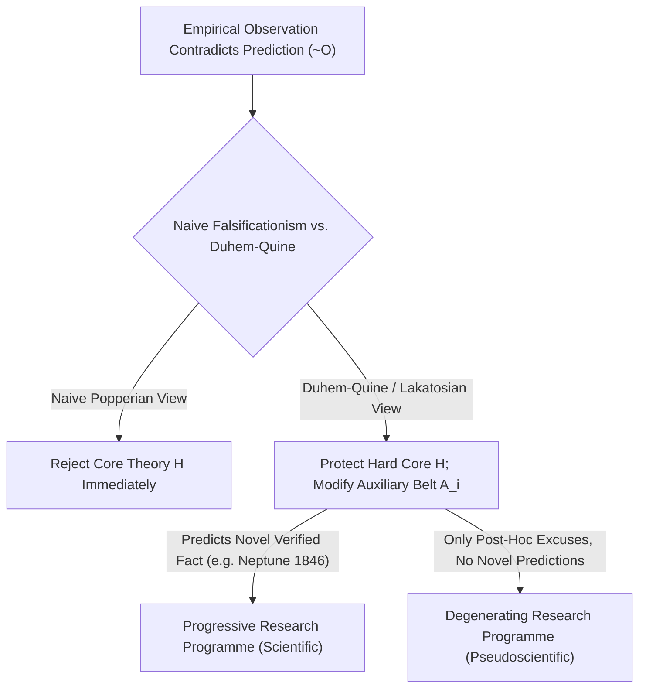
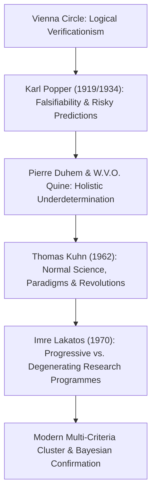

## Introducción: La epifanía vienesa de 1919 — El nacimiento del problema de la demarcación

En la vida cotidiana solemos equiparar la palabra «ciencia» con «verdad absoluta demostrada por los hechos». Sin embargo, numerosas doctrinas que reclaman para sí el estatus de ciencia —como la astrología, la homeopatía, la alquimia o las teorías conspirativas— presumen igualmente de acumular miles de «confirmaciones empíricas»: un astrólogo siempre encontrará en la carta astral una explicación para lo que te ocurrió ayer, y un conspiracionista interpretará incluso la ausencia total de pruebas como la demostración definitiva de lo bien oculta que está la conspiración. <strong>¿Dónde se traza entonces la frontera epistemológica exacta entre la ciencia empírica genuina y la pseudociencia?</strong> En filosofía de la ciencia, este interrogante fundamental se conoce como el <strong>problema de la demarcación (*Demarcation Problem* / *Abgrenzungsproblem*)</strong>.

A principios del siglo XX, el <strong>Círculo de Viena (positivismo lógico)</strong> liderado por Moritz Schlick y Rudolf Carnap intentó trazar esa línea mediante el <strong>criterio verificacionista del significado</strong>: un enunciado solo sería científicamente significativo si pudiera verificarse de forma concluyente mediante observaciones empíricas. Pero este criterio chocó de frente con el <strong>problema de la inducción de David Hume</strong>: toda ley científica es un enunciado universal de la forma $orall x\, P(x)$ («todos los cisnes son blancos» o «toda masa obedece a la gravitación universal»). ¡Ni siquiera mil millones de observaciones de cisnes blancos pueden demostrar deductivamente una ley universal sobre infinitos casos! Si exigiéramos verificación completa, hasta la física de Newton quedaría expulsada de la ciencia.

El 29 de mayo de 1919, durante un eclipse total de Sol en la isla de Príncipe, el astrónomo británico Arthur Eddington midió la deflexión de la luz estelar al rozar el limbo solar y confirmó la audaz predicción cuantitativa de la relatividad general de Albert Einstein ($1,75$ segundos de arco frente a los $0,875$ de Newton). En Viena, el joven de 17 años <strong>Karl Popper</strong> vivió aquel suceso como una revelación intelectual: comprendió que la grandeza de la teoría de Einstein no residía en acomodar hechos ya conocidos, sino en atreverse a formular una <strong>predicción arriesgada (*Risky Prediction*)</strong> que, de haber resultado falsa en el experimento, habría destruido la teoría entera sin excusas.

---

## 1. El giro copernicano de Karl Popper: La asimetría lógica entre verificación y falsación

En 1934, en *La lógica de la investigación científica* (*Logik der Forschung*), Popper propuso su célebre <strong>criterio de falsabilidad (o refutabilidad, *Falsifiability*)</strong>: lo que define a la ciencia no es ser infalible, sino todo lo contrario: <strong>ser susceptible de entrar en conflicto con la experiencia y ser refutada</strong>.
Este principio descansa en la <strong>asimetría lógica absoluta entre verificación y falsación</strong> en la lógica de predicados:
- Ninguna cantidad finita de observaciones favorables $O_1, O_2, \dots, O_n$ permite deducir lógicamente una teoría universal $T$ (inferir $T$ a partir de $T \implies O$ y $O$ es la falacia formal de *afirmación del consecuente*).
- En cambio, basta un <strong>único</strong> contraejemplo genuino $
eg O$ (como avistar un solo cisne negro en Australia) para que, mediante la regla deductiva rigurosa del <strong>Modus Tollens</strong>, de $T \implies O$ y $
eg O$ se deduzca con certeza absoluta $
eg T$ (la falsedad de la teoría $T$).

Por ello, Popper proclamó: una teoría es científica si y solo si prohíbe ciertos sucesos observables, es decir, si su conjunto de <strong>falsadores potenciales (*Potential Falsifiers*)</strong> no es vacío. La astrología es pseudociencia porque formula sus vaticinios con tal ambigüedad que cualquier suceso imaginable puede explicarse a posteriori: <strong>¡una teoría que lo explica todo pase lo que pase, en realidad no explica nada y su contenido empírico de información es cero!</strong> Para Popper, la ciencia avanza mediante un proceso evolutivo sin fin de <strong>conjeturas y refutaciones</strong>; las teorías que sobreviven a las pruebas más severas nunca quedan «demostradas como verdaderas», sino que alcanzan un alto grado de <strong>corroboración</strong>.

$$
\text{Modus Tollens:} \quad \frac{T \implies O, \quad \neg O}{\therefore \neg T}
$$

$$
\text{Duhem-Quine Holistic Conjunction:} \quad \big( H \land A_1 \land A_2 \land \dots \land A_n \land C_{\text{init}} \big) \implies O
$$

$$
\neg O \implies \neg H \lor \neg A_1 \lor \neg A_2 \lor \dots \lor \neg A_n \lor \neg C_{\text{init}}
$$

---

## 2. La crisis del falsacionismo ingenuo: La tesis de Duhem-Quine y el descubrimiento de Neptuno

Por impecable que fuera el criterio de Popper en el plano lógico, al contrastarlo con la historia real de la física surgió un obstáculo formidable: <strong>¡si los científicos hubieran aplicado al pie de la letra el falsacionismo ingenuo, todas las grandes teorías científicas habrían muerto en la cuna!</strong>

El físico francés Pierre Duhem (1906) y el filósofo estadounidense W.V.O. Quine (1951) formularon la célebre <strong>tesis de Duhem-Quine (subdeterminación holista)</strong>: en la práctica científica real, una hipótesis teórica central $H$ (como la ley de gravitación de Newton $F = G m_1 m_2 / r^2$) <strong>jamás puede por sí sola</strong> implicar una predicción observable $O$. Para calcular dónde estará un planeta mañana por la noche es indispensable conjugar $H$ con toda una red de <strong>hipótesis auxiliares (*Auxiliary Hypotheses*)</strong> $A_1, A_2, \dots, A_n$ (por ejemplo: «solo existen siete planetas en el sistema solar», «el espacio interplanetario carece de rozamiento», «la óptica del telescopio no introduce aberraciones») y condiciones iniciales $C_{	ext{init}}$.
Por consiguiente, cuando una observación contradice la predicción ($
eg O$), el Modus Tollens solo nos dice que la conjunción completa $(H \land A_1 \land \dots \land A_n \land C_{	ext{init}})$ es falsa. ¡La lógica pura <strong>no puede decirnos si el error reside en el núcleo teórico $H$ o en alguna de las hipótesis auxiliares $A_i$</strong>!

El episodio más luminoso de la historia de la ciencia es el <strong>descubrimiento del planeta Neptuno en 1846</strong>: a comienzos del siglo XIX, la órbita observada de Urano discrepaba gravemente de los cálculos newtonianos ($
eg O$). ¿Declararon los físicos refutada la gravitación de Newton? ¡En absoluto! El francés Urbain Le Verrier y el inglés John Couch Adams mantuvieron intacto el núcleo newtoniano $H$ y modificaron la hipótesis auxiliar $A_1$ postulando un octavo planeta desconocido más allá de Urano. El 23 de septiembre de 1846, en el observatorio de Berlín, Johann Gottfried Galle apuntó su telescopio hacia las coordenadas calculadas por Le Verrier y halló a <strong>Neptuno</strong> a menos de $1^\circ$ de distancia. ¡Una aparente refutación se transformó en el mayor triunfo de la mecánica de Newton! En cambio, cuando Le Verrier intentó explicar la precesión anómala del perihelio de Mercurio ($43''$ por siglo) postulando un planeta interior llamado «Vulcano», fracasó: aquella vez sí era necesario sustituir el núcleo newtoniano $H$ por la relatividad general de Einstein.

---

## 3. Los paradigmas de Kuhn, los programas de Lakatos y los modelos multicriterio actuales

Para salvar la racionalidad científica y explicar la historia real de la ciencia, la filosofía de la ciencia de la segunda mitad del siglo XX dio tres pasos decisivos:
1. <strong>*La estructura de las revoluciones científicas* de Thomas Kuhn (1962)</strong>: Kuhn mostró que durante los largos periodos de <strong>ciencia normal</strong>, los científicos no intentan refutar su <strong>paradigma</strong>, sino que se dedican a «resolver rompecabezas» (*puzzle-solving*). Las anomalías se archivan temporalmente; solo cuando su acumulación desata una <strong>crisis</strong> profunda y surge un paradigma alternativo se produce un <strong>cambio de paradigma (revolución científica)</strong>.
2. <strong>La *Metodología de los programas de investigación científica* de Imre Lakatos (MSRP, 1970)</strong>: Lakatos sintetizó brillantemente a Popper y Kuhn. La unidad de evaluación científica no es una hipótesis aislada, sino un <strong>programa de investigación</strong> histórico integrado por un <strong>núcleo firme (*Hard Core*)</strong> irrenunciable y un <strong>cinturón protector de hipótesis auxiliares (*Protective Belt*)</strong> que se modifica para absorber las anomalías. ¿Cómo distinguir entonces la ciencia de la pseudociencia? Lakatos responde: ¡depende de si los cambios en el cinturón protector son <strong>progresivos</strong> o <strong>degenerativos</strong>!
   - Un <strong>programa de investigación progresivo (ciencia genuina)</strong> modifica sus hipótesis auxiliares de modo que no solo explica las anomalías previas, sino que <strong>predice hechos nuevos e inesperados (*Novel Facts*)</strong> que resultan confirmados empíricamente (como el hallazgo de Neptuno).
   - Un <strong>programa de investigación degenerativo (pseudociencia)</strong> se limita a añadir parches a posteriori (<strong>excusas *ad hoc*</strong>) para salvar las apariencias sin predecir jamás un solo hecho nuevo verificable.
3. <strong>Parecidos de familia y desafíos contemporáneos</strong>: Tras demostrar Larry Laudan (1983) que no existe una única condición necesaria y suficiente, filósofos actuales como Massimo Pigliucci y Martin Mahner emplean <strong>modelos multicriterio de «parecidos de familia» (Wittgenstein)</strong> combinados con la <strong>teoría bayesiana de la confirmación</strong>. Ante la actual <strong>crisis de replicación</strong> ($p$-hacking, HARKing y *Registered Reports* en psicología y biomedicina) y los debates sobre la teoría de cuerdas o el multiverso, el legado de Popper y Lakatos sigue siendo la brújula indispensable de la integridad científica.

| Corriente filosófica | Criterio de demarcación | Respuesta ante una anomalía ($
eg O$) | Fortalezas y límites históricos |
| :--- | :--- | :--- | :--- |
| <strong>Positivismo lógico (Círculo de Viena)</strong> | <strong>Verificabilidad</strong>: reducción a enunciados observacionales | Las leyes universales son indemostrables por inducción | Excluye la metafísica, pero naufraga ante el problema de Hume |
| <strong>Falsacionismo ingenuo (Popper 1934)</strong> | <strong>Falsabilidad</strong>: falsadores potenciales y predicciones arriesgadas | Modus Tollens $
eg O \implies 
eg T$ refuta la teoría | Explica la asimetría lógica, pero choca con la tesis de Duhem-Quine |
| <strong>Historicismo y paradigmas (Kuhn 1962)</strong> | <strong>Resolución de rompecabezas dentro de un paradigma</strong> | La ciencia normal tolera anomalías hasta la crisis | Fiel a la historia real, pero expuesto al relativismo |
| <strong>Programas de investigación (Lakatos 1970)</strong> | <strong>Programa progresivo vs. degenerativo</strong> (*Novel Facts*) | Núcleo firme protegido; cinturón auxiliar ajustado | Distingue los hallazgos (Neptuno) de los parches *ad hoc* |
| <strong>Modelos multicriterio y bayesianismo</strong> | <strong>Clúster multicriterio + Factor de Bayes + Reproducibilidad</strong> | Actualización bayesiana y prerregistro contra $p$-hacking | Estándar en fallos judiciales (*Kitzmiller*) y ciencia abierta actual |

$$
P(H \mid E) = \frac{P(E \mid H)\,P(H)}{P(E \mid H)\,P(H) + P(E \mid \neg H)\,P(\neg H)}, \qquad \frac{P(H \mid E)}{P(\neg H \mid E)} = \text{BF}_{10}(E) \cdot \frac{P(H)}{P(\neg H)}
$$

$$
\text{Popper Corroboration:} \quad C(H, E) = \frac{P(E \mid H) - P(E)}{P(E \mid H) + P(E) - P(E \land H)}
$$
