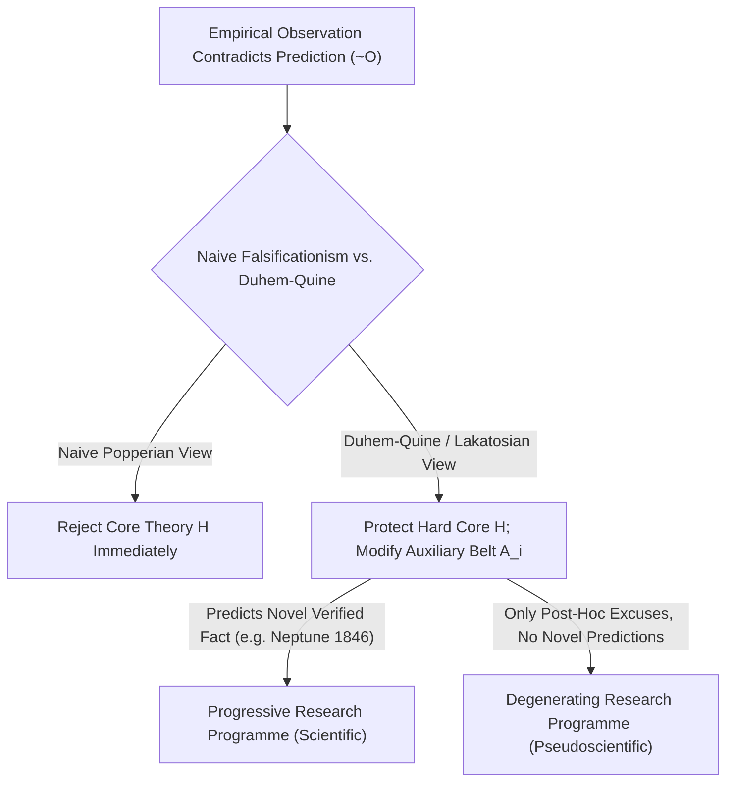
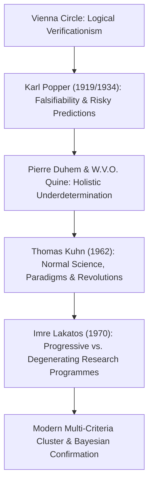

## Introduction : L'illumination viennoise de 1919 — La naissance du problème de la démarcation

Dans le langage courant, nous assimilons volontiers la « science » à un ensemble de « vérités absolues prouvées par les faits ». Pourtant, d'innombrables doctrines qui revendiquent le titre de science — comme l'astrologie, l'homéopathie, l'alchimie ou les théories du complot — se targuent elles aussi d'accumuler des milliers de « confirmations empiriques » : un astrologue trouvera toujours dans votre thème astral une explication à vos déboires de la veille, et un complotiste interprétera l'absence même de preuves comme la démonstration suprême de la perfection du camouflage. <strong>Où passe donc la frontière épistémologique exacte entre la véritable science empirique et la pseudoscience ?</strong> En philosophie des sciences, cette question fondamentale porte le nom de <strong>problème de la démarcation (*Demarcation Problem* / *Abgrenzungsproblem*)</strong>.

Au début du XXe siècle, le <strong>Cercle de Vienne (positivisme logique)</strong> de Moritz Schlick et Rudolf Carnap tenta de tracer cette frontière grâce au <strong>critère de vérifiabilité (Verificationism)</strong> : un énoncé n'aurait de sens scientifique que s'il peut être définitivement vérifié par l'observation empirique. Mais ce critère se fracassa rapidement sur le célèbre <strong>problème de l'induction de David Hume</strong> : toute loi de la nature est une proposition universelle de la forme $orall x\, P(x)$ (« tous les cygnes sont blancs » ou « tous les corps massifs obéissent à la gravitation universelle »). Or, même un milliard d'observations de cygnes blancs ne pourront jamais prouver déductivement une loi universelle portant sur une infinité de cas ! Si l'on exigeait une vérification complète, même la physique de Newton devrait être bannie de la science.

Le 29 mai 1919, lors d'une éclipse solaire totale sur l'île de Príncipe, l'astronome britannique Arthur Eddington mesura la déviation de la lumière des étoiles frôlant le Soleil et confirma la prédiction audacieuse de la relativité générale d'Albert Einstein ($1,75$ seconde d'arc, contre $0,875$ pour Newton). À Vienne, le jeune <strong>Karl Popper</strong>, alors âgé de 17 ans, vécut cet événement comme une révélation : il comprit que la grandeur de la théorie d'Einstein ne résidait pas dans sa capacité à expliquer après coup des faits connus, mais dans le courage de formuler une <strong>prédiction risquée (*Risky Prediction*)</strong> qui, si l'observation l'avait démentie, aurait immédiatement condamné la théorie tout entière !

---

## 1. Le renversement copernicien de Karl Popper : L'asymétrie logique entre vérification et réfutation

En 1934, dans *La Logique de la découverte scientifique* (*Logik der Forschung*), Popper proposa son célèbre <strong>critère de réfutabilité (ou falsifiabilité, *Falsifiability*)</strong> : ce qui fait la scientificité d'une théorie, ce n'est pas qu'elle soit infaillible, mais tout au contraire qu'elle soit <strong>exposée au risque d'être réfutée par l'expérience</strong> !
Ce critère repose sur l'<strong>asymétrie logique absolue entre vérification et réfutation</strong> en logique des prédicats :
- Aucune accumulation d'observations positives $O_1, O_2, \dots, O_n$ ne permet de déduire logiquement une loi universelle $T$ (conclure $T$ à partir de $T \implies O$ et $O$ constitue le sophisme formel de l'*affirmation du conséquent*).
- En revanche, un <strong>seul</strong> contre-exemple avéré $
eg O$ (par exemple l'observation d'un unique cygne noir en Australie) suffit, en vertu de la règle déductive implacable du <strong>Modus Tollens</strong>, à déduire de $T \implies O$ et $
eg O$ la conclusion certaine $
eg T$ (la théorie $T$ est fausse) !

Popper énonça donc : une théorie est scientifique si et seulement si elle interdit certains événements observables, autrement dit si la classe de ses <strong>réfutateurs potentiels (*Potential Falsifiers*)</strong> n'est pas vide. Si l'astrologie est une pseudoscience, c'est précisément parce qu'elle formule ses prédictions de manière si vague que n'importe quel événement peut être accommodé après coup — <strong>une théorie qui explique tout ce qui pourrait arriver n'explique en réalité strictement rien ; son contenu informatif empirique est nul !</strong> Pour Popper, la science progresse par une suite ininterrompue de <strong>conjectures et réfutations</strong> ; une théorie qui survit aux tests les plus sévères n'est jamais « prouvée vraie », elle acquiert seulement un haut degré de <strong>corroboration</strong>.

$$
\text{Modus Tollens:} \quad \frac{T \implies O, \quad \neg O}{\therefore \neg T}
$$

$$
\text{Duhem-Quine Holistic Conjunction:} \quad \big( H \land A_1 \land A_2 \land \dots \land A_n \land C_{\text{init}} \big) \implies O
$$

$$
\neg O \implies \neg H \lor \neg A_1 \lor \neg A_2 \lor \dots \lor \neg A_n \lor \neg C_{\text{init}}
$$

---

## 2. La crise du falsificationnisme naïf : La thèse de Duhem-Quine et la découverte de Neptune

Aussi élégant que fût le critère de Popper sur le plan logique, sa confrontation avec l'histoire réelle de la physique révéla une difficulté majeure : <strong>si les scientifiques avaient appliqué à la lettre le falsificationnisme naïf, toutes les grandes théories scientifiques auraient été tuées dans l'œuf !</strong>

Le physicien français Pierre Duhem (1906) et le philosophe américain W.V.O. Quine (1951) formulèrent la célèbre <strong>thèse de Duhem-Quine (sous-détermination holiste)</strong> : dans la pratique scientifique réelle, une hypothèse théorique centrale $H$ (comme la loi de la gravitation de Newton $F = G m_1 m_2 / r^2$) ne peut <strong>jamais à elle seule</strong> engendrer une prédiction observable $O$ ! Pour calculer la position d'une planète demain soir, il faut impérativement adjoindre à $H$ tout un faisceau d'<strong>hypothèses auxiliaires (*Auxiliary Hypotheses*)</strong> $A_1, A_2, \dots, A_n$ (par exemple : « le système solaire ne comporte que sept planètes », « l'espace interplanétaire est vide », « le télescope est dépourvu d'aberration optique ») ainsi que des conditions initiales $C_{	ext{init}}$.
Par conséquent, lorsqu'une observation contredit la prédiction ($
eg O$), le Modus Tollens nous apprend uniquement que la conjonction globale $(H \land A_1 \land \dots \land A_n \land C_{	ext{init}})$ est fausse ! La logique pure est <strong>totalement incapable de nous dire si la faute incombe à la théorie centrale $H$ ou à l'une des hypothèses auxiliaires $A_i$</strong> !

L'épisode le plus célèbre de l'histoire des sciences est la <strong>découverte de la planète Neptune en 1846</strong> : au début du XIXe siècle, l'orbite observée d'Uranus présentait de graves écarts ($
eg O$) par rapport aux calculs newtoniens. Les astronomes ont-ils aussitôt déclaré la gravitation de Newton réfutée ? Absolument pas ! Le Français Urbain Le Verrier et l'Anglais John Couch Adams conservèrent intacte la loi de Newton $H$ et modifièrent l'hypothèse auxiliaire $A_1$ en postulant l'existence d'une huitième planète inconnue au-delà d'Uranus. Le 23 septembre 1846, à l'observatoire de Berlin, Johann Gottfried Galle pointa sa lunette vers la position calculée par Le Verrier et découvrit <strong>Neptune</strong> à moins de $1^\circ$ ! Ce qui ressemblait à une réfutation de Newton devint son plus éclatant triomphe. À l'inverse, lorsque Le Verrier tenta d'expliquer l'avance anormale du périhélie de Mercure ($43''$ par siècle) par une planète hypothétique « Vulcain », ce fut un échec — il fallut cette fois abandonner le cœur newtonien $H$ au profit de la relativité générale d'Einstein.

---

## 3. Les paradigmes de Kuhn, les programmes de Lakatos et les critères multidimensionnels modernes

Pour sauver la rationalité scientifique tout en rendant justice à l'histoire réelle des sciences, la philosophie des sciences de la seconde moitié du XXe siècle a accompli trois avancées décisives :
1. <strong>*La Structure des révolutions scientifiques* de Thomas Kuhn (1962)</strong> : Kuhn montra que durant les longues périodes de <strong>science normale</strong>, les chercheurs ne cherchent nullement à réfuter leur <strong>paradigme</strong>, mais s'attachent à « résoudre des énigmes » (*puzzle-solving*). Les anomalies sont mises de côté ; ce n'est que lorsque leur accumulation provoque une <strong>crise</strong> profonde et qu'un paradigme rival émerge que survient un <strong>changement de paradigme (révolution scientifique)</strong>.
2. <strong>La *Méthodologie des programmes de recherche scientifiques* d'Imre Lakatos (MSRP, 1970)</strong> : Lakatos réalisa une synthèse magistrale entre Popper et Kuhn. L'unité d'évaluation scientifique n'est pas une hypothèse isolée, mais un <strong>programme de recherche</strong> historique composé d'un <strong>noyau dur (*Hard Core*)</strong> intouchable et d'une <strong>ceinture protectrice d'hypothèses auxiliaires (*Protective Belt*)</strong> constamment réajustée pour encaisser les chocs empiriques. Comment dès lors distinguer la science de la pseudoscience ? Tout dépend, répond Lakatos, du caractère <strong>progressif</strong> ou <strong>dégénératif</strong> de ces réajustements !
   - Un <strong>programme de recherche progressif (science authentique)</strong> modifie sa ceinture protectrice de façon à expliquer les anomalies anciennes tout en <strong>prédisant des faits nouveaux inédits (*Novel Facts*)</strong> confirmés par l'expérience (comme la découverte de Neptune).
   - Un <strong>programme de recherche dégénératif (pseudoscience)</strong> se contente de rafistolages après coup (<strong>modifications *ad hoc*</strong>) pour sauver les apparences, sans jamais produire la moindre prédiction nouvelle vérifiable !
3. <strong>Ressemblance de famille et défis contemporains</strong> : Après que Larry Laudan (1983) eut montré qu'aucun critère unique nécessaire et suffisant ne suffit, des philosophes contemporains comme Massimo Pigliucci et Martin Mahner ont développé des <strong>modèles multicritères par « airs de famille » (Wittgenstein)</strong> couplés à la <strong>théorie bayésienne de la confirmation</strong>. Face à la <strong>crise de la reproductibilité</strong> ($p$-hacking, HARKing et *Registered Reports* en psychologie et biomédecine) et aux débats sur la théorie des cordes ou le multivers, l'héritage de Popper et de Lakatos demeure le rempart indispensable de l'intégrité scientifique.

| Courant philosophique | Critère de démarcation | Réponse face à une anomalie ($
eg O$) | Forces & Limites historiques |
| :--- | :--- | :--- | :--- |
| <strong>Positivisme logique (Cercle de Vienne)</strong> | <strong>Vérifiabilité</strong> : réduction aux énoncés d'observation | Lois universelles impossibles à prouver par induction | Élimine la métaphysique, mais échoue face au problème de Hume |
| <strong>Falsificationnisme naïf (Popper 1934)</strong> | <strong>Réfutabilité</strong> : réfutateurs potentiels et prédictions risquées | Modus Tollens $
eg O \implies 
eg T$ réfute la théorie | Révèle l'asymétrie logique, mais bute sur la thèse de Duhem-Quine |
| <strong>Historicisme & Paradigmes (Kuhn 1962)</strong> | <strong>Résolution d'énigmes au sein d'un paradigme</strong> | La science normale tolère les anomalies jusqu'à la crise | Fidèle à l'histoire des sciences, mais exposé au relativisme |
| <strong>Programmes de recherche (Lakatos 1970)</strong> | <strong>Programme progressif vs. dégénératif</strong> (*Novel Facts*) | Noyau dur protégé ; ceinture auxiliaire ajustée | Distingue les découvertes (Neptune) des excuses *ad hoc* |
| <strong>Modèles multicritères & Bayésianisme</strong> | <strong>Cluster multicritère + Facteur de Bayes + Reproductibilité</strong> | Mise à jour bayésienne et pré-enregistrement | Standard dans les procès (*Kitzmiller*) et la science ouverte moderne |

$$
P(H \mid E) = \frac{P(E \mid H)\,P(H)}{P(E \mid H)\,P(H) + P(E \mid \neg H)\,P(\neg H)}, \qquad \frac{P(H \mid E)}{P(\neg H \mid E)} = \text{BF}_{10}(E) \cdot \frac{P(H)}{P(\neg H)}
$$

$$
\text{Popper Corroboration:} \quad C(H, E) = \frac{P(E \mid H) - P(E)}{P(E \mid H) + P(E) - P(E \land H)}
$$
