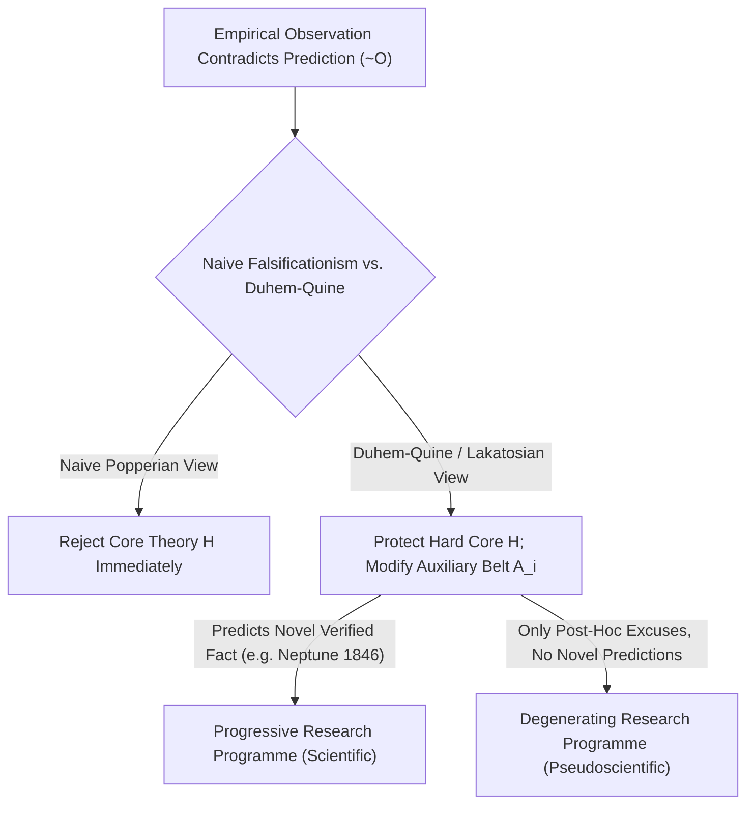
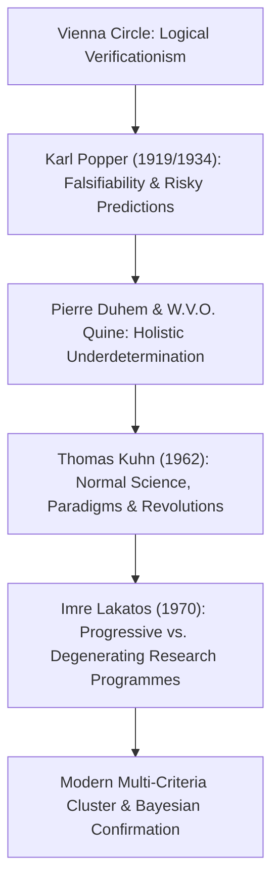

## प्रस्तावना: 1919 का वियना बोध — सीमांकन समस्या (Demarcation Problem) का जन्म

दैनिक जीवन में हम प्रायः ‘विज्ञान’ शब्द को ‘तथ्यों द्वारा सिद्ध परम सत्य’ का पर्याय मान लेते हैं। किंतु ज्योतिष, होम्योपैथी, प्राचीन कीमियागिरी या षड्यंत्र सिद्धांतों जैसी अनेक प्रणालियाँ भी स्वयं को ‘वैज्ञानिक’ कहती हैं और हजारों ‘आनुभविक प्रमाण’ प्रस्तुत करने का दावा करती हैं: एक ज्योतिषी आपकी कल की दुर्घटना की व्याख्या आपकी कुंडली से तुरंत कर देगा, और एक षड्यंत्रकारी सबूतों के पूर्ण अभाव को भी इस बात का सबसे बड़ा सबूत बता देगा कि षड्यंत्र को कितनी चालाकी से छिपाया गया है! <strong>तब वास्तविक अनुभवजन्य विज्ञान (Empirical Science) और छद्म-विज्ञान (Pseudoscience) के बीच की सटीक ज्ञानमीमांसीय सीमा (boundary) आखिर कहाँ है?</strong> विज्ञान के दर्शन में इस मूलभूत प्रश्न को <strong>सीमांकन समस्या (The Demarcation Problem / *Abgrenzungsproblem*)</strong> कहा जाता है।

20वीं सदी की शुरुआत में मोरित्ज़ श्लिक और रुडोल्फ कारनाप के नेतृत्व वाले <strong>वियना सर्कल (तार्किक प्रत्यक्षवाद / Logical Positivism)</strong> ने <strong>सत्यापनीयता सिद्धांत (Verificationism)</strong> के माध्यम से यह रेखा खींचने का प्रयास किया: कोई कथन तभी वैज्ञानिक रूप से सार्थक है जब उसे इंद्रियानुभव और प्रेक्षण द्वारा अंतिम रूप से सत्य सिद्ध (*सत्यापित*) किया जा सके। किंतु यह कसौटी शीघ्र ही 18वीं सदी के दार्शनिक डेविड ह्यूम की <strong>आगमन की समस्या (Problem of Induction)</strong> से टकराकर चूर-चूर हो गई: प्रत्येक वैज्ञानिक नियम $orall x\, P(x)$ के रूप का एक सार्वभौमिक कथन होता है (“सभी हंस सफेद होते हैं” या “सभी द्रव्यमान गुरुत्वाकर्षण के नियम का पालन करते हैं”)। भले ही हम एक अरब सफेद हंस देख लें, परिमित प्रेक्षण कभी भी अनंत मामलों वाले सार्वभौमिक नियम को निगमनात्मक रूप से सिद्ध नहीं कर सकते! यदि पूर्ण सत्यापन को शर्त माना जाए, तो न्यूटन के भौतिकी नियमों को भी विज्ञान से बाहर करना पड़ेगा।

29 मई 1919 को प्रिंसिपे द्वीप पर पूर्ण सूर्यग्रहण के दौरान ब्रिटिश खगोलशास्त्री आर्थर एडिंगटन ने सूर्य के किनारे से गुजरने वाले तारों के प्रकाश के झुकाव को मापा और अल्बर्ट आइंस्टीन के सामान्य सापेक्षता सिद्धांत की साहसिक मात्रात्मक भविष्यवाणी ($1.75$ आर्कसेकंड, जबकि न्यूटन का सिद्धांत $0.875$ देता था) की पुष्टि की। वियना में 17 वर्षीय युवा <strong>कार्ल पॉपर (Karl Popper)</strong> के लिए यह घटना एक बौद्धिक क्रांति थी: उन्होंने समझा कि आइंस्टीन के सिद्धांत की महानता ज्ञात तथ्यों की व्याख्या करने में नहीं, बल्कि एक ऐसी <strong>जोखिम भरी भविष्यवाणी (Risky Prediction)</strong> करने के साहस में थी जो यदि प्रेक्षण में गलत निकलती, तो पूरा सिद्धांत तुरंत ध्वस्त हो जाता!

---

## 1. कार्ल पॉपर की कोपरनिकसीय क्रांति: सत्यापन और मिथ्याकरण की तार्किक असममिति

1934 में अपनी प्रसिद्ध कृति *वैज्ञानिक खोज का तर्क* (*Logik der Forschung*) में पॉपर ने अपनी ऐतिहासिक <strong>मिथ्यापनीयता कसौटी (Falsifiability Criterion / खंडनीयता)</strong> प्रस्तुत की: कोई सिद्धांत वैज्ञानिक इसलिए नहीं होता कि वह कभी गलत नहीं हो सकता, बल्कि ठीक इसके विपरीत, इसलिए होता है क्योंकि <strong>अनुभव द्वारा उसका खंडन (मिथ्याकरण) किया जा सकता है</strong>!
यह सिद्धांत विधेय तर्कशास्त्र में <strong>सत्यापन (Verification) और मिथ्याकरण (Falsification) के बीच की पूर्ण तार्किक असममिति (Logical Asymmetry)</strong> पर आधारित है:
- अनुकूल प्रेक्षणों $O_1, O_2, \dots, O_n$ की कोई भी परिमित संख्या सार्वभौमिक सिद्धांत $T$ को निगमनात्मक रूप से सिद्ध नहीं कर सकती ($T \implies O$ और $O$ से $T$ का निष्कर्ष निकालना *फलानुमान दोष* है)।
- इसके विपरीत, केवल <strong>एक</strong> प्रामाणिक प्रति-उदाहरण $
eg O$ (जैसे ऑस्ट्रेलिया में एक काले हंस का दिखना) निगमनात्मक तर्क के अचूक नियम <strong>मोडस टोलेंस (Modus Tollens)</strong> द्वारा $T \implies O$ और $
eg O$ से शत-प्रतिशत निश्चितता के साथ $
eg T$ (सिद्धांत $T$ का असत्य होना) सिद्ध कर देता है!

अतः पॉपर ने घोषणा की: कोई सिद्धांत वैज्ञानिक तभी है जब वह कुछ प्रेक्षणीय घटनाओं के घटित होने को निषिद्ध करता है, अर्थात उसके <strong>संभावित मिथ्याकारकों (Potential Falsifiers)</strong> का समुच्चय रिक्त न हो। ज्योतिष छद्म-विज्ञान इसलिए है क्योंकि वह अपनी भविष्यवाणियाँ इतनी अस्पष्ट रखता है कि दुनिया में कुछ भी घटित हो, उसे बाद में सही ठहराया जा सके — <strong>जो सिद्धांत हर संभावित परिणाम की व्याख्या कर सकता है, वह वास्तव में कुछ भी व्याख्यायित नहीं करता और उसकी आनुभविक सूचना मात्रा शून्य होती है!</strong> पॉपर के अनुसार विज्ञान <strong>अनुमान और खंडन (Conjectures and Refutations)</strong> की अनंत विकासवादी प्रक्रिया से आगे बढ़ता है; कठोरतम परीक्षणों में टिके रहने वाले सिद्धांत कभी ‘सिद्ध सत्य’ नहीं बनते, बल्कि उच्च <strong>संम्पूष्टि (Corroboration)</strong> प्राप्त करते हैं।

$$
\text{Modus Tollens:} \quad \frac{T \implies O, \quad \neg O}{\therefore \neg T}
$$

$$
\text{Duhem-Quine Holistic Conjunction:} \quad \big( H \land A_1 \land A_2 \land \dots \land A_n \land C_{\text{init}} \big) \implies O
$$

$$
\neg O \implies \neg H \lor \neg A_1 \lor \neg A_2 \lor \dots \lor \neg A_n \lor \neg C_{\text{init}}
$$

---

## 2. सरल मिथ्याकरणवाद का संकट: ड्यूहेम-क्वाइन थीसिस और नेपच्यून (वरुण) ग्रह की खोज

तार्किक रूप से पॉपर की कसौटी जितनी आकर्षक थी, जब विज्ञान के इतिहासकारों ने इसे भौतिकी के वास्तविक इतिहास पर परखा तो एक गंभीर समस्या सामने आई: <strong>यदि वैज्ञानिकों ने सचमुच सरल मिथ्याकरणवाद (Naive Falsificationism) का अक्षरशः पालन किया होता, तो विज्ञान के सभी महान सिद्धांत अपने शैशवकाल में ही त्याग दिए गए होते!</strong>

फ्रांसीसी भौतिक विज्ञानी पियरे ड्यूहेम (1906) और अमेरिकी दार्शनिक विलार्ड वैन ओरमैन क्वाइन (1951) ने प्रसिद्ध <strong>ड्यूहेम-क्वाइन थीसिस (Duhem-Quine Thesis / समग्रतावादी अनिर्धारण)</strong> प्रतिपादित किया: वास्तविक वैज्ञानिक व्यवहार में कोई भी केंद्रीय सैद्धांतिक परिकल्पना $H$ (जैसे न्यूटन का गुरुत्वाकर्षण नियम $F = G m_1 m_2 / r^2$) <strong>अकेले अपने दम पर</strong> कोई प्रेक्षणीय भविष्यवाणी $O$ उत्पन्न नहीं कर सकती! कल रात किसी ग्रह की स्थिति की गणना करने के लिए $H$ के साथ अनेक <strong>सहायक परिकल्पनाओं (Auxiliary Hypotheses)</strong> $A_1, A_2, \dots, A_n$ (जैसे: “सौरमंडल में केवल सात ग्रह हैं”, “अंतरग्रहीय अंतरिक्ष निर्वात है”, “दूरबीन में कोई प्रकाशीय दोष नहीं है”) तथा प्रारंभिक शर्तों $C_{	ext{init}}$ को जोड़ना अनिवार्य है।
इसलिए जब कोई प्रेक्षण भविष्यवाणी का खंडन करता है ($
eg O$), तो मोडस टोलेंस हमें केवल यह बताता है कि संपूर्ण संयोजन $(H \land A_1 \land \dots \land A_n \land C_{	ext{init}})$ असत्य है! शुद्ध तर्कशास्त्र यह <strong>कभी नहीं बता सकता कि गलती मुख्य सिद्धांत $H$ में है या किसी सहायक परिकल्पना $A_i$ में</strong>!

विज्ञान के इतिहास का सबसे शानदार उदाहरण <strong>1846 में नेपच्यून (वरुण) ग्रह की खोज</strong> है: 19वीं सदी की शुरुआत में यूरेनस (अरुण) की वास्तविक कक्षा न्यूटन के यांत्रिकी की गणनाओं से गंभीर रूप से भटक रही थी ($
eg O$)। क्या तब भौतिकविदों ने न्यूटन के गुरुत्वाकर्षण नियम को मिथ्या घोषित कर दिया? बिल्कुल नहीं! फ्रांस के अर्बेन ले वेरिए (Urbain Le Verrier) और इंग्लैंड के जॉन काउच एडम्स ने न्यूटन के मूल नियम $H$ को अटल माना और इसके बजाय सहायक परिकल्पना $A_1$ में संशोधन करते हुए यूरेनस के परे एक आठवें अज्ञात ग्रह के अस्तित्व की कल्पना की और उसकी स्थिति की गणना की। 23 सितंबर 1846 को बर्लिन वेधशाला में जोहान गॉटफ्रीड गाले ने ले वेरिए द्वारा गणना किए गए स्थान पर दूरबीन घुमाई और $1^\circ$ के भीतर <strong>नेपच्यून</strong> को खोज निकाला! जो संकट न्यूटन के सिद्धांत का खंडन लग रहा था, वह उसकी सबसे बड़ी विजय बन गया। इसके विपरीत, जब बाद में ले वेरिए ने बुध के उपसौर (perihelion) के $43''$ प्रति शताब्दी के विचलन को समझाने के लिए ‘वल्कन (Vulcan)’ नामक काल्पनिक ग्रह की परिकल्पना की, तो वे असफल रहे — इस बार वास्तव में न्यूटन के मूल सिद्धांत $H$ को आइंस्टीन के सामान्य सापेक्षता सिद्धांत से बदलना पड़ा।

---

## 3. कुह्न के प्रतिमान (Paradigms), लाकातोस के शोध कार्यक्रम और आधुनिक बहु-मानदंड मॉडल

वैज्ञानिक तार्किकता की रक्षा करने और वास्तविक विज्ञान के इतिहास को समझाने के लिए 20वीं सदी के उत्तरार्ध में विज्ञान के दर्शन ने तीन निर्णायक कदम उठाए:
1. <strong>थॉमस कुह्न (Thomas Kuhn) की *वैज्ञानिक क्रांतियों की संरचना* (1962)</strong>: कुह्न ने दिखाया कि <strong>सामान्य विज्ञान (Normal Science)</strong> के लंबे कालखंडों में वैज्ञानिक अपने <strong>प्रतिमान (Paradigm)</strong> को गलत सिद्ध करने की कोशिश नहीं करते, बल्कि उसके भीतर ‘पहेली सुलझाने’ (*puzzle-solving*) का कार्य करते हैं। विसंगतियों (anomalies) को तब तक अलग रखा जाता है जब तक कि उनका संचय एक गहरा <strong>संकट (Crisis)</strong> न पैदा कर दे और एक नए प्रतिमान के उदय के साथ <strong>प्रतिमान परिवर्तन (Paradigm Shift / वैज्ञानिक क्रांति)</strong> न हो जाए।
2. <strong>इमरे लाकातोस (Imre Lakatos) की *वैज्ञानिक शोध कार्यक्रमों की कार्यप्रणाली* (MSRP, 1970)</strong>: लाकातोस ने पॉपर और कुह्न का अद्भुत संश्लेषण किया। वैज्ञानिक मूल्यांकन की इकाई कोई अकेला कथन नहीं, बल्कि समय के साथ विकसित होने वाला <strong>शोध कार्यक्रम (Research Programme)</strong> है। इसके दो भाग होते हैं: एक अटल <strong>कठोर क्रोड (Hard Core)</strong> और उसके चारों ओर <strong>सहायक परिकल्पनाओं की सुरक्षा पट्टी (Protective Belt)</strong> जो विसंगतियों के प्रहार झेलने के लिए संशोधित होती रहती है। तब विज्ञान और छद्म-विज्ञान में अंतर कैसे करें? लाकातोस का उत्तर है: यह इस पर निर्भर करता है कि सुरक्षा पट्टी में किए गए संशोधन <strong>प्रगतिशील (Progressive)</strong> हैं या <strong>अपकर्षी/पतनशील (Degenerating)</strong>!
   - एक <strong>प्रगतिशील शोध कार्यक्रम (सच्चा विज्ञान)</strong> अपनी सुरक्षा पट्टी को इस प्रकार संशोधित करता है कि वह न केवल पुरानी विसंगतियों को समझाता है, बल्कि <strong>बिल्कुल नए और अप्रत्याशित तथ्यों (Novel Facts) की भविष्यवाणी</strong> करता है जिनकी पुष्टि प्रयोगों से होती है (जैसे नेपच्यून की खोज)।
   - एक <strong>अपकर्षी शोध कार्यक्रम (छद्म-विज्ञान)</strong> केवल घटना के बाद अपनी लाज बचाने के लिए <strong>तदर्थ बहानेबाजी (Ad hoc modifications)</strong> करता है, किंतु कभी कोई नई परीक्षणीय भविष्यवाणी नहीं कर पाता!
3. <strong>पारिवारिक समानता और आधुनिक चुनौतियाँ</strong>: लैरी लाउडन (1983) के बाद मासिमो पिग्लिउची और मार्टिन महनर जैसे आधुनिक दार्शनिक विट्गेन्स्टाइन के <strong>‘पारिवारिक समानता’ (Family Resemblance) आधारित बहु-मानदंड क्लस्टर मॉडल</strong> और <strong>बेयसियन पुष्टिकरण सिद्धांत</strong> का उपयोग करते हैं। आज मनोविज्ञान और चिकित्सा में <strong>पुनरुत्पादनीयता संकट (Replication Crisis, $p$-hacking और पूर्व-पंजीकरण Registered Reports)</strong> तथा स्ट्रिंग थ्योरी और मल्टीवर्स पर चल रही बहसों के बीच, पॉपर और लाकातोस की विरासत वैज्ञानिक सत्यनिष्ठा की सबसे मजबूत ढाल बनी हुई है।

| दार्शनिक धारा / विद्वान | सीमांकन कसौटी (Demarcation Criterion) | विसंगति ($
eg O$) के प्रति प्रतिक्रिया | मुख्य शक्तियाँ और ऐतिहासिक सीमाएँ |
| :--- | :--- | :--- | :--- |
| <strong>तार्किक प्रत्यक्षवाद (वियना सर्कल)</strong> | <strong>सत्यापनीयता</strong>: प्रेक्षण कथनों में अपचयन | सार्वभौमिक नियमों का आगमनात्मक प्रमाण असंभव | तत्वमीमांसा को हटाया, पर ह्यूम की आगमन समस्या से विफल |
| <strong>सरल मिथ्याकरणवाद (पॉपर 1934)</strong> | <strong>मिथ्यापनीयता</strong>: संभावित मिथ्याकारक व जोखिम भरी भविष्यवाणी | Modus Tollens $
eg O \implies 
eg T$ से सिद्धांत तुरंत निरस्त | तार्किक असममिति स्पष्ट की, पर ड्यूहेम-क्वाइन थीसिस से टकराया |
| <strong>ऐतिहासिकता व प्रतिमान (कुह्न 1962)</strong> | <strong>प्रतिमान के भीतर पहेली-समाधान क्षमता</strong> | सामान्य विज्ञान संकट आने तक विसंगति सहता है | वास्तविक इतिहास के अनुरूप, किंतु सापेक्षवाद का खतरा |
| <strong>शोध कार्यक्रम (लाकातोस 1970)</strong> | <strong>प्रगतिशील बनाम अपकर्षी कार्यक्रम</strong> (*Novel Facts*) | कठोर क्रोड सुरक्षित; सुरक्षा पट्टी में संशोधन | वैज्ञानिक खोज (नेपच्यून) और *Ad hoc* बहानों में सटीक भेद |
| <strong>आधुनिक क्लस्टर व बेयसियन मॉडल</strong> | <strong>बहु-मानदंड प्रोफाइल + बेयस गुणक + पुनरुत्पादनीयता</strong> | बेयसियन अद्यतन और $p$-hacking के विरुद्ध पूर्व-पंजीकरण | न्यायालयीन निर्णयों (*Kitzmiller*) व आधुनिक खुले विज्ञान का मानक |

$$
P(H \mid E) = \frac{P(E \mid H)\,P(H)}{P(E \mid H)\,P(H) + P(E \mid \neg H)\,P(\neg H)}, \qquad \frac{P(H \mid E)}{P(\neg H \mid E)} = \text{BF}_{10}(E) \cdot \frac{P(H)}{P(\neg H)}
$$

$$
\text{Popper Corroboration:} \quad C(H, E) = \frac{P(E \mid H) - P(E)}{P(E \mid H) + P(E) - P(E \land H)}
$$
