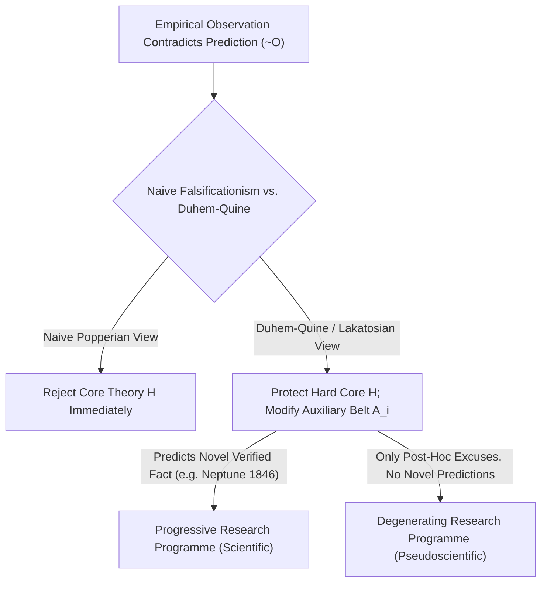
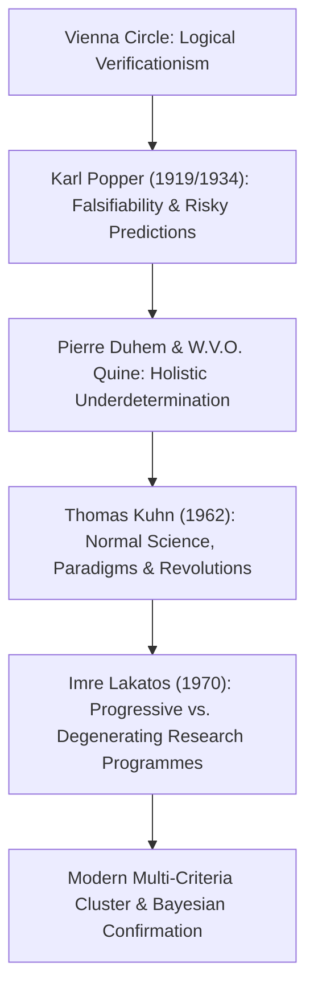

## Pendahuluan: Pencerahan Wina 1919 — Lahirnya Masalah Demarkasi

Dalam kehidupan sehari-hari, kita sering menyamakan kata “sains” dengan “kebenaran mutlak yang telah dibuktikan oleh fakta”. Namun, banyak ajaran yang mengklaim dirinya ilmiah — seperti astrologi, homeopati, alkimia, atau teori konspirasi — juga membanggakan ribuan “bukti konfirmasi empiris”: seorang astrolog selalu bisa menemukan penjelasan di peta bintang atas kesialan Anda kemarin, dan penganut teori konspirasi bahkan menafsirkan ketiadaan bukti sama sekali sebagai bukti paling sahih betapa rapinya konspirasi tersebut disembunyikan. <strong>Lalu, di manakah batas epistemologis yang tegas antara sains empiris sejati dan pseudosains (sains semu)?</strong> Dalam filsafat sains, pertanyaan mendasar ini dikenal sebagai <strong>masalah demarkasi (*Demarcation Problem* / *Abgrenzungsproblem*)</strong>.

Pada awal abad ke-20, <strong>Lingkaran Wina (Positivisme Logis)</strong> yang dipimpin Moritz Schlick dan Rudolf Carnap mencoba menarik garis batas ini melalui <strong>prinsip verifikasionisme</strong>: suatu pernyataan hanya memiliki makna ilmiah jika kebenarannya dapat dibuktikan (*diverifikasi*) secara tuntas melalui pengamatan indrawi. Namun kriteria ini segera membentur <strong>masalah induksi David Hume</strong>: setiap hukum alam adalah pernyataan universal berbentuk $orall x\, P(x)$ (“semua angsa berwarna putih” atau “semua benda bermassa mematuhi hukum gravitasi universal”). Bahkan satu miliar pengamatan angsa putih tidak akan pernah bisa membuktikan secara deduktif hukum universal untuk kasus tak-hingga! Jika verifikasi penuh dijadikan syarat, mekanika Newton sekalipun harus didepak dari sains.

Pada 29 Mei 1919, saat gerhana matahari total di Pulau Príncipe, astronom Inggris Arthur Eddington mengukur pembelokan cahaya bintang di tepi Matahari dan mengonfirmasi prediksi kuantitatif berani dari relativitas umum Albert Einstein ($1,75$ detik busur, dibandingkan $0,875$ menurut Newton). Di Wina, pemuda berusia 17 tahun <strong>Karl Popper</strong> mengalami peristiwa ini sebagai pencerahan intelektual: ia menyadari bahwa kehebatan teori Einstein bukan terletak pada kemampuannya menjelaskan fakta lama, melainkan pada keberaniannya mengajukan <strong>prediksi berisiko (*Risky Prediction*)</strong> yang jika meleset dalam pengamatan akan langsung menghancurkan seluruh teori tersebut!

---

## 1. Revolusi Kopernikan Karl Popper: Asimetri Logis antara Verifikasi dan Falsifikasi

Pada tahun 1934, dalam bukunya *Logik der Forschung* (*The Logic of Scientific Discovery*), Popper mengajukan <strong>kriteria falsifiabilitas (keterbantahan, *Falsifiability*)</strong> yang terkenal: apa yang membuat sebuah teori bersifat ilmiah bukanlah karena ia tak mungkin salah, melainkan justru sebaliknya: <strong>karena ia membuka diri untuk disangkal oleh pengalaman empiris</strong>!
Prinsip ini berakar pada <strong>asimetri logis mutlak antara verifikasi dan falsifikasi</strong> dalam logika predikat:
- Sebanyak apa pun pengamatan positif $O_1, O_2, \dots, O_n$ dikumpulkan, kita tidak pernah bisa menarik kesimpulan deduktif bahwa teori universal $T$ benar (menyimpulkan $T$ dari $T \implies O$ dan $O$ adalah sesat pikir formal *afirmasi konsekuen*).
- Sebaliknya, cukup <strong>satu saja</strong> contoh penyangkal $
eg O$ yang sahih (misalnya ditemukannya seekor angsa hitam di Australia), maka melalui kaidah deduktif <strong>Modus Tollens</strong> yang tak terbantahkan, dari $T \implies O$ dan $
eg O$ kita dapat menyimpulkan $
eg T$ (teori $T$ salah) secara pasti!

Oleh karena itu, Popper menyatakan: sebuah teori bersifat ilmiah jika dan hanya jika ia melarang terjadinya peristiwa teramati tertentu, yakni himpunan <strong>pemfalsifikasi potensialnya (*Potential Falsifiers*)</strong> tidak kosong. Astrologi adalah pseudosains karena merumuskan ramalannya secara begitu kabur sehingga peristiwa apa pun yang terjadi dapat dijelaskan setelah kejadian — <strong>teori yang bisa menjelaskan segala kemungkinan hasil sejatinya tidak menjelaskan apa-apa, dan kandungan informasi empirisnya nol!</strong> Bagi Popper, sains bergerak maju melalui proses evolusi tanpa akhir berupa <strong>dugaan dan sanggahan (*Conjectures and Refutations*)</strong>; teori yang bertahan dari ujian paling keras tidak pernah “terbukti benar”, melainkan memperoleh derajat <strong>koroborasi (pengukuhan)</strong> yang tinggi.

$$
\text{Modus Tollens:} \quad \frac{T \implies O, \quad \neg O}{\therefore \neg T}
$$

$$
\text{Duhem-Quine Holistic Conjunction:} \quad \big( H \land A_1 \land A_2 \land \dots \land A_n \land C_{\text{init}} \big) \implies O
$$

$$
\neg O \implies \neg H \lor \neg A_1 \lor \neg A_2 \lor \dots \lor \neg A_n \lor \neg C_{\text{init}}
$$

---

## 2. Krisis Falsifikasionisme Naif: Tesis Duhem-Quine dan Penemuan Neptunus

Betapapun elegannya kriteria Popper secara logis, ketika para sejarawan sains menghadapkannya pada sejarah fisika yang sesungguhnya, muncul masalah besar: <strong>jika para ilmuwan benar-benar menerapkan falsifikasionisme naif secara harfiah, semua teori besar sains pasti sudah mati sejak dalam buaian!</strong>

Fisikawan Prancis Pierre Duhem (1906) dan filsuf Amerika W.V.O. Quine (1951) merumuskan <strong>tesis Duhem-Quine (underdeterminasi holistik)</strong>: dalam praktik ilmiah nyata, satu hipotesis teoretis inti $H$ (seperti hukum gravitasi Newton $F = G m_1 m_2 / r^2$) <strong>tidak pernah bisa sendirian</strong> menghasilkan prediksi teramati $O$! Untuk menghitung posisi planet besok malam, kita wajib menggabungkan $H$ dengan serangkaian <strong>hipotesis bantu (*Auxiliary Hypotheses*)</strong> $A_1, A_2, \dots, A_n$ (misalnya: “hanya ada tujuh planet di tata surya”, “ruang antarplanet hampa udara”, “teleskop bebas dari aberasi optik”) beserta syarat awal $C_{	ext{init}}$.
Akibatnya, ketika pengamatan bertentangan dengan prediksi ($
eg O$), Modus Tollens hanya memberi tahu kita bahwa konjungsi keseluruhan $(H \land A_1 \land \dots \land A_n \land C_{	ext{init}})$ bernilai salah! Logika murni <strong>sama sekali tidak bisa memberi tahu apakah kesalahan terletak pada teori inti $H$ atau pada salah satu hipotesis bantu $A_i$</strong>!

Kisah paling gemilang dalam sejarah sains adalah <strong>penemuan planet Neptunus pada tahun 1846</strong>: di awal abad ke-19, orbit Uranus yang teramati menyimpang parah dari perhitungan mekanika Newton ($
eg O$). Apakah para fisikawan langsung menyatakan hukum gravitasi Newton gugur? Sama sekali tidak! Urbain Le Verrier di Prancis dan John Couch Adams di Inggris mempertahankan inti hukum Newton $H$ dan justru memodifikasi hipotesis bantu $A_1$ dengan mempostulatkan adanya planet kedelapan yang belum ditemukan di luar orbit Uranus. Pada 23 September 1846 di Observatorium Berlin, Johann Gottfried Galle mengarahkan teleskopnya ke koordinat hitungan Le Verrier dan menemukan <strong>Neptunus</strong> kurang dari $1^\circ$ dari titik prediksi! Apa yang tampak seperti falsifikasi atas Newton justru berubah menjadi kemenangan terbesarnya. Sebaliknya, ketika Le Verrier mencoba menjelaskan presesi anomali perihelion Merkurius ($43''$ per abad) dengan mempostulatkan planet dalam bernama “Vulcan”, ia gagal — kali ini inti gravitasi Newton $H$ memang harus digantikan oleh relativitas umum Einstein.

---

## 3. Paradigma Kuhn, Program Riset Lakatos, dan Model Multikriteria Modern

Demi menyelamatkan rasionalitas ilmiah sekaligus menjelaskan sejarah sains secara akurat, filsafat sains paruh kedua abad ke-20 melahirkan tiga lompatan besar:
1. <strong>*The Structure of Scientific Revolutions* karya Thomas Kuhn (1962)</strong>: Kuhn menunjukkan bahwa selama periode panjang <strong>sains normal (*Normal Science*)</strong>, ilmuwan tidak berusaha memfalsifikasi <strong>paradigma</strong> mereka, melainkan memecahkan teka-teki (*puzzle-solving*). Anomali disimpan sementara; barulah ketika akumulasi anomali memicu <strong>krisis</strong> hebat dan muncul paradigma пеsaing, terjadi <strong>pergeseran paradigma (revolusi ilmiah)</strong>.
2. <strong>*Methodology of Scientific Research Programmes* karya Imre Lakatos (MSRP, 1970)</strong>: Lakatos menyintesiskan Popper dan Kuhn secara brilian. Unit penilaian ilmiah bukanlah hipotesis tunggal, melainkan <strong>program riset (*Research Programme*)</strong> yang terdiri atas <strong>inti keras (*Hard Core*)</strong> yang tak boleh diganggu gugat dan <strong>sabuk pelindung hipotesis bantu (*Protective Belt*)</strong> yang terus disesuaikan. Lalu bagaimana membedakan sains dari pseudosains? Lakatos menjawab: tergantung apakah modifikasi sabuk pelindung itu bersifat <strong>progresif</strong> atau <strong>degeneratif</strong>!
   - <strong>Program riset progresif (sains sejati)</strong> memodifikasi sabuk pelindungnya sehingga tidak hanya menjelaskan anomali lama, tetapi juga <strong>memprediksi fakta-fakta baru yang tak terduga (*Novel Facts*)</strong> dan terkonfirmasi secara empiris (seperti penemuan Neptunus).
   - <strong>Program riset degeneratif (pseudosains)</strong> hanya melakukan tambal-sulam setelah kejadian (<strong>alasan *ad hoc*</strong>) demi menyelamatkan muka, tanpa pernah menghasilkan satu pun prediksi baru yang dapat diuji!
3. <strong>Kemiripan Keluarga dan Tantangan Sains Modern</strong>: Setelah Larry Laudan (1983) menunjukkan tiadanya kriteria tunggal yang perlu dan cukup, filsuf modern seperti Massimo Pigliucci dan Martin Mahner menggunakan <strong>model klaster multikriteria “kemiripan keluarga” (Wittgenstein)</strong> yang dipadukan dengan <strong>teori konfirmasi Bayesian</strong>. Dalam menghadapi <strong>krisis replikasi</strong> ($p$-hacking, HARKing, dan *Registered Reports* di psikologi serta biomedis) maupun perdebatan teori dawai (*string theory*) dan 멀티バース (*multiverse*), warisan Popper dan Lakatos tetap menjadi kompas utama integritas ilmiah.

| Aliran Filsafat Sains | Kriteria Demarkasi | Respons terhadap Anomali ($
eg O$) | Kekuatan & Keterbatasan Historis |
| :--- | :--- | :--- | :--- |
| <strong>Positivisme Logis (Lingkaran Wina)</strong> | <strong>Verifikabilitas</strong>: reduksi ke kalimat pengamatan | Hukum universal tak dapat dibuktikan secara induktif | Menyingkirkan metafisika, namun gagal akibat masalah induksi Hume |
| <strong>Falsifikasionisme Naif (Popper 1934)</strong> | <strong>Falsifiabilitas</strong>: pemfalsifikasi potensial & prediksi berisiko | Modus Tollens $
eg O \implies 
eg T$ menggugurkan teori | Menjelaskan asimetri logis, namun terbentur tesis Duhem-Quine |
| <strong>Historisisme & Paradigma (Kuhn 1962)</strong> | <strong>Pemecahan teka-teki dalam paradigma</strong> | Sains normal menoleransi anomali hingga krisis | Sesuai sejarah sains nyata, namun rentan terhadap relativisme |
| <strong>Program Riset Ilmiah (Lakatos 1970)</strong> | <strong>Program progresif vs. degeneratif</strong> (*Novel Facts*) | Inti keras dilindungi; sabuk bantu disesuaikan | Membedakan tegas temuan baru (Neptunus) dari dalih *ad hoc* |
| <strong>Model Klaster & Bayesian Modern</strong> | <strong>Klaster multikriteria + Faktor Bayes + Reprodusibilitas</strong> | Pembaruan Bayesian & praregistrasi cegah $p$-hacking | Standar dalam putusan pengadilan (*Kitzmiller*) & sains terbuka |

$$
P(H \mid E) = \frac{P(E \mid H)\,P(H)}{P(E \mid H)\,P(H) + P(E \mid \neg H)\,P(\neg H)}, \qquad \frac{P(H \mid E)}{P(\neg H \mid E)} = \text{BF}_{10}(E) \cdot \frac{P(H)}{P(\neg H)}
$$

$$
\text{Popper Corroboration:} \quad C(H, E) = \frac{P(E \mid H) - P(E)}{P(E \mid H) + P(E) - P(E \land H)}
$$
