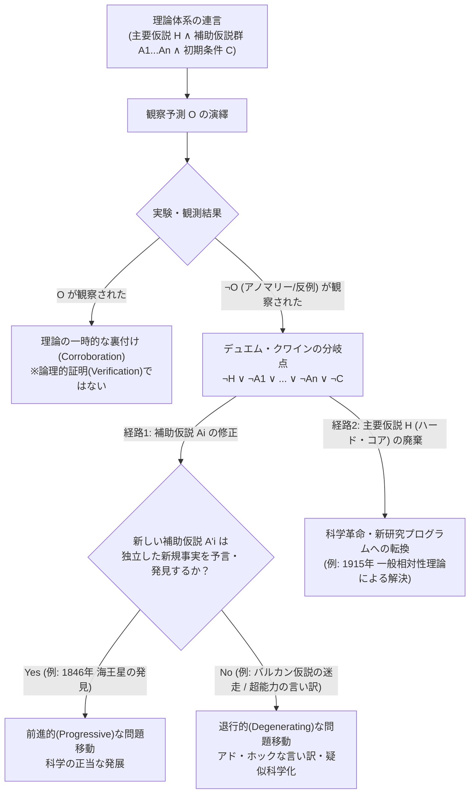
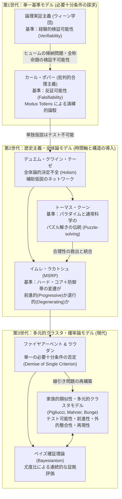

## 序論：なぜ「科学と疑似科学の境界」を問うのか

現代社会において、「科学的である（scientific）」という形容詞は単なる学問領域の分類を超え、高度な認識論的権威（epistemic authority）と社会的信頼の証左として機能している。医療政策、気候変動対策、法廷における証拠採用、公教育のカリキュラム編成、さらには国家の研究開発予算の配分に至るまで、「何が科学であり、何が科学ではないのか」という境界設定は、市民の生命や財産、そして民主主義社会の意思決定の根幹を左右する重大な実践的帰結をもたらす。占星術、ホメオパシー、創造科学（インテリジェント・デザイン）、反ワクチン陰謀論、あるいは量子力学の用語を恣意的に借用した「量子ヒーリング」の類いが、しばしば「もう一つの科学的視点」や「既存のアカデミズムに抑圧された革新的パラダイム」を自称するのは、まさに「科学」というラベルが持つ強大な正当化能力を簒奪するためである。

科学哲学（Philosophy of Science）において、経験科学（empirical science）と非科学（non-science）——とりわけ、科学の装いを纏いながら科学固有の認識論的規範を欠いた<strong>疑似科学（pseudoscience）</strong>——とをいかにして区別するかという問いは、<strong>線引き問題（Demarcation Problem / 独: Abgrenzungsproblem）</strong>と呼ばれてきた。一見すると、この問いに対する答えは自明であるかのように思われるかもしれない。「科学は観察や実験という客観的データに基づき、疑似科学は迷信やドグマに基づく」と。しかし、歴史と論理のメスをひとたびこの素朴な直観に入れるならば、その境界線は驚くほど複雑に揺らぎ始める。

占星術師もまた、膨大な天体観測データと過去の事例の蓄積（経験的証拠）を誇示する。フロイト派の精神分析家は、臨床現場における無数の患者の症例を自説の「検証例」として提示する。逆に、ニュートン力学や一般相対性理論、あるいは現代の素粒子物理学といった最も模範的な精密科学の歴史を紐解けば、理論の予測と実験データが真っ向から食い違ったにもかかわらず、科学者たちが自らの基本理論を放棄せず、「未知の惑星があるはずだ」「観測機器の誤差だ」と言い張って理論を死守した事例が枚挙に暇がない。もし「データに合致するかどうか」や「反証されたら即座に理論を捨てるかどうか」という単純な物差しだけを適用するならば、歴史上の偉大な科学の多くが疑似科学の烙印を押され、逆に巧みに事後的説明（アド・ホックな言い訳）を張り巡らせた疑似科学が生き残ってしまう危険すらあるのだ。

本稿では、20世紀初頭の論理実証主義とカール・ポパー（Karl Popper）による「反証可能性（falsifiability）」の提唱から説き起こし、ピエール・デュエム（Pierre Duhem）とW.V.O.クワイン（Willard Van Orman Quine）による全体論的決定不全（デュエム・クワイン・テーゼ）、トーマス・クーン（Thomas Kuhn）のパラダイム論、イムレ・ラカトシュ（Imre Lakatos）の「科学的研究プログラムの方法論（MSRP）」、ポール・ファイヤアーベント（Paul Feyerabend）とラリー・ラウダン（Larry Laudan）による線引き問題の解体論、そしてウィトゲンシュタインの「家族的類似性（family resemblance）」を応用した現代の多元的クラスタ・モデルや再現性の危機（Replication Crisis）、さらには超弦理論・マルチバース宇宙論をめぐる最先端の科学哲学論争に至るまで、1世紀以上にわたる知の格闘を体系的かつ徹底的に解剖する。なぜ「たった一つの基準」では科学と疑似科学を割り切ることができないのか、そしてその複雑な境界線の先にいかなる知性的誠実さの規範が浮かび上がるのかを明らかにしよう。

---

## 第1章：帰納の問題と論理実証主義の「検証可能性」——ポパー以前の風景

### 1.1 ベーコン的帰納主義とヒュームの懐疑論

近代科学の黎明期以来、科学の方法論的基盤として素朴に信じられてきたのは、フランシス・ベーコン（Francis Bacon）に端を発する<strong>帰納主義（inductivism）</strong>であった。帰納主義の描像によれば、科学者はまず偏見を持たずに自然界の個別的な事実を多数観察・実験し（例：「この白鳥$a_1$は白い」「あの白鳥$a_2$も白い」……「$n$番目の白鳥$a_n$も白い」）、そこから一般的な普遍法則（例：「すべての白鳥は白い」$\forall x (\text{Swan}(x) \to \text{White}(x))$）を導き出し、さらに多くの観察によってその法則を確証していく。

しかし、この素朴な帰納主義には、18世紀のスコットランドの哲学者デイヴィッド・ヒューム（David Hume）が『人間本性論』および『人間知性研究』において暴き出した致命的な論理的欠陥が潜んでいた。いわゆる<strong>「帰納の問題（Problem of Induction / ヒュームの問題）」</strong>である。ヒュームは、どれほど多くの個別的な観察事例（有限個の単称言明）を積み重ねようとも、そこから時間と空間のすべてを覆う普遍法則（全称言明）や未知の未来の事象への推論を<strong>論理的・演繹的に正当化することは絶対に不可能である</strong>と論証した。

過去に太陽が毎朝昇ったという1億回の観察から、「明日も太陽が昇る」という結論を導くためには、「まだ観察されていない未来の自然も、すでに観察された過去の自然と同じように振る舞う」という<strong>自然の斉一性原理（Principle of the Uniformity of Nature）</strong>を暗黙の前提として仮定しなければならない。ところが、この「自然の斉一性原理」自体はいかにして正当化されるのか？ それは論理的必然（トートロジー）ではない。「自然が明日突然その法則を変える」と想像しても論理的な自己矛盾は生じないからである。かといって、「これまで自然の斉一性が保たれてきたから、これからも保たれるはずだ」と経験的に正当化しようとすれば、それ自体が帰納推論を使った<strong>循環論証（petitio principii / 論点先取）</strong>に陥ってしまう。したがって、観察データの蓄積によって科学理論の真理性を「証明」できるとする素朴な帰納主義は、論理的に破綻しているのである。

### 1.2 ウィーン学団と意味の検証理論

20世紀初頭、マッハの経験批判論やフレーゲ、ラッセル、初期ウィトゲンシュタイン（『論理哲学論考』）の記号論理学の強い影響のもと、モーリッツ・シュリック（Moritz Schlick）、ルドルフ・カルナップ（Rudolf Carnap）、オットー・ノイラート（Otto Neurath）らを中心とする<strong>ウィーン学団（Vienna Circle）</strong>が形成され、<strong>論理実証主義（Logical Positivism / 論理経験主義）</strong>の運動が展開された。

論理実証主義者たちが掲げた最大の目標は、カント以降のドイツ観念論やハイデガーの実存哲学のような思弁的形而上学（metaphysics）を哲学から一掃し、科学的世界把握を確立することであった。そのために彼らが導入した武器が、<strong>「意味の検証理論（Verification Theory of Meaning）」</strong>あるいは<strong>検証可能性基準（Verifiability Criterion）</strong>である。彼らによれば、分析的真理（論理学や数学のトートロジー）を別にすれば、ある文が認知的に<strong>有意味（meaningful）</strong>であるための必要十分条件は、その文が感覚経験（観察言明・プロトコル言明）によって<strong>経験的に検証可能（empirically verifiable）</strong>であることだとした。

この立場に立てば、「絶対精神が自己を実現する」といった形而上学の命題や、神学・占星術の主張は、そもそも経験的な観察によって真偽を決着させる手続きが存在しないため、「偽」である以前に<strong>「無意味（meaningless / 擬似命題）」</strong>として退けられる。

しかし、この検証可能性基準にはすぐさま深刻な内部矛盾が露呈した。第一に、ヒュームの帰納の問題が示す通り、ニュートンの万有引力の法則 $\forall x \forall y (F = G \frac{m_x m_y}{r^2})$ のような<strong>全称言明（普遍法則）</strong>は、空間と時間のあらゆる領域における無限の事例を対象としているため、有限回の観察によっては原理的に<strong>決して完全に検証（verify）することができない</strong>。もし「完全に検証できない命題は無意味である」という強い検証基準を文字通りに適用すれば、形而上学だけでなく、物理学や化学のあらゆる普遍的 자연法則までもが「無意味な形而上学」として科学から追放されてしまうのである。カルナップらはその後、厳密な「検証可能性（verifiability）」を撤回し、経験的証拠によって命題の確からしさ（確率）が高められるという<strong>「確証可能性（confirmability）」</strong>や<strong>帰納論理（inductive logic）</strong>へと後退せざるを得なかったが、無限の母集団に対する全称命題の論理的確率は常にゼロ（$P(\forall x\, P(x)) = 0$）になってしまうという難問は解消されなかった。

---

## 第2章：カール・ポパーのコペルニクス的転回——1919年のウィーンと「反証可能性」

### 2.1 1919年ウィーンの知的衝撃：アインシュタイン対マルクス、フロイト、アドラー

論理実証主義が「意味の境界（有意味か無意味か）」と「検証・確証」に固執して袋小路に入り込んでいたのとほぼ同時期、同じくウィーンの知的土壌で育ちながらもウィーン学団の「公式の反対者（official opposition）」を自認した若き哲学者<strong>カール・ポパー（Karl Raimund Popper, 1902–1994）</strong>は、まったく異なる角度から線引き問題にアプローチした。ポパーにとって、問題は「有意味な言明と無意味な形而上学の区別」ではなく、あくまで<strong>「経験科学と疑似科学の方法論的区別」</strong>であった（ポパーは形而上学を有意味であり得るとし、科学理論の母胎となることさえ認めていた）。

ポパーの思考を決定づけたのは、第一次世界大戦直後の<strong>1919年のウィーン</strong>における鮮烈な原体験であった。当時17歳だったポパーの周囲では、三つの巨大な知的潮流が若者たちを熱狂させていた。第一にカール・マルクスの<strong>歴史的唯物論（マルクス主義歴史理論）</strong>、第二にジークムント・フロイトの<strong>精神分析（psychoanalysis）</strong>、第三にポパー自身が社会事業の手伝いを通じて個人的にも親交のあったアルフレッド・アドラーの<strong>個人心理学（individual psychology）</strong>である。これらの理論はいずれも「科学」を名乗り、人間社会や心理のあらゆる現象を余すところなく説明できるかのように見えた。

しかしポパーは、これらの理論の信奉者たちが誇る「圧倒的な説明力」と「無数の検証事例」に対して、次第に強い違和感を抱くようになる。フロイトやアドラーの理論に照らせば、人間がどのような行動をとろうとも、それは常に理論の正しさを裏付ける「証拠」として解釈された。ポパーが挙げた有名な例がある。ある男が子供を溺れさせようとして川に突き飛ばした場合と、逆に別の男が自分の命を犠牲にして子供を救うために川に飛び込んだ場合を考えてみよう。フロイトの理論によれば、前者は「抑圧された攻撃衝動（あるいはエディプス・コンプレックス等）」の表れであり、後者はその衝動が「昇華（sublimation）」された結果として見事に説明される。アドラーの理論によれば、前者は自分が犯罪を犯す勇気があることを自らに証明しようとする「劣等感の補償」であり、後者もまた自分が子供を救う勇気があることを証明しようとする「劣等感の補償」として、まったく同じくらい淀みなく説明されてしまう。

ある日、ポパーがアドラーに対して、あまりにもアドラー主義的ではないと思われるある子供の症例を報告した際、アドラーはその子供を一度も診察することなく、即座に自らの「劣等感の理論」の枠組みでそれを分析してみせた。驚いたポパーが「どうしてそんなに確信が持てるのですか？」と尋ねると、アドラーは「これまでの私の千もの経験（a thousandfold experience）があるからだ」と答えた。このときポパーは思わずこう言い返したという。<strong>「その新しい症例によって、先生の経験は千一（a thousand and one）になったわけですね。しかし、それは先生の理論が最初からどんな症例でも当てはまるようにできているからにすぎないのではないですか？」</strong>

これと鮮やかな対照をなしたのが、同じ<strong>1919年5月29日</strong>に行われたアーサー・エディントン（Arthur Eddington）率いるイギリスの日食観測隊による、<strong>アルベルト・アインシュタイン（Albert Einstein）の一般相対性理論（General Theory of Relativity）</strong>の実験的テストであった。1915〜1916年に発表されたアインシュタインの重力場方程式：

$$R_{\mu\nu} - \frac{1}{2} R g_{\mu\nu} = \frac{8\pi G}{c^4} T_{\mu\nu}$$

は、太陽のような巨大な質量を持つ天体のすぐそばを通過する遠方の恒星の光が、時空の歪みによって太陽の重力場の方へ曲げられることを予言していた。しかもアインシュタインは、「光が曲がるかもしれない」といった曖昧な予言ではなく、太陽の縁をかすめる星光の偏向角が厳密に

$$\Delta \theta = \frac{4GM_{\odot}}{c^2 R_{\odot}} \approx 1.75\text{ 秒角（arcseconds）}$$

になるという極めて具体的・定量的な数値を事前に導出していた（なお、ニュートン力学と光の粒子説を組み合わせた古典的計算では、その半分の約 $0.875\text{ 秒角}$ になると予測されていた）。普段は太陽光が眩しすぎて太陽の背後の星を見ることはできないが、皆既日食の瞬間であれば、太陽の周囲にある恒星の見かけの位置を写真撮影し、半年前の夜間に撮影した同じ星野の写真と比較することで、星の位置が本当に $1.75\text{ 秒角}$ ずれているかどうかを直接テストできる。エディントンは西アフリカのプリンシペ島へ、クロムリンはブラジルのソブラルへと遠征して皆既日食を観測し、1919年11月、その結果がアインシュタインの予測値と合致したことを発表して世界中を震撼させた。

ポパーが心を揺さぶられたのは、結果が当たったこと以上に、<strong>アインシュタインの理論が自ら進んで負っていた「論理的リスク（risky prediction）」の大きさ</strong>であった。もし日食観測において星光のズレがまったく観測されなかったり、あるいは古典値の $0.875''$ であったりしたならば、アインシュタインの一般相対性理論は<strong>決定的に誤りであることが暴かれ（論駁され）、破棄されるはずであった</strong>。アインシュタインの理論は、起こり得る無数の観察結果のうち、ごくわずかな狭い範囲の事象しか許容せず、それ以外のあらゆる事象を<strong>「禁止（forbid）」</strong>していたのである。

対照的に、占星術の曖昧な予言や、フロイト・アドラーの心理学、そして当時の俗流マルクス主義者たちの議論は、<strong>いかなる事象が起きようとも決して自説が誤りにならないよう、あらかじめ全方位的な逃げ道が用意されていた</strong>。すべてを説明できる理論とは、裏を返せば「何一つとして禁止していない理論」であり、世界について実質的な経験的情報（empirical content）を何も語っていないに等しい。ここからポパーは、1934年の主著『探求の論理（Logik der Forschung / 英訳: The Logic of Scientific Discovery）』において、科学哲学の歴史を塗り替える画期的なテーゼを打ち立てた。<strong>「理論の科学的地位の基準は、その反証可能性（falsifiability）、あるいは論駁可能性（refutability）、テスト可能性（testability）である」</strong>。

### 2.2 検証と反証の論理的非対称性（Logical Asymmetry）

ポパーの「反証主義（Falsificationism）」がなぜヒュームの帰納の問題を回避しつつ科学の合理性を救い出せたのかを理解するためには、彼が注目した<strong>「検証（verification）と反証（falsification）のあいだの純粋に論理的な非対称性」</strong>を記号論理学の観点から確認する必要がある。

いま、ある普遍的な科学理論（全称言明）を $T$ とし（例：$\forall x (\text{Swan}(x) \to \text{White}(x))$「すべての白鳥は白い」）、そこから初期条件のもとで演繹される個別的な観察予測（単称言明）を $O$ とする（例：$\text{White}(a)$「いま目の前にいるこの白鳥 $a$ は白い」）。このとき、理論 $T$ と観察予測 $O$ の関係は、条件法（含意） $T \to O$ として表される。

もし私たちが観察を行って、予測通りに $O$ が真であること（「白い白鳥が観察された」）を確認したとしよう。このとき、「$T \to O$」と「$O$」から「ゆえに $T$ は真である」と結論づける推論は、形式論理学においては<strong>「後件肯定の虚偽（Fallacy of Affirming the Consequent）」</strong>と呼ばれる明白な論理的誤謬である：

$$\frac{T \to O \quad , \quad O}{\therefore T} \quad \text{（論理的に無効 / Invalid：後件肯定の虚偽）}$$

なぜなら、$T$ が偽であっても $O$ が真であることはいくらでもあり得るからだ。100万羽の白い白鳥を観察しても、「すべての白鳥が白い」という全称命題 $T$ が演繹的に証明されることは永遠にない。これが「検証の論理的不可能性」である。

ところが、もし私たちがオーストラリアへ行き、予測 $O$ に反する観察結果 $\neg O$（「ここに黒い白鳥 $b$ がいる」：$\text{Swan}(b) \land \neg\text{White}(b)$ という存在言明）を<strong>たった一つでも</strong>見つけ出したとしたらどうなるか。「$T \to O$」という前提と、「$\neg O$（$O$ではない）」という観察言明からは、古典命題論理の最も基本的な妥当な推論規則である<strong>モーダス・トレンス（Modus Tollens：後件否定式）</strong>によって、結論「$\neg T$（理論 $T$ は偽である）」が<strong>100%の演繹的確実性をもって導出される</strong>のである！

$$\frac{T \to O \quad , \quad \neg O}{\therefore \neg T} \quad \text{（論理的に妥当 / Valid：Modus Tollens）}$$

これこそがポパーの発見した<strong>論理的非対称性</strong>の核心である。全称言明（普遍法則）は、有限個の観察言明から演繹的に導出（検証）することは<strong>決してできない</strong>が、単称言明（反例となる観察言明）と矛盾することによって演繹的に論駁（反証）することは<strong>完全に可能である</strong>。したがって、科学は不可能な「帰納的検証」に頼る必要はまったくない。科学とは、大胆な<strong>推測（Conjectures）</strong>として普遍的な仮説を自由に創案し、それを過酷な実験的・観察的テストにかけて<strong>論駁（Refutations）</strong>しようと試みる、終わりなき「推測と論駁（Conjectures and Refutations）」の演繹的プロセスなのである。

### 2.3 基礎言明・反証可能性の度合い・確証（Corroboration）・真理近似性（Verisimilitude）

ここで重大な誤解を解いておかなければならない。「反証可能性（falsifiability）」とは、「その理論がすでに反証されて間違っていること（falsified）」を意味するのではない。そうではなく、<strong>「もしその理論が間違っているとしたら、どのような観察や実験結果が出ればその誤りが暴かれるかが、論理的に明確に規定されていること（反証される潜在的可能性があること）」</strong>を意味する。

ポパーはこれをより厳密に定式化するために、<strong>基礎言明（basic statements / 観察言明）</strong>という概念を導入した。基礎言明とは、「時空領域 $k$ において、これこれの観察可能な事象が生じている」という形式の単称存在言明である。ある理論 $T$ が経験的・科学的である（反証可能である）とは、理論 $T$ がすべての可能な基礎言明の集合を、以下の二つの空でない（non-empty）部分集合へと分割することを意味する：
1. 理論 $T$ と両立する（理論が許容する）基礎言明のクラス。
2. 理論 $T$ と矛盾する（理論が<strong>禁止する</strong>）基礎言明のクラス——ポパーはこれをその理論の<strong>「潜在的反証者（potential falsifiers）」</strong>と呼んだ。

つまり、<strong>経験科学の理論とは、潜在的反証者のクラスが空集合ではない（$\text{Falsifiers}(T) \neq \emptyset$）ような理論体系</strong>のことである。逆に、疑似科学や形而上学の言明は、どのような事象が起きてもそれを許容してしまうため、潜在的反証者のクラスが空集合（$\text{Falsifiers}(T) = \emptyset$）となっている。

さらにポパーは、理論が禁止する事象が多ければ多いほど（つまり潜在的反証者のクラスが大きければ大きいほど）、その理論の<strong>反証可能性の度合い（degree of falsifiability）</strong>が高く、世界についてより多くのことを語る<strong>経験的情報量（empirical content）</strong>が豊かであると論じた。たとえば、「明日、雨が降るか、または降らないかのどちらかだ」（$p \lor \neg p$）というトートロジーは、論理的確率は $1$（絶対に真）であるが、潜在的反証者がゼロであるため経験的情報量はゼロである。一方、「明日正午ちょうどに東京駅で時間雨量50ミリの豪雨が降る」という予測は、外れるリスク（反証可能性）が極めて高いがゆえに、情報量が圧倒的に高い。科学が目指すべきは、確率が高くて当たり障りのない安全な命題ではなく、<strong>論理的確率が低く（反証されるリスクが極めて高く）、情報量に富んだ大胆な仮説</strong>なのである。

そして、そのような極めてリスクの高い、過酷な反証テスト（crucial experiments）にさらされながら、それを生き延びて反証されなかった理論について、ポパーは論理実証主義者の「検証（verification）」や「確証（confirmation：確率の上昇）」という言葉を厳しく拒絶し、代わりに<strong>「裏付け / 確証（Corroboration / 独: Bewährung）」</strong>という独自の用語を充てた。ある理論が高い度合いで「裏付けられている（corroborated）」とは、その理論が未来永劫にわたって真であることが証明されたという意味では決してなく、あくまで<strong>「現在までのところ、最も過酷な批判的テストに耐え抜いた最良の仮説として暫定的に生き残っているという過去の成績証明書」</strong>にすぎない。

また後期のポパーは、すべての科学理論がいずれ反証され得る仮説であるならば、科学の進歩とは何かという問いに答えるため、アルフレッド・タルスキ（Alfred Tarski）の真理の意味論的定義を援用して<strong>「真理近似度 / 確からしさ（Verisimilitude / 独: Wahrheitsähnlichkeit）」</strong>という概念を提示した。理論 $T_2$（たとえばアインシュタインの重力理論）が旧理論 $T_1$（ニュートンの重力理論）よりも真理近似度が高いとは、$T_2$ から導かれる真なる帰結の集合（真理内容 Truth Content）が $T_1$ よりも大きく、かつ $T_2$ から導かれる偽なる帰結の集合（虚偽内容 Falsity Content）が $T_1$ 以下であることを意味する。私たちは絶対的真理に到達したことを知る術は持たない（不可謬主義の否定・<strong>可謬主義 Fallibilism</strong>）が、誤りを批判的に除去し続けることによって、より真理に近い（真理近似度の高い）理論へと漸近していくことはできる——これがポパーの描いた「批判的合理主義（Critical Rationalism）」の崇高な科学観であった。

---

## 第3章：素朴反証主義の崩壊——デュエム・クワイン・テーゼと補助仮説の迷宮

### 3.1 全体論的決定不全（Holistic Underdetermination）の論理構造

ポパーの反証可能性基準は、その明快さと鋭利さゆえに、現場の自然科学者たちから熱狂的な支持を集めた。しかし、科学史の実態と論理構造をより精密に分析した科学哲学者たちは、理論と観察が1対1で対決する「素朴反証主義（Naive Falsificationism）」には致命的な論理的陥穽があることを突き止めた。それが、フランスの物理学者・科学史家<strong>ピエール・デュエム（Pierre Duhem, 1861–1916）</strong>が1906年の著書『物理学理論の目的と構造』で指摘し、後にアメリカの論理学者・哲学者<strong>ウィラード・ヴァン・オーマン・クワイン（Willard Van Orman Quine, 1908–2000）</strong>が1951年の歴史的論文「経験主義の二つのドグマ（Two Dogmas of Empiricism）」で認識論全体へと拡張した<strong>「デュエム・クワイン・テーゼ（Duhem-Quine Thesis）」</strong>である。

デュエムとクワインが明らかにしたのは、<strong>「いかなる単独の仮説 $H$ からも、それ単独では観察可能な予測 $O$ を演繹することは論理的に不可能である」</strong>という冷厳な事実である。

たとえば、ニュートンの万有引力の法則と運動の三法則（主要仮説 $H$）だけから、「明日の夜、天王星が天球上の座標 $(\alpha, \delta)$ に観測されるはずだ」という観察言明 $O$ を導き出せるだろうか？ 決して導き出せない。その予測 $O$ を計算するためには、主要仮説 $H$ に加えて、無数の<strong>補助仮説（auxiliary hypotheses：$A_1, A_2, \dots, A_n$）</strong>と<strong>初期条件（initial conditions：$C_{\text{init}}$）</strong>を連言（AND：$\land$）として組み合わせなければならない。具体的には：
- $A_1$：太陽系に存在する惑星の総数とそれぞれの質量・軌道要素に関する仮定（例：「天王星の外側には未知の巨大惑星は存在しない」）。
- $A_2$：惑星間に働く力は重力のみであり、電磁気力や未知の媒質による抵抗は無視できるという仮定。
- $A_3$：観測に用いる望遠鏡の光学系や大気差（光の屈折）の補正理論が正しいという仮定（観測理論）。
- $C_{\text{init}}$：過去の時点 $t_0$ における天王星や木星・土星の位置と速度の測定データが正確であるという初期条件。

したがって、実際のテストにおける演繹構造は、単純な $H \to O$ ではなく、次のような複合的な連言からの含意となる：

$$(H \land A_1 \land A_2 \land \dots \land A_n \land C_{\text{init}}) \to O$$

ここで、実際の観測を行った結果、予測 $O$ が外れ、反証事例 $\neg O$ が観測されたとしよう。このとき、モーダス・トレンス（Modus Tollens）によって演繹的に導かれる結論は何か？ ド・モルガンの法則（De Morgan's laws）を適用すれば明らかなように、それは「$\neg H$（主要仮説 $H$ が偽である）」では<strong>ない</strong>。論理的に導かれるのは、次の<strong>選言（OR：$\lor$）</strong>だけである：

$$\frac{(H \land A_1 \land A_2 \land \dots \land A_n \land C_{\text{init}}) \to O \quad , \quad \neg O}{\therefore \neg(H \land A_1 \land A_2 \land \dots \land A_n \land C_{\text{init}}) \equiv \neg H \lor \neg A_1 \lor \neg A_2 \lor \dots \lor \neg A_n \lor \neg C_{\text{init}}}$$

すなわち、<strong>「主要仮説 $H$、補助仮説群 $A_1 \sim A_n$、初期条件 $C_{\text{init}}$ で構成される理論体系のネットワークの『どこかに』少なくとも一つの誤りがある」</strong>ということまでは論理的に確実に言えるが、<strong>「その誤りの犯人が主要仮説 $H$ であるのか、それとも補助仮説 $A_i$ のどれかであるのか」を純粋な論理学だけで特定することは絶対にできない</strong>のである！

クワインはこれをさらに推し進め、私たちの知識体系全体（科学理論から数学・論理学に至るまで）は一つの巨大な「信念のクモの巣（Web of Belief）」を形成しており、経験の法廷に立つのは個別の命題ではなく知識体系全体であるという<strong>確認の全体論（Confirmational Holism）</strong>を唱えた。周縁部で不都合な経験（$\neg O$）が生じたとき、私たちはクモの巣の内部のどこかの補助仮説を調整することによって、中心部にあるお気に入りの主要仮説 $H$ を<strong>いかなる反証からも論理的に無傷のまま守り抜く（immunize）ことが常に可能である</strong>。つまり、厳密な論理的意味における「決定実験（Crucial Experiment / 仏: Expérience cruciale）」——ただ一撃で特定の理論 $H$ を葬り去る実験——は存在しないのだ。

### 3.2 科学史の劇的な対比：1846年の海王星発見 vs. 水星の近日点移動（バルカン仮説）

このデュエム・クワイン・テーゼが単なる哲学者の机上の空論ではなく、実際の科学史のど真ん中で起きている現象であることを最も劇的に示すのが、19世紀天文学における<strong>二つの惑星軌道異常（アノマリー）</strong>の物語である。

#### 事例1：天王星の軌道異常と海王星（Neptune）の発見（1846年）

1781年にウィリアム・ハーシェルによって発見された天王星（Uranus）の運動を数十年にわたって精密に観測し続けた天文学者たちは、19世紀前半、深刻な問題に直面した。ニュートンの万有引力の法則（$H$）と既知の惑星（木星や土星など）からの摂動計算に基づいて算出された天王星の理論上の軌道予測（$O$）と、実際の観測位置とのあいだに、どうしても説明のつかないズレ（$\neg O$）が生じていたのである。

もし当時の天文学者たちが、素朴な反証主義のルールに忠実に従っていたならば、彼らは「ニュートンの万有引力の法則 $H$ は天王星によって反証された！ ゆえにニュートン力学を廃棄せよ！」と宣言しなければならなかったはずだ。しかし、彼らはそのようなことは一切しなかった。

フランスのユルバン・ル・ヴェリエ（Urbain Le Verrier）とイギリスのジョン・カウチ・アダムズ（John Couch Adams）は、ニュートン力学 $H$ は絶対に正しいという前提を堅持し、代わりに<strong>補助仮説 $A_1$（「天王星の外側には未知の惑星は存在しない」）の方が偽である（$\neg A_1$）</strong>と推論した。彼らは天王星の軌道のズレから逆算して、未知の8番目の惑星（海王星）の質量と軌道、そして現在の天球上の位置をニュートン力学を用いて精密に計算した。1846年9月23日、ル・ヴェリエから手紙を受け取ったベルリン天文台のヨハン・ゴットフリート・ガレ（Johann Gottfried Galle）が指定された座標に望遠鏡を向けたところ、予測位置からわずか1度以内の場所で新惑星<strong>海王星（Neptune）</strong>が発見されたのである！

このとき、ニュートン力学を反証から守るために導入された「未知の惑星がある」という補助仮説の変更は、単なる言い訳ではなく、<strong>ニュートン力学の最も輝かしい勝利</strong>となった。

#### 事例2：水星の近日点移動と幻の惑星バルカン（Vulcan）

ところが、この大成功に自信を深めたル・ヴェリエが、その直後に取り組んだもう一つのアノマリーでは、まったく正反対の結末が待っていた。太陽に最も近い惑星である<strong>水星（Mercury）</strong>の楕円軌道の近日点（太陽に最も近づく点）は、他の惑星からの重力摂動によって少しずつ歳差運動（移動）している。しかし、ニュートン力学で既知のすべての惑星の摂動を計算しても、100年あたり約<strong>$43\text{ 秒角}$（$43''/\text{century}$）</strong>だけ、観測される近日点の移動量が理論値よりも大きかったのである（$\neg O$）。

海王星発見の成功体験を持つル・ヴェリエは、今度もまったく同じ論理を使った。「ニュートン力学 $H$ は正しい。誤っているのは補助仮説 $A_1$ であり、水星よりもさらに太陽に近い内側の軌道に、まだ見ぬ未知の小惑星（あるいは惑星群）が存在して水星を引っ張っているに違いない」。ル・ヴェリエはこの仮説上の惑星に鍛冶の神の名をとって<strong>「バルカン（Vulcan）」</strong>と名付けた。

その後、半世紀以上にわたって世界中の天文学者が日食のたびに太陽近傍を捜索し、「バルカンを発見した！」という誤報が何度も飛び交った。バルカンが見つからないとなると、天文学者たちは「単一の惑星ではなく、望遠鏡では見えない微細な宇宙塵のリングが太陽を取り巻いているのだ」「太陽の内部質量分布が完全な球対称ではなく歪んでいるのだ」「重力法則の逆二乗則の指数 $2$ が実は $2.00000016$ なのだ」といった次なる補助仮説を次々とひねり出してニュートン力学を守ろうとした。

結果としてどうなったか。バルカンは存在しなかった。1915年、アインシュタインがニュートン力学の基本前提（絶対空間・絶対時間と遠隔作用の重力 $H$）そのものを根底から覆す<strong>一般相対性理論</strong>を構築し、太陽近傍の強重力場における時空の曲率から水星の軌道を計算したところ、いかなる未知の惑星や恣意的なパラメータも仮定することなく、100年あたり<strong>$43\text{ 秒角}$</strong>というズレが理論からピタリと自然に導出されたのである。

この二つの歴史的事例は、線引き問題に極めて深刻な問いを突きつける。<strong>天王星におけるル・ヴェリエの行動（海王星の仮定）と、水星におけるル・ヴェリエの行動（バルカンの仮定）は、論理構造としては寸分違わぬ「補助仮説の変更による主要理論の防衛」であった。</strong>さらに言えば、疑似科学の代表格である占星術師や超能力研究者が、実験で超能力が確認できなかった（$\neg O$）ときに、「検証者の懐疑的なオーラ（悪しき波動）が超能力の発現を妨害したのだ（補助仮説 $A_k$ の変更）」と弁明するのも、純粋な形式論理学（Modus Tollensの否定の選言）の上では同じ形をしている。では、科学における「正当な補助仮説の修正」と、疑似科学における「不正な言い訳（アド・ホックな仮説）」とを分かつものは一体何なのか？

---

## 第4章：ポパーの精緻化とトーマス・クーンの『科学革命の構造』

### 4.1 アド・ホックな仮説（Ad Hoc Hypotheses）に対するポパーの方法論的規約

実を言えば、ポパー自身も『探求の論理』（1934年）の段階から、デュエム的な批判（補助仮説を導入すればどんな理論でも反証を免れることができるという事実——ポパーはこれをポアンカレらの「規約主義的戦略 conventionalist stratagem」と呼んだ）を十分に認識していた。

ポパーはこれに対処するため、反証可能性を単なる論理的性質としてだけでなく、科学者が遵守すべき<strong>方法論的規則（methodological rule）</strong>として規定した。すなわち、反証の危機に瀕した理論を救うために補助仮説 $A'$ を導入することが許されるのは、<strong>「その補助仮説の導入によって、理論体系全体の反証可能性の度合い（経験的情報量・テスト可能性）が減少せず、むしろ増大する場合に限る」</strong>というルールである。

天王星の例で言えば、「この座標にこれだけの質量の未知の惑星が存在する」というル・ヴェリエの補助仮説は、望遠鏡をそこに向けて確かめることができるという<strong>新たな独立したテスト可能性（潜在的反証者）</strong>を生み出したため、経験的情報量を増大させる許容可能な修正であった。これに対し、ただ目の前の反証事例 $\neg O$ を打ち消すためだけに事後的に（after the fact）継ぎ接ぎされ、それ以外のいかなる新しい独立した予測も生み出さないような仮説は、<strong>「アド・ホックな仮説（ad hoc hypothesis：その場しのぎの仮説）」</strong>として方法論的に厳しく禁止される。たとえば、「すべてのパンは栄養になる」という理論が、フランスのある村で麦角菌に汚染されたパンを食べた人々が中毒を起こした事例によって反証されそうになったとき、「すべてのパンは（あのフランスの村で作られたその特定のパンを除いて）栄養になる」と書き換えるのは、理論の経験的情報量と反証可能性を縮小させるだけの典型的なアド・ホックな修正（免疫化戦略 immunization strategy）であり、疑似科学への転落を意味する。

### 4.2 トーマス・クーンの衝撃：パラダイム・通常科学・パズル解き

しかし、ポパーのように「科学者は常に自らの理論を過酷な反証テストにかけ、反証されたら潔く理論を捨て去る批判的精神の持ち主であるべきだ」という規範的（normative）な科学像に対して、歴史的・記述的（descriptive）な観点から根底的な異議を申し立てたのが、1962年に出版された<strong>トーマス・クーン（Thomas S. Kuhn, 1922–1996）</strong>の記念碑的著作<strong>『科学革命の構造（The Structure of Scientific Revolutions）』</strong>であった。

もともと理論物理学者であったクーンは、アリストテレス物理学からニュートン力学への転換など科学史の実際の記録を精査する中で、ポパーの描く「常時批判・常時反証」の科学者像は歴史の現実とまったく乖離していることに気づいた。実際の成熟した科学の大部分の期間——クーンが<strong>「通常科学（Normal Science）」</strong>と呼ぶ期間——において、科学者たちは自らが依拠する基本理論を反証しようなどとは毛頭考えていない。むしろ彼らは、共同体が共有する<strong>「パラダイム（Paradigm）」</strong>（後にクーンはこれを、法則・理論・価値観・形而上学的信念のセットである「専門母体 disciplinary matrix」と、具体的な模範的問題解決例である「見本例 exemplars」とに整理した）を<strong>疑いえない絶対の前提（ドグマ）</strong>として受け入れ、その枠組みの中で解けるはずの細部の問題を解く<strong>「パズル解き（puzzle-solving）」</strong>に専念しているのである。

クーンによれば、通常科学における「パズル解き」では、実験結果がパラダイムの予測と食い違った場合（$\neg O$）、失敗したとみなされるのはパラダイム（基本理論）ではなく、<strong>科学者個人の能力（または実験装置）</strong>である。「大工が仕事の失敗を道具のせいにするように、失敗した科学者は理論のせいにする」のであり、パラダイムを疑う者は科学者共同体から異端者あるいは無能者として排除される。それでもどうしてもパズルとして解けない厄介な不一致は、「反証事例（falsification）」として扱われるのではなく、単なる<strong>「変則事例（Anomaly / アノマリー）」</strong>として棚上げされるか、補助仮説の微調整によって処理される。

しかし、通常科学の探求が極めて精密に進むにつれて、棚上げできない深刻な変則事例（アノマリー）が蓄積し、既存のパラダイムへの信頼が揺らぐ<strong>「危機（Crisis）」</strong>の時代が訪れる。そして、その危機を打開するまったく新しい体系を備えた競合パラダイムが出現したとき、旧パラダイムから新パラダイムへの非連続的な転換——<strong>「科学革命（Scientific Revolution / パラダイム・シフト）」</strong>——が起きる。クーンはさらに、異なるパラダイムのあいだには概念の意味、問題設定の基準、さらには観察データの見え方（理論負荷性 theory-ladenness of observation）にまで根本的な断絶が存在するため、中立的な共通の物差しで優劣を論理的に比較することができないという<strong>「共約不可能性（Incommensurability / 通約不可能性）」</strong>を主張し、パラダイム転換を宗教的回心（conversion）やゲシュタルト転換（アヒルとウサギの反転図形）になぞらえた。

### 4.3 クーンによる線引き基準：「パズル解きの伝統」の有無

では、クーンは「科学と疑似科学の線引き問題」をどう考えたのか？ 興味深いことに、1965年のロンドン国際科学哲学コロキアムにおいてポパーと直接対決した際、クーンは<strong>「ポパー卿と私は、何が科学で何が非科学かという具体的な判定（例：天文学は科学であり、占星術は非科学である）においては完全に一致しているが、その理由（線引きの基準）において真っ向から対立している」</strong>と述べた。

ポパーは、占星術が疑似科学である理由を「占星術師が曖昧な予言ばかりして、自説を反証不可能にしているからだ」と説明した。しかしクーンは占星術の歴史を調査し、<strong>「占星術の歴史は、外れた具体的予測（反証事例）で満ち溢れている」</strong>と反論した。占星術師自身も、自らの予言がしばしば外れることを熟知していた。彼らが非科学的だったのは、予測が外れなかったからではなく、予測が外れたときに「天体の位置計算や個人の出生時刻の記録が不正確であり、占星術の体系はあまりに複雑で微細な要因に左右されるため、外れるのは当然だ」と弁明し、<strong>失敗の事例を「解くべき研究パズル」へと変換して理論と観測の精度を組織的に高めていく「通常科学のパズル解きの伝統（puzzle-solving tradition）」を一切持たなかったからである</strong>。

これに対して天文学は、惑星の予測位置がわずか数秒角ずれただけでも、それを共同体全体の解くべき「パズル」として共有し、観測機器を改良し、数学的摂動計算を精緻化する日常的な「通常科学（パズル解き）」のメカニズムを確立していた。つまりクーンにとって、<strong>科学を非科学から分かつ境界線は、「反証テスト」にあるのではなく、共有されたパラダイムのもとで「通常科学のパズル解きの伝統」を維持・発展させているか否かにある</strong>のである。

---

## 第5章：イムレ・ラカトシュの「科学的研究プログラムの方法論（MSRP）」

### 5.1 ポパーとクーンの止揚：個別理論から「研究プログラム」へ

クーンの『科学革命の構造』は科学哲学界に激震をもたらしたが、ポパー学派からは猛烈な反発を招いた。もしパラダイム転換が論理的証拠ではなく共同体の社会心理学や「宗教的回心」「群衆心理（mob psychology）」によって決まるのだとすれば、科学の進歩の客観的合理性は失われ、相対主義に陥ってしまうではないか、と。

このポパーの「規範的合理性」とクーンの「歴史的リアリズム（科学者は少々の反例では理論を捨てないという事実）」を見事に統合し、線引き問題をより高次の次元へと引き上げたのが、ハンガリー出身の数学者・科学哲学者であり、ロンドン・スクール・オブ・エコノミクス（LSE）でポパーの後継者となった<strong>イムレ・ラカトシュ（Imre Lakatos, 1922–1974）</strong>である。ラカトシュは1970年の記念碑的論文「反証と科学的研究プログラムの方法論（Falsification and the Methodology of Scientific Research Programmes）」において、<strong>洗練された方法論的反証主義（Sophisticated Methodological Falsificationism）</strong>、すなわち<strong>「科学的研究プログラムの方法論（MSRP: Methodology of Scientific Research Programmes）」</strong>を提唱した。

ラカトシュの最大の洞察は、<strong>「科学的評価の基本単位は、孤立した単一の仮説や理論 $T$ ではなく、時間軸に沿って連続的に修正・発展していく一連の理論の系列 $T_1, T_2, T_3, \dots, T_n$、すなわち『研究プログラム（Research Programme）』である」</strong>と見抜いた点にある。

### 5.2 ハード・コア、防御帯、消極的／積極的ヒューリスティック

ラカトシュによれば、あらゆる科学的研究プログラムは以下の四つの構造的要素から成り立っている。

1. <strong>堅固な中核（Hard Core / ハード・コア）</strong>：
   その研究プログラムのアイデンティティそのものを構成する最も基本的な理論的公理・原理のセットである（例：ニュートン力学の研究プログラムにおける「運動の三法則」と「万有引力の法則」；コペルニクス的プログラムにおける「地球を含む惑星は太陽の周りを公転し、地球は自転する」という原理；進化生物学における「自然選択を伴う共通祖先からの変化を伴う由来」）。研究プログラムの参加者たちは、方法論的な合意（規約）によって、この<strong>ハード・コアを直接反証可能なものとしては扱わず、いかなる変則事例からも頑強に守り抜く</strong>。ハード・コアを放棄することは、すなわちその研究プログラム自体から離脱することを意味する。

2. <strong>補助仮説の防御帯（Protective Belt of Auxiliary Hypotheses）</strong>：
   ハード・コアの周囲を幾重にも取り囲む、具体的な補助仮説、境界条件、初期条件、観測理論（実験装置の理論）のネットワークである。ハード・コアそのものは直接経験とぶつかることはなく、<strong>経験的テスト（反証の矢）の衝撃を直接受け止め、吸収し、絶えず修正・交換・再構築されるのは、常にこの「防御帯」である</strong>。

3. <strong>消極的ヒューリスティック（Negative Heuristic / 否定的な発見法）</strong>：
   「研究プログラムのハード・コアにモーダス・トレンスの矢（反証の矛先）を向けてはならない」という方法論的禁止令である。実験結果 $\neg O$ が生じた際、科学者は消極的ヒューリスティックに従い、その矛先をハード・コアから逸らして「防御帯」の補助仮説へと差し向ける。

4. <strong>積極的ヒューリスティック（Positive Heuristic / 肯定的な発見法）</strong>：
   単に反例から逃げるだけでなく、「いかにして防御帯を構築・洗練させ、現実の複雑な現象を段階的にモデル化し、変則事例（アノマリー）をプログラムの勝利へと転換していくか」を示す建設的な研究指針・計画である。たとえばニュートンは、まず太陽を固定された質点、惑星を互いに相互作用しない単一の質点とみなす極度に理想化されたモデル（第1近似）から出発し、次に太陽と惑星の共通重心、次に惑星の球体としての体積、次に惑星間の重力摂動、さらに惑星の扁平率……というように、自らの積極的ヒューリスティックに従って計画的に防御帯（モデル）を高度化させていった。科学者はアノマリーの海に溺れることなく、この積極的ヒューリスティックという羅針盤があるからこそ、少々の観察との不一致を脇に置いて理論建設に邁進できるのである。

### 5.3 前進的（Progressive）プログラム vs. 退行的（Degenerating）プログラム

では、どの研究プログラムもハード・コアを守り、防御帯の補助仮説を書き換えて生き延びることが許されるのだとしたら、ラカトシュはどこに<strong>科学と疑似科学（あるいは優れた科学と駄目な科学）の境界線</strong>を引いたのか？

ラカトシュは、単一の理論ではなく、防御帯の補助仮説を次々と修正していく<strong>理論の系列（$T_1 \to T_2 \to T_3 \dots$）のダイナミズム（問題移動 Problemshift）</strong>に注目し、それを<strong>「前進的（Progressive）」</strong>なものと<strong>「退行的（Degenerating）」</strong>なものとに峻別した。

いま、研究プログラムの中で、ある変則事例（アノマリー）に対処するために、理論 $T_i$ の防御帯の補助仮説を修正して新しい理論 $T_{i+1}$ を作ったとしよう。
- <strong>理論的に前進的（Theoretically Progressive）</strong>であるとは、新しい理論 $T_{i+1}$ が、旧理論 $T_i$ が成功裏に説明していた内容をすべて保持しつつ、<strong>旧理論 $T_i$ では思いもよらなかった（あるいは $T_i$ が禁止していた）ような「新奇な事実（novel facts）」を余剰の経験的情報として予言していること</strong>である。
- <strong>経験的に前進的（Empirically Progressive）</strong>であるとは、その予言された「新奇な事実」の少なくとも一部が、実際の実験や観測によって<strong>実際に確認（裏付け）され、新しい発見につながっていること</strong>である。

この理論的・経験的の両面において前進的である研究プログラムを、ラカトシュは<strong>「前進的研究プログラム（Progressive Research Programme）」</strong>と呼ぶ。たとえば、ル・ヴェリエが天王星のアノマリーを解決するために防御帯を修正して導いた理論 $T_{i+1}$ は、「これまで誰も見たことのない新惑星（海王星）が、この日時にこの座標に存在する」という劇的な<strong>新奇な事実（novel fact）</strong>を予言し、ガレの観測によってそれが見事に発見された。また、アインシュタインの一般相対性理論は、水星の近日点移動という既知のアノマリーを説明しただけでなく、「皆既日食時に太陽の縁で星光が $1.75\text{ 秒角}$ 曲がる」「強い重力場では時計の進みが遅れ、光の波長が赤方偏移する」といった、ニュートン力学では想像もつかなかった驚異的な新奇の事実を次々と予言し、実証していった。これが<strong>前進的研究プログラム</strong>の真髄である。

これとは対照的に、<strong>「退行的研究プログラム（Degenerating Research Programme）」</strong>とは、変則事例や不都合な事実が突きつけられるたびに、それを事後的に（post-hoc）帳尻合わせするための<strong>アド・ホックな補助仮説</strong>を防御帯に継ぎ足すだけで、<strong>いかなる独立した「新奇な事実」も予言できず、新しい経験的発見を何一つ生み出せないまま、常に事実の後追いに終始しているプログラム</strong>のことである。

ラカトシュの視座に立てば、ポパーが1919年に感じた違和感の正体が、デュエム・クワイン・テーゼを完全に踏まえた上で見事に定式化される。マルクス主義やフロイト精神分析、占星術、あるいは現代の創造科学や陰謀論が非科学的（退行的）なのは、それらが反例に直面したときに補助仮説を使ってハード・コアを守るからではない（それをやるのはニュートン物理学も同じである）。そうではなく、<strong>彼らの防御帯の修正が常に事後的な言い訳（言語的言い換えやアド・ホックな例外規定）にとどまり、自らの理論が覆るリスクを冒してまで「これまで誰も知らなかった驚くべき新事実」を事前に予言し、それを的中させるという『前進的ダイナミズム』を完全に欠いているからである！</strong>

さらにラカトシュは、ただ一つの実験結果だけで研究プログラムが即死することはなく、あるプログラムが一時的に退行期に陥っても、天才的な科学者の登場によって再び前進的に転じる可能性（プログラムの復活）もあるため、<strong>「研究プログラムの評価には歴史的な時間スケールが必要であり、かつ、より優れた前進的な競合プログラムが現れて旧プログラムの成功を吸収・凌駕するまでは、旧プログラムは最終的に廃棄されない」</strong>と論じた。

---

## 第6章：単一基準の終焉——ファイヤアーベント、ラウダン、そして「家族的類似性」へ

### 6.1 ポール・ファイヤアーベントの「認識論的アナーキズム」

ポパー、クーン、ラカトシュへと至る科学哲学の展開は、科学の合理性を捉える枠組みを精緻化させたが、同時に「あらゆる時代・あらゆる分野の科学に共通する普遍的・固定的な方法論的ルールは存在するのか？」という根本的な懐疑をも呼び起こした。

この懐疑を最も過激な形で突きつけたのが、ラカトシュの親友であり論敵でもあったオーストリア出身の科学哲学者<strong>ポール・ファイヤアーベント（Paul Feyerabend, 1924–1994）</strong>である。彼は1975年の挑発的な主著<strong>『方法への挑戦（Against Method: Outline of an Anarchistic Theory of Knowledge）』</strong>において、<strong>「認識論的アナーキズム（Epistemological Anarchism）」</strong>を宣言した。

ファイヤアーベントは、コペルニクス地動説を擁護したガリレオ・ガリレイ（Galileo Galilei）の歴史的事例を詳細に分析した。当時、アリストテレス自然学と天動説は、「重い物体を塔から落とせば真下に落ちる（もし地球が猛スピードで自転しているなら、塔から落とした石は西に取り残されるはずだ）」という日常の確実な観察証拠や、「金星の見かけの大きさが年間を通じてあまり変化しない」といった裸眼観測データによって強力に支持されていた。これに対し、ガリレオは当時まだ光学理論すら確立されておらず地上では幻影（色収差など）を見せることもあった粗末な自作望遠鏡を空に向け、慣性の法則（円慣性）という新しい補助仮説や巧みなレトリック、プロパガンダ、さらには反証データの意図的な無視を駆使して地動説を押し通した。

ファイヤアーベントは主張する。もしガリレオの時代にポパーの厳格な反証主義や論理実証主義の規則が適用されていたならば、<strong>地動説は誕生した瞬間に「反証された疑似科学」として葬り去られていたはずだ</strong>、と。科学史上の偉大なブレークスルーはすべて、当時の「正統な科学的方法論」を意図的に破ることによって達成された。ゆえに、科学の進歩を妨げない唯一の普遍的原則があるとすれば、それは<strong>「何でも構わない（Anything goes）」</strong>という方法論的多元主義だけであり、科学を他の知的伝統（神話や伝統医学など）の上に立つ特権的イデオロギーとして神聖視すべきではない、とファイヤアーベントは喝破した。

### 6.2 ラリー・ラウダンの「線引き問題の終焉（Demise of the Demarcation Problem）」

ファイヤアーベントのような過激なアナーキズムに与しない主流派の科学哲学者のあいだでも、1980年代に入ると、アリストテレス以来の「科学と非科学を分かつ単一の必要十分条件（necessary and sufficient conditions）」を探し求める試みそのものへの批判が決定的なものとなった。その急先鋒が、1983年に発表された<strong>ラリー・ラウダン（Larry Laudan, 1941–2022）</strong>の著名な論文<strong>「線引き問題の終焉（The Demise of the Demarcation Problem）」</strong>である。

ラウダンは、科学が歴史を通じてその方法論や認識論的基準そのものを進化させてきた多様な営み（<strong>方法論の進化と科学の不均質性 epistemic heterogeneity</strong>）であることを指摘した。理論素粒子物理学や宇宙論、実験化学、進化生物学や古生物学（歴史科学）、臨床疫学、気候科学などは、それぞれが扱う対象も、実験操作の可否も、用いる推論様式（演繹、統計的推論、最良説明への推論 IBE / アブダクション、計算機シミュレーション）も大きく異なる。これらすべての「科学」を漏れなく含み、かつすべての「非科学」を漏れなく排除するような<strong>単一の論理的・方法論的境界線（シルバー・ブレット）は存在しない</strong>。

さらにラウダンは、ポパーの反証可能性基準が抱える逆説的な欠陥を突いた。もし「反証可能であること」だけを科学の条件とするならば、<strong>「地球は平面である」「1999年7月に人類は滅亡する」といった明白に間違っており、すでに何百回も反証された馬鹿げた主張も、立派に「反証可能である」がゆえに「科学的（scientific）」と呼ばなければならなくなる</strong>！ ラウダンに言わせれば、私たちが本当に知るべき重要な問いは、「その主張が『科学的』か『疑似科学的』か」というレッテル貼りではなく、<strong>「その主張を支持する経験的証拠はどれだけ強固で信頼できるか（経験的・認識論的信頼性 epistemic warrant）」</strong>という実質的な問いなのである。

### 6.3 現代の再生：ウィトゲンシュタインの「家族的類似性」と多元的クラスタ・モデル

では、ラウダンの言う通り、「科学と疑似科学の線引き問題」は完全に死滅した無意味な擬似問題なのだろうか？ 21世紀の今日、マッシモ・ピグリウッチ（Massimo Pigliucci）、マーティン・マーナー（Martin Mahner）、スヴェン・オーヴェ・ハンソン（Sven Ove Hansson）、マリオ・ブンゲ（Mario Bunge）ら現代の科学哲学者たちは、ラウダンに対して力強い<strong>否（No）</strong>を突きつけている。

第一に、法廷や医療、教育、公共政策の現場において、「疑似科学の排除」は依然として極めて切実な実践的課題である。第二に、そしてより哲学的に重要なことに、<strong>「ある概念に単一の厳密な必要十分条件（本質主義的定義）が存在しないこと」や「境界線が曖昧（ファジー）なグレーゾーンが存在すること」は、「その区別自体が無意味であり存在しないこと」を決して意味しない！</strong>（昼と夜のあいだに薄明かりの夕暮れがあるからといって、真昼と真夜中の区別が存在しないと言う人はいない——いわゆる「砂山のパラドックス Sorites Paradox」の誤謬である）。

ここで現代の科学哲学が導入した決定的な概念装置が、後期ルートヴィヒ・ウィトゲンシュタイン（Ludwig Wittgenstein）が『哲学探究（Philosophical Investigations）』において「ゲーム（game）」という概念を分析する際に提示した<strong>「家族的類似性（Family Resemblance / 独: Familienähnlichkeit）」</strong>および認知科学における<strong>「クラスタ概念（Cluster Concept）」</strong>である。

ウィトゲンシュタインが指摘したように、チェス、サッカー、トランプのソリティア、鬼ごっこ、テレビゲームなど、「ゲーム」と呼ばれるすべての活動に共通する「たった一つの本質的特徴」は存在しない。しかし、それらのあいだには、ある家族のメンバー同士が「体格、顔つき、目の色、歩き方、気質」などを部分的に重なり合い、交差し合いながら共有しているのと同じような、<strong>複雑な類似性のネットワーク（家族的類似性）</strong>が存在する。

同様に、「科学（Science）」および「疑似科学（Pseudoscience）」もまた、単一の軸ではなく、<strong>複数の認識論的・方法論的・制度的基準が織りなす多次元空間上のクラスタ（塊）</strong>として捉えることができる。たとえば、ピグリウッチは「理論的理解の深さ（theoretical understanding / メカニズムの論理的整合性）」を横軸に、「経験的知識・証拠の確実性（empirical knowledge / テスト可能性と再現性）」を縦軸にとった2次元（さらには多次元）の連続空間を提示した：
- 素粒子物理学や分子生物学は、両方の軸において極めて高いスコアを持つクラスタの核（プロトタイプ）に位置する。
- 占星術、ホメオパシー、若い地球の創造論、超能力（PSI）は、理論的整合性（既存の確立された物理・化学・生物法則との整合性）も経験的証拠もともに限りなくゼロに近い領域にクラスタを形成する。
- その中間的な「境界領域（borderlands / フリンジ・サイエンス）」には、経験的データは豊富だが包括的統一理論が途上にある心理学や経済学の一部、逆に数学的・理論的構造は極めて精緻だが現時点での直接的実験検証が困難な超弦理論（String Theory）やマルチバース宇宙論、あるいは地球外知的生命体探査（SETI）などが位置づけられる。

マーティン・マーナーやマリオ・ブンゲらは、このクラスタを構成する<strong>多元的チェックリスト（Multi-criteria cluster indicators）</strong>として、以下の諸指標の重なり合いを挙げている：
1. <strong>反証可能性とテスト可能性（Falsifiability & Testability）</strong>：リスクのある予測を行い、経験による反駁に開かれているか。
2. <strong>研究プログラムの前進性（Progressiveness）</strong>：新奇な事実を予言し、知識が時間とともに累積的・自己修正的に発展しているか（数千年前の古典を無謬の聖典として崇めていないか）。
3. <strong>外的整合性（External Consistency / 知識の統合性 Consilience）</strong>：物理学のエネルギー保存則や化学の質量作用の法則など、隣接する確立された他分野の科学的知識と矛盾なく接続しているか（例：ホメオパシーは、有効成分の分子が1個も残らないほど水で極限希釈 $10^{-60}$ した溶液が病気を治すと主張するが、これはアボガドロ定数と物理化学の基本法則を根底から否定しており、しかもその否定を正当化する新たな物理理論を一切持たない）。
4. <strong>アド・ホックな免疫化戦略の不在</strong>：不都合な実験結果をすべて「陰謀」や「懐疑論者の悪意」で片付けていないか。
5. <strong>再現性とピア・レビュー（Reproducibility & Institutional Norms）</strong>：データの透明な公開、統計的厳密性、共同体による相互批判の制度が機能しているか。

さらに現代の科学哲学では、論理的な白黒（真か偽か）の反証モデルを補完するものとして、<strong>ベイズ確証理論（Bayesian Confirmation Theory）</strong>が広く用いられている。ベイズの定理によれば、ある仮説 $H$ の事前確率を $P(H)$ としたとき、新しい経験的証拠 $E$ が得られた後の事後確率 $P(H \mid E)$ は次のように更新される：

$$P(H \mid E) = \frac{P(E \mid H) P(H)}{P(E)} = \frac{P(E \mid H) P(H)}{P(E \mid H) P(H) + P(E \mid \neg H) P(\neg H)}$$

このベイズ主義の枠組みで見ると、ポパーの「リスクのある予測（新奇な事実の予言）」がなぜ科学において決定的に重要なのかが数学的に明快に理解できる。もし仮説 $H$ が何にでも当てはまる曖昧な予言しかせず、証拠 $E$ が仮説 $H$ の真偽にかかわらずどこでも起きるようなありふれた事象（$P(E \mid H) \approx P(E \mid \neg H) \approx 1$）であるならば、尤度比は $1$ に近づき、事後確率 $P(H \mid E)$ は事前確率 $P(H)$ からほとんど上昇しない（確証度ゼロ）。逆に、もし証拠 $E$ が「仮説 $H$ が真でなければまず絶対に起きないような極めて驚くべき新奇な事象」（すなわち背景知識のもとで $P(E \mid \neg H) \ll 1$ であり、かつ $P(E \mid H) \approx 1$）であったならば、分母の $P(E)$ が極めて小さくなるため、証拠 $E$ の観察によって事後確率 $P(H \mid E)$ は劇的に跳ね上がる！ つまり、<strong>ポパーの「厳しいテスト（反証リスク）」やラカトシュの「新奇な事実の予言」は、ベイズ推論における「尤度比（ベイズ・ファクター）の最大化」として完全に連続的に定式化できる</strong>のである。

---

## 第7章：科学哲学の主要な線引きモデルの比較一覧

ここまでの議論を整理するため、科学と疑似科学をめぐる主要な5つの哲学的アプローチを以下の比較表にまとめる。

| 哲学的立場・提唱者 | 評価の基本単位 | 線引きの核心的基準 | 変則事例（アノマリー $\neg O$）への対処 | 疑似科学の特徴づけ | 主な限界・批判点 |
| :--- | :--- | :--- | :--- | :--- | :--- |
| <strong>論理実証主義</strong> （シュリック、カルナップらウィーン学団） | 個別の命題・言明 | <strong>検証可能性 / 確証可能性</strong> （経験的観察言明への還元可能性） | 命題の確率（確証度）を引き下げる証拠として扱う | 経験的に検証不可能な「無意味な擬似命題」（形而上学と同列） | 全称命題（普遍的自然法則）が有限の観察では検証不可能になり、科学自体が排除される |
| <strong>反証主義（批判的合理主義）</strong> （カール・ポパー） | 理論体系（仮説 $T$） | <strong>反証可能性（Falsifiability）</strong> （潜在的反証者が存在し、リスクある予測を行うこと） | モーダス・トレンスによる理論の演繹的論駁（アド・ホックな回避を禁止） | どんな事態が起きても適合するよう作られ、何一つ事象を禁止しない理論（精神分析、占星術） | デュエム・クワイン・テーゼにより単独仮説の決定的反証は不可能。実際の科学史では反例が出ても即座に理論を捨てない |
| <strong>パラダイム論（歴史主義）</strong> （トーマス・クーン） | パラダイム （専門母体＋見本例） | <strong>通常科学における「パズル解きの伝統」</strong>の存否 | 反証ではなく「パズル（または棚上げされる変則事例）」として扱い、危機が深刻化した時のみ科学革命が起きる | 失敗を研究パズルに変換して日常的に理論・観測を精密化する通常科学の伝統を持たない営み | パラダイム間の共約不可能性を強調しすぎると、科学の進歩の客観的合理性が揺らぎ相対主義に近づく |
| <strong>科学的研究プログラムの方法論（MSRP）</strong> （イムレ・ラカトシュ） | 研究プログラム （時間的に連なる理論の系列 $T_1, T_2, \dots$） | <strong>前進的（Progressive）か退行的（Degenerating）か</strong> （新奇な事実の予言と発見の有無） | 消極的ヒューリスティックによりハード・コアを守り、防御帯の補助仮説を修正して吸収する | 新奇な事実を予言・発見できず、事後的なアド・ホック修正だけでハード・コアを守り続ける退行的プログラム | 退行しているプログラムが将来復活する可能性を論理的に排除できないため、リアルタイムの即断基準になりにくい |
| <strong>多元的クラスタ / 家族的類似性モデル</strong> （ピグリウッチ、マーナー、現代ベイズ主義） | 理論・実践・共同体制度の複合体 | <strong>多次元指標のクラスタ</strong> （テスト可能性、前進性、他分野との外的整合性、再現性、ベイズ的証拠力） | 補助仮説のベイズ的尤度評価、独立検証、再現実験、メタ分析による総合的判断 | 確立された科学知識との外的整合性を欠き、自己修正機能や査読・再現性の規範を持たないクラスタ | 単一のシャープな境界線ではなく連続的なグラデーション（フリンジ領域）を認めるため、境界事例では個別具体的な精査が必要 |

---

## 第8章：現代の戦場——法廷闘争、再現性の危機、そして物理学の最前線

線引き問題は、哲学科のセミナー室の中に閉じ込められた過去の遺物ではない。それは現代社会の最前線において、かつてないほど激しい論争の焦点となっている。ここでは三つの決定的な現代的戦場を検討する。

### 8.1 法廷に立ったポパー：創造科学とインテリジェント・デザイン裁判

アメリカ合衆国では、キリスト教原理主義に基づく「創造科学（Creation Science）」や、その洗練された後継形態である「インテリジェント・デザイン（Intelligent Design: ID理論）」を公立学校の理科（生物）の授業で進化論と同等に教えることを義務付ける州法をめぐり、合衆国憲法修正第1条（政教分離原則）違反を問う歴史的な法廷闘争が繰り広げられた。この法廷において、裁判官が「何が科学であり、何が科学の仮面を被った宗教（疑似科学）であるか」を判定するために直接召喚されたのが、まさに科学哲学の線引き基準であった。

1981〜1982年の<strong>マクリーン対アーカンソー州教育委員会裁判（*McLean v. Arkansas Board of Education*, 1982）</strong>では、進化生物学者スティーヴン・ジェイ・グールドらとともに、科学哲学者<strong>マイケル・ルース（Michael Ruse）</strong>が原告側証人として出廷した。ウィリアム・オーヴァートン（William Overton）連邦地裁判事は、ルースの証言を全面的に採用し、判決文の中で「科学の本質的特徴」として以下の5条件を明記した：
1. 自然法則によって導かれていること（Guided by natural law）。
2. 自然法則を参照することによって説明的であること（Explanatory by reference to natural law）。
3. 経験的世界に対してテスト可能であること（Testable against the empirical world）。
4. その結論が暫定的であり、必ずしも最終的なものではないこと（Its conclusions are tentative, i.e., are not necessarily the final word）。
5. <strong>反証可能であること（Falsifiable）</strong>。

オーヴァートン判事は、創造科学が超自然的な創造主の介入を前提とし、聖書の記述を絶対無謬の「ハード・コア」としていかなる経験的修正も拒絶しているため、上記5条件のすべてを満たさない「宗教的ドグマ（疑似科学）」であると断じ、州法に違憲判決を下した。（なお、この裁判の直後、前述のラリー・ラウダンは「結論には賛成だが、創造科学の個別の主張——たとえば『地球の年齢は6000年であり、すべての地層はノアの洪水で形成された』——自体は、テスト可能かつ反証可能であり、<strong>すでに地質学によって反証された誤った経験的主張</strong>である。反証不可能だから非科学だとするオーヴァートン判決の論理は危うい」と鋭い批判を寄せ、ルースとの間で有名な論争が起きた。これはまさにラカトシュ的な「プログラムの退行性・反証後の頑迷な拒絶」とポパー的な「命題の論理的反証可能性」の違いを浮き彫りにした事件であった）。

その23年後、ペンシルベニア州で起きた<strong>キッツミラー対ドーヴァー学区教育委員会裁判（*Kitzmiller v. Dover Area School District*, 2005）</strong>では、超自然的な神という言葉を伏せ、「生物の鞭毛モーターなどの『還元不可能な複雑性（irreducible complexity）』は自然選択では説明できないため、知的なデザイナー（Intelligent Designer）の介入を推論すべきだ」と主張する<strong>インテリジェント・デザイン（ID）</strong>の科学性が争われた。保守派のジョージ・W・ブッシュ大統領に任命されたジョン・E・ジョーンズ3世（John E. Jones III）連邦地裁判事は、科学哲学者ロバート・ペンノック（Robert Pennock）や生物学者ケネス・ミラーらの証言に基づき、139ページに及ぶ歴史的判決文を書いた。ジョーンズ判事は、17世紀の科学革命以来の自然科学の根本規範である<strong>「方法論的自然主義（Methodological Naturalism）」</strong>（自然現象の説明には自然的な原因と法則のみを探求するという方法論的ルール）をID理論が破っていること、そしてID理論が「進化論にはまだ説明できない隙間がある」というネガティブな攻撃（神の隙間の議論 God of the gaps）ばかりを行い、自らの積極的な経験的テストや査読論文、すなわちラカトシュの言う<strong>前進的な研究プログラムを一切生み出していない</strong>ことを徹底的に論証し、ID理論は科学ではなく宗教的創造論の言い換えにすぎないと結論づけた。

### 8.2 再現性の危機（Replication Crisis）：制度化された科学の内部に潜む「退行」

第2の戦場は、外部の疑似科学ではなく、<strong>現代の主流アカデミズム（心理学、医学、生命科学、行動経済学など）の内部</strong>で2010年代以降に噴出した<strong>「再現性の危機（Replication Crisis / Reproducibility Crisis）」</strong>である。

2015年、ブライアン・ノセック（Brian Nosek）らによる「再現性プロジェクト：心理学（Reproducibility Project: Psychology）」が、一流学術誌に掲載された100本の心理学実験論文を厳密に追試したところ、元の研究と同じように統計的に有意な結果（$p < 0.05$）が再現されたのはわずか<strong>36%〜39%</strong>にすぎないという衝撃的な結果が『Science』誌に発表された。同様に、がん生物学や前臨床医学の分野でも、著名なランドマーク論文の大半が製薬企業や独立機関の追試で再現できないことが明らかになった。

なぜ、厳しい査読（ピア・レビュー）を通過し、厳密な統計的仮説検定を行っているはずの「正統な科学」が、これほどまでに脆弱な結果を生み出してしまったのか？ 科学哲学の視点から見れば、これは統計手法の誤用を通じた<strong>「デュエム・クワイン的防御帯の恣意的操作」</strong>と<strong>「ポパー的反証テストの形骸化」</strong>にほかならない。

1. <strong>$p$-ハッキング（$p$-hacking / 研究者自由度の乱用 Researcher Degrees of Freedom）</strong>：
   帰無仮説有意性検定（NHST）において、統計的有意水準の慣習的閾値である $p < 0.05$ をクリアするために、研究者がデータ収集を途中で止めたり追加したり、都合の悪い外れ値（outliers）を除外したり、複数の従属変数や共変量の組み合わせを何十通りも試して、たまたま $p < 0.05$ になった分析結果だけを論文に報告する行為である。これは実質的に、データのランダムなノイズに対して補助仮説を無限にチューニングする行為であり、偽陽性（Type I error）の確率を跳ね上げる。
2. <strong>HARKing（Hypothesizing After the Results are Known：結果を見た後での仮説捏造）</strong>：
   本来は探索的（exploratory）にデータをいじくり回して偶然見つけた相関関係であるにもかかわらず、論文を書く際には、あたかも「最初から理論的にその仮説を予言しており、厳しい反証テストを行って見事に的中させた（確証的研究 confirmatory research）」かのようにストーリーを書き換える行為である。ポパーとラカトシュが最も厳しく戒めた<strong>「事後的なアド・ホック説明を、事前のリスクある新奇な予測（novel prediction）であるかのように偽装する行為」</strong>が、現代の研究室の日常として蔓延していたのである。
3. <strong>出版バイアス（Publication Bias / ファイル・ドロワー問題）</strong>：
   学術誌が「新奇でポジティブな結果（仮説が支持された結果）」ばかりを掲載し、「仮説が反証されたネガティブな結果（null results）」や「単なる追試研究」の掲載を拒否するため、反証事例が研究者の机の引き出し（file drawer）に埋もれ、科学共同体全体の自己修正メカニズムが機能不全に陥る現象である。

この危機に直面した現代の科学界は、いままさにポパーとラカトシュの精神を<strong>制度的・構造的に再実装する「オープン・サイエンス（Open Science）」改革</strong>を進めている。その切り札が<strong>「事前登録（Preregistration）」</strong>および<strong>「登録レポート（Registered Reports）」</strong>である。登録レポート制度では、研究者は<strong>実験データを収集する前</strong>に、「どのような仮説を立て、どのような実験手順とサンプルサイズ、統計モデルでテストするか（何が起きたら仮説が反証されるか）」を記した研究計画書を学術誌に提出し、その<strong>方法論的厳密性だけに基づいて第1段階の査読・採択（In-Principle Acceptance）が決まる</strong>。データが出た後に仮説を書き換える（HARKing）ことも、都合の良い分析だけを選ぶ（$p$-ハッキング）ことも物理的に不可能になり、たとえ結果がネガティブ（反証）であっても必ず論文として出版される。これは、科学と疑似科学の境界が単なる「個人の心構え」ではなく、<strong>「いかにアド・ホックな自己欺瞞を封じ込めるかという共同体の制度設計」</strong>にかかっていることを如実に物語っている。

### 8.3 物理学の最前線における線引き論争：超弦理論とマルチバース宇宙論

第3の戦場は、最も基礎的で精密な科学の王道であるはずの<strong>理論物理学・宇宙論の最前線</strong>で起きている。重力と量子力学を統一する最有力候補として半世紀近くにわたり研究されてきた<strong>超弦理論（Superstring Theory / M理論）</strong>と、インフレーション宇宙論や弦理論のランドスケープ（約 $10^{500}$ 個もの異なる物理定数を持つ真空解）から導かれる<strong>マルチバース（多元宇宙論 Multiverse）</strong>および人間原理（Anthropic Principle）をめぐる激しい科学哲学論争である。

超弦理論が直接的な量子重力効果を現すエネルギースケール（プランクスケール $E_P \approx 10^{19}\text{ GeV}$）は、人類が現在持つ最大の粒子加速器LHC（約 $10^4\text{ GeV}$）の1000兆倍も高く、予見しうる未来において直接的な実験テストを行うことは絶望的である。さらに、超弦理論の余剰次元のコンパクト化の仕方が $10^{500}$ 通り以上も存在するため、どのような低エネルギー物理現象が観測されようとも、パラメータや真空解の選び方を調整すれば説明できてしまう。また、マルチバース宇宙論においては、私たちの宇宙の事象の地平線の外側にある他の宇宙は、因果的に隔離されているため原理的に観測不可能である。

この状況に対して、ピーター・ウォイト（Peter Woit『Not Even Wrong（間違ってすらいない）』—物理学者ヴォルフガング・パウリが、反証不可能で曖昧な理論を酷評した有名な言葉に由来する）、リー・スモーリン（Lee Smolin）、ジム・バゴット（Jim Baggott）、サビーネ・ホッセンフェルダー（Sabine Hossenfelder）らは、ポパーとラカトシュの基準を掲げて猛烈な批判を展開している。<strong>「いかなる実験結果とも両立し、直接観測不可能な無数の宇宙の存在を仮定し、40年以上にわたって実験的に検証可能な『新奇な事実』を一つも予言できていない超弦理論やマルチバースは、もはや経験科学の境界を逸脱した『おとぎ話物理学（fairy-tale physics）』あるいは退行的研究プログラムに陥っているのではないか？」</strong>と。

これに対し、物理学者のショーン・キャロル（Sean Carroll）や、科学哲学者の<strong>リチャード・ダヴィッド（Richard Dawid）</strong>は、ポパー的な素朴反証主義の方こそが現代の基礎物理学の実態に追いついていないと反論する。ダヴィッドは2013年の著書『String Theory and the Scientific Method』において、直接的な実験テストが不可能な領域においても理論の妥当性を合理的に評価するための<strong>「非経験的理論評価（Non-Empirical Theory Assessment）」</strong>を提唱し、ベイズ確証理論を拡張した以下の3つのメタ帰納的議論を提示した：
1. <strong>無代替性議論（No-Alternatives Argument: NAA）</strong>：世界中の何千人もの天才的な理論物理学者が数十年間必死に探求しても、重力の量子化とゲージ理論の統一を無矛盾に達成できる理論的枠組みが超弦理論以外に一つも見つからないという事実自体が、その理論の真理性に対する強い間接的証拠となる。
2. <strong>予想外の说明的連関（Unexpected Explanatory Connections: UEC）</strong>：ある特定の問題を解くために導入された理論が、開発者が意図していなかった全く別の数学的・物理的難問（例：ブラックホールのベッケンシュタイン・ホーキング・エントロピーの微視的状態の導出や、AdS/CFT対応）を次々と鮮やかに解決してしまうという理論的豊穣性。
3. <strong>メタ帰納的議論（Meta-Inductive Argument: MIA）</strong>：過去の素粒子物理学（例：ヒッグス粒子やクォークの予言）において、上記のような理論的無代替性や数学的整合性によって導かれた理論が、後に実験が可能になった段階で実際に正しいと判明してきたという歴史的実績。

このダヴィッドの「ポスト経験主義（post-empiricism）」的な提案に対しては、ジョージ・エリス（George Ellis）やジョー・シルク（Joe Silk）らが『Nature』誌（2014年 "Defend the integrity of physics"）において、「どれほど数学的に美しく無代替に見えようとも、経験的テスト可能性の要求を放棄することは、科学が数世紀かけて勝ち取った権威の基盤そのものを破壊し、創造論や疑似科学に付け入る隙を与える危険な暴挙である」と激しく反駁している。このように、ポパー、クーン、ラカトシュが切り拓いた線引き問題は、21世紀の物理学の最先端において最も熱い哲学的論争として生き続けているのである。

---

## 結論：単一の境界線を超えて——「批判的態度」と「制度化された誠実さ」としての科学

「科学と疑似科学の境界はどこにあるのか？」

私たちが1世紀にわたる科学哲学の旅路を通じて辿り着いた結論は、次のような重層的なものである。

第一に、<strong>単一の論理的公式（検証可能性であれ、素朴な反証可能性であれ）だけで、孤立した一つの命題を切り取って「科学」か「疑似科学」かを即座に判定できるような魔法の杖（必要十分条件）は存在しない</strong>。デュエムとクワインが示した通り、あらゆる理論は補助仮説のネットワークの中でしか経験と向き合うことはできず、クーンとラカトシュが示した通り、科学者は少々の変則事例（アノマリー）が出たからといって即座に基本理論（ハード・コア）を投げ捨てたりはしないし、またそうすべきでもない。

第二に、にもかかわらず、<strong>科学と疑似科学のあいだには、歴史的・時間的なダイナミズムと多元的な認識論的指標のクラスタにおいて、厳然たる決定的な境界が存在する</strong>。
ある知的営みが「科学」の名に値するのは、それが無謬の真理を所有しているからではない。そうではなく、それが以下の特徴からなる<strong>前進的な研究プログラムと制度的エコシステム</strong>を形成しているからである：
- 自らの理論が間違っている可能性（可謬性）を認め、曖昧な言い逃れを排して、理論が破綻するリスクを伴う具体的・定量的な予測（<strong>反証可能性・テスト可能性</strong>）を世界に突きつけること。
- 変則事例に対して補助仮説（防御帯）を修正する際、単なる事後的な言い訳（アド・ホックな免疫化）にとどまらず、誰も知らなかった<strong>新奇な事実（novel facts）を予言・発見する「前進的（progressive）」な展開</strong>を見せること。
- 隣接する他分野の確立された科学的知識との<strong>外的整合性（consilience）</strong>を重んじること。
- そして何より、人間が誰しも持つ「自分の信じたい説を確証したい」という確証バイアス（confirmation bias）や自己欺瞞を個人の道徳心だけに委ねるのではなく、データの公開、厳格な統計処理、事前登録、独立した追試（<strong>再現性</strong>）、そして容赦のない共同体的相互批判（ピア・レビュー）という<strong>「制度化された懐疑主義（organized skepticism）」</strong>によって体系的に抑制していること。

逆に、<strong>疑似科学（Pseudoscience）</strong>の本質とは、科学的な専門用語や数式、あるいは都合よくつまみ食い（チェリー・ピッキング）された経験的エピソードの装飾をどれほど華やかに纏っていようとも、その核心（ハード・コア）を絶対不可侵のドグマとして聖域化し、不都合な証拠をすべてアド・ホックな言い訳や陰謀論によって無効化し、新しい経験的発見を何一つ生み出さないまま同じ主張を何十年も反復し続ける<strong>「退行的（degenerating）かつ閉鎖的な知的態度」</strong>にある。

物理学者リチャード・ファインマン（Richard Phillips Feynman）は1974年のカリフォルニア工科大学卒業式講演『カーゴ・カルト・サイエンス（Cargo Cult Science）』において、科学の形式だけを真似て本質を欠いた疑似科学を戒め、科学者が持つべき最も根本的な倫理をこう表現した。

> 「第一の原則は、<strong>自分自身を騙してはならない（You must not fool yourself）</strong>ということだ——そして、自分自身こそが最も騙されやすい人間なのである。」

カール・ポパーの「反証可能性」からイムレ・ラカトシュの「研究プログラム」を経て現代の多元的モデルへと至る科学哲学の系譜とは、詰まるところ、<strong>「人間がいかに巧妙に自分自身を騙し、自説を反証から守ってしまう生き物であるか」を冷徹に自覚し、それでもなお現実の世界との摩擦を通じて誤りを訂正し、より深い真理へと漸近していくための「知性的誠実さ（intellectual integrity）のアーキテクチャ」を解明する試み</strong>にほかならない。この批判的かつ多面的な視座を身につけることこそが、玉石混淆の情報と精巧な疑似科学が氾濫する現代世界を生き抜くための、最も強靭な知の羅針盤となるのである。

---

## 主要参考文献（References）

1. <strong>Popper, Karl R.</strong> (1934 / 1959). *Logik der Forschung*. Vienna: Julius Springer. (English translation: *The Logic of Scientific Discovery*. London: Hutchinson, 1959).
2. <strong>Popper, Karl R.</strong> (1963). *Conjectures and Refutations: The Growth of Scientific Knowledge*. London: Routledge and Kegan Paul.
3. <strong>Duhem, Pierre.</strong> (1906 / 1954). *La théorie physique: son objet et sa structure*. Paris: Chevalier & Rivière. (English translation: *The Aim and Structure of Physical Theory*. Princeton University Press, 1954).
4. <strong>Quine, Willard Van Orman.</strong> (1951). "Two Dogmas of Empiricism." *The Philosophical Review*, 60(1), 20–43.
5. <strong>Kuhn, Thomas S.</strong> (1962 / 1970). *The Structure of Scientific Revolutions*. University of Chicago Press.
6. <strong>Lakatos, Imre.</strong> (1970). "Falsification and the Methodology of Scientific Research Programmes." In I. Lakatos & A. Musgrave (Eds.), *Criticism and the Growth of Knowledge* (pp. 91–196). Cambridge University Press.
7. <strong>Feyerabend, Paul.</strong> (1975). *Against Method: Outline of an Anarchistic Theory of Knowledge*. London: New Left Books.
8. <strong>Laudan, Larry.</strong> (1983). "The Demise of the Demarcation Problem." In R. S. Cohen & L. Laudan (Eds.), *Physics, Philosophy and Psychoanalysis* (pp. 111–127). Dordrecht: D. Reidel.
9. <strong>Pigliucci, Massimo, & Boudry, Maarten (Eds.).</strong> (2013). *Philosophy of Pseudoscience: Reconsidering the Demarcation Problem*. University of Chicago Press.
10. <strong>Dawid, Richard.</strong> (2013). *String Theory and the Scientific Method*. Cambridge University Press.
11. <strong>Open Science Collaboration.</strong> (2015). "Estimating the reproducibility of psychological science." *Science*, 349(6251), aac4716.
