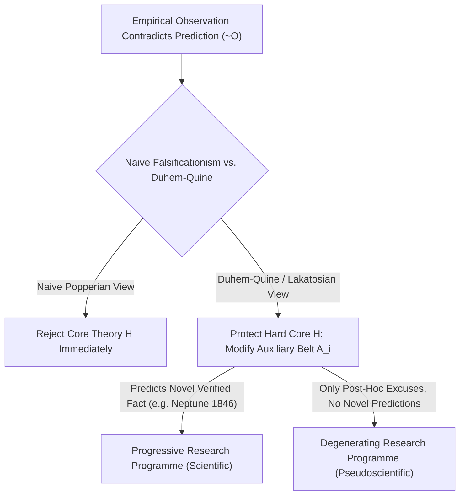
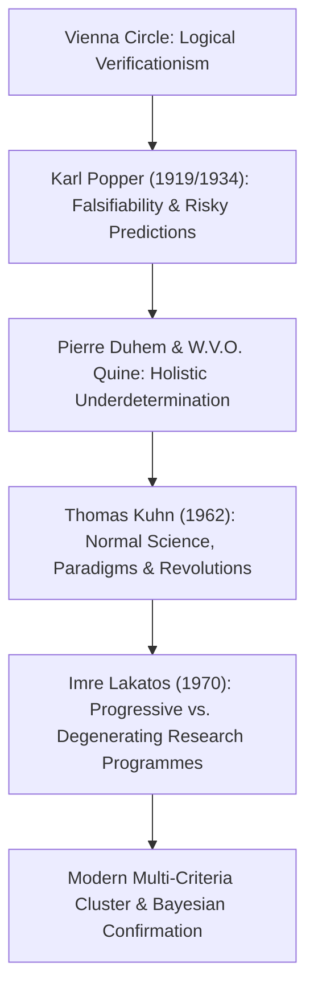

## 서론: 1919년 빈에서의 깨달음 — 구획 문제(Demarcation Problem)의 탄생

일상생활에서 우리는 흔히 ‘과학’을 ‘사실로 증명된 절대적 진리’와 동의어로 사용합니다. 그러나 점성술, 동종요법, 고대 연금술이나 각종 음모론처럼 스스로를 ‘과학적’이라고 주장하는 체계들 역시 무수히 많은 ‘경험적 확증 사례’를 내세웁니다. 점성술사는 언제나 별자리표에서 어제 당신이 겪은 일을 그럴듯하게 설명해 내며, 음모론자는 반대 증거조차 “음모가 그만큼 치밀하게 은폐되어 있다는 증거”로 둔갑시킵니다. 그렇다면 <strong>진정한 경험과학(Empirical Science)과 유사과학(Pseudoscience) 혹은 비과학적 형이상학을 가르는 본질적인 경계선은 과연 어디에 있을까요?</strong> 과학철학에서는 이를 <strong>구획 문제(The Demarcation Problem, *Abgrenzungsproblem*)</strong>라고 부릅니다.

20세기 초 슐리크와 카르나프가 이끈 <strong>빈 학파(논리실증주의 Logical Positivism)</strong>는 <strong>검증 가능성 원리(Verificationism)</strong>로 이 경계를 그으려 했습니다. 즉 감각 경험과 관찰에 의해 ‘참임이 입증(검증)’될 수 있는 명제만이 과학적 의미를 갖는다는 것입니다. 그러나 이 기준은 곧바로 18세기 철학자 데이비드 흄이 제기한 <strong>귀납의 문제(Problem of Induction)</strong>라는 암초에 부딪혔습니다. 모든 자연법칙은 전칭 명제(예: “모든 백조는 희다” 또는 “모든 질량은 만유인력 법칙 $orall x\, P(x)$를 따른다”)입니다. 우리가 백조를 만 마리, 혹은 십억 마리 관찰하더라도 유한한 관찰 사례만으로는 무한한 영역에 대한 전칭 명제를 연역적으로 절대 증명할 수 없습니다! 만약 ‘완전한 검증’을 기준으로 삼는다면 뉴턴 역학이나 맥스웰 전자기학조차 과학에서 추방당하고 맙니다.

1919년 5월 29일, 영국의 천문학자 아서 에딩턴(Arthur Eddington)은 서아프리카 프린시페 섬에서 개기일식을 관측하여 알베르트 아인슈타인의 일반 상대성 이론이 내놓은 대담한 정량적 예측(태양 가장자리를 스쳐 지나가는 별빛이 $1.75$초각 휘어진다는 예측; 뉴턴 중력 이론은 절반인 $0.875$초각 예측)을 검증했습니다. 당시 17세였던 빈의 청년 <strong>칼 포퍼(Karl Popper)</strong>는 이 사건에 깊은 충격을 받았습니다. 그는 아인슈타인 이론의 위대함이 이미 알려진 현상을 끼워 맞추는 데 있는 것이 아니라, <strong>관측 결과와 어긋나면 이론 전체가 즉각 파산할 수밖에 없는 ‘위험을 무릅쓴 예측(Risky Prediction)’</strong>을 기꺼이 감수했다는 점에 있음을 간파했습니다!

---

## 1. 칼 포퍼의 코페르니쿠스적 전환: 검증과 반증의 논리적 비대칭성

1934년 포퍼는 《과학적 발견의 논리》(*Logik der Forschung*)에서 유명한 <strong>반증 가능성 기준(Falsifiability Criterion)</strong>을 제시했습니다. 과학이 과학인 이유는 ‘절대 틀리지 않기 때문’이 아니라, 정반대로 <strong>‘틀릴 수 있기 때문(경험에 의해 반박될 수 있기 때문)’</strong>이라는 것입니다!
이 기준은 일차 술어 논리에서 성립하는 <strong>검증(Verification)과 반증(Falsification) 사이의 절대적인 논리적 비대칭성</strong>에 뿌리를 두고 있습니다.
- 아무리 많은 긍정적 관찰 사례 $O_1, O_2, \dots, O_n$을 모아도 보편 이론 $T$를 연역적으로 도출할 수 없습니다($T \implies O$와 $O$로부터 $T$를 결론짓는 것은 형식논리학의 ‘후건 긍정의 오류’입니다).
- 반면, 단 <strong>하나의</strong> 확실한 반례 $
eg O$(예: 호주에서 발견된 검은 백조 한 마리)만 나타나도, 우리는 연역 논리의 가장 엄밀한 추론 규칙인 <strong>후건 부정법(Modus Tollens)</strong>에 의해 $T \implies O$와 $
eg O$로부터 $
eg T$(이론 $T$는 거짓이다)를 $100\%$ 확실하게 도출할 수 있습니다!

따라서 포퍼는 다음과 같이 선언했습니다. 어떤 이론이 과학적일 필요충분조건은 그 이론이 특정한 관찰 가능한 사건의 발생을 금지하는 것, 즉 <strong>잠재적 반증자(Potential Falsifiers)의 집합이 공집합이 아닌 것</strong>입니다. 점성술이 유사과학인 이유는 예언을 모호하고 포괄적으로 서술하여 세상에서 어떤 일이 일어나도 사후적으로 끼워 맞출 수 있게 만들었기 때문입니다. <strong>일어날 수 있는 모든 결과를 다 설명할 수 있는 이론은 실제로는 아무것도 설명하지 못하는 것이며, 그 경험적 정보량은 $0$입니다!</strong> 포퍼에게 과학의 역사는 영원한 ‘대담한 추측과 혹독한 반박(Conjectures and Refutations)’의 진화 과정이며, 가혹한 시험을 견뎌낸 이론은 ‘참으로 증명된’ 것이 아니라 높은 <strong>건재성(Corroboration)</strong>을 획득한 잠정적 가설일 뿐입니다.

$$
\text{Modus Tollens:} \quad \frac{T \implies O, \quad \neg O}{\therefore \neg T}
$$

$$
\text{Duhem-Quine Holistic Conjunction:} \quad \big( H \land A_1 \land A_2 \land \dots \land A_n \land C_{\text{init}} \big) \implies O
$$

$$
\neg O \implies \neg H \lor \neg A_1 \lor \neg A_2 \lor \dots \lor \neg A_n \lor \neg C_{\text{init}}
$$

---

## 2. 소박한 반증주의의 위기: 뒤엠-콰인 총체주의 논제와 해왕성의 발견

포퍼의 반증 가능성 기준은 명쾌하고 강력했지만, 과학사학자들이 이를 실제 물리학의 역사와 대조해 보자 치명적인 문제가 드러났습니다. <strong>만약 과학자들이 정말로 소박한 반증주의(Naive Falsificationism) 교리대로 행동했다면, 현대 과학은 요람에서 일찌감치 질식사했을 것입니다!</strong>

프랑스 물리학자 피에르 뒤엠(Pierre Duhem, 1906)과 미국 철학자 윌러드 밴 오먼 콰인(W.V.O. Quine, 1951)은 유명한 <strong>뒤엠-콰인 논제(Duhem-Quine Thesis / 총체주의적 과소결정성 Holistic Underdetermination)</strong>를 제시했습니다. 실제 과학 연구에서는 어떤 핵심 이론 가설 $H$(예: 뉴턴의 만유인력 법칙 $F = G m_1 m_2 / r^2$)도 <strong>단독으로는</strong> 관측 가능한 경험적 예측 $O$를 도출할 수 없습니다! 내일 밤 행성의 위치를 계산하려면 핵심 이론 $H$뿐만 아니라 수많은 <strong>보조 가설(Auxiliary Hypotheses)</strong> $A_1, A_2, \dots, A_n$(예: “태양계에는 알려진 행성이 7개뿐이다”, “우주 공간에는 저항 매질이 없다”, “망원경의 대기 굴절 보정식이 정확하다”)과 초기 조건 $C_{	ext{init}}$을 함께 결합해야 합니다.
따라서 관측 결과가 예측과 어긋날 때($
eg O$), 후건 부정법이 우리에게 알려주는 것은 단지 전체 연언 명제 $(H \land A_1 \land \dots \land A_n \land C_{	ext{init}})$이 거짓이라는 사실뿐입니다! 논리학 자체는 <strong>핵심 이론 $H$가 틀렸는지, 아니면 보조 가설 $A_i$ 중 하나가 틀렸는지 결코 알려주지 못합니다!</strong>

과학사에서 가장 극적인 사례가 바로 <strong>1846년 해왕성(Neptune)의 발견</strong>입니다. 19세기 초 천문학자들은 천왕성의 실제 궤도가 뉴턴 역학으로 계산한 궤도와 심각하게 어긋난다는 사실($
eg O$)을 발견했습니다. 당시 물리학자들이 포퍼의 규칙대로 “뉴턴의 만유인력 법칙이 반증되었다!”라고 선언했을까요? 전혀 그렇지 않았습니다! 프랑스의 르베리에(Urbain Le Verrier)와 영국의 애덤스(John Couch Adams)는 뉴턴 법칙 $H$를 굳게 신뢰하는 대신 보조 가설 $A_1$(행성의 개수)을 수정하여 천왕성 바깥에 미지의 8번째 행성이 존재한다고 가정하고 그 궤도를 계산했습니다. 그리고 1846년 9월 23일, 베를린 천문대의 갈레가 예측 위치에서 $1^\circ$도 채 벗어나지 않은 곳에서 <strong>해왕성</strong>을 발견했습니다! 뉴턴 역학을 반증할 뻔했던 위기가 오히려 뉴턴 역학의 가장 위대한 승리로 뒤바뀐 것입니다. 반대로 르베리에가 수성의 근일점 세차운동 오차(세기당 $43$초각)를 설명하기 위해 수성 안쪽에 가상의 행성 ‘불칸(Vulcan)’을 도입했을 때는 실패로 끝났고, 이때는 핵심 이론 $H$ 자체가 아인슈타인의 일반 상대성 이론으로 대체되어야 했습니다.

---

## 3. 쿤의 패러다임, 라카토스의 연구 프로그램과 현대 다차원 구획 기준

과학적 합리성을 구출하고 실제 과학사의 역동성을 설명하기 위해 20세기 후반 과학철학은 세 단계의 도약을 이루었습니다.
1. <strong>토머스 쿤(Thomas Kuhn)의 《과학혁명의 구조》(1962)</strong>: 쿤은 대부분의 <strong>정상과학(Normal Science)</strong> 시기에 과학자들은 자신의 핵심 이론을 반증하려 애쓰는 것이 아니라, 지배적인 <strong>패러다임(Paradigm)</strong> 안에서 ‘퍼즐 풀이(Puzzle-solving)’를 수행한다고 지적했습니다. 변칙 사례(Anomaly)가 나타나도 이를 즉각 반증으로 받아들이지 않고 보류하거나 주변부 가설을 조정하며, 변칙이 누적되어 심각한 <strong>위기(Crisis)</strong>가 닥치고 새로운 대안 패러다임이 등장할 때 비로소 <strong>패러다임 전환(Paradigm Shift / 과학혁명)</strong>이 일어납니다.
2. <strong>임레 라카토스(Imre Lakatos)의 ‘과학적 연구 프로그램 방법론(MSRP, 1970)’</strong>: 라카토스는 포퍼와 쿤을 정교하게 결합했습니다. 과학적 평가의 기본 단위는 고립된 단일 가설이 아니라 시간 속에서 진화하는 <strong>연구 프로그램(Research Programme)</strong>입니다. 모든 연구 프로그램은 절대 포기하지 않는 <strong>견고한 핵(Hard Core, 예: 뉴턴의 운동 법칙)</strong>과, 핵을 방어하기 위해 끊임없이 수정되는 주변부의 <strong>보조 가설 보호대(Protective Belt)</strong>로 구성됩니다. 그렇다면 과학과 유사과학은 어떻게 구별될까요? 라카토스는 보호대를 수정하는 방식이 <strong>전진적(Progressive)</strong>인지 아니면 <strong>퇴행적(Degenerating)</strong>인지에 달려 있다고 보았습니다!
   - <strong>전진적 연구 프로그램(진정한 과학)</strong>: 보호대의 수정이 기존의 변칙 사례를 설명할 뿐만 아니라, <strong>이전에 아무도 예상하지 못했던 새로운 경험적 사실(Novel Facts)을 예측</strong>하고 그중 일부가 실험적으로 확증되는 경우(예: 해왕성 예측).
   - <strong>퇴행적 연구 프로그램(유사과학)</strong>: 반례가 나타날 때마다 오직 사후적인 <strong>임시방편적 변명(Ad hoc modifications)</strong>으로만 구멍을 메울 뿐, 단 하나의 새로운 검증 가능한 예측도 내놓지 못하는 경우!
3. <strong>가족 유사성과 현대 과학의 최전선</strong>: 래리 라우든(Larry Laudan, 1983)이 지적했듯, 모든 과학과 유사과학을 단 하나의 필요충분조건으로 가르는 마법의 칼날은 존재하지 않습니다. 오늘날 마시모 피글리우치(Massimo Pigliucci)와 마르틴 마너(Martin Mahner) 등 현대 과학철학자들은 비트겐슈타인의 <strong>가족 유사성(Family Resemblance) 및 다중 기준 군집 모델</strong>과 <strong>베이즈주의 확증 이론(Bayesian Confirmation Theory)</strong>을 결합하여 반증 가능성, 라카토스적 전진성, 내적 일관성, 인접 학문과의 통섭적 정합성(Consilience), 동료 심사 및 <strong>재현 가능성(Reproducibility)</strong>을 종합적으로 평가합니다. 현대 심리학과 의학계의 <strong>재현성 위기(Replication Crisis, $p$-해킹 방지와 사전등록제 Registered Reports)</strong> 및 초끈 이론(String Theory)과 다중우주(Multiverse)를 둘러싼 논쟁에서, 포퍼에서 라카토스로 이어지는 구획의 철학은 여전히 인류의 합리성을 지키는 가장 날카로운 나침반입니다.

| 과학철학 사조 / 학자 | 핵심 구획 기준 (Demarcation Criterion) | 변칙 관측($
eg O$)에 대한 대응 메커니즘 | 핵심 강점과 역사적 한계 |
| :--- | :--- | :--- | :--- |
| <strong>논리실증주의 (빈 학파)</strong> | <strong>검증 가능성 (Verificationism)</strong>: 감각 관찰 명제로의 환원 | 전칭 법칙의 귀납적 증명 불가능 | 순수 형이상학을 배제했으나 흄의 귀납 문제로 보편 자연법칙까지 배제하는 모순 발생 |
| <strong>소박한 반증주의 (포퍼 1934)</strong> | <strong>반증 가능성 (Falsifiability)</strong>: 잠재적 반증자와 위험한 예측 | 후건 부정법 $
eg O \implies 
eg T$로 즉각 이론 폐기 | 검증과 반증의 논리적 비대칭성을 규명했으나 보조 가설 수정(해왕성 발견) 설명 불가 |
| <strong>역사주의 패러다임론 (쿤 1962)</strong> | <strong>퍼즐 풀이 능력과 공동체 패러다임 (Paradigm)</strong> | 정상과학에서는 변칙 보류; 위기 시 패러다임 혁명 | 실제 과학사의 사회학적 작동을 설명했으나 공약 불가능성 및 상대주의 논란 초래 |
| <strong>과학적 연구 프로그램 (라카토스 1970)</strong> | <strong>프로그램의 전진성 vs. 퇴행성</strong> (새로운 사실 Novel Facts 예측) | <strong>견고한 핵</strong>을 보호하고 <strong>보호대</strong>를 수정하여 새 예측 시험 | 해왕성 같은 과학적 수정과 유사과학의 사후 임시방편(Ad hoc) 변명을 완벽히 구별 |
| <strong>현대 다차원 군집 및 베이즈주의</strong> | <strong>다중 기준 클러스터 (검증성 + 정합성 + 재현성 + 베이즈 인수)</strong> | 베이즈 확률 갱신 및 사전등록제로 $p$-hacking 차단 | 법정 판결(창조과학 재판 등)과 현대 빅데이터/첨단 이론 물리학 평가의 표준 도구 |

$$
P(H \mid E) = \frac{P(E \mid H)\,P(H)}{P(E \mid H)\,P(H) + P(E \mid \neg H)\,P(\neg H)}, \qquad \frac{P(H \mid E)}{P(\neg H \mid E)} = \text{BF}_{10}(E) \cdot \frac{P(H)}{P(\neg H)}
$$

$$
\text{Popper Corroboration:} \quad C(H, E) = \frac{P(E \mid H) - P(E)}{P(E \mid H) + P(E) - P(E \land H)}
$$
