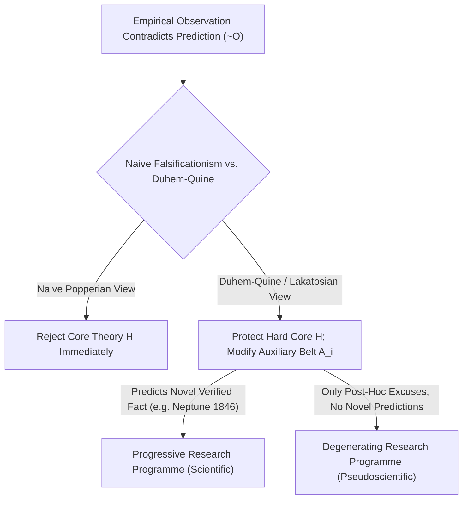
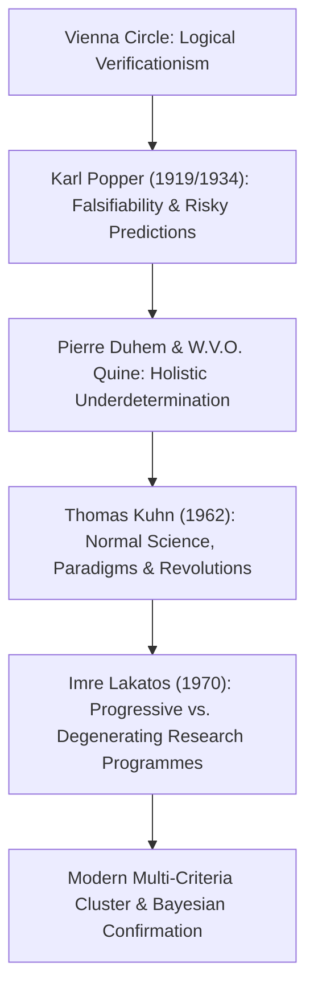

## Introdução: A Epifania Vienense de 1919 — O Nascimento do Problema da Demarcação

No cotidiano, costumamos tratar a palavra “ciência” como sinônimo de “verdade absoluta provada pelos fatos”. Contudo, inúmeras doutrinas que reivindicam o título de ciência — como astrologia, homeopatia, alquimia ou teorias da conspiração — também se orgulham de acumular milhares de “confirmações empíricas”: um astrólogo sempre encontrará no mapa astral uma explicação para o que lhe aconteceu ontem, e um teórico da conspiração interpretará até a ausência total de provas como a evidência suprema de quão bem a conspiração foi ocultada. <strong>Onde passa, então, a fronteira epistemológica exata entre a verdadeira ciência empírica e a pseudociência?</strong> Na filosofia da ciência, essa questão central é chamada de <strong>problema da demarcação (*Demarcation Problem* / *Abgrenzungsproblem*)</strong>.

No início do século XX, o <strong>Círculo de Viena (positivismo lógico)</strong>, liderado por Moritz Schlick e Rudolf Carnap, tentou traçar essa linha por meio do <strong>critério verificacionista de significado</strong>: uma proposição só teria sentido científico se pudesse ser conclusivamente verificada por observações empíricas. Mas esse critério logo colidiu com o clássico <strong>problema da indução de David Hume</strong>: toda lei científica é uma proposição universal da forma $orall x\, P(x)$ (“todos os cisnes são brancos” ou “toda massa obedece à gravitação universal”). Nem mesmo um bilhão de cisnes brancos observados podem provar dedutivamente uma lei universal sobre infinitos casos! Se exigíssemos verificação completa, até a física de Newton seria expulsa da ciência.

Em 29 de maio de 1919, durante um eclipse solar total na Ilha do Príncipe, o astrônomo britânico Arthur Eddington mediu a deflexão da luz das estrelas ao tangenciar o Sol e confirmou a ousada previsão quantitativa da relatividade geral de Albert Einstein ($1,75$ segundo de arco, contra $0,875$ de Newton). Em Viena, o jovem de 17 anos <strong>Karl Popper</strong> viveu esse episódio como uma revelação intelectual: ele percebeu que a grandeza da teoria de Einstein não estava em acomodar fatos já conhecidos, mas na coragem de fazer uma <strong>previsão arriscada (*Risky Prediction*)</strong> que, se fosse desmentida pela observação, destruiria toda a teoria imediatamente!

---

## 1. A Revolução Copernicana de Karl Popper: A Assimetria Lógica entre Verificação e Falsificação

Em 1934, em *A Lógica da Pesquisa Científica* (*Logik der Forschung*), Popper propôs seu famoso <strong>critério da falsificabilidade (ou refutabilidade, *Falsifiability*)</strong>: o que torna uma teoria científica não é sua infalibilidade, mas exatamente o oposto: <strong>sua capacidade de entrar em conflito com a experiência e ser refutada</strong>!
Esse princípio baseia-se na <strong>assimetria lógica absoluta entre verificação e falsificação</strong> na lógica de predicados:
- Nenhuma quantidade finita de observações favoráveis $O_1, O_2, \dots, O_n$ permite deduzir logicamente uma lei universal $T$ (inferir $T$ a partir de $T \implies O$ e $O$ é a falácia formal da *afirmação do consequente*).
- Por outro lado, basta um <strong>único</strong> contraexemplo genuíno $
eg O$ (como avistar um único cisne negro na Austrália) para que, pela regra dedutiva rigorosa do <strong>Modus Tollens</strong>, de $T \implies O$ e $
eg O$ se deduza com certeza absoluta $
eg T$ (a falsidade da teoria $T$)!

Assim, Popper declarou: uma teoria é científica se e somente se proíbe certos eventos observáveis, isto é, se o conjunto de seus <strong>falsificadores potenciais (*Potential Falsifiers*)</strong> não for vazio. A astrologia é pseudociência porque formula suas previsões de modo tão vago que qualquer evento concebível pode ser explicado a posteriori: <strong>uma teoria que explica tudo o que possa acontecer na verdade não explica nada, e seu conteúdo informativo empírico é zero!</strong> Para Popper, a ciência avança por um processo evolutivo incessante de <strong>conjecturas e refutações</strong>; teorias que sobrevivem aos testes mais severos nunca são “provadas verdadeiras”, mas adquirem um alto grau de <strong>corroboração</strong>.

$$
\text{Modus Tollens:} \quad \frac{T \implies O, \quad \neg O}{\therefore \neg T}
$$

$$
\text{Duhem-Quine Holistic Conjunction:} \quad \big( H \land A_1 \land A_2 \land \dots \land A_n \land C_{\text{init}} \big) \implies O
$$

$$
\neg O \implies \neg H \lor \neg A_1 \lor \neg A_2 \lor \dots \lor \neg A_n \lor \neg C_{\text{init}}
$$

---

## 2. A Crise do Falsificacionismo Ingênuo: A Tese de Duhem-Quine e a Descoberta de Netuno

Por mais elegante que fosse o critério de Popper no plano lógico, seu confronto com a história real da física revelou um obstáculo formidável: <strong>se os cientistas tivessem seguido literalmente o falsificacionismo ingênuo, todas as grandes teorias científicas teriam morrido no berço!</strong>

O físico francês Pierre Duhem (1906) e o filósofo norte-americano W.V.O. Quine (1951) formularam a célebre <strong>tese de Duhem-Quine (subdeterminação holista)</strong>: na prática científica real, uma hipótese teórica central $H$ (como a lei da gravitação de Newton $F = G m_1 m_2 / r^2$) <strong>jamais pode, sozinha</strong>, implicar uma previsão observável $O$! Para calcular a posição de um planeta amanhã à noite, é indispensável combinar $H$ com toda uma rede de <strong>hipóteses auxiliares (*Auxiliary Hypotheses*)</strong> $A_1, A_2, \dots, A_n$ (por exemplo: “existem apenas sete planetas no sistema solar”, “o espaço interplanetário não tem atrito”, “o telescópio não sofre aberração óptica”) e condições iniciais $C_{	ext{init}}$.
Portanto, quando uma observação contradiz a previsão ($
eg O$), o Modus Tollens nos diz apenas que a conjunção inteira $(H \land A_1 \land \dots \land A_n \land C_{	ext{init}})$ é falsa! A lógica pura é <strong>incapaz de nos dizer se o erro está no núcleo teórico $H$ ou em alguma das hipóteses auxiliares $A_i$</strong>!

O episódio mais famoso da história da ciência é a <strong>descoberta do planeta Netuno em 1846</strong>: no início do século XIX, a órbita observada de Urano divergia gravemente dos cálculos newtonianos ($
eg O$). Os físicos declararam a gravitação de Newton refutada? De modo algum! O francês Urbain Le Verrier e o inglês John Couch Adams mantiveram intocado o núcleo newtoniano $H$ e modificaram a hipótese auxiliar $A_1$, postulando um oitavo planeta desconhecido além de Urano. Em 23 de setembro de 1846, no observatório de Berlim, Johann Gottfried Galle apontou seu telescópio para as coordenadas calculadas por Le Verrier e encontrou <strong>Netuno</strong> a menos de $1^\circ$ de distância! Uma aparente refutação transformou-se no maior triunfo da mecânica de Newton. Em contrapartida, quando Le Verrier tentou explicar a precessão anômala do periélio de Mercúrio ($43''$ por século) postulando um planeta interior chamado “Vulcano”, fracassou — dessa vez foi realmente necessário substituir o núcleo newtoniano $H$ pela relatividade geral de Einstein.

---

## 3. Os Paradigmas de Kuhn, os Programas de Lakatos e os Modelos Multicritério Modernos

Para salvar a racionalidade científica e explicar a história real da ciência, a filosofia da ciência da segunda metade do século XX deu três passos decisivos:
1. <strong>*A Estrutura das Revoluções Científicas* de Thomas Kuhn (1962)</strong>: Kuhn mostrou que durante os longos períodos de <strong>ciência normal</strong>, os cientistas não tentam refutar seu <strong>paradigma</strong>, mas dedicam-se à “resolução de quebra-cabeças” (*puzzle-solving*). As anomalias são deixadas de lado; somente quando seu acúmulo gera uma <strong>crise</strong> profunda e surge um paradigma rival ocorre uma <strong>mudança de paradigma (revolução científica)</strong>.
2. <strong>A *Metodologia dos Programas de Pesquisa Científica* de Imre Lakatos (MSRP, 1970)</strong>: Lakatos sintetizou brilhantemente Popper e Kuhn. A unidade de avaliação científica não é uma hipótese isolada, mas um <strong>programa de pesquisa</strong> histórico composto por um <strong>núcleo firme (*Hard Core*)</strong> intocável e um <strong>cinturão protetor de hipóteses auxiliares (*Protective Belt*)</strong> que se modifica para absorver anomalias. Como distinguir então a ciência da pseudociência? Lakatos responde: depende de se as mudanças no cinturão protetor são <strong>progressivas</strong> ou <strong>degenerativas</strong>!
   - Um <strong>programa de pesquisa progressivo (ciência genuína)</strong> modifica suas hipóteses auxiliares de modo que não apenas explica as anomalias antigas, mas <strong>prevê fatos novos e inesperados (*Novel Facts*)</strong> que são confirmados empiricamente (como a descoberta de Netuno).
   - Um <strong>programa de pesquisa degenerativo (pseudociência)</strong> limita-se a remendos pós-fato (<strong>modificações *ad hoc*</strong>) para salvar as aparências, sem jamais prever um único fato novo testável!
3. <strong>Semelhança de Família e Desafios Contemporâneos</strong>: Após Larry Laudan (1983) demonstrar que não existe uma única condição necessária e suficiente, filósofos atuais como Massimo Pigliucci e Martin Mahner utilizam <strong>modelos multicritério de “semelhança de família” (Wittgenstein)</strong> combinados com a <strong>teoria bayesiana da confirmação</strong>. Diante da atual <strong>crise de reprodutibilidade</strong> ($p$-hacking, HARKing e *Registered Reports* na psicologia e biomedicina) e dos debates sobre a teoria das cordas e o multiverso, o legado de Popper e Lakatos continua sendo a bússola indispensável da integridade científica.

| Corrente Filosófica | Critério de Demarcação | Resposta Diante de Anomalia ($
eg O$) | Forças e Limites Históricos |
| :--- | :--- | :--- | :--- |
| <strong>Positivismo Lógico (Círculo de Viena)</strong> | <strong>Verificabilidade</strong>: redução a enunciados observacionais | Leis universais são indemonstráveis por indução | Exclui a metafísica, mas naufraga diante do problema de Hume |
| <strong>Falsificacionismo Ingênuo (Popper 1934)</strong> | <strong>Falsificabilidade</strong>: falsificadores potenciais e previsões arriscadas | Modus Tollens $
eg O \implies 
eg T$ refuta a teoria | Explica a assimetria lógica, mas esbarra na tese de Duhem-Quine |
| <strong>Historicismo e Paradigmas (Kuhn 1962)</strong> | <strong>Resolução de quebra-cabeças dentro de um paradigma</strong> | Ciência normal tolera anomalias até a crise | Fiel à história real, mas exposto ao relativismo |
| <strong>Programas de Pesquisa (Lakatos 1970)</strong> | <strong>Programa progressivo vs. degenerativo</strong> (*Novel Facts*) | Núcleo firme protegido; cinturão auxiliar ajustado | Distingue descobertas (Netuno) de desculpas *ad hoc* |
| <strong>Modelos Multicritério e Bayesianismo</strong> | <strong>Cluster multicritério + Fator de Bayes + Reprodutibilidade</strong> | Atualização bayesiana e pré-registro contra $p$-hacking | Padrão em decisões judiciais (*Kitzmiller*) e ciência aberta atual |

$$
P(H \mid E) = \frac{P(E \mid H)\,P(H)}{P(E \mid H)\,P(H) + P(E \mid \neg H)\,P(\neg H)}, \qquad \frac{P(H \mid E)}{P(\neg H \mid E)} = \text{BF}_{10}(E) \cdot \frac{P(H)}{P(\neg H)}
$$

$$
\text{Popper Corroboration:} \quad C(H, E) = \frac{P(E \mid H) - P(E)}{P(E \mid H) + P(E) - P(E \land H)}
$$
