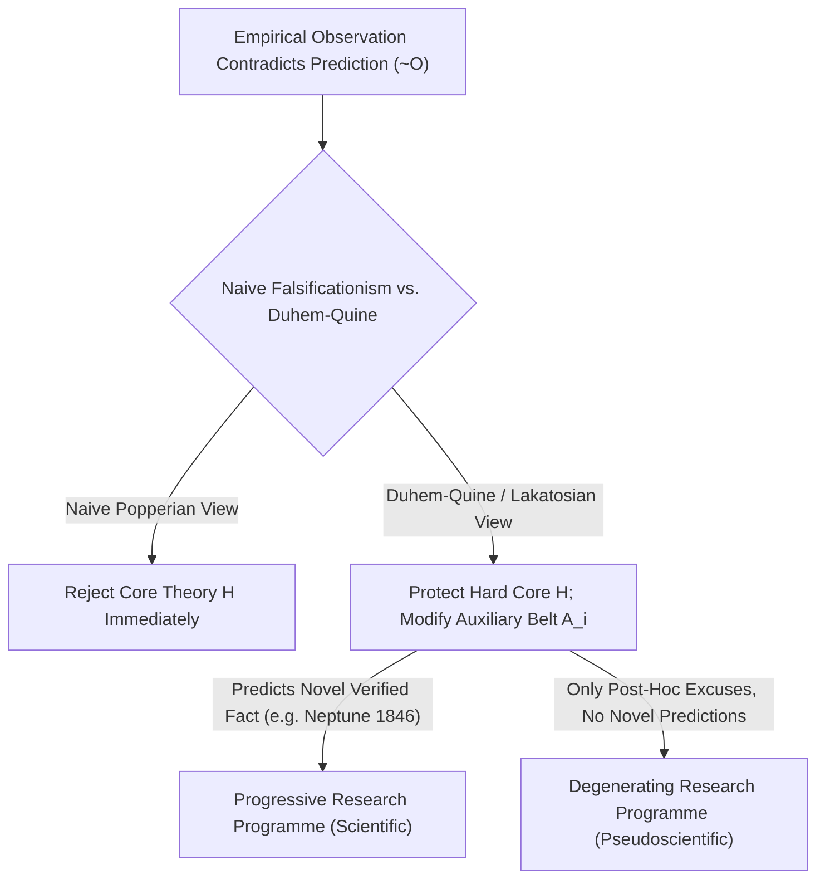
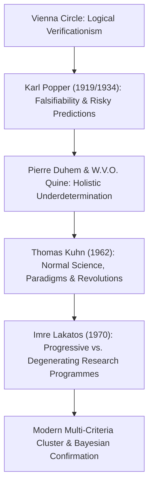

## Введение: Венское озарение 1919 года — Рождение проблемы демаркации

В повседневной жизни мы часто отождествляем слово «наука» с «абсолютной истиной, доказанной фактами». Однако множество учений, претендующих на статус науки — таких как астрология, гомеопатия, алхимия или конспирологические концепции истории, — точно так же гордятся тысячами «эмпирических подтверждений»: астролог всегда найдёт в натальной карте объяснение вчерашней неудаче, а сторонник теории заговора истолкует даже полное отсутствие улик как лучшее доказательство того, насколько искусно заговорщики заметают следы. <strong>Где же проходит точная эпистемологическая граница между подлинной эмпирической наукой и псевдонаукой (лженаукой)?</strong> В философии науки этот фундаментальный вопрос называется <strong>проблемой демаркации (Demarcation Problem / *Abgrenzungsproblem*)</strong>.

В начале XX века <strong>Венский кружок (логический позитивизм)</strong> во главе с Морицем Шликом и Рудольфом Карнапом попытался провести эту границу с помощью <strong>принципа верифицируемости (Verificationism)</strong>: утверждение имеет научный смысл тогда и только тогда, когда его истинность можно окончательно установить (*верифицировать*) путём чувственного наблюдения. Но этот критерий быстро разбился о знаменитую <strong>проблему индукции Дэвида Юма</strong>: любой закон природы представляет собой универсальное высказывание вида $orall x\, P(x)$ («все лебеди белые» или «все массивные тела подчиняются закону всемирного тяготения»). Даже миллиард наблюдений белых лебедей не может дедуктивно доказать истинность общего закона для бесконечного числа случаев! Если требовать полной верификации, то из науки придётся исключить даже механику Ньютона.

29 мая 1919 года во время полного солнечного затмения на острове Принсипи британский астроном Артур Эддингтон измерил отклонение света звёзд вблизи солнечного диска и подтвердил смелое количественное предсказание общей теории относительности Альберта Эйнштейна ($1{,}75$ угловой секунды против $0{,}875$ по Ньютону). В Вене 17-летний <strong>Карл Поппер</strong> пережил это событие как интеллектуальное откровение: он понял, что величие теории Эйнштейна заключалось не в умении задним числом объяснять известные факты, а в смелости сделать <strong>рискованное предсказание (Risky Prediction)</strong>, провал которого на эксперименте немедленно уничтожил бы всю теорию!

---

## 1. Коперниканский переворот Карла Поппера: Логическая асимметрия верификации и фальсификации

В 1934 году в книге «Логика научного исследования» (*Logik der Forschung*) Поппер выдвинул свой знаменитый <strong>критерий фальсифицируемости (опровержимости, Falsifiability)</strong>: научность теории определяется не её безошибочностью, а, напротив, её <strong>принципиальной уязвимостью для опытного опровержения</strong>!
Этот критерий опирается на фундаментальную <strong>логическую асимметрию между верификацией и фальсификацией</strong> в логике предикатов:
- Никакое конечное число подтверждающих наблюдений $O_1, O_2, \dots, O_n$ не позволяет дедуктивно вывести универсальную теорию $T$ (вывод $T$ из $T \implies O$ и $O$ является формальной логической ошибкой *утверждения консеквента*).
- Напротив, достаточно <strong>одного-единственного</strong> достоверного контрпримера $
eg O$ (например, обнаружения одного чёрного лебедя в Австралии), чтобы по железному дедуктивному правилу <strong>Modus Tollens</strong> из $T \implies O$ и $
eg O$ со стопроцентной строгостью вывести $
eg T$ (ложность теории $T$)!

Поэтому Поппер провозгласил: теория научна тогда и только тогда, когда она запрещает некоторые мыслимые наблюдаемые события, то есть когда множество её <strong>потенциальных фальсификаторов (Potential Falsifiers)</strong> не пусто. Астрология является псевдонаукой именно потому, что формулирует свои прогнозы настолько расплывчато, что любой исход можно истолковать в её пользу — <strong>теория, способная объяснить абсолютно всё, на самом деле не объясняет ничего, а её эмпирическое информационное содержание равно нулю!</strong> По Попперу, наука развивается через бесконечную череду <strong>предположений и опровержений (Conjectures and Refutations)</strong>; теории, выдержавшие суровые проверки, никогда не становятся «доказанными истинами», а лишь приобретают высокую степень <strong>подкреплённости (Corroboration)</strong>.

$$
\text{Modus Tollens:} \quad \frac{T \implies O, \quad \neg O}{\therefore \neg T}
$$

$$
\text{Duhem-Quine Holistic Conjunction:} \quad \big( H \land A_1 \land A_2 \land \dots \land A_n \land C_{\text{init}} \big) \implies O
$$

$$
\neg O \implies \neg H \lor \neg A_1 \lor \neg A_2 \lor \dots \lor \neg A_n \lor \neg C_{\text{init}}
$$

---

## 2. Кризис наивного фальсификационизма: Тезис Дюэма — Куайна и открытие Нептуна

Каким бы безупречным ни казался критерий Поппера с точки зрения чистой логики, его сопоставление с реальной историей физики выявило серьёзную проблему: <strong>если бы учёные действительно следовали наивному фальсификационизму, все великие научные теории были бы отброшены ещё в колыбели!</strong>

Французский физик Пьер Дюэм (1906) и американский философ Уиллард Ван Орман Куайн (1951) сформулировали знаменитый <strong>тезис Дюэма — Куайна (холистская недоопределённость)</strong>: в реальной науке изолированная фундаментальная гипотеза $H$ (например, закон всемирного тяготения Ньютона $F = G m_1 m_2 / r^2$) <strong>никогда не может сама по себе</strong> породить наблюдаемое предсказание $O$! Чтобы вычислить положение планеты на завтрашнюю ночь, необходимо объединить $H$ с целым комплексом <strong>вспомогательных гипотез (Auxiliary Hypotheses)</strong> $A_1, A_2, \dots, A_n$ (например: «в Солнечной системе ровно семь планет», «межпланетное пространство пусто», «телескоп не даёт оптических искажений») и начальными условиями $C_{	ext{init}}$.
Следовательно, когда наблюдение противоречит предсказанию ($
eg O$), правило Modus Tollens говорит нам лишь о том, что ложна вся конъюнкция $(H \land A_1 \land \dots \land A_n \land C_{	ext{init}})$ в целом! Чистая логика <strong>не способна указать, скрывается ли ошибка в ядре теории $H$ или в одной из вспомогательных гипотез $A_i$</strong>!

Самый яркий пример в истории науки — <strong>открытие планеты Нептун в 1846 году</strong>: в начале XIX века наблюдаемая орбита Урана существенно отклонялась от расчётов ньютоновской механики ($
eg O$). Объявили ли астрономы закон тяготения Ньютона опровергнутым? Ничуть! Француз Урбен Леверье и англичанин Джон Кауч Адамс сохранили неприкосновенным ньютоновское ядро $H$, но изменили вспомогательную гипотезу $A_1$, предположив существование восьмой неизвестной планеты за орбитой Урана. 23 сентября 1846 года в Берлинской обсерватории Иоганн Готфрид Галле навёл телескоп в рассчитанную Леверье точку и менее чем в $1^\circ$ от неё обнаружил <strong>Нептун</strong>! Кажущееся опровержение обернулось величайшим триумфом механики Ньютона. Напротив, когда позже Леверье попытался аналогичным образом объяснить аномальное смещение перигелия Меркурия ($43''$ в столетие) гипотетической планетой «Вулкан», его постигла неудача — в этом случае пришлось заменить само ньютоновское ядро $H$ на общую теорию относительности Эйнштейна.

---

## 3. Парадигмы Куна, исследовательские программы Лакатоса и современные многомерные критерии

Чтобы спасти научную рациональность и объяснить реальную историю науки, философия науки второй половины XX века совершила три решающих шага:
1. <strong>«Структура научных революций» Томаса Куна (1962)</strong>: Кун показал, что в длительные периоды <strong>нормальной науки</strong> учёные вовсе не пытаются опровергнуть свою <strong>парадигму</strong>, а занимаются «решением головоломок» (*puzzle-solving*). Аномалии откладываются в сторону; и лишь когда их накопление вызывает глубокий <strong>кризис</strong> и появляется конкурирующая парадигма, происходит <strong>смена парадигмы (научная революция)</strong>.
2. <strong>«Методология научно-исследовательских программ» Имре Лакатоса (MSRP, 1970)</strong>: Лакатос блестяще синтезировал идеи Поппера и Куна. Единицей научной оценки является не отдельная гипотеза, а развивающаяся во времени <strong>исследовательская программа (Research Programme)</strong>, состоящая из неприкосновенного <strong>жёсткого ядра (Hard Core)</strong> и гибкого <strong>защитного пояса вспомогательных гипотез (Protective Belt)</strong>, который принимает на себя удары аномалий. Как же тогда отличить науку от лженауки? Лакатос отвечает: всё зависит от того, являются ли изменения защитного пояса <strong>прогрессивными</strong> или <strong>вырождающимися (регрессивными)</strong>!
   - <strong>Прогрессивная исследовательская программа (подлинная наука)</strong> модифицирует защитный пояс так, что это не только объясняет старые аномалии, но и <strong>предсказывает совершенно новые, неожиданные эмпирические факты (Novel Facts)</strong>, подтверждаемые опытом (как открытие Нептуна).
   - <strong>Вырождающаяся программа (лженаука)</strong> ограничивается заплатками задним числом (<strong>уловками *ad hoc*</strong>) ради спасения видимости, не давая ни одного нового проверяемого предсказания!
3. <strong>Семейное сходство и современные вызовы</strong>: После того как Ларри Лаудан (1983) показал отсутствие единого необходимого и достаточного критерия, современные философы (Массимо Пильюччи, Мартин Манер) используют <strong>многомерные кластерные модели «семейного сходства» (по Витгенштейну)</strong> в сочетании с <strong>байесовской теорией подтверждения</strong>. В эпоху борьбы с <strong>кризисом воспроизводимости</strong> ($p$-hacking, HARKing и пререгистрация исследований в психологии и биомедицине), а также споров вокруг теории струн и мультивселенной наследие Поппера и Лакатоса остаётся главным щитом научной честности.

| Философское направление | Критерий демаркации | Реакция на аномалию ($
eg O$) | Сильные стороны и исторические границы |
| :--- | :--- | :--- | :--- |
| <strong>Логический позитивизм (Венский кружок)</strong> | <strong>Верифицируемость</strong>: сведение к протокольным предложениям | Универсальные законы недоказуемы индуктивно | Отсекает метафизику, но рушится из-за проблемы индукции Юма |
| <strong>Наивный фальсификационизм (Поппер 1934)</strong> | <strong>Фальсифицируемость</strong>: потенциальные фальсификаторы | Modus Tollens $
eg O \implies 
eg T$ отвергает теорию | Выявляет логическую асимметрию, но уязвим для тезиса Дюэма — Куайна |
| <strong>Историцизм и парадигмы (Кун 1962)</strong> | <strong>Решение головоломок внутри парадигмы</strong> | Нормальная наука терпит аномалии вплоть до кризиса | Реалистичен исторически, но ведёт к релятивизму |
| <strong>Исследовательские программы (Лакатос 1970)</strong> | <strong>Прогрессивный vs. регрессивный сдвиг проблем</strong> (*Novel Facts*) | Жёсткое ядро защищено; меняется защитный пояс | Чётко отделяет научные открытия (Нептун) от уловок *ad hoc* |
| <strong>Кластерные и байесовские модели</strong> | <strong>Многокритериальный профиль + фактор Байеса + воспроизводимость</strong> | Байесовское обновление и пререгистрация против $p$-hacking | Стандарт в судебной экспертизе (*Kitzmiller*) и современной науке |

$$
P(H \mid E) = \frac{P(E \mid H)\,P(H)}{P(E \mid H)\,P(H) + P(E \mid \neg H)\,P(\neg H)}, \qquad \frac{P(H \mid E)}{P(\neg H \mid E)} = \text{BF}_{10}(E) \cdot \frac{P(H)}{P(\neg H)}
$$

$$
\text{Popper Corroboration:} \quad C(H, E) = \frac{P(E \mid H) - P(E)}{P(E \mid H) + P(E) - P(E \land H)}
$$
