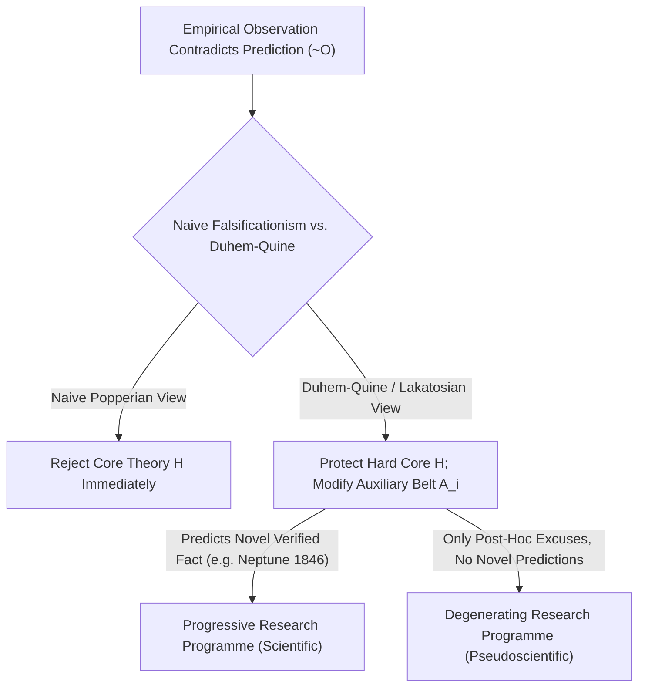
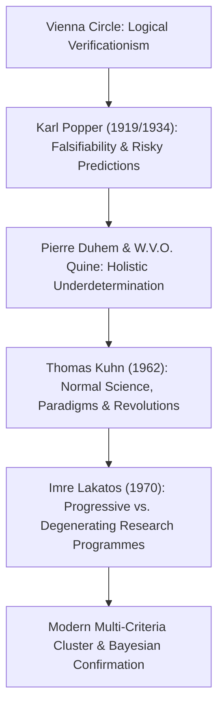

## 引言：1919年的维也纳顿悟——划界问题（Demarcation Problem）的诞生

在日常生活中，我们常常把“科学”当作“已被事实证明的绝对真理”的代名词。然而，许多自称“科学”的体系——如占星术、顺势疗法、古代炼金术或某些宏大的历史宿命论——同样宣称自己拥有海量的“经验验证案例”：占星师总能从星盘中为你昨天的遭遇找到完美解释，阴谋论者也能把任何反面证据解释为“阴谋掩盖得太深”的明证。那么，<strong>真正的经验科学（Empirical Science）与伪科学（Pseudoscience）或非科学形而上学之间的本质边界究竟在哪里？</strong>在科学哲学中，这被称为<strong>划界问题（The Demarcation Problem, *Abgrenzungsproblem*）</strong>。

20世纪初，以石里克、卡尔纳普为代表的<strong>维也纳学派（逻辑实证主义 Logical Positivism）</strong>曾试图用<strong>可证实性原则（Verificationism）</strong>来划定边界：一个命题只有当它能被感官经验观察所“证实”时，才具有科学意义。然而，这一标准很快撞上了18世纪哲学家大卫·休谟提出的<strong>休谟归纳问题（Problem of Induction）</strong>：任何科学定律都是全称命题（例如“所有天鹅都是白的”或“所有质量都遵循万有引力定律 $orall x\, P(x)$”）。无论我们观察了一万只还是十亿只白天鹅，有限的经验观察永远无法在演绎逻辑上证明一个无限域的全称命题！如果以“完全证实”为标准，连牛顿力学和麦克斯韦电磁学都会被开除出科学殿堂。

1919年5月29日，英国天文学家亚瑟·爱丁顿（Arthur Eddington）率队在西非普林西比岛观测日全食，检验阿尔伯特·爱因斯坦广义相对论做出的惊人定量预言：掠过太阳边缘的星光将偏折 $1.75$ 角秒（牛顿引力理论仅给出 $0.875$ 角秒）。当时年仅17岁的维也纳青年<strong>卡尔·波普尔（Karl Popper）</strong>深受震撼。他敏锐地意识到，爱因斯坦理论的伟大之处，不在于它能解释已知现象，而在于它敢于把脖子伸到断头台上，做出一个<strong>一旦观测不符就会令整个理论彻底破产的“高风险预言（Risky Prediction）”</strong>！

---

## 1. 卡尔·波普尔的哥白尼式反转：证实与证伪的逻辑不对称性

1934年，波普尔在《科学发现的逻辑》（*Logik der Forschung*）中提出了著名的<strong>可证伪性判据（Falsifiability Criterion）</strong>：科学之所以为科学，不在于它“不可错”，恰恰相反，在于它<strong>可错（可被经验反驳）</strong>！
这一判据植根于一阶谓词逻辑中<strong>证实（Verification）与证伪（Falsification）的绝对逻辑不对称性</strong>：
- 再多的正面观察 $O_1, O_2, \dots, O_n$ 也无法通过演绎逻辑推出全称理论 $T$（因为由 $T \implies O$ 和 $O$ 推出 $T$ 犯了形式逻辑中的“肯定后件谬误”）；
- 但是，只要出现<strong>一个</strong>确凿的反例 $
eg O$（例如在澳大利亚发现了一只黑天鹅），我们就可以依据演绎逻辑中最严密的<strong>否定后件律（Modus Tollens）</strong>，从 $T \implies O$ 与 $
eg O$ 绝对严格地推导出 $
eg T$（理论 $T$ 为假）！

因此，波普尔宣布：一个理论是科学的，当且仅当它禁止某些可观察事件的发生，即它的<strong>潜在证伪者集合（Potential Falsifiers）非空</strong>。占星术之所以是伪科学，正是因为它把预言写得模棱两可、包罗万象，使得宇宙中发生任何事情都能被它“事后解释”——<strong>一个能解释一切可能结果的理论，实际上什么也没有解释，它的经验信息含量为零！</strong>在波普尔看来，科学永远处于“大胆猜想与严酷反驳（Conjectures and Refutations）”的演化过程中；经受住严酷检验而未被证伪的理论并未被“证明为真”，而是获得了更高的<strong>验证度（Corroboration）</strong>。

$$
\text{Modus Tollens:} \quad \frac{T \implies O, \quad \neg O}{\therefore \neg T}
$$

$$
\text{Duhem-Quine Holistic Conjunction:} \quad \big( H \land A_1 \land A_2 \land \dots \land A_n \land C_{\text{init}} \big) \implies O
$$

$$
\neg O \implies \neg H \lor \neg A_1 \lor \neg A_2 \lor \dots \lor \neg A_n \lor \neg C_{\text{init}}
$$

---

## 2. 朴素证伪主义的危机：迪昂-蒯因整体论与海王星的发现

波普尔的可证伪性判据干净利落、极具感召力，但当科学史家将其对照真实的物理学历史时，却发现了一个致命的问题：<strong>如果科学家真的严格按照朴素证伪主义行事，现代科学早就夭折在摇篮里了！</strong>

法国物理学家皮埃尔·迪昂（Pierre Duhem, 1906）与美国哲学家威拉德·蒯因（W.V.O. Quine, 1951）提出了著名的<strong>迪昂-蒯因论题（Duhem-Quine Thesis / 整体论欠决定性 Holistic Underdetermination）</strong>：在真实的科学研究中，任何一个核心理论假说 $H$（例如牛顿万有引力定律 $F = G m_1 m_2 / r^2$）都<strong>不可能单独</strong>推导出可观测的经验预言 $O$！要算出天空中一颗行星明晚的位置，你必须同时联立一大群<strong>辅助假说（Auxiliary Hypotheses）</strong> $A_1, A_2, \dots, A_n$（如“太阳系只有已知的七大行星”、“星际空间是真空无阻力的”、“望远镜的光学折射校正公式是正确的”）以及初始条件 $C_{	ext{init}}$。
因此，当观测结果与预言发生冲突（$
eg O$）时，否定后件律告诉我们的仅仅是整个合取式 $(H \land A_1 \land \dots \land A_n \land C_{	ext{init}})$ 为假！逻辑本身<strong>根本无法告诉我们究竟是核心理论 $H$ 错了，还是某条辅助假说 $A_i$ 错了</strong>！

科学史上最辉煌的案例莫过于<strong>1846年海王星的发现</strong>：19世纪初，天文学家发现天王星的实际轨道与牛顿力学计算的轨道存在严重偏差（反常 $
eg O$）。当时的物理学家有没有按照波普尔的教条，立即宣布“牛顿万有引力定律被证伪了”呢？完全没有！法国的勒维耶（Urbain Le Verrier）与英国的亚当斯（John Couch Adams）坚信牛顿定律 $H$ 绝对正确，转而修改了辅助假说 $A_1$（假设天王星外侧还存在第8颗未知行星），并算出了它的位置。1846年9月23日，柏林天文台的伽勒在预言位置不到 $1^\circ$ 处找到了<strong>海王星（Neptune）</strong>！原本似乎要“证伪”牛顿力学的危机，反而变成了牛顿力学最伟大的胜利！相反，当勒维耶试图用同样的手法假设水星内侧存在“火神星（Vulcan）”来解释水星近日点每世纪 $43$ 角秒的反常进动时，却彻底失败了——这一次真正需要被推翻的恰恰是牛顿引力核心 $H$ 本身（由爱因斯坦广义相对论取代）。

---

## 3. 库恩的范式、拉卡托斯的研究纲领与现代多维划界标准

为了拯救科学理性并解释科学史的真实运作，20世纪下半叶的科学哲学完成了三次关键跃迁：
1. <strong>托马斯·库恩（Thomas Kuhn）的《科学革命的结构》（1962）</strong>：库恩指出，在绝大多数时期的<strong>常规科学（Normal Science）</strong>阶段，科学家根本不是在试图证伪自己的核心理论，而是在既有<strong>范式（Paradigm）</strong>的框架下进行“解谜活动（Puzzle-solving）”。遇到反常（Anomaly）时，科学家会暂时搁置或修正外围假说；只有当反常积累到引发深层<strong>危机（Crisis）</strong>且出现强有力的新竞争范式时，才会爆发非累积性的<strong>范式转换（Paradigm Shift / 科学革命）</strong>。
2. <strong>伊姆雷·拉卡托斯（Imre Lakatos）的“科学研究纲领方法论（MSRP, 1970）”</strong>：拉卡托斯巧妙地综合了波普尔与库恩。他指出，科学评估的基本单位不是孤立的假说，而是演化中的<strong>研究纲领（Research Programme）</strong>。每个研究纲领都由两部分组成：神圣不可侵犯的<strong>硬核（Hard Core，如牛顿三定律）</strong>，以及环绕在周围、随时准备替硬核挡子弹并被修改的<strong>辅助假说保护带（Protective Belt）</strong>。那么如何区分科学与伪科学呢？拉卡托斯提出：关键不在于是否修改了保护带，而在于这种修改是<strong>进步的（Progressive）</strong>还是<strong>退化的（Degenerating）</strong>！
   - <strong>进步的研究纲领（真科学）</strong>：对保护带的修改不仅解释了旧反常，还能<strong>预言前所未见的崭新经验事实（Novel Facts）</strong>，并且部分新预言得到了实验证实（如勒维耶预言海王星）。
   - <strong>退化的研究纲领（伪科学）</strong>：面对反例时，永远只会做马后炮式的<strong>特设性修补（Ad hoc modifications）</strong>来勉强自圆其说，却从未做出任何可被独立检验的新预言！
3. <strong>家族相似性与现代科学的前沿挑战</strong>：拉里·劳丹（Larry Laudan, 1983）曾指出，不存在单一的“必要且充分条件”能把所有科学与伪科学一刀切开。今天，马西莫·皮格柳奇（Massimo Pigliucci）与马丁·马纳（Martin Mahner）等学者采用维特根斯坦的<strong>家族相似性（Family Resemblance）与多准则聚类模型</strong>，结合<strong>贝叶斯确证理论（Bayesian Confirmation Theory）</strong>，将可证伪性、拉卡托斯进步性、内部逻辑一致性、与邻近成熟学科的融贯性（Consilience）、同行评议与<strong>可重复性（Reproducibility）</strong>结合起来。在当代心理学与生物医学应对<strong>复制危机（Replication Crisis，$p$-hacking 与预注册制度 Registered Reports）</strong>以及理论物理学围绕弦论（String Theory）与多重宇宙（Multiverse）的激烈交锋中，从波普尔到拉卡托斯的划界之问，依然是守护人类理性底线的最锋利武器。

| 科学哲学流派 / 学者 | 核心划界判据（Demarcation Criterion） | 面对反常观测（$
eg O$）的处理机制 | 核心优势与历史局限 |
| :--- | :--- | :--- | :--- |
| <strong>逻辑实证主义（维也纳学派）</strong> | <strong>可证实性（Verificationism）</strong>：命题可还原为感官观察语句 | 无法归纳证明全称命题 | 排除了纯粹玄学，但因休谟归纳问题误伤了所有普遍科学定律 |
| <strong>朴素证伪主义（波普尔 1934）</strong> | <strong>可证伪性（Falsifiability）</strong>：存在潜在证伪者与高风险预言 | 否定后件律 $
eg O \implies 
eg T$ 立即否证理论 | 揭示了证实与证伪的逻辑不对称性，但无法解释辅助假说修正（如海王星发现） |
| <strong>历史主义范式论（库恩 1962）</strong> | <strong>解谜能力与共同体范式（Paradigm）</strong> | 常规科学归咎于实验者或暂存反常；危机期发生范式革命 | 符合真实科学史社会学，但易滑向范式不可通约的相对主义 |
| <strong>科学研究纲领（拉卡托斯 1970）</strong> | <strong>纲领的进步性 vs. 退化性</strong>（能否预言新奇事实 Novel Facts） | 保护<strong>硬核</strong>，修改<strong>保护带</strong>并检验新预言 | 完美区分海王星式的科学修正与伪科学的特设性（Ad hoc）狡辩 |
| <strong>现代多维聚类与贝叶斯主义</strong> | <strong>多准则簇（可检验性 + 融贯性 + 可重复性 + 似然比更新）</strong> | 贝叶斯因子更新置信度 + 预注册防止 $p$-hacking | 适用于法庭科学裁决（如 Kitzmiller 案）与现代大数据/前沿理论评估 |

$$
P(H \mid E) = \frac{P(E \mid H)\,P(H)}{P(E \mid H)\,P(H) + P(E \mid \neg H)\,P(\neg H)}, \qquad \frac{P(H \mid E)}{P(\neg H \mid E)} = \text{BF}_{10}(E) \cdot \frac{P(H)}{P(\neg H)}
$$

$$
\text{Popper Corroboration:} \quad C(H, E) = \frac{P(E \mid H) - P(E)}{P(E \mid H) + P(E) - P(E \land H)}
$$
