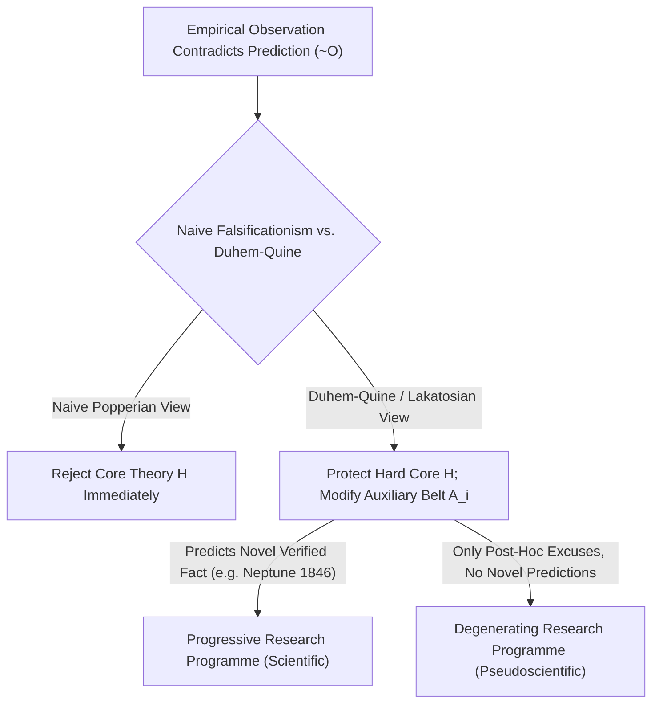
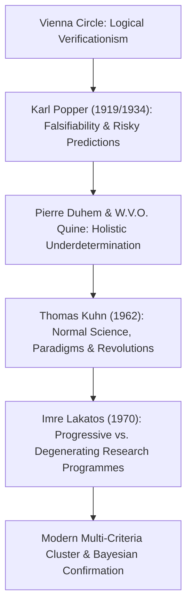

## 引言：1919年的維也納頓悟——劃界問題（Demarcation Problem）的誕生

在日常生活中，我們常常把「科學」當作「已被事實證明的絕對真理」的代名詞。然而，許多自稱「科學」的體系——如占星術、順勢療法、古代煉金術或某些宏大的歷史宿命論——同樣宣稱自己擁有海量的「經驗驗證案例」：占星師總能從星盤中為你昨天的遭遇找到完美解釋，陰謀論者也能把任何反面證據解釋為「陰謀掩蓋得太深」的明證。那麼，<strong>真正的經驗科學（Empirical Science）與偽科學（Pseudoscience）或非科學形上學之間的本質邊界究竟在哪裡？</strong>在科學哲學中，這被稱為<strong>劃界問題（The Demarcation Problem, *Abgrenzungsproblem*）</strong>。

20世紀初，以石里克、卡爾納普為代表的<strong>維也納學派（邏輯實證論 Logical Positivism）</strong>曾試圖用<strong>可證實性原則（Verificationism）</strong>來劃定邊界：一個命題只有當它能被感官經驗觀察所「證實」時，才具有科學意義。然而，這一標準很快撞上了18世紀哲學家大衛·休謨提出的<strong>休謨歸納問題（Problem of Induction）</strong>：任何科學定律都是全稱命題（例如「所有天鵝都是白的」或「所有質量都遵循萬有引力定律 $orall x\, P(x)$」）。無論我們觀察了一萬隻還是十億隻白天鵝，有限的經驗觀察永遠無法在演繹邏輯上證明一個無限域的全稱命題！如果以「完全證實」為標準，連牛頓力學和馬克士威電磁學都會被開除出科學殿堂。

1919年5月29日，英國天文學家亞瑟·愛丁頓（Arthur Eddington）率隊在西非普林西比島觀測日全食，檢驗阿爾伯特·愛因斯坦廣義相對論做出的驚人定量預言：掠過太陽邊緣的星光將偏折 $1.75$ 角秒（牛頓引力理論僅給出 $0.875$ 角秒）。當時年僅17歲的維也納青年<strong>卡爾·波普爾（Karl Popper）</strong>深受震撼。他敏銳地意識到，愛因斯坦理論的偉大之處，不在於它能解釋已知現象，而在於它敢於把脖子伸到斷頭台上，做出一個<strong>一旦觀測不符就會令整個理論徹底破產的「高風險預言（Risky Prediction）」</strong>！

---

## 1. 卡爾·波普爾的哥白尼式反轉：證實與證偽的邏輯不對稱性

1934年，波普爾在《科學發現的邏輯》（*Logik der Forschung*）中提出了著名的<strong>可證偽性判準（Falsifiability Criterion）</strong>：科學之所以為科學，不在於它「不可錯」，恰恰相反，在於它<strong>可錯（可被經驗反駁）</strong>！
這一判準植根於一階謂詞邏輯中<strong>證實（Verification）與證偽（Falsification）的絕對邏輯不對稱性</strong>：
- 再多的正面觀察 $O_1, O_2, \dots, O_n$ 也無法透過演繹邏輯推出全稱理論 $T$（因為由 $T \implies O$ 和 $O$ 推出 $T$ 犯了形式邏輯中的「肯定後件謬誤」）；
- 但是，只要出現<strong>一個</strong>確鑿的反例 $
eg O$（例如在澳洲發現了一隻黑天鵝），我們就可以依據演繹邏輯中最嚴密的<strong>否定後件律（Modus Tollens）</strong>，從 $T \implies O$ 與 $
eg O$ 絕對嚴格地推導出 $
eg T$（理論 $T$ 為假）！

因此，波普爾宣布：一個理論是科學的，當且僅當它禁止某些可觀察事件的發生，即它的<strong>潛在證偽者集合（Potential Falsifiers）非空</strong>。占星術之所以是偽科學，正是因為它把預言寫得模稜兩可、包羅萬象，使得宇宙中發生任何事情都能被它「事後解釋」——<strong>一個能解釋一切可能結果的理論，實際上什麼也沒有解釋，它的經驗資訊含量為零！</strong>在波普爾看來，科學永遠處於「大膽猜想與嚴酷反駁（Conjectures and Refutations）」的演化過程中；經受住嚴酷檢驗而未被證偽的理論並未被「證明為真」，而是獲得了更高的<strong>驗證度（Corroboration）</strong>。

$$
\text{Modus Tollens:} \quad \frac{T \implies O, \quad \neg O}{\therefore \neg T}
$$

$$
\text{Duhem-Quine Holistic Conjunction:} \quad \big( H \land A_1 \land A_2 \land \dots \land A_n \land C_{\text{init}} \big) \implies O
$$

$$
\neg O \implies \neg H \lor \neg A_1 \lor \neg A_2 \lor \dots \lor \neg A_n \lor \neg C_{\text{init}}
$$

---

## 2. 樸素證偽主義的危機：迪昂-蒯因整體論與海王星的發現

波普爾的可證偽性判準乾淨俐落、極具感召力，但當科學史家將其對照真實的物理學歷史時，卻發現了一個致命的問題：<strong>如果科學家真的嚴格按照樸素證偽主義行事，現代科學早就夭折在搖籃裡了！</strong>

法國物理學家皮埃爾·迪昂（Pierre Duhem, 1906）與美國哲學家威拉德·蒯因（W.V.O. Quine, 1951）提出了著名的<strong>迪昂-蒯因論題（Duhem-Quine Thesis / 整體論欠決定性 Holistic Underdetermination）</strong>：在真實的科學研究中，任何一個核心理論假說 $H$（例如牛頓萬有引力定律 $F = G m_1 m_2 / r^2$）都<strong>不可能單獨</strong>推導出可觀測的經驗預言 $O$！要算出天空中一顆行星明晚的位置，你必須同時聯立一大群<strong>輔助假說（Auxiliary Hypotheses）</strong> $A_1, A_2, \dots, A_n$（如「太陽系只有已知的七大行星」、「星際空間是真空無阻力的」、「望遠鏡的光學折射校正公式是正確的」）以及初始條件 $C_{	ext{init}}$。
因此，當觀測結果與預言發生衝突（$
eg O$）時，否定後件律告訴我們的僅僅是整個合取式 $(H \land A_1 \land \dots \land A_n \land C_{	ext{init}})$ 為假！邏輯本身<strong>根本無法告訴我們究竟是核心理論 $H$ 錯了，還是某條輔助假說 $A_i$ 錯了</strong>！

科學史上最輝煌的案例莫過於<strong>1846年海王星的發現</strong>：19世紀初，天文學家發現天王星的實際軌道與牛頓力學計算的軌道存在嚴重偏差（反常 $
eg O$）。當時的物理學家有沒有按照波普爾的教條，立即宣布「牛頓萬有引力定律被證偽了」呢？完全沒有！法國的勒維耶（Urbain Le Verrier）與英國的亞當斯（John Couch Adams）堅信牛頓定律 $H$ 絕對正確，轉而修改了輔助假說 $A_1$（假設天王星外側還存在第8顆未知行星），並算出了它的位置。1846年9月23日，柏林天文台的伽勒在預言位置不到 $1^\circ$ 處找到了<strong>海王星（Neptune）</strong>！原本似乎要「證偽」牛頓力學的危機，反而變成了牛頓力學最偉大的勝利！相反，當勒維耶試圖用同樣的手法假設水星內側存在「火神星（Vulcan）」來解釋水星近日點每世紀 $43$ 角秒的反常進動時，卻徹底失敗了——這一次真正需要被推翻的恰恰是牛頓引力核心 $H$ 本身（由愛因斯坦廣義相對論取代）。

---

## 3. 孔恩的典範、拉卡托斯的研究綱領與現代多維劃界標準

為了拯救科學理性並解釋科學史的真實運作，20世紀下半葉的科學哲學完成了三次關鍵躍遷：
1. <strong>湯瑪斯·孔恩（Thomas Kuhn）的《科學革命的結構》（1962）</strong>：孔恩指出，在絕大多數時期的<strong>常態科學（Normal Science）</strong>階段，科學家根本不是在試圖證偽自己的核心理論，而是在既有<strong>典範（Paradigm）</strong>的框架下進行「解謎活動（Puzzle-solving）」。遇到反常（Anomaly）時，科學家會暫時擱置或修正外圍假說；只有當反常積累到引發深層<strong>危機（Crisis）</strong>且出現強有力的新競爭典範時，才會爆發非累積性的<strong>典範轉移（Paradigm Shift / 科學革命）</strong>。
2. <strong>伊姆雷·拉卡托斯（Imre Lakatos）的「科學研究綱領方法論（MSRP, 1970）」</strong>：拉卡托斯巧妙地綜合了波普爾與孔恩。他指出，科學評估的基本單位不是孤立的假說，而是演化中的<strong>研究綱領（Research Programme）</strong>。每個研究綱領都由兩部分組成：神聖不可侵犯的<strong>硬核（Hard Core，如牛頓三定律）</strong>，以及環繞在周圍、隨時準備替硬核擋子彈並被修改的<strong>輔助假說保護帶（Protective Belt）</strong>。那麼如何區分科學與偽科學呢？拉卡托斯提出：關鍵不在於是否修改了保護帶，而在於這種修改是<strong>進步的（Progressive）</strong>還是<strong>退化的（Degenerating）</strong>！
   - <strong>進步的研究綱領（真科學）</strong>：對保護帶的修改不僅解釋了舊反常，還能<strong>預言前所未見的嶄新經驗事實（Novel Facts）</strong>，並且部分新預言得到了實驗證實（如勒維耶預言海王星）。
   - <strong>退化的研究綱領（偽科學）</strong>：面對反例時，永遠只會做馬後炮式的<strong>特設性修補（Ad hoc modifications）</strong>來勉強自圓其說，卻從未做出任何可被獨立檢驗的新預言！
3. <strong>家族相似性與現代科學的前沿挑戰</strong>：拉里·勞丹（Larry Laudan, 1983）曾指出，不存在單一的「必要且充分條件」能把所有科學與偽科學一刀切開。今天，馬西莫·皮格柳奇（Massimo Pigliucci）與馬丁·馬納（Martin Mahner）等學者採用維根斯坦的<strong>家族相似性（Family Resemblance）與多準則聚類模型</strong>，結合<strong>貝氏確證理論（Bayesian Confirmation Theory）</strong>，將可證偽性、拉卡托斯進步性、內部邏輯一致性、與鄰近成熟學科的融貫性（Consilience）、同儕審查與<strong>可重複性（Reproducibility）</strong>結合起來。在當代心理學與生物醫學應對<strong>複製危機（Replication Crisis，$p$-hacking 與預註冊制度 Registered Reports）</strong>以及理論物理學圍繞弦論（String Theory）與多重宇宙（Multiverse）的激烈交鋒中，從波普爾到拉卡托斯的劃界之問，依然是守護人類理性底線的最鋒利武器。

| 科學哲學流派 / 學者 | 核心劃界判準（Demarcation Criterion） | 面對反常觀測（$
eg O$）的處理機制 | 核心優勢與歷史局限 |
| :--- | :--- | :--- | :--- |
| <strong>邏輯實證論（維也納學派）</strong> | <strong>可證實性（Verificationism）</strong>：命題可還原為感官觀察語句 | 無法歸納證明全稱命題 | 排除了純粹玄學，但因休謨歸納問題誤傷了所有普遍科學定律 |
| <strong>樸素證偽主義（波普爾 1934）</strong> | <strong>可證偽性（Falsifiability）</strong>：存在潛在證偽者與高風險預言 | 否定後件律 $
eg O \implies 
eg T$ 立即否證理論 | 揭示了證實與證偽的邏輯不對稱性，但無法解釋輔助假說修正（如海王星發現） |
| <strong>歷史主義典範論（孔恩 1962）</strong> | <strong>解謎能力與共同體典範（Paradigm）</strong> | 常態科學歸咎於實驗者或暫存反常；危機期發生典範革命 | 符合真實科學史社會學，但易滑向典範不可共量的相對主義 |
| <strong>科學研究綱領（拉卡托斯 1970）</strong> | <strong>綱領的進步性 vs. 退化性</strong>（能否預言新奇事實 Novel Facts） | 保護<strong>硬核</strong>，修改<strong>保護帶</strong>並檢驗新預言 | 完美區分海王星式的科學修正與偽科學的特設性（Ad hoc）狡辯 |
| <strong>現代多維聚類與貝氏主義</strong> | <strong>多準則簇（可檢驗性 + 融貫性 + 可重複性 + 似然比更新）</strong> | 貝氏因子更新置信度 + 預註冊防止 $p$-hacking | 適用於法庭科學裁決（如 Kitzmiller 案）與現代大數據/前沿理論評估 |

$$
P(H \mid E) = \frac{P(E \mid H)\,P(H)}{P(E \mid H)\,P(H) + P(E \mid \neg H)\,P(\neg H)}, \qquad \frac{P(H \mid E)}{P(\neg H \mid E)} = \text{BF}_{10}(E) \cdot \frac{P(H)}{P(\neg H)}
$$

$$
\text{Popper Corroboration:} \quad C(H, E) = \frac{P(E \mid H) - P(E)}{P(E \mid H) + P(E) - P(E \land H)}
$$
