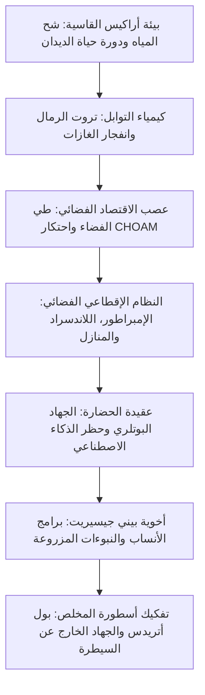

تعد رواية *كثيب* (Dune) التي نُشرت عام 1965 للأديب الأمريكي فرانك هربرت ذروة الخيال العلمي الفلسفي وأبرز نماذج بناء العوالم المركبة. في زمن شاعت فيه القصص عن الحواسيب الذكية والسفن اللامعة، قدّم هربرت مستقبلاً مغايراً: إمبراطورية مجرية إقطاعية حظرت الآلات المفكرة واعتمدت على أقصى قدرات العقل البشري، بينما يرتبط مصير الكون بأكمله بكوكب صحراوي واحد: أراكيس.

أراكيس صحراء قاحلة لا تسقط فيها قطرة مطر واحدة، لكنها المصدر الوحيد في الكون لمادة **توابل الميلاج (Spice Melange)**. هذه المادة تطيل العمر وتفتح البصيرة وتتيح لملاحي نقابة الفضاء طي أبعاد الكون بأمان. "من يسيطر على التوابل، يسيطر على الكون". ومن هنا تنشب صراعات دامية بين الإمبراطور والمنازل النبيلة ونقابة الفضاء وأخوية بيني جيسيريت.

## 1. بيئة أراكيس وديناميكا المياه المغلقة

استلهم هربرت الرواية من مشروع لتثبيت الكثبان الرملية في ولاية أوريغون عام 1959، فصمم أراكيس كنظام بيئي متكامل. تنعدم الأمطار على الكوكب وتقل الرطوبة عن $2\%$، بينما تبلغ سرعة عواصف كوريوليس الرملية $700\text{ كم/ساعة}$.

### بدلة التقطير (Stillsuit) لدى الفريمن

ابتكر شعب الفريمن **بدلة التقطير (Stillsuit)** للبقاء أحياء في قلب الصحراء:
1. **أغشية ترشيح دقيقة شعيرية**: تمتص العرق والبول وبخار التنفس.
2. **مضخات ميكانيكية بحركة القدم**: تستغل طاقة المشي لتشغيل التناضح العكسي.
3. **مبادلات حرارية**: تكثف الماء النقي المقطر في جيوب عند العنق.

$$\eta_{\text{water}} = \frac{W_{\text{recovered}}}{W_{\text{excreted}}} \ge 0{,}99$$

تعيد البدلة تدوير **أكثر من 99% من سوائل الجسم**، ليقتصر الفاقد اليومي على ملء ملعقة صغيرة. ويعتبر ماء الميت لدى الفريمن ملكية مقدسة للقبيلة بأسرها.

### دورة حياة ديدان الرمال (شاي-هولود)

- **تروت الرمال (Sandtrout)**: كائنات دقيقة تحتجز المياه العميقة لتبقي الكوكب جافاً تماماً.
- **كتلة ما قبل التوابل والانفجار (Spice Blow)**: تخمر لاهوائي للغازات ينفجر إلى السطح ويتأكسد ليشكل بلورات الميلاج.
- **الدودة البالغة**: كائن عملاق بطول مئات الأمتار ينتج الأكسجين. يمثل الماء سماً قاتلاً للدودة يُسفر عن موتها مفرزة "ماء الحياة".

## 2. جيوسياسة التوابل وطي الفضاء

تمنح التوابل قدرة **الاستشراف المستقبلي (Prescience)**.
وفي ظل غياب الحواسيب، يغمر ملاحو **نقابة الفضاء** أنفسهم بغاز التوابل لاستشراف المسارات الآمنة في الفضاء المطوي. انقطاع التوابل يعني شلل التجارة وموت المليارات عزلة وجوعاً.

## 3. الجهاد البوتلري: حظر العقول الاصطناعية

قبل أحداث الرواية بعشرة آلاف عام، ثار البشر على الآلات المفكرة في **الجهاد البوتلري**، وسجل الكتاب الكاثوليكي البرتقالي الوصية المطلقة:

> **"لا تصنع آلة على شاكلة عقل الإنسان."**

أدى هذا إلى تطور قدرات بشرية فائقة:
- **المينتات**: حواسيب بشرية تحلل الاحتمالات المعقدة دون تحيز عاطفي.
- **بيني جيسيريت**: أخوية نسائية تتقن التحكم العضلي والعصبي التام واستخدام "الصوت" للإخضاع النفسي الفوري.
- **أطباء سوك**: يخضعون لتكييف إمبراطوري يمنعهم تماماً من إلحاق الأذى بالبشر.

## 4. دروع هولتزمان وعودة المبارزة بالسيوف

تصد دروع هولتزمان المقذوفات السريعة ($> 6\text{--}9\text{ سم/ثانية}$)، مما عطل الأسلحة النارية وجعل "النصل البطيء" وحده القادر على اختراق الدرع.
كما أن **إطلاق شعاع الليزر على الدرع يؤدي إلى اندماج نووي دون ذري كارثي** يبيد الرامي والهدف معاً، مما أعاد الحروب إلى أساليب المبارزة التاريخية بالخناجر والسيوف.

## 5. تفكيك أسطورة المخلص: تحذير هربرت الأبدي

قدم هربرت في الرواية تحذيراً سياسياً وفلسفياً صادماً:

> **"احذروا القادة الكاريزميين؛ فإن أخطاءهم تقود الشعوب إلى الهلاك."**

لم يكن بول أتريدس مخلصاً مرسلاً من السماء؛ بل استغل نبوءات زرعتها منظمة **المبشرين الوقائية** التابعة للبيني جيسيريت قبل قرون للسيطرة على الفريمن. تحول بول إلى سجين للهوس الديني الذي أشعله، مما قاد إلى جهاد مجري أودى بحياة **61 مليار إنسان**. رواية *كثيب* شهادة خالدة على أخطار القداسة والتعصب الأعمى.
