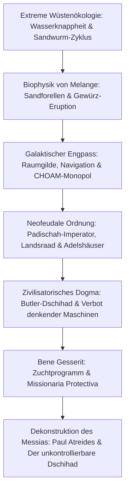

Als Frank Herbert 1965 seinen epochalen Roman *Dune* (Der Wüstenplanet) veröffentlichte, schuf er das wohl faszinierendste und intellektuell anspruchsvollste Universum der modernen Science-Fiction. Während die zeitgenössische Science-Fiction von Chrom-Raumschiffen und allmächtiger Computertechnologie träumte, entwarf Herbert eine radikal andere Zukunft: Ein interstellares Imperium unter einem neofeudalen Adelssystem, in dem denkende Maschinen verboten sind, der menschliche Geist zu quasi-göttlichen Fähigkeiten trainiert wird und das gesamte Schicksal der Galaxis an einem einzigen Wüstenplaneten hängt: Arrakis.

Arrakis ist eine erbarmungslose Welt ohne Niederschlag, auf der ein Wassertropfen das höchste Gut darstellt. Gleichzeitig ist Arrakis der einzige Ort im bekannten Universum, an dem das **Spice Melange (das Gewürz)** existiert. Melange verlängert das menschliche Leben, verleiht Hellsicht und ermöglicht den mutierten Navigatoren der Raumgilde die überlichtschnelle Raumfaltung. "Wer das Gewürz kontrolliert, kontrolliert das Universum." Vor diesem Hintergrund entfaltet sich ein tödliches Machtspiel zwischen Imperator, Adelshäusern (Landsraad), Raumgilde und dem Orden der Bene Gesserit.

## 1. Wüstenökologie und Thermodynamik auf Arrakis

Die Inspiration für *Dune* entsprang 1959 einer journalistischen Recherche über das Dünen-Stabilisierungsprojekt des US-Landwirtschaftsministeriums in Florence, Oregon. Herbert erkannte, dass ein Planet als geschlossenes thermodynamisches System verstanden werden kann.

Auf Arrakis herrscht Niederschlag von exakt null. Gewaltige Coriolisstürme erreichen $700\text{ km/h}$ und wirken wie gigantische Sandstrahlgebläse.

### Der Fremen-Destillieranzug (Stillsuit)

Das Überleben in der tiefen Wüste sichert der **Destillieranzug (Stillsuit)** der Fremen – ein Meisterwerk der Biofiltration und des Wärmeaustauschs:
1. **Mehrstufige Kapillarmembranen**: Erfassen Schweiß, Atemfeuchtigkeit und Ausscheidungen.
2. **Kinematische Pumpe**: Die mechanische Bewegung von Fersen und Knien beim Gehen treibt Kolbenpumpen für die Umkehrosmose an.
3. **Wärmetauscher**: Leiten Körperwärme ab und kondensieren reines Trinkwasser in Sammelblasen.

$$\eta_{\text{water}} = \frac{W_{\text{recovered}}}{W_{\text{excreted}}} \ge 0{,}99$$

Ein korrekter Destillieranzug **recycelt über 99% des Körperwassers**, sodass der tägliche Nettoverlust weniger als einen Fingerhut ($10\text{--}15\text{ ml}$) beträgt. Wasser ist das heiligste Gemeinschaftsgut der Fremen.

### Der Lebenszyklus der Sandwürmer (Schai-Hulud)

- **Sandforellen (Sandtrout)**: Die mikroskopische Larvenform des Wurms kapselt jegliche freie Feuchtigkeit im Boden ein und hält Arrakis in extremer Dürre.
- **Prä-Gewürz-Masse & Eruption**: In feuchten Tiefenlagern bildet sich durch anaerobe Gärung explosives Gas, das in einer gewaltigen Eruption (Spice Blow) an die Oberfläche bricht. An der Luft oxidiert die Masse zum kristallinen Melange.
- **Ausgewachsener Wurm**: Hunderte Meter lang, atmet Sauerstoff aus und verbrennt organische Stoffe bei extremen Innentemperaturen. Freies Wasser wirkt auf den ausgewachsenen Wurm als tödliches Nervengift, das die "Wasser des Lebens" genannte psychoaktive Essenz freisetzt.

## 2. Geopolitik und Ökonomie des Spice

Melange ist die harte Währung des Universums. Neben der Verdopplung der Lebensspanne erweckt es **Hellsicht und multidimensionale Wahrscheinlichkeitsberechnung (Prescience)**.

Da künstliche Intelligenz verboten ist, steuern die mutierten Navigatoren der **Raumgilde (Spacing Guild)** gigantische Raumschiffe (Heighliner), indem sie in gasförmigem Melange baden und die sicheren Pfade durch den gefalteten Raum hellseherisch vorausberechnen. Ein Versiegen des Gewürzes würde den gesamten interstellaren Handel und die Kommunikation innerhalb von Wochen zum Erliegen bringen.

## 3. Butlers Dschihad: Das KI-Tabu und die menschliche Perfektion

Zehntausend Jahre vor der Romanhandlung befreite sich die Menschheit in **Butlers Dschihad** von der Sklaverei durch denkende Maschinen. Die Orange-Katholische Bibel formulierte das unumstößliche Gebot:

> **"Du sollst dir keine Maschine nach dem Bilde des menschlichen Geistes machen."**

Anstelle von Computern wurden spezialisierte menschliche Kasten gezüchtet und trainiert:
- **Mentaten**: Menschliche Hochleistungsrechner, die frei von Emotionen gigantische Datenströme und Wahrscheinlichkeiten analysieren.
- **Bene Gesserit**: Eine politische Schwesternschaft, die über Prana-Bindu (vollkommene Muskel- und Nervenkontrolle), die "Stimme" (akustische Gedankenbeherrschung) und biochemische Giftneutralisierung verfügt.
- **Suk-Ärzte**: Durch imperiale Konditionierung unumkehrbar unfähig, menschliches Leben zu verletzen.

## 4. Holtzman-Schilde und die Wiedergeburt des Schwertkampfs

Der Holtzman-Schild hüllt den Krieger in ein Abwehrfeld:
- Geschosse mit hoher Geschwindigkeit ($> 6\text{--}9\text{ cm/s}$) werden zu $100\%$ reflektiert.
- Nur extrem langsame Klingen dringen durch das Schildfeld ein ("Die langsame Klinge durchdringt das Schild").
- **Trifft ein Laserstrahl (Lasgun) auf einen Schild, kommt es zu einer nuklearen Kettenreaktion**, die Schütze und Ziel in einer gewaltigen atomaren Explosion vernichtet. Daher meiden Truppen Laserwaffen und kämpfen im Nahkampf mit Schwertern und Chrysmessern.

## 5. Dekonstruktion des Messias: Herberts Warnung vor Helden

Frank Herbert schuf *Dune* als bewusste Antithese zur klassischen Heldenreise:

> **"Hütet euch vor charismatischen Führern. Ihre Fehler reißen ganze Völker in den Abgrund."**

Paul Atreides wird von den Fremen nicht durch göttliche Vorsehung als Erlöser ("Lisan al-Gaib") verehrt, sondern weil der Orden der Bene Gesserit über die **Missionaria Protectiva** Jahrhunderte zuvor gezielt religiöse Kontrollmythen gestreut hatte. Paul nutzt diese Prophezeiungen, verliert jedoch die Kontrolle über die religiöse Massenhysterie. Der darauf folgende galaktische Dschihad fordert **61 Milliarden Menschenleben** und verwüstet 90 Welten. *Dune* ist ein zeitloses Meisterwerk über Macht, Glauben und die Abgründe des Fanatismus.
