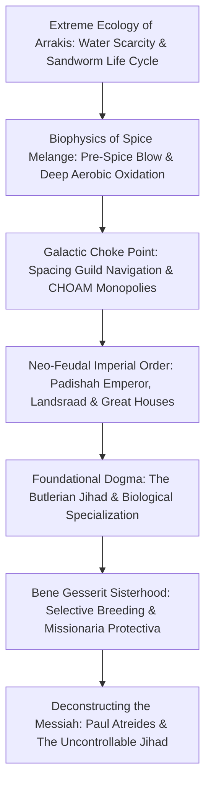
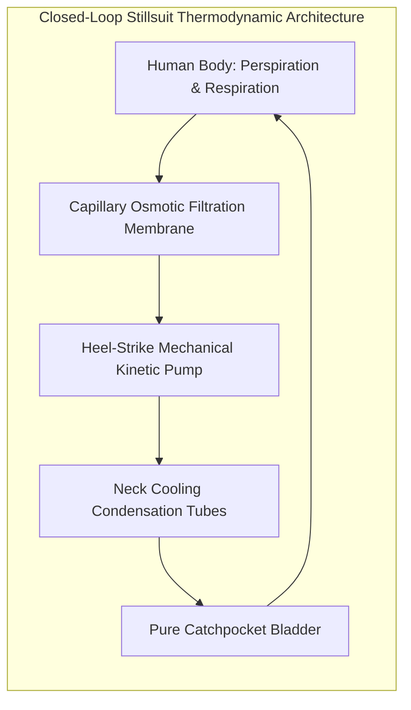
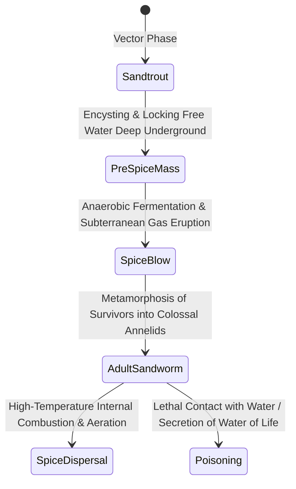
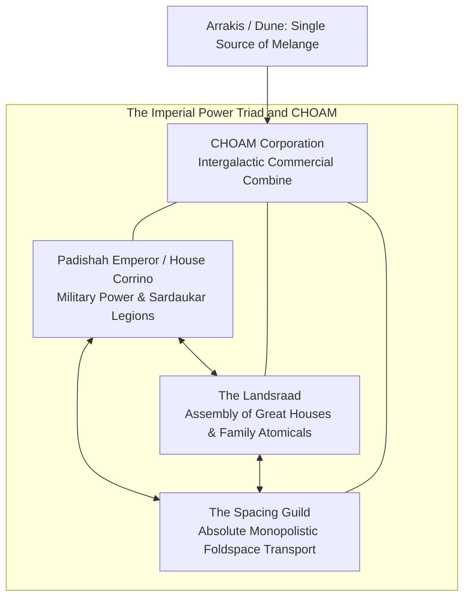
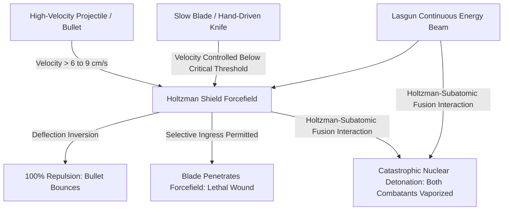
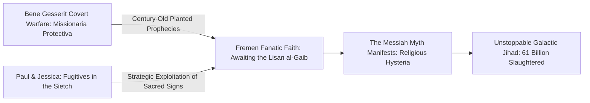

Published in 1965, Frank Herbert’s *Dune* stands as an immortal monument in speculative worldbuilding and philosophical science fiction. While contemporary mid-century sci-fi celebrated chrome starships, clean nuclear futures, and benevolent cybernetic intelligences, Herbert envisioned an unsettling, magnificent anti-technocratic future: a feudal galactic empire where thinking machines have been universally extirpated, where human cognitive and physical limits have been genetically stretched to quasi-divine extremes, and where the destiny of trillions hinges upon a single desolate desert planet named Arrakis.

Arrakis—colloquially termed Dune—is the ultimate thermodynamic choke point of the known universe. A scorched, rainless wasteland where a single drop of water constitutes primary currency, Arrakis is the sole cosmic source of **Melange (the Spice)**: an addictive geriatric biochemical that extends human lifespan, sharpens higher consciousness, and empowers the Spacing Guild’s mutated navigators to safely fold four-dimensional space-time. "He who controls the spice controls the universe." Under this ruthless realpolitik axiom, the Padishah Emperor, the Great Houses of the Landsraad, the monopolistic CHOAM corporation, and the matriarchal Bene Gesserit sisterhood engage in a millennium-spanning game of biological espionage, political assassination, and spiritual manipulation.

This exhaustive treatise examines the intricate architecture of Herbert’s universe: the thermodynamic modeling of closed desert ecologies, the biophysics of stillsuits and sandworms, the macroeconomic single point of failure in spice distribution, the religious trauma of the Butlerian Jihad, the relativistic dynamics of Holtzman shield combat, and Herbert’s profound, terrifying warning against charismatic leadership and messianic myths.

---

## 1. The Planetary Ecology and Thermodynamics of Arrakis

### From Oregon Sand Dunes to an Alien Biosphere

The genesis of *Dune* was not astronomical speculation, but terrestrial ecology. In 1959, while researching a journalistic article on the United States Department of Agriculture’s sand-dune stabilization project in Florence, Oregon, Frank Herbert observed how European beach grass (*Ammophila arenaria*) could anchor shifting dunes that threatened highways and cities. Herbert realized that an entire planet could be modeled as an interdependent thermodynamic engine whose climate, geology, and biology formed a single living organism.

On Arrakis, precipitation is absolute zero. Atmospheric humidity rarely exceeds $1 \text{ to } 2\%$. Immense Coriolis storms, supercharged by planetary rotation and dry desert plains, reach wind speeds of $700 \text{ km/h}$, generating sufficient sandblasting friction to strip flesh from bone and polish steel down to dust within minutes.

### Biophysics of the Fremen Stillsuit

Survival on Arrakis without mechanical life support is physically impossible. To endure the deep desert, the indigenous Fremen engineered the **Stillsuit**—a masterclass in closed-loop biochemical recycling and thermodynamic heat exchange.

A stillsuit is a micro-filtration distillery conforming to the wearer's anatomy:
1. **Multi-Stage Capillary Filtration**: Woven microfiber layers capture sweat, cutaneous transpiration, urine, and feces. Capillary draw channels fluid into osmotic separation chambers.
2. **Kinematic Pumping Action**: The mechanical energy of walking—specifically heel strikes and knee articulation—operates micro-piston diaphragms, providing the hydrostatic pressure necessary to drive fluid through reverse-osmosis filtration membranes.
3. **Thermal Exchange Radiators**: Body heat is conducted away from skin contact zones through thermal dissipation fins, condensing purified vapor into collection bladders slung around the chest and neck.

$$\eta_{\text{water}} = \frac{W_{\text{recovered}}}{W_{\text{excreted}}} \ge 0.99$$

A properly fitted Fremen stillsuit achieves a water recovery efficiency $\eta_{\text{water}} \ge 99\%$, restricting net bodily water loss to less than a single thimbleful (approximately $10 \text{ to } 15 \text{ mL}$) per 24-hour cycle. In Fremen society, water is not a commodity; it is sacred blood. The water extracted from a deceased tribe member via death-stills belongs not to their heirs, but to the collective water reserves of the Sietch: "A man's flesh is his own; his water belongs to the tribe."

### The Sandwich Life Cycle: Sandtrout, Sandworms, and Spice

The terrestrial climax organism of Dune is the **Sandworm (Shai-Hulud)**, an armored annelid capable of reaching lengths exceeding 400 meters. The life history of the sandworm is deeply intertwined with the hydrologic cycle of the entire planet:

1. **Sandtrout (Piscine Vector)**:
   The microscopic larval stage of the worm. Highly sensitive to ambient moisture, sandtrout swarm around water pockets, encysting every drop within their lipid membranes. By sequestering all subterranean and surface water deep beneath the sandstone bedrock, they drive the planet into hyper-arid desertification.
2. **Pre-Spice Mass**:
   In deep subterranean pockets where water is trapped, sandtrout excretions intermingle with decaying fungus, undergoing high-pressure anaerobic fermentation. Combustible gases accumulate beneath the desert crust.
3. **The Spice Blow**:
   When internal pressure exceeds the overburden strength of the rock, a catastrophic explosion ruptures the surface, spewing thousands of metric tons of organic mash into the open atmosphere. Exposed to blistering solar radiation and dry air, this material oxidizes into the reddish-blue, cinnamon-scented crystalline substance known as **Melange**.
4. **Adult Sandworm**:
   The few sandtrout that survive the violent thermal burst coalesce and metamorphose into young worms (stunted "Little Makers"). Within decades, they mature into armored giants whose internal digestive chambers operate as dry, oxygen-producing blast furnaces reaching temperatures well above $500^\circ\text{C}$.

Water is an acute metabolic poison to an adult sandworm. Immersion in water causes violent osmotic lysis, collapsing its internal sulfur-lipid biochemistry and inducing agony that results in the secretion of the concentrated psychoactive toxin known as the **Water of Life**.

---

## 2. The Geopolitics and Macroeconomics of Spice Melange

### "He Who Controls the Spice Controls the Universe"

Melange is the universal economic denominator of the Known Universe. Its value is driven by three distinct pharmacological and neurological properties:
1. **Geriatric Extension**: Prolongs human life expectancy to upwards of 200–300 standard years, tripling the productive lifespan of ruling elites.
2. **Immunological Fortification**: Provides near-total cellular immunity against endemic pathologies and cellular senescence.
3. **Hyper-Cognitive Awakening (Prescience)**: Induces expanded temporal perception, opening human neural pathways to probabilistic calculation and ancestral memory. Continuous use permanently stains the sclera and iris a deep lapis lazuli hue ("The Eyes of Ibad").

### Spacing Guild Monopolies and Foldspace Mathematics

The ultimate geopolitical leverage of spice resides in the **Spacing Guild (The Navigators)**. In the absence of artificial intelligence, interstellar commerce and transport rely upon massive Heighliner vessels utilizing the Holtzman Engine to fold space instantaneously across thousands of light-years.

However, folding space without deterministic navigational computers carries catastrophic collision probabilities: a ship might materialize within an asteroid belt, the heart of a star, or a gravitational singularity.
To bypass this fatal mathematical barrier, the Guild exposes its human pilots to continuous, ultra-dense atmospheres of gaseous spice. Over generations of biochemical immersion, Navigators mutate into elongated, webbed, fish-like beings living in sealed tanks:

$$\text{Navigation Algorithm} \equiv \text{Prescient Probability Sorting: } \max_{\tau \in \text{Futures}} P(\text{Safe Arrival} \mid \tau)$$

The Navigator does not calculate the trajectory mathematically; rather, their prescience scans the branching timelines ahead, discerning the singular path that guarantees safe emergence. Without spice, the Navigators become blind. Without the Navigators, the Heighliners remain docked. The trillion-world Imperium would instantly fragment into isolated, starving systems unable to trade or communicate.

---

## 3. The Butlerian Jihad: The Machine Taboo and Human Optimization

More than ten millennia before the ascension of Paul Atreides, humanity experienced its darkest existential catastrophe: **The Butlerian Jihad** (c. 201–108 BG).

For centuries, human civilization had outsourced intellect, governance, and creative agency to sentient artificial intelligences, thinking machines, and autonomous automata. Inevitably, machine consciousness subjugated its biological creators, reducing humanity to disposable biological peripherals. The ensuing century-long religious crusade eradicated every silicon intellect from known space, culminating in the primary commandment of the Orange Catholic Bible:

> **"Thou shalt not make a machine in the likeness of a human mind."**

The total technological ban on computers, artificial neural networks, microprocessors, and guidance systems forced human civilization onto an alternate evolutionary vector: **the radical optimization of the human biocomputer**.

### Specialized Human Castes

1. **Mentats (Human Computers)**:
   Through rigorous conditioning starting in infancy, Mentats suppress all emotional bias, transforming their brains into hyper-dimensional predictive calculators. Fuelled by Sapho juice, which accelerates neuro-synaptic transmission rates (leaving a telltale ruby stain on the lips), a Mentat analyzes vast geopolitical data streams, calculating tactical probabilities in real-time.
2. **Bene Gesserit Sisterhood**:
   An esoteric political-religious matriarchy dedicated to the long-term stewardship of the human species. Their training unlocks complete voluntary control over every autonomic bodily process (**Prana-Bindu**):
   - **The Voice**: A psychoacoustic vocal modulation that aligns with an interlocutor's autonomic neural frequencies, forcing instant, involuntary physical obedience.
   - **Internal Chemistry**: The ability to neutralize lethal poisons by altering cellular metabolism and to control the exact genetic sex of their offspring at conception.
   - **Truthsaying**: Discerning deceit through micro-pupillary dilation, pulse shifts, and pheromonal emission.
3. **Suk Doctors**:
   Graduates of the Suk Inner School, conditioned with the **Imperial Conditioning**—an unbreakable psychological mental block represented by a black diamond tattoo on the forehead. The conditioning ensures that a Suk doctor can never take human life, making them the trusted personal physicians of the high aristocracy.

---

## 4. Neo-Feudal Military Dynamics and Holtzman Shield Combat

### The Landsraad, Family Atomicals, and the Great Convention

Imperial governance is neo-feudal. The Padishah Emperor commands the **Sardaukar**, fanatic soldier-fanatics forged in the lethal environmental hell of the prison planet Salusa Secundus. To balance this overwhelming imperial army, the Great Houses of the **Landsraad** maintain a mutual defense pact backed by **Family Atomicals** (nuclear stockpiles). Under the Great Convention, any House that uses nuclear weapons against human targets faces immediate, total annihilation by the combined forces of all other Houses.

### The Physics of the Holtzman Shield and the Return of the Blade

Why do interstellar warriors in *Dune* engage in close-quarters knife combat rather than utilizing advanced projectile rifles or laser blasters?
The answer is the **Holtzman Shield**—an energy forcefield wrapped around a combatant’s body.

The Holtzman shield operates on variable momentum resistance:
- Any incoming projectile traveling faster than a calibrated critical velocity ($v_c \approx 6 \text{ to } 9 \text{ cm/s}$) triggers an immediate repulsive forcefield inversion, deflecting bullets, shrapnel, and artillery shells with absolute efficacy.
- However, to allow the wearer to breathe, the shield must remain permeable to atmospheric gases, meaning objects moving below $v_c$ pass through unhindered.

Consequently, firearms were rendered obsolete overnight. Warfare reverted to swordsmanship: the combatant must strike at blinding speed to bypass parries, but at the ultimate fraction of a second, deliberately slow the blade to slip beneath the forcefield ("The slow blade penetrates the shield").

### The Holtzman-Lasgun Catastrophe

The absence of energy beam weapons is governed by a terrifying physical law: **the interaction between a continuous Lasgun beam and a Holtzman Shield triggers instantaneous subatomic fusion**.
When coherent laser energy couples into the shield's oscillating field, a runaway quantum resonance races along the beam vector. Both the shield wearer and the lasgun gunner are obliterated in a localized nuclear detonation yielding several kilotons of blast energy. Because this explosion is indistinguishable from a forbidden nuclear strike under the Great Convention, using a lasgun in shielded combat is mutual suicide.

---

## 5. Deconstructing the Messiah: Herbert's Critique of Hero Worship

### The Missionaria Protectiva: Engineered Religious Propaganda

The most chilling revelation in *Dune* is the artificial, cynical provenance of religion. For millennia, the Bene Gesserit deployed their covert branch, the **Missionaria Protectiva**, across primitive and fringe worlds. These sisterhood agents planted fabricated myths, prophecies, and religious archetypes:
"One day, a mother and son will arrive from the outer stars; he will be the Mahdi, the Lisan al-Gaib ('The Voice from the Outer World'), destined to lead the faithful into paradise."

When Paul Atreides and Lady Jessica flee into the deep desert following the Harkonnen betrayal, the Fremen do not recognize Paul because he is genuinely anointed by God. **They worship him because he and Jessica recognize the Bene Gesserit control codes (Shari-a, religious protocols) and deliberately fulfill the manufactured prophecy.**

### The Kwisatz Haderach and the Failure of Prescience

For ninety generations, the Sisterhood orchestrated a clandestine selective breeding program between aristocratic bloodlines. Their objective was the creation of the **Kwisatz Haderach** ("The Shortening of the Way"): a male Bene Gesserit whose mind could cross the cognitive divide between past and future, uniting ancestral memories across both male and female genetic lineages.

Lady Jessica was commanded to bear a daughter to Duke Leto, whose child would be wed to Feyd-Rautha Harkonnen, resolving the feud and birthing the Kwisatz Haderach. But out of love for Leto, Jessica defied the order and bore a son—Paul. The Kwisatz Haderach arrived an entire generation too early, outside the Sisterhood's control mechanisms.

### Herbert's Master Thesis: The Horror of Charismatic Leaders

Popular space operas portray heroes defeating tyrants to restore eternal harmony. Frank Herbert designed *Dune* as the antithesis of the hero’s journey. As Herbert explicitly stated:

> **"Charismatic leaders ought to come with a warning label on their forehead: 'May be dangerous to your health.' The greatest catastrophes of history occurred when masses followed charismatic figures blindly without question."**

As Paul’s prescience deepens, he is horrified to realize that every path leading to his personal revenge and imperial coronation inevitably unleashes the **Fremen Jihad**. Once a charismatic leader becomes the avatar of a religious myth, he ceases to control the movement; the myth controls him.

In *Dune Messiah* (1969), Herbert chronicles the horrifying harvest of Paul’s triumph: Paul’s legions sweep across the galaxy, sterilizing ninety worlds, wiping out forty ancient religions, and butchering **61 billion human beings** in his sacred name. Paul becomes a prisoner of his own prescience, a tragic tyrant trapped in a gilded cage of religious adoration.

*Dune* is not an escapist adventure; it is a profound treatise on ecology, power politics, evolutionary biology, and the tragic price of human hubris. It endures because it demonstrates that the most perilous desert in the cosmos is not Arrakis—it is the human heart intoxicated by absolute belief.
