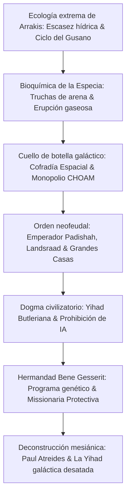

Publicada en 1965, *Dune* de Frank Herbert representa la cúspide de la ciencia ficción especulativa y la construcción de mundos. A diferencia de las visiones tecnológicas habituales de su época, Herbert imaginó un imperio galáctico neofeudal donde las máquinas pensantes han sido prohibidas, las facultades de la mente humana se han expandido hasta la presciencia casi divina y el destino cósmico gravita en torno a un planeta desértico: Arrakis.

En Arrakis, cada gota de agua es sagrada. No obstante, es el único rincón del universo conocido donde brota la **Especia Melange**: un compuesto geriátrico que prolonga la vida, abre la percepción temporal y permite a la Cofradía Espacial plegar el espacio estelar de manera segura. "Quien controla la especia, controla el universo." Alrededor de esta verdad chocan el Emperador Padishah, la nobleza del Landsraad, la Cofradía y la misteriosa hermandad Bene Gesserit.

## 1. Ecología planetaria y termodinámica en Arrakis

Herbert concibió el ecosistema de Dune inspirado en un proyecto forestal de fijación de dunas en Oregón en 1959. Arrakis no tiene lluvia y su humedad es inferior al $2\%$. Sus tormentas de Coriolis alcanzan $700\text{ km/h}$, erosionando el metal como sierras de arena.

### El destiltraje (Stillsuit) de los Fremen

Para sobrevivir en el erial, los nativos Fremen diseñaron el **destiltraje (Stillsuit)**, prodigio de termodinámica y reciclaje biológico:
1. **Membranas capilares de microfiltración**: Capturan sudor, vapor respiratorio y desechos fisiológicos.
2. **Bombas mecánicas de paso**: El impacto de los talones y la flexión de las rodillas impulsan la filtración por ósmosis.
3. **Disipadores de calor**: Condensan el agua purificada en bolsas situadas en el cuello.

$$\eta_{\text{water}} = \frac{W_{\text{recovered}}}{W_{\text{excreted}}} \ge 0{,}99$$

Un destiltraje en perfecto estado **recicla más del 99% del agua corporal**, limitando las pérdidas diarias a escasos mililitros. Para los Fremen, el agua de un cadáver es propiedad comunitaria de la tribu.

### El ciclo vital de los gusanos de arena (Shai-Hulud)

- **Truchas de arena (Sandtrout)**: Larvas que encierran el agua en bolsas subterráneas provocando la aridez extrema del planeta.
- **Masa de pre-especia y erupción (Spice Blow)**: Fermentación de gases que revientan la superficie en una explosión geológica. Al contacto con el aire seco y el sol, se transforma en la Especia Melange.
- **Gusano adulto**: Coloso de cientos de metros que produce oxígeno en sus hornos digestivos internos. El agua líquida es un veneno letal para el gusano que le provoca una muerte atroz, secretando el Agua de la Vida.

## 2. Geopolítica y economía de la Especia

La Especia extiende la longevidad y desata la **presciencia** (visión de futuros posibles).
Los Navegantes de la **Cofradía Espacial (Spacing Guild)** mutan en tanques saturados de gas de especia para calcular prescientemente rutas seguras a través del espacio plegado. Sin especia, el transporte interestelar colapsa y la civilización humana se desmorona en el aislamiento.

## 3. La Yihad Butleriana: la proscripción de la inteligencia artificial

Diez milenios atrás, la humanidad destruyó las máquinas pensantes que la dominaban en la **Yihad Butleriana**. La Biblia Católica Naranja dictó el mandamiento:

> **"No construirás una máquina a semejanza de la mente humana."**

Esto provocó la evolución hiperespecializada del cuerpo y cerebro humanos:
- **Mentats**: Computadoras humanas sin sesgo emocional capaces de procesar probabilidades complejas.
- **Bene Gesserit**: Maestras del Prana-Bindu (control celular y muscular) y de la Voz (sumisión psicológica inmediata mediante modulación tonal).
- **Médicos Suk**: Sujetos a un bloqueo mental imperial que les impide éticamente causar daño físico a sus pacientes.

## 4. Escudos Holtzman y combate cuerpo a cuerpo

El escudo Holtzman envuelve el cuerpo en un campo que repele proyectiles veloces ($> 6\text{--}9\text{ cm/s}$), neutralizando armas de fuego. Solo los filos introducidos lentamente consiguen penetrar la barrera.
Además, **el impacto de un rayo láser (Lasgun) sobre un escudo provoca una fusión subatómica descontrolada**, desatando una explosión nuclear bilateral. Esta ley física forzó a los ejércitos galácticos a volver al combate con espadas y cuchillos crizo.

## 5. Deconstrucción mesiánica: la advertencia contra los héroes

La tesis central de Frank Herbert desafía la epopeya clásica del héroe redentor:

> **"Tened cuidado con los líderes carismáticos. Sus errores arrastran a pueblos enteros al desastre."**

Paul Atreides no es un salvador enviado por la providencia: los Fremen lo veneran como "Lisan al-Gaib" porque la **Missionaria Protectiva** de la Bene Gesserit había sembrado esos mitos siglos antes para proteger a sus miembros. Paul manipula estas profecías para vengar a su padre, pero desata una Yihad galáctica incontrolable que causará **la masacre de 61.000 millones de personas**. *Dune* es una lúcida lección sobre el peligro de entregarse ciegamente a los mesías.
