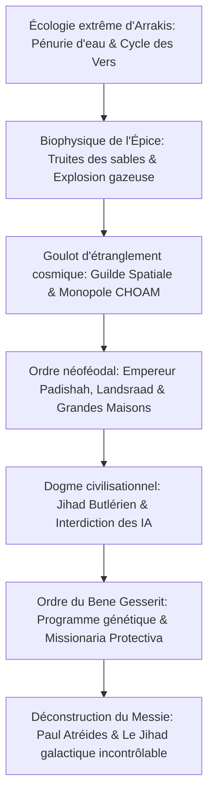

Publié en 1965, le chef-d'œuvre de Frank Herbert, *Dune*, est l'un des piliers incontournables de la science-fiction mondiale. Alors que les récits de son époque vantaient les mérites des ordinateurs et des vaisseaux étincelants, Herbert imaginait un univers féodal sombre et fascinant où les machines pensantes sont interdites, où les facultés humaines sont poussées jusqu'à la prescience quasi divine, et dont l'équilibre repose sur une unique planète désertique : Arrakis.

Arrakis, surnommée Dune, est un désert impitoyable où l'eau est la monnaie suprême. C'est l'unique gisement universel de **l'Épice (Melange)**, une substance miraculeuse qui allonge la vie, confère des pouvoirs de prescience et permet aux Navigateurs de la Guilde Spatiale de replier l'espace pour voyager plus vite que la lumière. "Qui contrôle l'Épice contrôle l'Univers." Autour de cet enjeu s'affrontent l'Empereur Padishah, le Landsraad des Grandes Maisons, la Guilde et l'ordre secret du Bene Gesserit.

## 1. Écologie planétaire et thermodynamique d'Arrakis

Inspiré en 1959 par un projet d'ancrage des dunes en Oregon, Frank Herbert conçut Arrakis comme un gigantesque modèle écologique vivant.
La pluie est inexistante sur Arrakis et l'humidité de l'air est inférieure à $2\%$. Les tempêtes de Coriolis soufflent à $700\text{ km/h}$, décapant les roches et le métal.

### Le distille (Stillsuit) des Fremen

Pour survivre en plein désert, les Fremen ont mis au point le **distille (Stillsuit)**, merveille d'ingénierie thermodynamique en circuit fermé :
1. **Membranes de microfiltration capillaire** : Récupèrent la sueur, la vapeur respiratoire, l'urine et les matières fécales.
2. **Pompes actionnées par la marche** : Les mouvements des talons et des genoux pressurisent les filtres d'osmose inverse.
3. **Échangeurs thermiques** : Refroidissent et condensent l'eau pure dans des poches buccales.

$$\eta_{\text{water}} = \frac{W_{\text{recovered}}}{W_{\text{excreted}}} \ge 0{,}99$$

Un distille bien ajusté **recycle plus de 99% de l'eau corporelle**, réduisant la perte journalière à une simple cuillère à café d'eau. Chez les Fremen, l'eau d'un mort appartient à la tribu tout entière.

### Le cycle des vers des sables (Shai-Hulud)

- **Truites des sables (Sandtrout)** : Larves qui emprisonnent l'eau dans les profondeurs de la roche, provoquant la désertification absolue.
- **Explosion d'Épice (Spice Blow)** : Fermentation anaérobie souterraine de matière organique créant des poches de gaz qui finissent par exploser à la surface. Exposée à l'air sec et au soleil, la pâte s'oxyde en cristaux d'Épice.
- **Ver adulte** : Monstre gigantesque de plusieurs centaines de mètres, fournaise vivante produisant de l'oxygène. L'eau agit sur lui comme un poison violent, provoquant son agonie et libérant l'Eau de Vie.

## 2. Géopolitique et économie de l'Épice

L'Épice double l'espérance de vie et développe la prescience.
Sans ordinateurs de bord, les Navigateurs de la **Guilde Spatiale (Spacing Guild)** baignent en permanence dans du gaz d'Épice. Mutés en êtres aquatiques, ils utilisent la prescience pour choisir le corridor de vol sûr à travers l'espace replié. Sans Épice, la Guilde devient aveugle et l'Empire s'effondre en quelques semaines.

## 3. Le Jihad Butlérien : le tabou des machines pensantes

Dix mille ans avant l'histoire, l'humanité détruisit les intelligences artificielles qui l'avaient asservie lors du **Jihad Butlérien**. La Bible Catholique Orange proclama :

> **"Tu ne feras point de machine à l'image de l'esprit humain."**

L'humanité développa alors des capacités biologiques extrêmes :
- **Mentats** : Calculateurs humains capables d'analyser des flux immenses de probabilités statistiques.
- **Bene Gesserit** : Sorcières politiques maîtrisant le Prana-Bindu (contrôle musculaire et biochimique) et la Voix (soumission psychologique immédiate).
- **Médecins Suk** : Conditionnés au niveau mental pour être incapables de tuer.

## 4. Les boucliers Holtzman et le retour du combat à l'épée

Le bouclier énergétique Holtzman repousse tout projectile rapide ($> 6\text{--}9\text{ cm/s}$), rendant les armes à feu obsolètes. Seule une lame manoeuvrée lentement ("la lame lente perce le bouclier") peut pénétrer le champ.
De surcroît, **le tir d'un rayon laser (Lasgun) sur un bouclier provoque une fusion subatomique foudroyante**, vaporisant tireur et cible dans une explosion nucléaire. La guerre interstellaire est donc revenue à l'escrime de corps à corps.

## 5. La déconstruction du mythe messianique

Le message central de Frank Herbert est une mise en garde tragique contre les faux sauveurs :

> **"Méfiez-vous des dirigeants charismatiques. Leurs erreurs précipitent les peuples dans le néant."**

Paul Atréides n'est pas un sauveur divin : son statut de "Lisan al-Gaib" auprès des Fremen est le fruit des mythes propagés des siècles plus tôt par la **Missionaria Protectiva** du Bene Gesserit. Paul embrasse ce rôle pour venger son père, mais devient l'otage de la ferveur fanatique qu'il a suscitée. Son ascension déchaîne un Jihad galactique incontrôlable qui causera **la mort de 61 milliards d'êtres humains**. *Dune* est une œuvre philosophique universelle sur la dérive des religions et le mirage du pouvoir.
