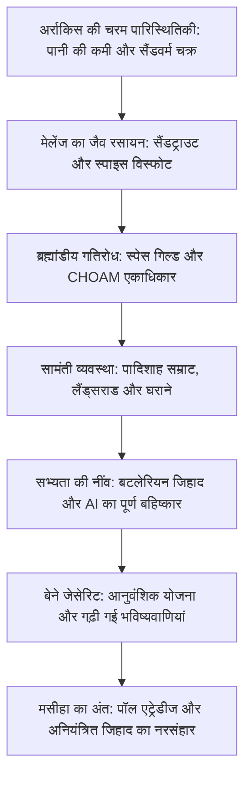

1965 में प्रकाशित फ्रैंक हर्बर्ट की कृति *ड्यून* (Dune) विश्व विज्ञान कथा साहित्य का शिखर है। जब अन्य रचनाकार उड़ने वाली कारों और कंप्यूटरों की बात कर रहे थे, हर्बर्ट ने एक ऐसे भविष्य की रचना की जहाँ सोचने वाली मशीनें प्रतिबंधित हैं, इंसानी दिमाग को अलौकिक क्षमताओं तक विकसित किया गया है, और पूरे ब्रह्मांड का भाग्य एक सूखे रेगिस्तानी ग्रह अर्राकिस (Arrakis) पर निर्भर करता है।

अर्राकिस पर बारिश शून्य है और पानी की एक बूंद सबसे कीमती संपत्ति है। फिर भी, यह ब्रह्मांड का एकमात्र ऐसा स्थान है जहाँ **स्पाइस मेलेंज (Spice Melange)** मिलता है। यह रसायन उम्र बढ़ाता है, भविष्य देखने की शक्ति देता है, और स्पेसिंग गिल्ड के अंतरिक्ष जहाजों को रास्ता दिखाता है। "जो स्पाइस को नियंत्रित करता है, वह ब्रह्मांड पर राज करता है।" इस विचार के इर्द-गिर्द सम्राट, सामंत, गिल्ड और बेने जेसेरिट का षड्यंत्र चलता है।

## 1. अर्राकिस की रेगिस्तानी पारिस्थितिकी और ऊष्मागतिकी

हर्बर्ट ने 1959 में ओरेगन के रेत के टीलों को घास से स्थिर करने की परियोजना से प्रेरणा लेकर अर्राकिस की रचना की। यहाँ हवा में नमी $2\%$ से कम होती है और $700\text{ किमी/घंटा}$ की कोरियोलिस आंधियां लोहे को भी रेत बना देती हैं।

### फ्रीमैन का स्टिलसूट (Stillsuit)

गहरे रेगिस्तान में जीवित रहने के लिए फ्रीमैन जनजाति **स्टिलसूट (Stillsuit)** पहनती है:
1. **केशिका निस्पंदन झिल्ली**: पसीना, सांस और मल-मूत्र से पानी सोखती है।
2. **कदमों से चलने वाला पंप**: चलने के दबाव से पानी का रिवर्स ऑस्मोसिस होता है।
3. **ऊष्मा विसर्जन नलियां**: शरीर की गर्मी निकालकर शुद्ध पानी गर्दन की थैली में जमा करती हैं।

$$\eta_{\text{water}} = \frac{W_{\text{recovered}}}{W_{\text{excreted}}} \ge 0{,}99$$

यह सूट **शरीर के पानी का 99% से अधिक पुनः चक्रित करता है**, जिससे दैनिक जल हानि कुछ मिलीलीटर तक सीमित रहती है। फ्रीमैन के लिए किसी मृतक का पानी पूरे कबीले की साझा धरोहर होता है।

### सैंडवर्म (शाई-हुलुद) का जीवन चक्र

- **सैंडट्राउट**: छोटे जीव जो जमीन के पानी को सोखकर ग्रह को सूखा रखते हैं।
- **प्री-स्पाइस मास और विस्फोट**: जमीन के अंदर गैस का भारी दबाव बनने पर विस्फोट होता है, जिससे धूप और हवा में स्पाइस मेलेंज बनता है।
- **विशाल सैंडवर्म**: सैकड़ों मीटर लंबे जीव जो अंदर की भट्टी से ऑक्सीजन बनाते हैं। पानी इनके लिए घातक विष है, जिसके संपर्क से ये मरते हुए 'जीवन का जल' छोड़ते हैं।

## 2. स्पाइस की भू-राजनीति और स्पेसिंग गिल्ड

स्पाइस उम्र लंबी करता है और **भविष्य देखने की शक्ति (Prescience)** जगाता है।
कंप्यूटर के अभाव में, **स्पेसिंग गिल्ड** के नाविक स्पाइस गैस के टैंकों में रहकर मुड़े हुए अंतरिक्ष में सुरक्षित रास्ता पहले ही देख लेते हैं। यदि स्पाइस रुक जाए, तो पूरे ब्रह्मांड का व्यापार ठप हो जाएगा और ग्रह भुखमरी से नष्ट हो जाएंगे।

## 3. बटलेरियन जिहाद: इंसानी दिमाग की सर्वोच्चता

कहानी से दस हजार वर्ष पूर्व इंसानों ने अपने ऊपर राज करने वाली मशीनों को **बटलेरियन जिहाद** में नष्ट कर दिया और नियम बनाया:

> **"मनुष्य के दिमाग जैसा सोचने वाली मशीन कभी मत बनाना।"**

इसके बाद इंसानों ने अपने शरीर और दिमाग को विकसित किया:
- **मेनटैट (Mentat)**: मानव कंप्यूटर जो बिना भावना के भारी गणनाएं करते हैं।
- **बेने जेसेरिट**: महिलाओं का संगठन जो प्राणा-बिंदु (मांसपेशी नियंत्रण) और 'द वॉयस' (आवाज से वशीकरण) में माहिर हैं।
- **सुक डॉक्टर**: जिनके दिमाग में कभी किसी मरीज को नुकसान न पहुँचाने का संस्कार बैठाया जाता है।

## 4. होल्ट्ज़मैन शील्ड और तलवारबाजी की वापसी

होल्ट्ज़मैन शील्ड शरीर के चारों ओर एक सुरक्षा क्षेत्र बनाती है जो तेज गति की गोलियों ($> 6\text{--}9\text{ सेमी/सेकंड}$) को लौटा देती है। केवल धीमी गति से चलाए गए चाकू ही इसे पार कर सकते हैं।
इसके अलावा, **शील्ड पर लेजरगन मारने से परमाणु स्तर का भारी विस्फोट होता है**, जिसमें मारने वाला और मरने वाला दोनों भस्म हो जाते हैं। इसलिए युद्ध फिर से तलवारों और खंजरों पर आ टिका।

## 5. मसीहा के भ्रम का अंत: हर्बर्ट की चेतावनी

फ्रैंक हर्बर्ट का मुख्य संदेश किसी जादुई नायक का गुणगान करना नहीं, बल्कि करिश्माई नेताओं से सावधान करना था:

> **"करिश्माई नेताओं से सावधान रहो, उनकी गलतियां पूरी मानव जाति को तबाही में झोंक देती हैं।"**

पॉल एट्रेडीज कोई भगवान का भेजा हुआ मसीहा नहीं था; बेने जेसेरिट की संस्था **मिशनारिया प्रोटेक्टिवा** ने सदियों पहले फ्रीमैन के मन में ये भविष्यवाणियां बोई थीं। पॉल ने अपने पिता का बदला लेने के लिए इस धार्मिक अंधविश्वास का सहारा लिया, लेकिन वह उसी आग में जल गया। उसके नाम पर हुए ब्रह्मांडीय जिहाद में **61 अरब मासूम इंसानों का कत्ल हुआ**। *ड्यून* अंधविश्वास और सत्ता के नशे की भयावहता का सजीव दस्तावेज है।
