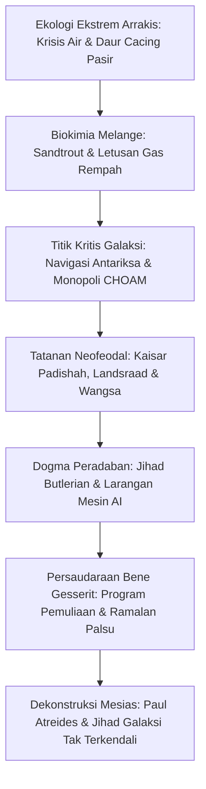

Diterbitkan pada tahun 1965, *Dune* karya Frank Herbert merupakan monumen agung fiksi ilmiah spekulatif. Alih-alih merayakan kecerdasan buatan dan kapal luar angkasa canggih, Herbert membayangkan masa depan neofeodal di mana mesin pemikir dilarang keras, potensi kognitif manusia dioptimalkan hingga batas mutlak, dan nasib kekaisaran galaksi bertumpu pada satu planet gurun gersang: Arrakis.

Arrakis adalah gurun tandus tanpa hujan di mana air bernilai lebih tinggi daripada emas. Namun, planet ini adalah satu-satunya sumber **Rempah Melange (Spice)**: zat yang memperpanjang umur, memperluas kesadaran, dan memungkinkan Navigator Guild melipat ruang angkasa antarbintang secara aman. "Barang siapa mengendalikan rempah, mengendalikan alam semesta." Dari premis ini, pecah perebutan kekuasaan antara Kaisar Padishah, Dewan Bangsawan Landsraad, Spacing Guild, dan persaudaraan Bene Gesserit.

## 1. Ekologi Planet dan Termodinamika Arrakis

Terinspirasi dari proyek stabilisasi bukit pasir di Oregon tahun 1959, Herbert merancang Arrakis sebagai sistem ekologi tertutup yang realistis. Curah hujan di Arrakis nol mutlak, dengan kelembapan udara di bawah $2\%$. Badai Coriolis bertiup hingga $700\text{ km/jam}$, mampu mengikis logam padat menjadi debu.

### Pakaian Stillsuit Kaum Fremen

Kunci bertahan hidup kaum pribumi Fremen adalah **Stillsuit**, mahakarya daur ulang cairan tubuh dan pertukaran kalor:
1. **Membran filtrasi kapiler**: Menyerap keringat, uap napas, dan kotoran tubuh.
2. **Pompa bertenaga langkah kaki**: Hentakan tumit dan tekukan lutut menggerakkan pompa osmosis terbalik.
3. **Radiator pembuang panas**: Mendinginkan uap air murni ke kantong minum di leher.

$$\eta_{\text{water}} = \frac{W_{\text{recovered}}}{W_{\text{excreted}}} \ge 0{,}99$$

Stillsuit yang terpasang sempurna **mendaur ulang lebih dari 99% cairan tubuh**, membatasi kehilangan air harian hanya beberapa mililiter. Bagi kaum Fremen, air dari tubuh orang mati adalah hak milik komunal suku.

### Siklus Hidup Cacing Pasir (Shai-Hulud)

- **Sandtrout (Ikan Pasir)**: Vektor larva yang mengurung seluruh air tanah di kedalaman bebatuan, menyebabkan penggurunan total planet.
- **Massa Pra-Rempah & Letusan (Spice Blow)**: Gas fermentasi meledak ke permukaan, dan saat bereaksi dengan sinar matahari serta udara kering, mengkristal menjadi Melange.
- **Cacing Dewasa**: Makhluk raksasa sepanjang ratusan meter yang menghasilkan oksigen di perutnya yang bersuhu tinggi. Air bertindak sebagai racun mematikan bagi cacing dewasa, menghasilkan zat psikoaktif "Air Kehidupan".

## 2. Geopolitik Rempah dan Navigasi Luar Angkasa

Melange melipatgandakan umur manusia dan membuka indra **prescience** (penglihatan masa depan).
Tanpa komputer, para Navigator **Spacing Guild** berendam dalam gas rempah untuk melihat rute aman melintasi ruang angkasa yang dilipat (Foldspace). Tanpa rempah, penerbangan antariksa lumpuh seketika dan peradaban manusia akan tercerai-berai dalam isolasi kelaparan.

## 3. Jihad Butlerian: Tabu Mesin Pemikir

Sepuluh ribu tahun sebelumnya, umat manusia menghancurkan AI yang memperbudaknya dalam **Jihad Butlerian**. Kitab Suci Katolik Oranye menegaskan hukum mutlak:

> **"Janganlah kamu membuat mesin menurut rupa pikiran manusia."**

Larangan ini melahirkan spesialisasi biologi manusia yang luar biasa:
- **Mentat**: Komputer manusia yang memproses data dan probabilitas tanpa bias emosi.
- **Bene Gesserit**: Ordo wanita yang menguasai Prana-Bindu (kendali saraf dan otot mutlak) serta The Voice (hipnosis suara pemaksa).
- **Dokter Suk**: Ditanamkan pengondisian mental kekaisaran yang mencegah mereka mencelakai manusia.

## 4. Perisai Holtzman dan Kembalinya Pertarungan Pedang

Perisai Holtzman memantulkan semua proyektil berkecepatan tinggi ($> 6\text{--}9\text{ cm/detik}$), membuat senjata api tidak berguna. Hanya bilah pisau lambat yang dapat menembus medan gaya ("pedang yang lambat menembus perisai").
Selain itu, **tembakan laser (Lasgun) ke perisai memicu reaksi fusi subatomik**, menciptakan ledakan dahsyat setara bom nuklir yang memusnahkan penembak dan target. Karena itu, pertempuran kembali menggunakan pedang dan pisau crysknife.

## 5. Dekonstruksi Mesias: Peringatan Keras Frank Herbert

Pesan inti Frank Herbert membongkar mitos penyelamat kepahlawanan:

> **"Waspadalah terhadap pemimpin karismatik. Kesalahan mereka akan menyeret pengikutnya ke jurang kehancuran."**

Paul Atreides dipuja sebagai "Lisan al-Gaib" bukan karena takdir ilahi, melainkan karena ordo Bene Gesserit telah menanamkan mitos kendali agama berabad-abad sebelumnya melalui **Missionaria Protectiva**. Paul memanfaatkan nubuat ini untuk membalas dendam, tetapi ia menjadi tawanan histeria agama yang ia ciptakan sendiri. Kemenangannya memicu Jihad galaksi tak terbendung yang **menewaskan 61 miliar nyawa**. *Dune* adalah kritik tajam terhadap bahaya kepemimpinan karismatik dan fanatisme buta.
