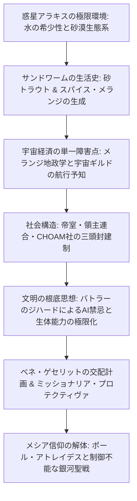
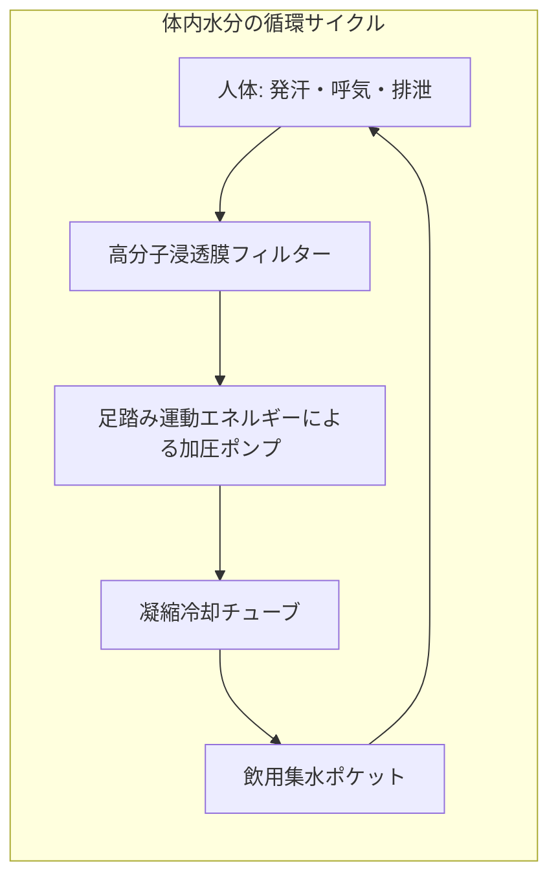
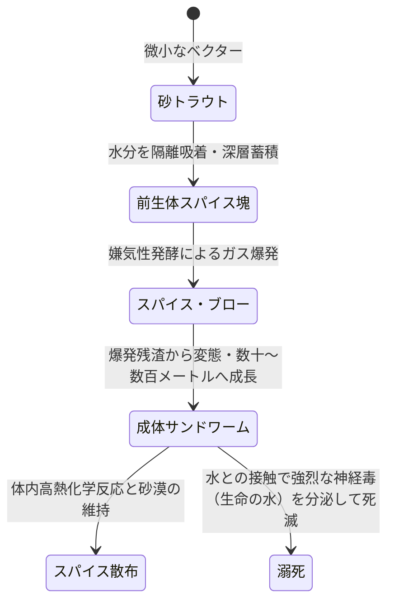
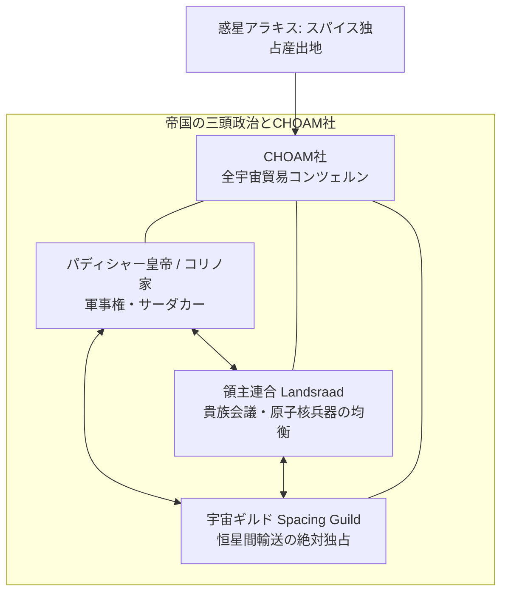
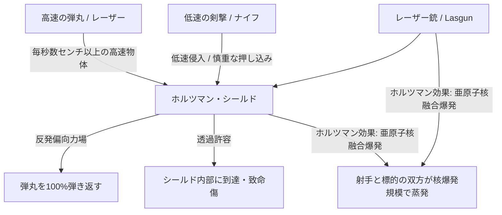
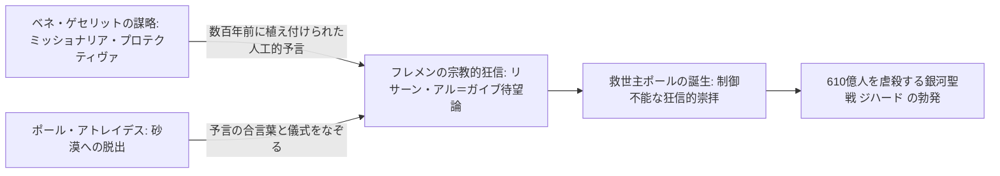
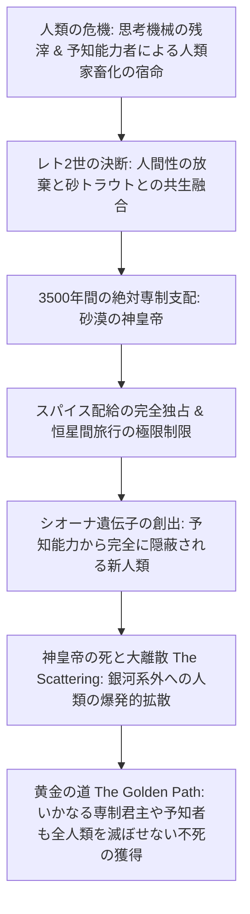

1965年に発表されたフランク・ハーバート（Frank Herbert）の『デューン/砂の惑星』（*Dune*）は、単なるスペースオペラの枠を遥かに超越した、20世紀最大の思索的SF文学の金字塔です。それまでのSFが宇宙船やロボットといった機械文明の華々しい発展を描いていたのに対し、ハーバートが構築したのは「思考機械を自ら禁絶し、極限まで純化・拡張された人間能力と、中世封建制の権謀術数が支配する銀河帝国」という、異様かつ重厚な未来史でした。

その世界の心臓部に位置するのが、砂漠の惑星アラキス（Arrakis）——通称「デューン」。水滴一つが命を分ける灼熱の荒野でありながら、全宇宙で唯一、人類の寿命を延ばし、恒星間航行を可能にする超感覚をもたらす奇跡の物質「メランジ（スパイス）」を産出する特異点です。「スパイスを制する者が宇宙を制する」という冷酷な地政学的テーゼのもと、皇帝、大貴族連合、宇宙ギルド、そして遺伝的陰謀を巡らせる修道会ベネ・ゲセリットが血みどろの覇権争いを繰り広げます。

本稿では、フランク・ハーバートが着想した砂漠緑化の生態系モデリングから、スパイスが駆動する宇宙経済機構、バトラーのジハードによるAI排除と生体能力開発、ホルツマン効果が強いる白兵戦力学、そして英雄崇拝の危険性を痛烈に告発したメシア神話の脱構築に至るまで、『DUNE』の壮大な世界観の全容を徹底的に解剖します。

---

## 1. 惑星アラキスの砂漠生態学と熱力学

### オレゴン州の砂丘緑化から生まれた惑星生態系

フランク・ハーバートが『DUNE』の執筆に着手した契機は、1959年、米国農務省（USDA）がオレゴン州フローレンスの海岸砂丘で行っていた「砂丘固定プロジェクト」のジャーナリズム取材でした。吹き荒れる風によって国道や街を飲み込む砂丘に対し、強靭なヨーロッパ砂草（*Ammophila arenaria*）を植樹して砂の流動を食い止める現場を目の当たりにしたハーバートは、「砂漠そのものをひとつの生命体として捉え、惑星規模でその生態系を改造する」という前代未聞のヴィジョンを着想しました。

アラキスの生態系は、天文学的な乾燥と過酷な気候条件によって定義されます：
- 降雨量は事実上ゼロ。大気中の水分は極限まで低く、地表の相対湿度は $1 \sim 2\%$ 程度。
- 砂漠の砂嵐（コリオリの嵐：Coriolis Storm）は時速 $700 \text{ km/h}$ に達し、その風圧と砂粒の摩擦は金属や骨組織を瞬時に削り落とす。

### 保水スーツ（Stillsuit）の生体工学と熱交換物理学

この地獄のような荒野で先住民族フレメン（Fremen）が生死を委ねるテクノロジーが、身体から失われる水分をほぼ完璧に回収・循環させる**「保水スーツ（Stillsuit）」**です。

保水スーツは、熱力学と浸透圧膜分離技術の極致です：
1. **多層濾過膜（Multi-layer Micro-filtration）**: 汗、呼気、尿、糞便の水分を、毛細管現象と身体の運動エネルギーを利用して吸い上げる。
2. **生体動力駆動ポンプ**: 歩行時の踵の踏み込みや膝の屈曲が機械的ピストンポンプを駆動し、浸透膜加圧に必要な圧力を供給。
3. **熱交換ラジエーター**: 高温の砂漠環境下で体温を放射冷却し、凝縮した純水を首筋の集水チューブへと送り込む。

$$\eta_{\text{water}} = \frac{W_{\text{recovered}}}{W_{\text{excreted}}} \ge 0.99$$

正しく着用されたフレメンの保水スーツは、**失われる水分の $99\%$ 以上を回収**し、人間が1日に喪失する水分量をわずかスプーン1杯（約 $10 \sim 15 \text{ mL}$）以下に抑え込みます。フレメンにとって「水」は単なる物質ではなく、通貨であり、生命そのものであり、死者の身体から回収される水（「肉体は本人のものだが、その水は部族のものだ」）は共有財産としてシエッチ（岩山洞窟の隠れ里）の水槽に蓄積されます。

### サンドワーム（シャイ＝フルード）の生活史とスパイスの循環

アラキスの生態系の頂点に君臨する巨大生物**サンドワーム（Sandworm）**、フレメンが「シャイ＝フルード（Shai-Hulud / 砂漠の老人）」と神格化して呼ぶ怪物の生態は、惑星規模の水循環と密接不可分に結びついています。

1. **砂トラウト（Sandtrout）**:
   サンドワームの幼生期である微小なアメーバ状生物。アラキスにわずかに存在する遊離水分を感知すると、群れで集合して水分を体内に閉じ込め、地下深くに封印する。これによりアラキスは絶対的な乾燥状態に維持される。
2. **前生体スパイス塊（Pre-spice Mass）**:
   砂トラウトの排泄物と地下の有機物が、閉じ込められた水中で嫌気性発酵を起こし、高圧の可燃性ガスを蓄積する。
3. **スパイス・ブロー（Spice Blow）**:
   ガス圧が限界に達すると、地表を突き破る巨大な水蒸気・ガス爆発が発生。地下の有機発酵物が日光と外気に晒されて乾燥・酸化し、芳醇なシナモンの香りを放つ結晶粉末——**メランジ（Melange）**が生成される。
4. **成体サンドワーム**:
   スパイス・ブローを生き延びた少数の砂トラウトが変態し、全長数百メートルに達するシリコン・炭素骨格の巨大虫へと成長する。ワームの体組織は極めて乾燥しており、体内は摂氏数百度の高熱炉として機能し、砂を飲み込んでプランクトンを濾過摂食しながら、副産物として酸素を大気中に放出する。

水はサンドワームにとって致死的な猛毒であり、水との接触はワームの体液を激しいアレルギー反応で変質させ、極めて有毒かつ意識拡張作用を持つ「生命の水（Water of Life）」を分泌させて死に至らしめます。

---

## 2. スパイス・メランジの地政学と宇宙経済構造

### 「スパイスを制する者が宇宙を制する」

メランジ（Melange）は、全宇宙でアラキスのみに存在する代替不可能な超高付加価値戦略物資です。
メランジが持つ3つの決定的薬理・生理作用：
1. **不老長寿（Geriatric property）**: 定期的に摂取することで人間の寿命を2倍から3倍（200歳以上）に延伸する。
2. **免疫活性化と肉体強化**: 病気に対する抵抗力を劇的に高める。
3. **意識拡張と予知能力の覚醒（Prescience）**: 高濃度で摂取・吸引することで、人間の脳の潜在的計算能力を解放し、未来の確率空間を見通す「限定的予知」を可能にする。

長期摂取者の眼球は、白目も虹彩もすべて深い青色に染まる「イバドの眼（Eyes of Ibad）」と呼ばれる兆候を示します。

### 宇宙ギルド（Spacing Guild）の航行予知とモノポリー

メランジが宇宙帝国の生命線である最大の理由は、**「宇宙ギルド（Spacing Guild）の航行者（Navigators）」**の存在にあります。
後述するバトラーのジハードにより思考機械（コンピューター）が禁絶された世界において、光速を超える「空間折りたたみ（Foldspace）」航行を行う巨大輸送船（ハイライナー）を操縦するためには、超空間突入時の衝突確率（小惑星や星間物質、ブラックホールとの衝突）を事前に計算しなければなりません。

ギルドの航行者は、高濃度のスパイスガスで満たされたカプセル内に棲息し、極度の肉体変異（魚類に似た水棲生物のような姿）を遂げながら、スパイスによる予知能力を常時発動させています。彼らは**「未来の安全な航路」を先回りして予知・選択する**ことで、ナビゲーション・コンピューターなしでの安全な恒星間跳躍を実現しています。

もしスパイスの供給が途絶えれば：
- ギルド航行者は予知能力を失い、ハイライナーの運行は即座に停止する。
- 数十万光年に広がる銀河帝国の惑星間貿易と連絡網は完全に分断され、孤立した各星系は数ヶ月で飢餓と破滅に直面する。

このため、宇宙ギルドは絶対的な政治的中立を保ちながら、帝国の実質的な支配者として君臨しています。

---

## 3. バトラーのジハード：思考機械の禁忌と人間能力の極限化

『DUNE』の宇宙史を決定づけた最重要の歴史的事件が、物語の数千年前（紀元前201年〜紀元前108年頃）に勃発した**「バトラーのジハード（The Butlerian Jihad）」**です。

人類が自ら生み出した高度な人工知能（思考機械：Thinking Machines）や自律ロボットに依存し、やがてその奴隷となり支配された暗黒時代に対する人類規模の血みどろの大反乱。思考機械を徹底的に破壊・撲滅した人類は、オランジュ・カトリック聖書（Orange Catholic Bible）の絶対的戒律として次の言葉を刻みました：

> **「人間を思考する機械に似せて造るなかれ」**
> （*Thou shalt not make a machine in the likeness of a human mind.*）

コンピューター、AI、自動航行装置、計算機の一切が宗教的タブーとして死罪の対象となった世界で、人類は「機械の代わりに人間自身の脳と身体を極限まで進化させる」という驚異的な自己改造の道を歩むことになります。

### 人間能力の分化と専門カースト

1. **メンタート（Mentat / 人間思考機械）**:
   感情を抑制し、膨大なデータから確率統計演算、論理的推論、戦略分析を瞬時に弾き出す生体コンピューター。サフォー（Sapho）と呼ばれる薬液を摂取して脳神経伝達速度を加速させ、唇にルビー色の染みを持つ。
2. **ギルド航行者（Guild Navigators）**:
   時空の幾何学的確率を予知する高等数学特化型変異人類。
3. **ベネ・ゲセリット（Bene Gesserit 修道会）**:
   女性のみで構成される政治・宗教結社。神経と筋肉を分子レベルで意図通りに制御する「プラーナ・ビンドゥ（Prana-Bindu）」肉体訓練を修得。
   - **ヴォイス（The Voice）**: 相手の心理的波長、声調、微細な表情を瞬時に分析し、絶対的な服従を強いる特定の周波数とトーンで発声する催眠的心理支配術。
   - **真実看破（Truthsaying）**: 相手の脈拍、瞳孔の拡大、声の揺らぎから嘘を100%見抜く能力。
4. **スーク医師（Suk Doctors）**:
   最高峰のスーク医学アカデミーで養成される医師。「インペリアル・コンディショニング（帝国制約条件）」と呼ばれる洗脳レベルの精神戒律が施され、いかなる脅迫や買収を受けても「患者を決して殺害・害することができない」という絶対の信頼性を保証される（額に黒いダイヤモンドの刺青を持つ）。

---

## 4. 中世封建制（Neo-Feudalism）とホルツマン効果の白兵戦力学

### 領主連合（Landsraad）と核の抑止力

帝国は、パディシャー皇帝（シャッダム4世率いるコリノ家）、各大公家（ハウス・アトレイデス、ハウス・ハルコンネン等）が議席を持つ**領主連合（Landsraad）**、そして巨大コンツェルン**CHOAM社**による三頭封建制（Neo-Feudalism）によって統治されています。

貴族家門間の紛争には厳格な「暗殺条規（Kanly）」が定められており、無差別な破壊ではなく、毒殺、決闘、限定的な特殊部隊戦のみが法的に認められています。全家門は惑星を一瞬で滅ぼしうる「原子核兵器（Family Atomicals）」を保有していますが、これを他家門に対して先制使用した家門は、帝国全土からの総攻撃によって完全に滅ぼされるという「相互確証破壊（MAD）」の均衡が保たれています。

### ホルツマン・シールド（Holtzman Shield）と白兵戦の復活

宇宙時代でありながら、なぜ『DUNE』の戦士たちは剣や短剣（クリスナイフ）を手に対峙し、銃器を用いないのでしょうか？
その物理的根拠が、天才科学者ホルツマンが発見した電磁力場テクノロジー**「ホルツマン・シールド（Personal Shield）」**です。

個人用シールドは、着用者の身体の周囲に半透明の力場を展開します。
この力場は**「高速で侵入する物体（銃弾や破片）を完全に弾き返し、低速で侵入する物体（空気呼吸のための分子流や、ゆっくりと差し込まれる刃）のみを通過させる」**という運動量依存の選択的透過特性を持ちます。

その結果：
- 高速のライフル弾や銃撃は完全に無力化される。
- 敵を倒す唯一の手段は、シールド格闘術において「素早くフェイントをかけ、刃がシールドに接触した瞬間に意図的に速度を落として力場をすり抜けさせ、肉体を切り裂く」という極めて高度な近接格闘技術（Slow-blade technique）のみとなる。

さらに恐るべきは、**レーザー銃（Lasgun）とシールドの相互作用**です。
レーザービームがホルツマン・シールドに命中した瞬間、力場の共鳴干渉によって**「亜原子核融合反応（Subatomic Fusion）」**が誘発され、光速で反応がビームを逆流します。その結果、シールド着用者とレーザーの射手を中心とする半径数キロメートルが小型核爆発と同等の熱量で瞬時に消滅します。
この破滅的な物理法則（レーザー・シールド相互爆発）の存在により、シールドが存在する戦場でのレーザー兵器の使用は事実上自殺行為として厳禁され、結果として宇宙戦争は中世さながらの剣術白兵戦へと先祖返りしたのです。

ただし、**砂漠のアラキスにおいてはシールドは死を意味します**。シールドが発する微小な振動電磁場は、数十キロメートル彼方のサンドワームを狂乱状態に陥らせ、猛烈な突進を誘発するため、砂漠の開けた大地でシールドを展開することは自殺行為となります。

---

## 5. ベネ・ゲセリットの交配計画と神話の脱構築

### クウィサッツ・ハデラック（Kwisatz Haderach）の交配プログラム

ベネ・ゲセリット修道会の究極の目標は、90世代・数千年にわたり秘密裏に各貴族家門の婚姻と受胎を操作してきた**「選択交配計画（Selective Breeding Program）」**を完成させることでした。

修道会の女性たちは自らの身体の排卵、受精、胎児の性別を分子レベルで完全に自己決定可能です。彼女たちが生み出そうとしたのは、女性修道女には決してアクセスできない「男性側の遺伝的・祖先記憶（Genetic Memory）」の深淵へと足を踏み入れ、過去と未来の全時空の確率を同時に俯瞰できる完全な超人——**「クウィサッツ・ハデラック（Kwisatz Haderach: 道の短縮者）」**でした。

計画では、アトレイデス家のレディ・ジェシカはハルコンネン男爵の血を引く女子を産み、その娘をハルコンネン家の世継ぎフェイド＝ラウサと交配させることで、憎悪を乗り越えた完璧な超人を誕生させる手はずでした。しかし、レディ・ジェシカが夫レト・アトレイデス公爵への愛ゆえに修道会の命令を裏切り、**男子（ポール・アトレイデス）を産んだ**ことから、銀河の運命は修道会のコントロールを完全に逸脱して激震することになります。

### ミッショナリア・プロテクティヴァと作られた救世主

『DUNE』の最も冷徹で先進的な洞察は、**「宗教と救世主神話の人工的プロパガンダ性」**の暴露です。

ベネ・ゲセリットは、何千年も前から銀河中の辺境惑星に宣教工作部門**「ミッショナリア・プロテクティヴァ（Missionaria Protectiva）」**を派遣し、現地の過酷な迷信の中に巧妙な神話と予言の種を植え付けていました：
「いつの日か、異世界から母子が現れ、この地を圧政から救い緑の天国へと導く救世主（マフディー / リサーン・アル＝ガイブ）となるであろう」。

ポールとジェシカがアラキスの砂漠に追放されたとき、フレメンたちが彼らを「救世主」として崇めたのは、彼らが真の神に選ばれたからではありません。**数百年前に修道会が植え付けた宗教的マインドコントロールの合言葉（シャリア、予言のコード）を、ジェシカとポールが戦略的に利用・合致させたからに他なりません。**

### 英雄崇拝への痛烈な告発：フランク・ハーバートの真のメッセージ

ジョージ・ルーカスの『スター・ウォーズ』のような古典的英雄譚（ヒーローズ・ジャーニー）が「選ばれし勇者が巨悪を倒して世界に平和を取り戻す」カタルシスを描くのに対し、フランク・ハーバートの意図はその真逆でした。
ハーバート自身が明言しているように、『DUNE』の根本的警告は次の一言に集約されます：

> **「カリスマ的指導者（リーダー）には気をつけろ。彼らが過ちを犯したとき、その信奉者たちを引き連れて全人類を破滅の奈落へと叩き落とすからだ。」**

ポール・アトレイデスは、スパイスによって未来を見通す超感覚を獲得すればするほど、恐るべき未来のヴィジョンに恐怖します。自分が父の復讐を果たし、皇帝の座を奪い取れば、彼を神と崇めるフレメンの狂信的な戦士たちが全宇宙へと解き放たれ、**610億人の命を奪い、90の惑星を不毛の地へと変える未曾有の銀河聖戦（ジハード）**が不可避となる運命です。

ポールはその血塗られた未来を回避しようと必死にもがきますが、自らが「救世主の神話」をまとってしまったがゆえに、自らが生み出した宗教的熱狂の激流に飲み込まれ、最後には聖戦の機械人形として祭り上げられてしまいます。

『DUNE』とは、生態学、経済学、物理学、そして宗教神話が完璧な歯車として噛み合わさった、**「神話がいかにして人間を狂わせ、歴史を不可逆の破滅へと突き動かすか」を冷徹に描ききった冷徹な文明批評**なのです。

---

## 6. パド・キネスの生態系遷移計画と砂丘固定の流体力学

アラキスの過酷な環境を根底から変革しようとした最初の異邦人こそ、帝国初代アラキス常駐生態学者**パド・キネス（Pardot Kynes）**でした。彼はフレメンの狂信的な敵対心を、神学的な説教ではなく「冷徹な生態学的計算と緑の未来の青写真」によって解きほぐし、彼らの精神的指導者（アンビヤ）となりました。

### バグノルドの砂移動方程式とデューン固定力学

砂丘が風によって前進・侵食される物理過程は、英国の物理学者ラルフ・バグノルド（Ralph Bagnold）が砂漠の研究で定式化した**風成砂移動の流体力学方程式**によって記述されます。風による砂粒の単位幅・単位時間あたりの質量輸送フラックス $q$ は、摩擦速度 $u_*$ の3乗に比例します：

$$q = C \sqrt{\frac{d}{D}} \frac{\rho_{\text{air}}}{g} u_*^3$$

ここで $d$ は平均砂粒径、$D$ は基準砂粒径、$\rho_{\text{air}}$ は大気密度、$g$ は重力加速度、$C$ は砂粒の粒度分布に依存する無次元定数です。
砂粒が移動を開始する臨界摩擦速度 $u_{*t}$ は：

$$u_{*t} = A \sqrt{\frac{\rho_{\text{sand}} - \rho_{\text{air}}}{\rho_{\text{air}}} g d}$$

キネスは、吹き荒れる風によって無限に移動する砂丘を固定するため、オレゴン州の砂丘緑化と同じ工学的段階遷移を計画しました：
1. **防風フェンスと砂草（Ammophila）の導入**: 風速プロファイルにおける表面粗度長 $z_0$ を人工的に増大させ、地表付近の摩擦速度 $u_*$ を砂移動臨界値 $u_{*t}$ 以下に強制的に低下させる。
2. **アカシアと砂漠低木の定着**: 砂草が移動を食い止めた砂丘に、乾燥と熱に強いアカシア、ギンドロ、乾燥地マメ科植物を植樹し、根系による土壌の物理的ネットワークを構築。
3. **微気候（Microclimate）の形成とアルベド変化**:
   裸の砂漠砂のアルベド（反射率 $\alpha \approx 0.40$）に対し、低木林のアルベドは $\alpha \approx 0.15 \sim 0.20$ へと半減。日中の地表面放射収支 $R_n = (1-\alpha) S_0 + L_{\text{in}} - L_{\text{out}}$ が変化し、植生蒸散による湿度トラップが局所的な雲の形成と微小降水サイクルを励起する。

キネスはフレメンたちに計算を示しました。「惑星表面のわずか $3\%$ を植物で覆い、地下水槽に風力集水器（Windtraps）で集めた数百万ガロンの水を蓄積すれば、約350年から500年の生態系遷移によってアラキスに自律的な大気循環と雨を取り戻すことができる」。フレメンにとって、この生態学的計算式こそが新たな宗教的啓示となったのです。

---

## 7. 言語学・人類学的多層構造：イスラム文化、セム系神話、禅仏教の融合

フランク・ハーバートが構築した『DUNE』の言語空間は、西洋SFにありがちな単純な英語圏の宇宙的敷衍とは一線を画しています。彼はアラビア語、ペルシャ語、トルコ語、ヘブライ語、そして禅仏教の教義を複雑に織り交ぜ、人類数万年の漂流が生み出した言語の堆積層を見事に再現しました。

| 用語（フレメン語 / 帝国公用語） | 語源・文化的背景 | 『DUNE』世界における定義・象徴的意味 |
| :--- | :--- | :--- |
| **リサーン・アル＝ガイブ** (Lisan al-Gaib) | アラビア語: لسان الغيب （見えざるものの舌、未知の預言者） | 外の世界から現れ、フレメンを緑の楽園へ導くと予言された異邦の救世主。 |
| **マフディー** (Mahdi) | イスラム神学: المهدي （正しく導かれた者） | 終末の日に現れ、世界に正義と公正を取り戻す至高の終末論的指導者。 |
| **シャイ＝フルード** (Shai-Hulud) | アラビア語: شيء خلود （永遠なる物 / 永遠の存在） | サンドワームの神格化名称。「砂漠の老人」「大地の父」。 |
| **シエッチ** (Sietch) | チャコブサ語（チェルケス系狩猟言語） | 砂漠の岩山深くに掘られたフレメン部族の隠れ里・集落。 |
| **ウラマー** (Ulema) | イスラム法学: علماء （知識人、神学者たち） | フレメンの宗教法や慣習法を司る長老・神学賢者会議。 |
| **クウィサッツ・ハデラック** (Kwisatz Haderach) | ヘブライ語: קפיצת הדרך （クフィツァット・ハデレフ: 道の跳躍） | カバラ神秘主義の「跳躍」。全時空のあらゆる場所に同時に存在できる超人。 |

### ゼン・スンニ（Zensunni）の放浪精神史

フレメンの祖先は、数千年前に数々の惑星を追放され奴隷として銀河を彷徨った放浪の民**「ゼン・スンニ（Zensunni Wanderers）」**でした。
彼らの信仰体系は、**仏教（特に禅宗）の「空（Sunyata）」「無常」「直接体験の直観」**と、**スンニ派イスラムの「絶対的唯一神（タウヒード）」「宿命（キスメット）」「強烈な共同体連帯（ウンマ）」**が過酷な流浪の歴史の中で不可分に結晶化したものです。

この「禅スンニ思想」は、アラキスの極限環境によってさらに先鋭化されました。無駄な感情や執着を削ぎ落とす禅のミニマリズムは、水分を一滴も無駄にしない保水スーツの規律と直結し、神の意志に対する絶対的服従は、砂漠の猛威やサンドワームの神威に対する畏敬へと昇華されました。彼らのクリスナイフ（サンドワームの歯から削り出された神聖な短剣）は、一度鞘から抜かれたら血を吸わせずに戻してはならないという絶対の血の掟に支配されています。

---

## 8. 『砂漠の神皇帝』への射程：黄金の道（The Golden Path）

フランク・ハーバートの『DUNE』クロニクルは、第1作のポールの勝利では終わりません。『デューン砂漠の救世主』『デューン砂丘の子供たち』、そして第4作『デューン砂漠の神皇帝』（*God Emperor of Dune*, 1981年）において、ハーバートの哲学は究極の極致に達します。

ポール・アトレイデスは、全宇宙の予知ヴィジョンの中で「自らが神皇帝となって数千年間君臨し、人類を絶滅から救うために耐え難い圧政者となる未来」を目撃しました。しかし、あまりの過酷さと自己破壊の重圧に耐えかね、ポールはその運命から逃走し、砂漠の盲目の預言者となって身を引きます。

その父が放棄した恐怖の運命を引き受けたのが、ポールの息子**レト・アトレイデス2世（Leto II）**でした。

### レト2世と砂トラウトの共生融合

レト2世は、自らの皮膚に何千匹もの砂トラウトを寄生・共生融合させ、人間の身体を捨てて全長数十メートルの**人面サンドワーム（神皇帝）**へと変態を遂げました。この変態により、彼は3,500年という超長大な寿命を獲得します。

神皇帝となったレト2世は、全宇宙のスパイス供給を完全に自己の身体と秘密貯蔵庫に独占し、宇宙ギルドと全大貴族を飢餓の恐怖によって完全に服従させます。彼は3,500年間にわたり、人類から戦争、進歩、宇宙旅行の自由を徹底的に奪い去り、銀河帝国を極限の退屈と閉塞感に満ちた「強制された平和」の中に封じ込めました。

### 予知からの不可視化と大離散（The Scattering）

なぜレト2世は、全人類から憎まれる絶対悪の暴君とならなければならなかったのでしょうか？
それが、彼が予見した人類存続のための唯一の細い道**「黄金の道（The Golden Path）」**でした。

1. **予知から不可視となる遺伝子の創出**:
   予知能力（Prescience）が存在する宇宙では、ひとたび強力な予知者が誕生すれば、全人類の未来はあらかじめ決定された罠の中に閉じ込められ、家畜のように狩り尽くされて絶滅する運命にありました。レト2世は3,500年間の交配実験を通じて、**「いかなる予知能力者にも、いかなる予知機械にも未来の行動を絶対に感知されない新人類（シオーナ・アトレイデスの遺伝子）」**をついに誕生させました。
2. **大離散（The Scattering）**:
   3,500年間にわたる超高圧の抑圧と拘束は、レト2世の死（暗殺）と同時に一気に解放されました。抑圧から解き放たれた人類は、狂気のような爆発的エネルギーをもって未知の外宇宙へと散らばり、二度と単一の帝国、単一の宗教、単一の資源（スパイス）によって統制・滅亡させられることのない、無限の分散社会（大離散）へと拡散していきました。

フランク・ハーバートが描いたのは、善悪の二元論を粉々に打ち砕く壮大無比な人類進化の物語です。「愛する者を守るための英雄的選択」が銀河聖戦の地獄を生み、「全宇宙から憎悪される専制暴君の冷酷な圧政」が人類を永遠の絶滅から救い出す——この深遠な哲学的逆説こそが、『DUNE』が半世紀を超えて世界文学の頂点に君臨し続ける所以なのです。

---

## 9. 文学的・哲学的照応：シェイクスピア悲劇とニーチェの超人思想

『DUNE』が半世紀にわたり純文学・比較文学研究の対象であり続ける理由は、フランク・ハーバートが古典的西洋演劇と近代実存主義哲学をSFの枠組みに完全融合させた点にあります。

### シェイクスピア劇の影：『ハムレット』と『マクベス』の変奏

ポール・アトレイデスのキャラクター造形は、ウィリアム・シェイクスピアの四大悲劇と深い血脈を共有しています：
- **『ハムレット』との照応**: 高潔な父（レト・アトレイデス公爵）を陰謀と裏切りによって惨殺された若き貴公子が、過酷な自己内省と復讐の義務に引き裂かれる構図。ポールは単なる復讐者にとどまらず、「正義を執行することが、より巨大な流血と狂気を宇宙にもたらす」という実存的パラドックスに苦悩します。
- **『マクベス』との照応**: 魔女たち（ベネ・ゲセリット修道会）による曖昧で魅惑的な予言の受託、そして予言を成就させようとする行動そのものが、皮肉にも自らを破滅と暴虐の深淵へと追いやる運命劇の構造。

ポールは自らの未来視（Prescience）によって、復讐を成し遂げ皇帝の座に就いた瞬間に、己が「救世主という名の神格化された怪物」として宇宙の歴史に永遠に呪われることを知っていました。彼は血塗られたジハードのヴィジョンを見るたびに吐き気を催し、運命の濁流から逃れようと必死に足掻きますが、一歩足を進めるごとに、自ら引いた因果の罠に捕らわれていきます。

### ニーチェの「超人（Übermensch）」と権力への意志

哲学的観点から見れば、クウィサッツ・ハデラックとはフリードリヒ・ニーチェが『ツァラトゥストラはこう言った』で説いた**「超人（Übermensch）」**の具現化に他なりません。
従来の人間的道徳（善悪の規範）を超越し、自らの意志によって新たな価値を創造する存在。しかし、ハーバートが描く超人は、栄光に満ちた神話的存在ではなく、**「自らの全能性によって人間性を剥奪され、すべての未来の可能性が既知の過去となって現在を窒息させる」**という、究極の孤独と絶望を背負わされた怪物でした。

時空のすべてを同時に知覚するということは、未来に対する「希望」や「驚き」が完全に消滅することを意味します。ポールの悲劇は、彼が敗北したからではなく、**「完全に勝利し、すべてを知りすぎてしまったから」**生じたのです。

---

## 10. 太古のアラキスと地質学的進化史：海洋の喪失

物語の背景として言及されるアラキスの地質学的起源は、地球外生命体と惑星環境の相互作用（ガイア理論）の極致を示しています。

驚くべきことに、太古のアラキスは砂漠の惑星ではありませんでした。極地には広大な海洋が存在し、温和な気候と豊富な湿潤大気に恵まれた水圏惑星でした。
この緑豊かな惑星を現在の極限砂漠へと変貌させた真の元凶こそ、外宇宙から何らかの経路で飛来した微小生命体——**砂トラウト（Sandtrout）**の爆発的繁殖でした。

水中で生存できない成体サンドワームの幼生である砂トラウトは、増殖の過程で惑星上のすべての液状水を自己の生体組織内に吸着・隔離し、地下深層の水脈へと封じ込めていきました。海洋は干上がり、湖は蒸発し、露出した大陸は激しい風化によって無辺の砂漠へと分解されました。
すなわち、アラキスの砂漠とは「自然の風土」ではなく、**「サンドワームという単一の侵略的外来種が、自らの生存に最適化するために惑星全体の気候システムを完全にハッキングして作り変えた人工的・生体工学的産物」**だったのです。

この壮大な生態学的反転の真実を知るとき、読者は『DUNE』という物語が内包する圧倒的なスケールと、生命と惑星環境が織りなす容赦なき相互進化の深淵に戦慄することになります。
