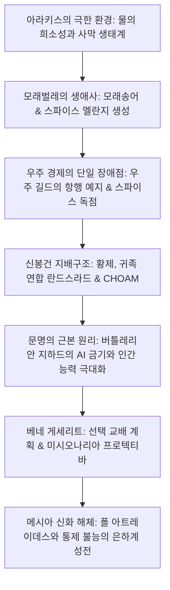

1965년에 출간된 프랭크 허버트(Frank Herbert)의 걸작 《듄》(DUNE)은 현대 SF 문학의 정점이자 세계관 구축(Worldbuilding)의 절대적 기준점입니다. 당시 유행하던 유선형 우주선과 컴퓨터 유토피아 대신, 허버트는 '생각하는 기계(AI)를 스스로 금지하고, 인간의 신체와 정신 능력을 극한까지 확장한 중세 봉건 제국'이라는 독창적 미래사를 창조했습니다.

이 거대한 우주의 중심은 전 우주에서 유일하게 **스파이스 멜란지(Spice Melange)**를 생산하는 사막 행성 아라키스(Arrakis)입니다. 스파이스는 인간의 수명을 수백 년으로 늘리고 의식을 확장시키며, 초공간을 접어 워프하는 우주 길드의 성간 항행을 가능케 하는 대체 불가능한 물질입니다. "스파이스를 지배하는 자가 전 우주를 지배한다." 이 잔혹한 지정학적 공리 아래 황제, 대귀족 연합(란드스라드), 우주 길드, 거대 독점기업 초암(CHOAM), 그리고 유전자 조작을 획책하는 여성 교단 베네 게세리트가 치열한 암투를 벌입니다.

## 1. 아라키스 행성의 사막 생태학과 보수복(Stillsuit)

프랭크 허버트는 1959년 오리건주의 사구(모래언덕) 녹화 프로젝트 취재에서 영감을 얻어, 행성 전체를 하나의 거대한 열역학적 생태계로 모델링했습니다.
강수량이 제로이며 습도가 $1 \sim 2\%$에 불과한 아라키스에서 프레멘(Fremen)이 생존할 수 있는 비결은 **보수복(Stillsuit)**입니다:
1. **모세관 다층 미세여과막**: 땀, 호흡 수분, 대소변을 모세관 현상으로 포집.
2. **보행 동력 구동 펌프**: 발뒤꿈치와 무릎 관절의 기계적 압력으로 역삼투막 가압.
3. **열교환 방열관**: 체온을 방열하고 정제수를 목 부위 물주머니로 집수.

$$\eta_{\text{water}} = \frac{W_{\text{recovered}}}{W_{\text{excreted}}} \ge 0.99$$

보수복은 **체내 수분의 $99\%$ 이상을 회수**하여 24시간 동안 소실되는 수분을 한 스푼 분량으로 억제합니다.

### 샤이-훌루드(모래벌레)의 생태 순환

- **모래송어(Sandtrout)**: 모래벌레의 유생으로 지하 수분을 격리 흡착하여 행성을 절대 건조 사막으로 유지.
- **프리스파이스 덩어리와 폭발(Spice Blow)**: 혐기성 발효로 축적된 가스가 지표면을 뚫고 폭발하여 태양광과 반응해 멜란지 결정 형성.
- **성체 모래벌레**: 수백 미터에 달하는 실리콘계 거대 환형동물로 체내는 수백 도의 용광로이며 대사 부산물로 산소를 공급. 물은 모래벌레에게 치명적 맹독으로 작용하여 '생명의 물'을 분비하고 사멸.

## 2. 스파이스 지정학과 우주 길드의 항행

스파이스는 수명 연장과 면역력 증강 외에도 **미래 예지(Prescience)**를 발현시킵니다.
생각하는 기계가 금지된 세계에서, 우주 길드의 항해사(Navigators)는 농축 스파이스 가스 속에서 돌연변이를 겪으며 예지력을 통해 충돌 없는 안전한 초공간 항로를 계산합니다. 스파이스가 고갈되면 전 우주의 교역과 통신은 즉시 마비되어 제국 전체가 멸망합니다.

## 3. 버틀레리안 지하드와 인간 능력의 극한화

이야기 1만 년 전, 인류는 자신을 노예화했던 인공지능과 자율 기계를 파괴하는 **버틀레리안 지하드(The Butlerian Jihad)**를 일으키고 다음과 같은 절대 계명을 제정했습니다:

> **"인간의 정신을 본뜬 기계를 만들지 말라." (Thou shalt not make a machine in the likeness of a human mind.)**

이로 인해 기계 대신 인간의 뇌와 신체를 특화한 전문 계층이 탄생했습니다:
- **멘타트(Mentat)**: 인간 컴퓨터로서 초당 수조 번의 확률 및 통계 논리 연산 수행.
- **베네 게세리트**: 음성 복종술(The Voice)과 세포 및 근육의 완벽한 자율 통제(프라나-빈두).
- **수크 의사**: 제국적 제약(Imperial Conditioning)을 통해 살인을 원천 차단당한 황실 주치의.

## 4. 홀츠만 실드와 근접 백병전의 부활

홀츠만 실드(Holtzman Shield)는 신체 주변에 역장 방어막을 형성합니다:
- 초속 수 센티미터 이상의 고속 투사체(총알, 파편)를 $100\%$ 반사 편향.
- 호흡을 위해 극저속 물체("느린 칼")만 통과 허용.
- **레이저총(Lasgun)이 실드에 명중하면 아원자 핵융합 폭발이 발생**하여 사수와 목표가 핵폭발 규모로 동반 증발. 이로 인해 우주 전쟁은 칼과 단검(크리스나이프)을 사용하는 정교한 근접 검술 백병전으로 회귀했습니다.

## 5. 메시아 신화의 해체와 허버트의 경고

프랭크 허버트의 궁극적 메시지는 영웅주의의 찬양이 아닌 **카리스마적 지도자에 대한 맹목적 추종의 위험성**입니다:

> **"카리스마를 지닌 지도자를 경계하라. 그들이 실수할 때 전 인류를 파멸의 구렁텅이로 몰고 가기 때문이다."**

폴이 프레멘의 구원자 '리산 알-가입'으로 숭배받은 것은 신의 섭리가 아니라, 베네 게세리트의 공작 부서 '미시오나리아 프로텍티바'가 수세기 전에 심어둔 세뇌 예언을 전략적으로 이용한 결과였습니다. 폴은 미래를 보면서도 스스로 일으킨 종교적 광신의 격류를 멈추지 못했고, 그 결과 **610억 명이 학살당하는 은하계 성전(지하드)**의 비극을 낳았습니다. 《듄》은 생태학, 정치경제학, 종교 신화학이 맞물린 냉철한 문명 비판서입니다.

## 6. 파도트 카인스의 생태계 전이 계산과 '황금의 길(The Golden Path)'

아라키스 초대 생태학자 파도트 카인스(Pardot Kynes)는 영국 물리학자 랠프 배그놀드(Bagnold)의 풍식 모래 이동 방정식을 적용했습니다:

$$q = C \sqrt{\frac{d}{D}} \frac{\rho_{\text{air}}}{g} u_*^3$$

내건성 사초를 식재하여 지표면 조도를 높이고 마찰속도 $u_*$를 모래 이동 임계치 이하로 억제했습니다. 풍력 집수기(Windtraps)로 수백만 갤런의 지하수를 비축하면 350~500년 내에 자생적 강수 순환을 복원할 수 있음을 계산했습니다.

나아가 후속작 《듄의 신황제》에서 폴의 아들 레토 2세(Leto II)는 모래송어와 융합하여 3500년간 불사의 모래벌레 신황제로 군림하며 '황금의 길'을 관철합니다. 극단적 압제를 통해 인류를 억압한 뒤 자신의 죽음과 함께 폭발적인 '대이산(The Scattering)'을 유도함으로써, 그 어떤 독재자나 단일 자원도 전 인류를 한꺼번에 절멸시킬 수 없는 영원한 번영을 선물했습니다.
