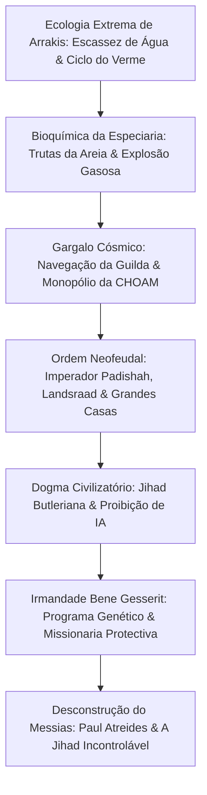

Lançado em 1965, *Duna* (Dune), de Frank Herbert, permanece como o ápice da ficção científica filosófica e da construção de mundos. Longe das fantasias tecnológicas de sua época, Herbert concebeu um império neofeudal no qual máquinas pensantes foram banidas, as capacidades mentais humanas foram elevadas à presciência quase divina e toda a engrenagem cósmica depende de um único mundo desértico: Arrakis.

Em Arrakis, cada gota de água é vida e patrimônio. No entanto, é o único planeta conhecido a produzir a **Especiaria Melange (Spice)**: um composto que triplica a longevidade, amplia a consciência e possibilita aos Navegadores da Guilda Espacial dobrar o espaço estelar com segurança. "Aquele que controla a especiaria controla o universo." Sob esse lema, o Imperador Padishah, as Casas Nobres do Landsraad, a Guilda e a irmandade Bene Gesserit travam um conflito milenar.

## 1. Ecologia Planetária e Termodinâmica de Arrakis

Frank Herbert inspirou-se em 1959 num projeto de estabilização de dunas com grama rasteira no Oregon. Em Arrakis, a chuva é nula e a umidade do ar fica abaixo de $2\%$. Tempestades de Coriolis atingem $700\text{ km/h}$, funcionando como esmeris capazes de pulverizar o aço.

### O Trajestilador (Stillsuit) dos Fremen

Para habitar o deserto, os nativos Fremen conceberam o **trajestilador (stillsuit)**, ápice da reciclagem osmótica e da termodinâmica biológica:
1. **Membranas capilares de microfiltração**: Absorvem suor, respiração e dejetos.
2. **Bombas mecânicas acionadas pelo passo**: A marcha comprime êmbolos que geram pressão para osmose reversa.
3. **Condensadores térmicos**: Resfriam o vapor filtrado conduzindo água pura para bolsas bucais.

$$\eta_{\text{water}} = \frac{W_{\text{recovered}}}{W_{\text{excreted}}} \ge 0{,}99$$

Um trajestilador correto **recicla mais de 99% da água eliminada pelo corpo**, restringindo a perda a poucos mililitros por dia. Para os Fremen, a água de quem morre é devolvida como dádiva sagrada aos reservatórios ocultos da tribo.

### O Ciclo dos Vermes de Areia (Shai-Hulud)

- **Trutas da Areia (Sandtrout)**: Larvas que aprisionam a água subterrânea criando a barreira que desertificou Arrakis.
- **Explosão de Pré-Especiaria (Spice Blow)**: Bolsões de fermentação anaeróbica que explodem na crosta. Ao contato com o oxigênio e a radiação solar, formam o pó cristalino de Melange.
- **Verme Adulto**: Criatura colossal de centenas de metros que produz oxigênio em suas fornalhas digestivas térmicas. A água líquida é veneno mortal para ele, provocando uma agonia que gera a Água da Vida.

## 2. Geopolítica e Economia da Especiaria

A Melange expande a mente e desperta a **presciência** (visão do futuro).
Na ausência de computadores, os Navegadores da **Guilda Espacial** vivem em tanques de gás de especiaria para prever trajetórias no espaço dobrado. Sem a especiaria, o comércio interestelar estagna imediatamente, isolando mundos inteiros na fome e no caos.

## 3. A Jihad Butleriana: o Tabu das Máquinas Pensantes

Dez mil anos antes dos Atreides, a humanidade destruiu os autômatos e IAs que a escravizavam na **Jihad Butleriana**. A Bíblia Católica Laranja decretou:

> **"Não farás máquina à semelhança da mente humana."**

Isso provocou a evolução e o treino biológico de ordens especializadas:
- **Mentats**: Computadores humanos livres de viés emocional que processam probabilidades e dados maciços.
- **Bene Gesserit**: Irmandade que domina o Prana-Bindu (controle autônomo total do organismo) e a Voz (hipnose vocal impositiva).
- **Médicos Suk**: Portadores de um bloqueio mental que impede qualquer agressão física contra pacientes.

## 4. Escudos Holtzman e Combate com Lâminas

O escudo Holtzman gera um campo que repele objetos em alta velocidade ($> 6\text{--}9\text{ cm/s}$), anulando projéteis e disparos balísticos. Apenas lâminas lentas conseguem atravessar a defesa.
Além disso, **um disparo de raio laser (Lasgun) contra um escudo provoca uma fusão subatômica**, gerando uma explosão com poder atômico que aniquila ambos os combatentes. Isso fez com que a guerra espacial regredisse ao duelo de espadas e facas crizo.

## 5. A Desconstrução do Mito Messiânico

A mensagem essencial de Frank Herbert é um severo alerta contra a fé cega em heróis e salvadores:

> **"Cuidado com os líderes carismáticos. Seus erros arrastam multidões para a destruição."**

Paul Atreides não é um salvador ungido pelos céus: ele é visto como "Lisan al-Gaib" porque a **Missionaria Protectiva** da Bene Gesserit disseminou lendas e mitos de controle religioso séculos antes. Paul explora essas crenças para vingar seu pai, mas acaba refém do fanatismo tribal que desperta. Sua coroação deflagra uma Jihad galáctica incontrolável que causará **a morte de 61 bilhões de pessoas**. *Duna* é uma reflexão monumental sobre as armadilhas da fé e a fragilidade do poder.
