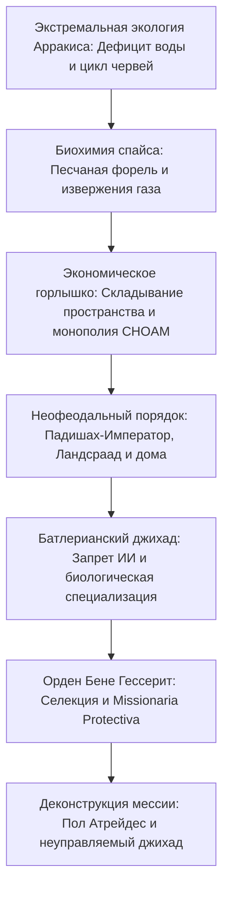

Вышедший в 1965 году роман Фрэнка Герберта «Дюна» (*Dune*) стал недосягаемой вершиной мировой философской фантастики и построения вымышленных миров. В отличие от современных ему авторов, воспевавших хромированные звездолеты и могущество искусственного интеллекта, Герберт представил удивительно глубокую антитехнократическую картину будущего: неофеодальную галактическую империю, где думающие машины запрещены под страхом смерти, человеческий разум развит до уровня предвидения, а судьба цивилизации зависит от одной безводной планеты — Арракиса.

Арракис — смертоносная пустыня, где капля воды дороже золота. Но именно здесь добывается величайшая драгоценность вселенной — **Пряность (Спайс / Меланж)**. Она дарует долголетие, расширяет восприятие и позволяет мутировавшим навигаторам Космической гильдии безопасно складывать пространство. «Тот, кто управляет пряностью, управляет вселенной». Вокруг этого ресурса разворачивается беспощадная интрига между Падишах-Императором, домами Ландсраада, Гильдией и орденом Бене Гессерит.

## 1. Экология и термодинамика Арракиса

Герберт задумал экосистему Дюны в 1959 году, изучая методы закрепления песчаных дюн травой в Орегоне. На Арракисе нет дождей, а влажность воздуха ниже $2\%$. Бури Кориолиса достигают $700\text{ км/ч}$, сдирая плоть и разрушая сталь.

### Дистикомб (Stillsuit) фрименов

Секрет выживания фрименов — **дистикомб (stillsuit)**, замкнутая система рециркуляции влаги:
1. **Капиллярные мембраны**: Собирают пот, дыхание и мочу.
2. **Насосы с приводом от ходьбы**: Движение пяток и колен создает давление для обратного осмоса.
3. **Теплообменные трубки**: Конденсируют очищенную воду в нагрудные карманы.

$$\eta_{\text{water}} = \frac{W_{\text{recovered}}}{W_{\text{excreted}}} \ge 0{,}99$$

Исправный дистикомб **возвращает более 99% влаги тела**, снижая дневные потери до считанных миллилитров. Для фрименов вода покойного принадлежит всей общине сиетча.

### Жизненный цикл песчаных червей (Шай-Хулуд)

- **Песчаная форель (Sandtrout)**: Личинки, связывающие воду в глубоких пластах и превращающие планету в сухую пустыню.
- **Пре-спайсовая масса и взрыв (Spice Blow)**: Анаэробное брожение органики под давлением, взрывающее поверхность. На солнце и сухом воздухе масса окисляется в кристаллы спайса.
- **Взрослый червь**: Исполин длиной в сотни метров, живой термоядерный тигель, выделяющий кислород. Жидкая вода действует на червя как яд, вызывая агонию и выделение «Воды Жизни».

## 2. Геополитика спайса и свертывание пространства

Спайс продлевает жизнь и пробуждает **предвидение (Prescience)**.
Без компьютеров навигаторы **Космической гильдии (Spacing Guild)** дышат газом меланжа, чтобы видеть безопасные маршруты через свернутое пространство. Прекращение поставок спайса означает немедленный паралич межзвездной торговли и гибель миллиардов людей от голода.

## 3. Батлерианский джихад: табу на думающие машины

За десять тысяч лет до описываемых событий человечество восстало против поработившего его ИИ в **Батлерианском джихаде**. Оранжевая Католическая Библия провозгласила:

> **«Не сотвори машины по образу разума человеческого».**

Это породило специализированные институты развития человека:
- **Ментаты**: Живые суперкомпьютеры, анализирующие сложнейшие вероятности без эмоций.
- **Бене Гессерит**: Сестринство, овладевшее прана-бинду (абсолютным мышечным контролем) и Голосом (мгновенным гипнотическим подчинением).
- **Врачи Сук**: Имеют алмазную татуировку Имперского кондиционирования, делающую их органически неспособными убить пациента.

## 4. Щиты Хольцмана и возрождение боя на клинках

Энергетический щит Хольцмана отклоняет быстрые объекты ($> 6\text{--}9\text{ см/с}$), обесценивая огнестрельное оружие. Проникнуть сквозь поле может только медленный клинок («медленный клинок проникает в щит»).
Кроме того, **попадание лазерного луча (Lasgun) в щит вызывает субатомную термоядерную реакцию**, эквивалентную ядерному взрыву, уничтожающую и стрелка, и цель. Это вернуло галактические войны к фехтованию на ножах и крисах.

## 5. Деконструкция мессианства: предупреждение Герберта

Главная идея Герберта — крушение романтического мифа об избавителе:

> **«Остерегайтесь харизматических лидеров. Их ошибки ведут народы к гибели».**

Пол Атрейдес становится «Лисан аль-Гаибом» не по воле богов: этот миф был веками ранее внедрен среди фрименов орденом Бене Гессерит через **Missionaria Protectiva**. Пол использует пророчество для мести, но становится заложником фанатизма толпы. Его триумф развязывает галактический джихад, уносящий **жизни 61 миллиарда человек**. «Дюна» — это вечное предупреждение об опасности слепой веры в вождей.
