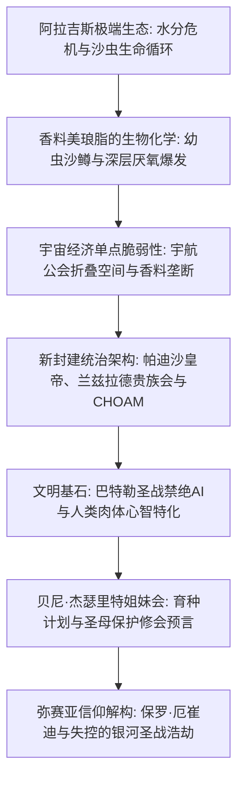

1965年问世的弗兰克·赫伯特（Frank Herbert）代表作《沙丘》（*Dune*），是世界科幻文学史上无可逾越的丰碑。当同时代的科幻作品普遍醉心于流线型太空飞船与人工智能统治的科技乌托邦时，赫伯特却反其道而行之，构建了一个严禁一切思考机器、依靠人类潜能极限与中世纪封建政治统治的宏大银河帝国。

这个宇宙的心脏正是极度干旱的荒漠行星阿拉吉斯（Arrakis）——亦称“沙丘”。这里滴水贵如黄金，却是全宇宙唯一出产**美琅脂香料（Spice Melange）**的地方。香料能延年益寿、激活预知潜能，更维系着宇航公会折叠时空的星际航行命脉。“谁控制了香料，谁就控制了宇宙。”在这一冷酷的地缘政治逻辑下，帕迪沙皇帝、领主兰兹拉德贵族会、宇航公会、CHOAM商业联合体以及贝尼·杰瑟里特姐妹会展开了长达万年的权力博弈。

## 1. 阿拉吉斯星球的沙漠生态学与热力学

弗兰克·赫伯特的创作灵感源自1959年美国农业部在俄勒冈州弗洛伦斯进行的“沙丘固定项目”。通过种植欧洲海滨草阻止流沙吞噬城镇的生态工程，激发了他构建一整个行星级生态循环系统的构想。

在阿拉吉斯，降雨量绝对为零，地表相对湿度仅 $1 \sim 2\%$。科里奥利风暴（Coriolis Storms）时速高达 $700 \text{ km/h}$，夹带的狂沙能瞬间将钢铁磨削成粉。

### 蒸馏服（Stillsuit）的生物工程与闭环水回收

原住民弗雷曼人（Fremen）赖以生存的终极装备是**蒸馏服（Stillsuit）**，它是微观流体力学与热力学能量转化的杰作：
1. **多层毛细渗透滤膜**：收集汗液、呼气凝结水与排泄物中的水分子。
2. **行走动能自驱动泵**：脚跟踏击与膝关节弯曲产生的机械冲程，为反渗透滤膜提供恒定高压。
3. **热交换辐射导管**：将体热散发至外界，使纯净蒸馏水冷凝流入口袋。

$$\eta_{\text{water}} = \frac{W_{\text{recovered}}}{W_{\text{excreted}}} \ge 0.99$$

合身完好的蒸馏服能实现 **$99\%$ 以上的水分回收率**，使人体每日净失水量控制在十几毫升以内。对弗雷曼人而言，水是生命、神圣的部族共有财产。

### 沙虫（夏胡鲁）的生态演变链

沙虫（Sandworm / Shai-Hulud）不仅是沙漠顶掠者，更是整颗星球水文地理的塑造者：
- **沙鳟（Sandtrout）**：沙虫的幼生形态，能本能地吸附并锁闭地下所有微量水分子，形成隔水层，彻底使地表沙漠化。
- **前香料团与香料爆发（Spice Blow）**：排泄物与受困水体在地下厌氧发酵产生高压气体，最终冲破地表发生剧烈爆裂。喷出的混合物在阳光与极干空气氧化下形成红褐色的美琅脂晶体粉末。
- **成体巨虫**：体内犹如几百度的高温熔炉，厌水且吞食沙土浮游物，副产物释放大量氧气。水对成体沙虫是剧烈神经毒素，接触致其痉挛死亡并分泌具有极强致幻开悟作用的“生命之水”。

## 2. 香料地缘政治与折叠空间航行

美琅脂的不可替代性体现在其三大特质：延长寿命至200~300岁、增强全面免疫力，以及最重要的——**激活深度预知潜能（Prescience）**。

在严禁电脑的世界里，宇航公会（Spacing Guild）的领航员（Navigators）长期浸泡在超高浓度香料气体中，身体变态退化为水栖生物形态，凭借被激发的预知力在错综复杂的可能未来中“看清”无碰撞的绝对安全轨迹，实现千万光年的超光速“折叠空间（Foldspace）”航行。一旦香料断供，星际贸易立刻瘫痪，无数殖民星球将在几个月内陷入绝望孤立与毁灭。

## 3. 巴特勒圣战：思考机器禁忌与潜能极限

故事发生前一万年的**巴特勒圣战（The Butlerian Jihad）**彻底重塑了人类历史。人类推翻了曾奴役自己的AI和自主机器人，在《奥兰治天主教圣经》中写下最高诫命：

> **“汝不可造思考之物如人之心智。”（Thou shalt not make a machine in the likeness of a human mind.）**

这一禁令催生出高度特化的人体超级潜能：
- **门塔特（Mentat / 人形电脑）**：完全克制情感偏见，每秒进行万亿次逻辑与统计概率运算。
- **贝尼·杰瑟里特姐妹会**：修习音控术（The Voice，以特定次声频率精神奴役他人）与普拉那-宾杜（肉体各肌群、神经元乃至胚胎性别的分子级控制）。
- **岳医生所在之苏克学院**：施加帝国烙印（Imperial Conditioning），保证终生绝对无法伤害生命。

## 4. 霍尔兹曼护盾与近战冷兵器复兴

霍尔兹曼护盾（Holtzman Shield）在人体周围形成排斥力场：
- 对高速撞击物（子弹、弹片，速度 $> 6\text{--}9\text{ cm/s}$）提供 $100\%$ 反弹偏折；
- 为保障呼吸气体交换，仅允许极低速物体（“慢刀”）缓慢穿透力场。
- **激光枪（Lasgun）射击护盾会诱发亚核聚合链式聚变爆炸**，导致射手与目标方圆数公里如同核爆般灰飞烟灭。因此宇宙战争摒弃了热兵器与激光枪，退化为刀剑近身白兵肉搏（Slow-blade technique）。

## 5. 英雄神话的解构与警世预言

弗兰克·赫伯特借保罗·厄崔迪的弥赛亚悲剧，发出了文学史上最凌厉的政治哲学警告：

> **“不要盲从领袖，领袖带来的往往是万劫不复的深渊。”**

保罗被弗雷曼人奉为救世主“李桑·阿尔-盖布”，并非神圣天意，而是贝尼·杰瑟里特“圣母保护修会（Missionaria Protectiva）”数百年前在落后土著中散播的宗教洗脑预言被利用的结果。保罗看穿了未来，却发现自己无法阻挡信徒的宗教狂热，最终演变成**吞噬610亿无辜生灵、毁灭90个星球的失控银河大圣战**。《沙丘》是生态学、政治经济学与宗教神话学咬合而成的批判文明悲歌。

## 6. 帕多特·凯恩斯的生态改造计算与“黄金之路”

阿拉吉斯首任行星生态学家帕多特·凯恩斯（Pardot Kynes）将严格的流体力学引入了沙丘治理。根据英国物理学家拉尔夫·巴格诺德（Bagnold）的风成流沙输送方程：

$$q = C \sqrt{\frac{d}{D}} \frac{\rho_{\text{air}}}{g} u_*^3$$

通过引入耐旱的滨草，大幅增加地表粗糙度，将摩擦风速 $u_*$ 压制在沙粒启动临界值以下。配合风力集水器（Windtraps）封存数百万加仑地下水，凯恩斯计算出仅需350至500年即可恢复自律性降水循环。

而在《沙丘神帝》中，保罗之子雷托二世（Leto II）选择与沙鳟共生化为活体沙虫，以长达3500年的残暴统治执行“黄金之路（The Golden Path）”：通过彻底禁绝星际旅行与全面垄断香料，逼迫人类在神帝死后爆发“大离散（The Scattering）”，永远消除了单一点对全人类种族生存的灭顶威胁。

## 7. 语言学隐喻与哲学深渊：莎翁悲剧与尼采超人

《沙丘》的文学厚度深深植根于多层文化交融。赫伯特广泛吸收了阿拉伯语（如李桑·阿尔-盖布、圣战圣徒）、希伯来语（奎萨茨·哈德拉赫，意为“跳跃之路”）与高加索查科布萨语。

保罗·厄崔迪的命运剧本折射着莎士比亚《哈姆雷特》与《麦克白》的深重悲剧色彩：肩负杀父之仇的年轻贵族，被女巫般的预言引导走上王座，却在终点沦为命运与信徒狂热的傀儡。保罗是尼采笔下超越世俗道德的“超人（Übermensch）”，但他所承受的是全知视界带来的极致虚无与窒息。这种深沉的存在主义哲学思考，使《沙丘》超越了普通太空歌剧，成为经久不衰的严肃文学殿堂之作。

## 8. 太古阿拉吉斯的海洋消失史与外星生物改造

令人震撼的是，阿拉吉斯在遥远的地质太古代并非沙漠，而是一颗拥有浩瀚海洋与湿润气候的蓝色水圈行星。造成海洋彻底干涸的始作俑者，正是外星引入的微小生物——沙鳟。沙鳟在其繁殖过程中，为了给厌水的成年沙虫创造生存环境，将行星上的液态水完全吸附并锁死在地下深层地质结构中。换言之，阿拉吉斯的沙漠并非大自然的原始造化，而是一场由单一外来入侵物种驱动的、规模宏大且彻底的行星级生物地球化学改造（Terraforming）。
