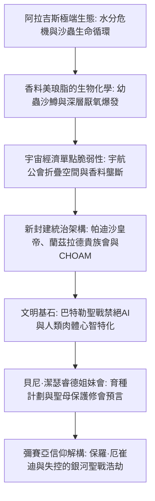

1965年問世的法蘭克·赫伯特（Frank Herbert）代表作《沙丘》（*Dune*），是世界科幻文學史上無可逾越的豐碑。當同時代的科幻作品普遍醉心於流線型太空飛船與人工智慧統治的科技烏托邦時，赫伯特卻反其道而行之，構建了一個嚴禁一切思考機器、依靠人類潛能極限與中世紀封建政治統治的宏大銀河帝國。

這個宇宙的心臟正是極度乾旱的荒漠行星阿拉吉斯（Arrakis）——亦稱「沙丘」。這裡滴水貴如黃金，卻是全宇宙唯一出產**美琅脂香料（Spice Melange）**的地方。香料能延年益壽、激活預知潛能，更維繫著宇航公會折疊時空的星際航行命脈。「誰控制了香料，誰就控制了宇宙。」在這一冷酷的地緣政治邏輯下，帕迪沙皇帝、領主蘭茲拉德貴族會、宇航公會、CHOAM商業聯合體以及貝尼·潔瑟睿德姐妹會展開了長達萬年的權力博弈。

## 1. 阿拉吉斯星球的沙漠生態學與熱力學

法蘭克·赫伯特的創作靈感源自1959年美國農業部在俄勒岡州弗洛倫斯進行的「沙丘固定項目」。通過種植歐洲海濱草阻止流沙吞噬城鎮的生態工程，激發了他構建一整個行星級生態循環系統的構想。

在阿拉吉斯，降雨量絕對為零，地表相對濕度僅 $1 \sim 2\%$。科里奧利風暴（Coriolis Storms）時速高達 $700 \text{ km/h}$，夾帶的狂沙能瞬間將鋼鐵磨削成粉。

### 蒸餾服（Stillsuit）的生物工程與閉環水回收

原住民弗瑞曼人（Fremen）賴以生存的終極裝備是**蒸餾服（Stillsuit）**，它是微觀流體力學與熱力學能量轉化的傑作：
1. **多層毛細滲透濾膜**：收集汗液、呼氣凝結水與排泄物中的水分子。
2. **行走動能自驅動泵**：腳跟踏擊與膝關節彎曲產生的機械衝程，為反滲透濾膜提供恆定高壓。
3. **熱交換輻射導管**：將體熱散發至外界，使純淨蒸餾水冷凝流入口袋。

$$\eta_{\text{water}} = \frac{W_{\text{recovered}}}{W_{\text{excreted}}} \ge 0.99$$

合身完好的蒸餾服能實現 **$99\%$ 以上的水分回收率**，使人體每日淨失水量控制在十幾毫升以內。對弗瑞曼人而言，水是生命、神聖的部族共有財產。

### 沙蟲（夏胡魯）的生態演變鏈

沙蟲（Sandworm / Shai-Hulud）不僅是沙漠頂掠者，更是整顆星球水文地理的塑造者：
- **沙鱒（Sandtrout）**：沙蟲的幼生形態，能本能地吸附並鎖閉地下所有微量水分子，形成隔水層，徹底使地表沙漠化。
- **前香料團與香料爆發（Spice Blow）**：排泄物與受困水體在地下厭氧發酵產生高壓氣體，最終衝破地表發生劇烈爆裂。噴出的混合物在陽光與極乾空氣氧化下形成紅褐色的美琅脂晶體粉末。
- **成體巨蟲**：體內猶如幾百度的高溫熔爐，厭水且吞食沙土浮游物，副產物釋放大量氧氣。水對成體沙蟲是劇烈神經毒素，接觸致其痙攣死亡並分泌具有極強致幻開悟作用的「生命之水」。

## 2. 香料地緣政治與折疊空間航行

美琅脂的不可替代性體現在其三大特質：延長壽命至200~300歲、增強全面免疫力，以及最重要的——**激活深度預知潛能（Prescience）**。

在嚴禁電腦的世界裡，宇航公會（Spacing Guild）的領航員（Navigators）長期浸泡在超高濃度香料氣體中，身體變態退化為水棲生物形態，憑藉被激發的預知力在錯綜複雜的可能未來中「看清」無碰撞的絕對安全軌跡，實現千萬光年的超光速「折疊空間（Foldspace）」航行。一旦香料斷供，星際貿易立刻癱瘓，無數殖民星球將在幾個月內陷入絕望孤立與毀滅。

## 3. 巴特勒聖戰：思考機器禁忌與潛能極限

故事發生前一萬年的**巴特勒聖戰（The Butlerian Jihad）**徹底重塑了人類歷史。人類推翻了曾奴役自己的AI和自主機器人，在《奧蘭治天主教聖經》中寫下最高誡命：

> **「汝不可造思考之物如人之心智。」（Thou shalt not make a machine in the likeness of a human mind.）**

這一禁令催生出高度特化的人體超級潛能：
- **門塔特（Mentat / 人形電腦）**：完全克制情感偏見，每秒進行萬億次邏輯與統計概率運算。
- **貝尼·潔瑟睿德姐妹會**：修習音控術（The Voice，以特定次聲頻率精神奴役他人）與普拉那-賓杜（肉體各肌群、神經元乃至胚胎性別的分子級控制）。
- **岳醫生所在之蘇克學院**：施加帝國烙印（Imperial Conditioning），保證終生絕對無法傷害生命。

## 4. 霍爾茲曼護盾與近戰冷兵器復興

霍爾茲曼護盾（Holtzman Shield）在人體周圍形成排斥力場：
- 對高速撞擊物（子彈、彈片，速度 $> 6\text{--}9\text{ cm/s}$）提供 $100\%$ 反彈偏折；
- 為保障呼吸氣體交換，僅允許極低速物體（「慢刀」）緩慢穿透力場。
- **雷射槍（Lasgun）射擊護盾會誘發亞核聚合鏈式聚變爆炸**，導致射手與目標方圓數公里如同核爆般灰飛煙滅。因此宇宙戰爭摒棄了熱兵器與雷射槍，退化為刀劍近身白兵肉搏（Slow-blade technique）。

## 5. 英雄神話的解構與警世預言

法蘭克·赫伯特藉保羅·厄崔迪的彌賽亞悲劇，發出了文學史上最凌厲的政治哲學警告：

> **「不要盲從領袖，領袖帶來的往往是萬劫不復的深淵。」**

保羅被弗瑞曼人奉為救世主「李桑·阿爾-蓋布」，並非神聖天意，而是貝尼·潔瑟睿德「聖母保護修會（Missionaria Protectiva）」數百年前在落後土著中散播的宗教洗腦預言被利用的結果。保羅看穿了未來，卻發現自己無法阻擋信徒的宗教狂熱，最終演變成**吞噬610億無辜生靈、毀滅90個星球的失控銀河大聖戰**。《沙丘》是生態學、政治經濟學與宗教神話學咬合而成的批判文明悲歌。

## 6. 帕多特·凱恩斯的生態改造計算與「黃金之路」

阿拉吉斯首任行星生態學家帕多特·凱恩斯（Pardot Kynes）將嚴格的流體力學引入了沙丘治理。根據英國物理學家拉爾夫·巴格諾德（Bagnold）的風成流沙輸送方程：

$$q = C \sqrt{\frac{d}{D}} \frac{\rho_{\text{air}}}{g} u_*^3$$

通過引入耐旱的濱草，大幅增加地表粗糙度，將摩擦風速 $u_*$ 壓制在沙粒啟動臨界值以下。配合風力集水器（Windtraps）封存數百萬加侖地下水，凱恩斯計算出僅需350至500年即可恢復自律性降水循環。

而在《沙丘神帝》中，保羅之子雷托二世（Leto II）選擇與沙鱒共生化為活體沙蟲，以長達3500年的殘暴統治執行「黃金之路（The Golden Path）」：通過徹底禁絕星際旅行與全面壟斷香料，逼迫人類在神帝死後爆發「大離散（The Scattering）」，永遠消除了單一點對全人類種族生存的滅頂威脅。

## 7. 語言學隱喻與哲學深淵：莎翁悲劇與尼采超人

《沙丘》的文學厚度深深植根於多層文化交融。赫伯特廣泛吸收了阿拉伯語（如李桑·阿爾-蓋布、聖戰聖徒）、希伯來語（奎薩茨·哈德拉赫，意為「跳躍之路」）與高加索查科布薩語。

保羅·厄崔迪的命運劇本折射著莎士比亞《哈姆雷特》與《馬克白》的深重悲劇色彩：肩負殺父之仇的年輕貴族，被女巫般的預言引導走上王座，卻在終點淪為命運與信徒狂熱的傀儡。保羅是尼采筆下超越世俗道德的「超人（Übermensch）」，但他所承受的是全知視界帶來的極致虛無與窒息。這種深沉的存在主義哲學思考，使《沙丘》超越了普通太空歌劇，成為經久不衰的嚴肅文學殿堂之作。

## 8. 太古阿拉吉斯的海洋消失史与外星生物改造

令人震撼的是，阿拉吉斯在遥远的地质太古代并非沙漠，而是一颗拥有浩瀚海洋与湿润气候的蓝色水圈行星。造成海洋彻底干涸的始作俑者，正是外星引入的微小生物——沙鳟。沙鳟在其繁殖过程中，为了给厌水的成年沙虫创造生存环境，将行星上的液态水完全吸附并锁死在地下深层地质结构中。换言之，阿拉吉斯的沙漠并非大自然的原始造化，而是一场由单一外来入侵物种驱动的、规模宏大且彻底的行星级生物地球化学改造（Terraforming）。
