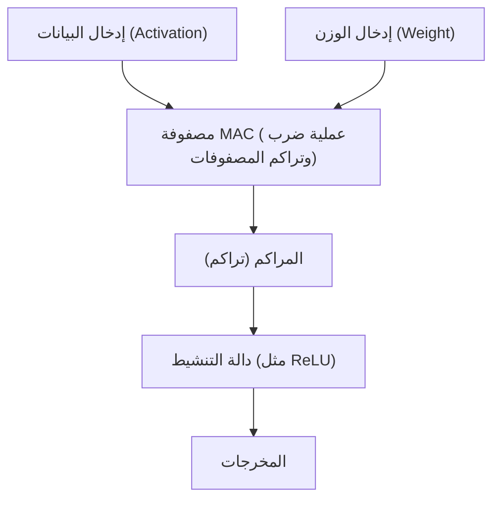

# بنية الذكاء الاصطناعي الطرفي (Edge AI) ووحدة المعالجة العصبية (NPU)

في السنوات الأخيرة، مع التطور السريع لتقنية الذكاء الاصطناعي (AI)، أصبح الذكاء الاصطناعي يُستخدم في كل جانب من جوانب حياتنا. ما قاد طفرة الذكاء الاصطناعي الأولية كان موارد الحوسبة الهائلة لمراكز البيانات الضخمة الموجودة على السحابة. ومع ذلك، فإن هذا النموذج يشهد الآن نقطة تحول رئيسية. إنه ظهور "الذكاء الاصطناعي الطرفي (Edge AI)" والأجهزة المخصصة التي تدعمه "وحدة المعالجة العصبية (NPU)".

تشرح هذه المقالة مزايا وقيود الاستدلال السحابي والمحلي، وأمثلة على تصاميم NPU، وأساليب تحسين النماذج. ولأن الأثر على الأداء والخصوصية ليس موحدًا، توضح أيضًا كيفية تقييمه لكل جهاز واستخدام.

## 1. حدود الذكاء الاصطناعي السحابي وظهور الذكاء الاصطناعي الطرفي

النهج التقليدي لإجراء استدلال الذكاء الاصطناعي على السحابة له العديد من التحديات الهيكلية.

### مشكلة زمن الوصول (الكمون)
يعتمد زمن الرحلة ذهابًا وإيابًا إلى السحابة على مسار الشبكة والمسافة والازدحام ومعالجة الخادم؛ لذلك لا تمثل عشرات أو مئات المللي ثانية قيمة عامة ثابتة. قد يجنّب الاستدلال على الجهاز انتظار الشبكة ويساعد عند وجود مهلة استجابة صارمة، لكن الاستدلال والإدخال والإخراج محليًا تستغرق وقتًا أيضًا. قِس الزمن من البداية إلى النهاية باستخدام النموذج والجهاز المستهدفين. وتحتاج الأنظمة الحساسة للسلامة، مثل المركبات، إلى ضمانات تتجاوز تنبؤًا واحدًا من الذكاء الاصطناعي.

### الخصوصية والأمان
قد يمنع الاستدلال على الجهاز إرسال الصور أو الصوت الخام إلى الخارج ويقلل البيانات المنقولة في بعض التصاميم. لكنه لا يضمن الخصوصية أو الأمان: فقد ترسل التطبيقات النتائج أو السجلات أو معلومات التشخيص، كما يحتاج الجهاز نفسه إلى ضوابط وصول وتشفير وتحديثات. تحقّق مما يخزنه كل تطبيق وخدمة وما يرسلانه.

### تكلفة الاتصال وعرض النطاق الترددي
يؤدي إرسال تدفقات الفيديو عالية الدقة وكميات هائلة من بيانات المستشعرات إلى السحابة إلى الضغط بشكل كبير على النطاق الترددي للشبكة وزيادة تكاليف الاتصال. من خلال المعالجة المسبقة للبيانات على الجانب الطرفي وإرسال المعلومات الضرورية فقط إلى السحابة، يمكن تقليل العبء على البنية التحتية للشبكة بشكل كبير.

بحسب الاستخدام، يمكن إجراء الاستدلال في السحابة أو على الجهاز أو بينهما. قد تقلل المعالجة المحلية كمون الشبكة أو حركة البيانات، لكن الأجهزة محدودة بالطاقة والحرارة والذاكرة. وتعتمد وحدات الحساب المستخدمة، بما فيها NPU، على النموذج وبيئة التشغيل.

## 2. ما هي وحدة المعالجة العصبية (NPU)؟

NPU مصطلح عام يشير إلى عتاد مخصص أو مدمج لتسريع عمليات الشبكات العصبية. تركز منتجات كثيرة على الاستدلال، لكن دعم التدريب والعمليات المحددة يختلف حسب المنتج. وتعتمد الإمكانات الفعلية أيضًا على بيئة التشغيل وبرامج التشغيل والنموذج.

### الفرق بين CPU و GPU و NPU

تُستخدم وحدة CPU غالبًا للتحكم العام والعمل التسلسلي، وGPU للأحمال المتوازية، وNPU لتسريع عمليات الشبكات العصبية التي تدعمها. تختلف الإمكانات حسب المنتج، وقد توزّع بيئة التشغيل العمل بين عدة معالجات. لا تكون NPU دائمًا أسرع أو أكفأ من GPU؛ فالنتيجة تعتمد على النموذج والعمليات والدقة وحجم الدفعة وبيئة التشغيل ونقل البيانات وحدود الطاقة أو الحرارة. قِس عبء العمل الكامل نفسه على الجهاز المستهدف؛ ولا تكفي قيمة TOPS القصوى للتنبؤ بسرعة التطبيق.

## 3. بنية NPU والعوامل المؤثرة في الأداء

يعتمد أداء NPU وكفاءتها على البنية الداخلية، وكذلك على النموذج والبرمجيات ونقل البيانات وحدود الطاقة والحرارة. يعرض هذا القسم بعض اعتبارات التصميم الشائعة.

### تكامل وحدات الضرب والتراكم (MAC)
تستخدم الشبكات العصبية عمليات MAC كثيرًا، لذلك تضم بعض وحدات NPU وحدات حساب وتدفقات بيانات متخصصة. تختلف التصاميم؛ فالمصفوفة الانقباضية أحد الأساليب، و«Tensor Core» اسم خاص ببعض المنتجات. لا تمتلك كل وحدات NPU البنية أو عدد الوحدات نفسه. يوضح الرسم أدناه مفهومًا مبسطًا فقط.

### تحسين التسلسل الهرمي للذاكرة (تقليل نقل البيانات)
قد يؤثر نقل البيانات في الطاقة والأداء، لكن لا توجد نسبة واحدة تنطبق على جميع الشرائح وأعباء العمل. تؤثر الذاكرة المدمجة وإعادة استخدام البيانات والنموذج وبيئة التشغيل؛ وقد تنتقل البيانات الوسيطة إلى DRAM. حلّل النموذج على العتاد المستهدف وقِس الأداء الكامل مع احتساب النقل.

## 4. أمثلة واقعية لبنى NPU

حاليًا، يتم تطوير وتجهيز العديد من وحدات المعالجة العصبية (NPU) للهواتف الذكية وأجهزة الكمبيوتر الشخصية.

### محرك أبل العصبي (ANE)
يمكن لـ Apple Core ML استخدام وحدات حساب مثل CPU وGPU وNeural Engine بحسب النموذج والجهاز. حلّل توزيع العمل باستخدام Xcode وقِس الأداء على الجهاز المستهدف؛ فقيمة TOPS القصوى لشريحة ما لا تحدد سرعة تطبيق آخر. [تحليل أداء Core ML](https://developer.apple.com/documentation/coreml/analyzing-a-core-ml-model-s-performance-in-xcode) · [وحدات الحساب](https://developer.apple.com/documentation/coreml/mlcomputeunits)

### Google Tensor (شرائح Pixel)
Google Tensor عائلة من شرائح SoC لأجهزة Pixel. Google Cloud TPU وEdge TPU (منتجات Coral) سلسلتان منفصلتان؛ ولا تثبت الأسماء وحدها وجود سلالة تصميم مباشرة. تختلف الميزات على الجهاز حسب الجيل والنموذج ونظام التشغيل والتطبيق. [إعلان Google عن Pixel 11 (Tensor G6)](https://blog.google/products-and-platforms/devices/pixel/google-pixel-11-pro-xl/) · [وثائق Coral Edge TPU](https://coral.ai/docs/)

### وحدة المعالجة العصبية Qualcomm Hexagon NPU
تصف Qualcomm وحدة Hexagon بأنها NPU تضم مسرّعات scalar وvector وtensor وذاكرة مشتركة؛ ويجمعها Qualcomm AI Engine مع معالجات أخرى مثل CPU وGPU. تختلف العمليات المدعومة والأداء الفعلي حسب SoC والبرمجيات والنموذج. قِس التكوين المستهدف. [Hexagon](https://www.qualcomm.com/processors/hexagon) · [AI Engine](https://www.qualcomm.com/processors/ai-engine)

## 5. البرمجيات وتقنيات التحسين التي تدعم الذكاء الاصطناعي الطرفي

قد تتجاوز النماذج الكبيرة حدود الذاكرة أو الطاقة في الجهاز. يمكن النظر في التكميم والتقليم والتقطير، مع التحقق من دعم العتاد وتأثير ذلك في الدقة والأداء المقاس.

### التكميم (Quantization)
يغيّر التكميم التمثيل الرقمي للأوزان أو العمليات، مثل التحويل من FP32 إلى FP16 أو INT8. وقد يقلل تخزين الأوزان، لكن حجم النموذج والسرعة لا يتحسنان بالضرورة بالنسبة نفسها؛ إذ تعتمد النتيجة على الدعم والدقة. بعد PTQ أو QAT، اختبر مدخلات ممثلة وقِس الأداء الكامل على الجهاز المستهدف. [ضغط نماذج Core ML](https://developer.apple.com/documentation/coreml/reducing-the-size-of-your-core-ml-app) · [ONNX Runtime](https://onnxruntime.ai/docs/performance/model-optimizations/quantization.html)

### التقليم (Pruning)
يحذف التقليم أوزانًا محددة أو يجعلها صفرًا لتكوين نموذج متناثر. وقد تواصل النوى الكثيفة حساب الأوزان الصفرية، لذلك لا يضمن التناثر وحده ملفًا أصغر أو استدلالًا أسرع. يلزم تمثيل متناثر مناسب، وعمليات وبيئة تشغيل وعتاد متوافق. قيّم الدقة والأداء المقاس معًا.

### تقطير المعرفة (Knowledge Distillation)
يدرّب تقطير المعرفة نموذج الطالب باستخدام مخرجات نموذج المعلم أو إشارات أخرى منه. قد يساعد نموذجًا أصغر، لكنه لا يضمن دقة أعلى من تدريب النموذج الصغير بصورة مستقلة. قارن الطرائق على المهمة والبيانات المعنيتين.

## 6. مستقبل الذكاء الاصطناعي الطرفي والتوقعات المستقبلية

تعمل بعض نماذج اللغة الكبيرة في السحابة بسبب احتياجاتها إلى الحوسبة والذاكرة، بينما تستطيع بعض الأجهزة تشغيل نماذج أصغر مكمّمة أو مُقطّرة. تعتمد إمكانية التشغيل والكمون والدقة واستهلاك الطاقة على النموذج والجهاز؛ لذا قيّم عبء العمل المقصود.

في المستقبل، من المتوقع حدوث الاتجاهات التالية.

*   **الذكاء الاصطناعي الهجين (Hybrid AI)**:
    يمكن اختيار المعالجة على الجهاز أو في السحابة وفق مهلة الاستجابة والاتصال ومعالجة البيانات والتكلفة وقدرات النموذج. لا تفترض أن كل المهام يجب أن تنفذ في مكان واحد؛ اتخذ القرار استنادًا إلى المتطلبات والقياسات.
*   **الاستخدام في أجهزة طرفية متنوعة**:
    قد تستخدم الكاميرات والمركبات والأجهزة القابلة للارتداء والمستشعرات نماذج صغيرة أو مسرّعات لمهام محددة. وتعتمد الجدوى على الطاقة والتكلفة والاتصال والنموذج ومتطلبات التحديث؛ ولا يحتاج كل جهاز IoT إلى NPU.
*   **موفرو التنفيذ وقابلية النقل**:
    تستخدم ONNX Runtime Execution Providers لتوزيع العمليات أو الرسوم الفرعية المدعومة على العتاد؛ وقد تعمل العمليات غير المدعومة على معالج آخر. تحقّق من التسريع الفعلي والأداء الكامل لكل نموذج. لا يوجد ضمان لأفضل أداء على أي NPU. [Execution Providers](https://onnxruntime.ai/docs/execution-providers/)

## خاتمة

يوسّع Edge AI وNPU خيارات إجراء الاستدلال على الجهاز. قد يفيد تجنب انتظار الشبكة أو تقليل إرسال البيانات الخام أو تعديل استهلاك الطاقة، لكن تحسين الكمون والخصوصية والكفاءة ليس تلقائيًا. قِس التكوين كاملًا — الاستخدام والنموذج والجهاز والبرمجيات — وقارنه بالاستدلال السحابي.

بالنسبة لمهندسي البرمجيات ومطوري الذكاء الاصطناعي، ليس فقط المهارات اللازمة للتعامل مع النماذج الضخمة على السحابة، ولكن أيضًا المعرفة حول "كيفية تنفيذ وتحسين الذكاء الاصطناعي من خلال الاستفادة من خصائص الأجهزة (NPU) في ظل موارد محدودة" ستصبح ذات أهمية متزايدة في المستقبل.
