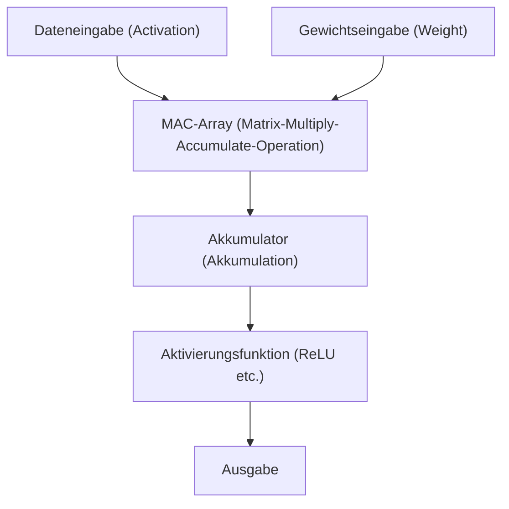

# Edge AI und NPU (Neural Processing Unit) Architektur

In den letzten Jahren ist Künstliche Intelligenz (KI) durch die rasante Entwicklung der Technologie zu einem integralen Bestandteil unseres Alltags geworden. Der anfängliche KI-Boom wurde von den massiven Rechenressourcen riesiger Rechenzentren in der Cloud angetrieben. Heute stehen wir jedoch an einem großen Wendepunkt in diesem Paradigma: dem Aufstieg von „Edge AI“ und der dafür entwickelten dedizierten Hardware, der „NPU (Neural Processing Unit)“.

Dieser Artikel erläutert Vor- und Nachteile von Cloud- und On-Device-Inferenz, Beispiele für NPU-Entwürfe und Modelloptimierungen. Da die Auswirkungen auf Leistung und Datenschutz nicht allgemeingültig sind, zeigt er auch, wie sie für ein bestimmtes Gerät und einen konkreten Anwendungsfall bewertet werden.

## 1. Die Grenzen der Cloud-KI und der Aufstieg von Edge-KI

Der traditionelle Ansatz, KI-Inferenz in der Cloud durchzuführen, bringt mehrere strukturelle Herausforderungen mit sich.

### Das Latenzproblem
Die Cloud-Rundlaufzeit hängt von Netzwerkroute und -entfernung, Auslastung und Serververarbeitung ab; einige zehn oder hundert Millisekunden sind kein allgemeingültiger Wert. On-Device-Inferenz kann die Wartezeit auf das Netzwerk vermeiden und bei strengen Antwortfristen helfen, doch auch lokale Inferenz sowie Ein- und Ausgabe benötigen Zeit. Messen Sie die Ende-zu-Ende-Latenz mit dem vorgesehenen Modell und Gerät. Sicherheitskritische Systeme wie Fahrzeuge brauchen außerdem Schutzmechanismen, die nicht von einer einzelnen KI-Vorhersage abhängen.

### Datenschutz und Sicherheit
Lokale Inferenz kann in manchen Architekturen verhindern, dass Rohbilder oder Audiodaten das Gerät verlassen, und so die übertragenen Daten reduzieren. Sie garantiert weder Datenschutz noch Sicherheit: Apps können weiterhin Ergebnisse, Protokolle oder Diagnosedaten senden; auch das Gerät benötigt Zugriffsschutz, Verschlüsselung und Updates. Prüfen Sie, was die jeweilige App und der Dienst speichern und übertragen.

### Kommunikationskosten und Bandbreite
Das Senden von hochauflösenden Videostreams oder riesigen Sensordatenmengen an die Cloud belastet die Netzwerkbandbreite erheblich und treibt die Kommunikationskosten in die Höhe. Durch die Vorverarbeitung der Daten am Edge und das Senden nur der notwendigen Informationen an die Cloud kann die Belastung der Netzwerkinfrastruktur drastisch reduziert werden.

Je nach Anwendungsfall kann die Inferenz in der Cloud, auf dem Gerät oder verteilt stattfinden. Lokale Verarbeitung ist eine Möglichkeit, Netzwerklatenz oder Datenverkehr zu verringern; Geräte haben jedoch Grenzen bei Energie, Wärme und Speicher. Welche Recheneinheiten einschließlich einer NPU verwendet werden, hängt vom Modell und der Laufzeitumgebung ab.

## 2. Was ist eine NPU (Neural Processing Unit)?

NPU ist ein Sammelbegriff für dedizierte oder integrierte Hardware zur Beschleunigung neuronaler Netzwerkoperationen. Viele Produkte sind auf Inferenz ausgelegt; die Unterstützung von Training und einzelnen Operatoren unterscheidet sich jedoch. Die tatsächlichen Fähigkeiten hängen auch von Laufzeitumgebung, Treibern und Modell ab.

### Der Unterschied zwischen CPU, GPU und NPU

Eine CPU übernimmt häufig allgemeine Steuerung und sequenzielle Aufgaben, eine GPU parallele Arbeitslasten und eine NPU die Beschleunigung unterstützter neuronaler Netzwerkoperationen. Fähigkeiten unterscheiden sich je nach Produkt; Laufzeitumgebungen können Aufgaben auf mehrere Prozessoren verteilen. Eine NPU ist nicht immer schneller oder effizienter als eine GPU. Das Ergebnis hängt von Modell, Operatoren, Genauigkeit, Batchgröße, Laufzeitumgebung, Datenübertragungen sowie Strom- und Temperaturgrenzen ab. Messen Sie dieselbe Ende-zu-Ende-Arbeitslast auf dem Zielgerät; die Spitzenleistung in TOPS sagt allein nichts über die Anwendungsgeschwindigkeit aus.

## 3. NPU-Architektur und Einflussfaktoren auf die Leistung

Leistung und Effizienz einer NPU hängen nicht nur von ihrem internen Aufbau ab, sondern auch von Modell, Software, Datenbewegungen sowie Strom- und Temperaturgrenzen. Dieser Abschnitt stellt einige typische Entwurfsaspekte vor.

### Ansammlung von MAC-Einheiten (Multiply-Accumulate)
Neuronale Netze verwenden häufig Multiply-Accumulate-Operationen (MAC); deshalb besitzen manche NPUs spezialisierte Recheneinheiten und Datenflüsse. Die Entwürfe unterscheiden sich: Ein systolisches Array ist ein Ansatz, „Tensor Core“ ein produktspezifischer Name. Nicht jede NPU hat dieselbe Struktur oder eine vergleichbare Anzahl solcher Einheiten. Die Grafik unten ist ein vereinfachtes Konzept, keine Beschreibung jeder NPU.

### Optimierung der Speicherhierarchie (Minimierung von Datenbewegungen)
Datenbewegungen können Leistungsaufnahme und Performance eines Beschleunigers beeinflussen; ein allgemeines Energieverhältnis für alle Chips und Arbeitslasten gibt es jedoch nicht. On-Chip-Speicher, Datenwiederverwendung, Modell und Laufzeitumgebung spielen eine Rolle. Gewichte und Zwischenergebnisse passen nicht immer vollständig auf den Chip; zwischen Schichten können weiterhin DRAM-Transfers auftreten. Profilieren Sie das Modell auf der Zielhardware und berücksichtigen Sie Transfers bei der Ende-zu-Ende-Messung.

## 4. Beispiele realer NPU-Architekturen

Heutzutage werden verschiedene NPUs für Smartphones und PCs entwickelt und eingesetzt.

### Apple Neural Engine (ANE)
Apple Core ML kann je nach Modell und Gerät Recheneinheiten wie CPU, GPU und Neural Engine verwenden. Zuordnung und Performance sind arbeitslastabhängig; analysieren Sie sie mit Xcode und messen Sie auf dem Zielgerät. Der Spitzenwert in TOPS einer Chipgeneration belegt nicht die Geschwindigkeit einer anderen Anwendung oder eines anderen Modells. [Core-ML-Performanceanalyse](https://developer.apple.com/documentation/coreml/analyzing-a-core-ml-model-s-performance-in-xcode) · [Recheneinheiten](https://developer.apple.com/documentation/coreml/mlcomputeunits)

### Google Tensor (Pixel-SoCs)
Google Tensor ist eine SoC-Produktfamilie für Pixel-Geräte. Google Cloud TPU und Edge TPU (die Coral-Produktfamilie) sind getrennte Produktlinien; allein aus den Namen lässt sich keine direkte Design-Abstammung ableiten. On-Device-Funktionen unterscheiden sich nach Generation, Modell, Betriebssystem und App. Prüfen Sie die Dokumentation des konkreten Geräts und der Funktion. [Googles Pixel-11-Ankündigung (Tensor G6)](https://blog.google/products-and-platforms/devices/pixel/google-pixel-11-pro-xl/) · [Coral-Edge-TPU-Dokumentation](https://coral.ai/docs/)

### Qualcomm Hexagon NPU
Qualcomm beschreibt Hexagon als NPU mit skalaren, vektoriellen und Tensor-Beschleunigern sowie gemeinsam genutztem Speicher. Die Qualcomm AI Engine kombiniert sie mit weiteren Prozessoren, darunter CPUs und GPUs. Unterstützte Operationen und tatsächliche Leistung variieren je nach SoC, Softwarestack und Modell. Vergleichen Sie Messwerte auf der Zielkonfiguration statt Produktnamen oder Spitzen-TOPS. [Hexagon NPU](https://www.qualcomm.com/processors/hexagon) · [Qualcomm AI Engine](https://www.qualcomm.com/processors/ai-engine)

## 5. Software und Optimierungstechnologien, die Edge AI unterstützen

Große Modelle können den Speicher- oder Energiebedarf eines Geräts überschreiten. Quantisierung, Pruning und Destillation sind mögliche Ansätze; prüfen Sie jedoch Hardwareunterstützung, Genauigkeitsverluste und gemessene Leistung.

### Quantisierung (Quantization)
Quantisierung ändert die numerische Darstellung von Gewichten oder Operationen, etwa von FP32 zu FP16 oder INT8. Dadurch lassen sich Gewichtsspeicher und Datentransfers reduzieren, aber Modellgröße und Inferenzgeschwindigkeit verbessern sich nicht zwangsläufig im selben Verhältnis. Das Ergebnis hängt von unterstützten Formaten, Operatoren, Laufzeitumgebungen und Hardware ab; auch die Genauigkeit kann sich ändern. Messen Sie nach PTQ oder QAT die Genauigkeit mit repräsentativen Eingaben und die Ende-zu-Ende-Leistung auf dem Zielgerät. [Core-ML-Modellkomprimierung](https://developer.apple.com/documentation/coreml/reducing-the-size-of-your-core-ml-app) · [ONNX-Runtime-Quantisierung](https://onnxruntime.ai/docs/performance/model-optimizations/quantization.html)

### Pruning (Beschneidung)
Beim Pruning werden ausgewählte Gewichte entfernt oder auf null gesetzt, um ein sparsames Modell zu erzeugen. Dichte Kernel können weiterhin auch mit Nullgewichten rechnen; Sparsität allein garantiert deshalb weder eine kleinere Datei noch schnellere Inferenz. Speicherersparnis erfordert eine geeignete Sparse-Darstellung, Beschleunigung kompatible Sparse-Operatoren, Laufzeitumgebung und Hardware. Bewerten Sie Genauigkeit und gemessene Leistung gemeinsam.

### Wissensdestillation (Knowledge Distillation)
Bei der Wissensdestillation wird ein Schüler-Modell anhand der Ausgaben oder anderer Signale eines Lehrer-Modells trainiert. Das kann ein kleineres Modell unter Größen- oder Genauigkeitsbeschränkungen verbessern, garantiert aber keine höhere Genauigkeit als ein unabhängiges Training desselben kleinen Modells. Vergleichen Sie die Methoden anhand der relevanten Aufgabe und Daten.

## 6. Die Zukunft und die Aussichten von Edge AI

Einige große Sprachmodelle laufen wegen ihres Rechen- und Speicherbedarfs in der Cloud; manche Geräte können kleinere quantisierte oder destillierte Modelle lokal ausführen. Machbarkeit, Latenz, Genauigkeit und Energiebedarf hängen vom Modell und Gerät ab. Bewerten Sie die vorgesehene Arbeitslast.

In Zukunft werden folgende Trends erwartet:

*   **Hybride KI (Hybrid AI)**:
    Je nach Antwortfrist, Verbindung, Datenverarbeitung, Kosten und Modellfähigkeit kann die Ausführung auf dem Gerät oder in der Cloud gewählt werden. Gehen Sie nicht davon aus, dass alle Aufgaben an denselben Ort gehören; entscheiden Sie anhand der Anforderungen und Messungen.
*   **Einsatz auf verschiedenen Edge-Geräten**:
    Kameras, Fahrzeuge, Wearables und Sensoren können für bestimmte Aufgaben kleine Modelle oder Beschleuniger nutzen. Ob sich das lohnt, hängt von Energie, Kosten, Verbindung, Modell und Update-Anforderungen ab; nicht jedes IoT-Gerät benötigt eine NPU.
*   **Execution Provider und Portabilität**:
    Frameworks wie ONNX Runtime weisen unterstützte Operatoren oder Teilgraphen über Execution Provider der Hardware zu. Nicht unterstützte Operationen können anderswo ausgeführt werden. Prüfen Sie, welche Teile tatsächlich beschleunigt werden, und messen Sie Genauigkeit sowie Ende-zu-Ende-Geschwindigkeit für jedes Modell. „Einmal schreiben und auf jeder NPU optimal ausführen“ ist nicht garantiert. [ONNX Runtime Execution Providers](https://onnxruntime.ai/docs/execution-providers/)

## Fazit

Edge AI und NPUs erweitern die Möglichkeit, Inferenz auf einem Gerät auszuführen. Ein Netzwerk-Roundtrip weniger, die Übertragung weniger Rohdaten oder ein angepasster Energie- und Bandbreitenbedarf können Vorteile sein; Verbesserungen bei Latenz, Datenschutz und Energieeffizienz sind jedoch nicht automatisch gegeben. Messen Sie die gesamte Konfiguration aus Anwendungsfall, Modell, Gerät und Software und vergleichen Sie sie mit Cloud-Inferenz.

Für Softwareentwickler und KI-Entwickler wird nicht nur die Fähigkeit, riesige Modelle in der Cloud zu verwalten, sondern auch das Wissen, „wie man KI implementiert und optimiert, indem man die Eigenschaften der Hardware (NPU) unter begrenzten Ressourcen nutzt“, in Zukunft immer wichtiger werden.
