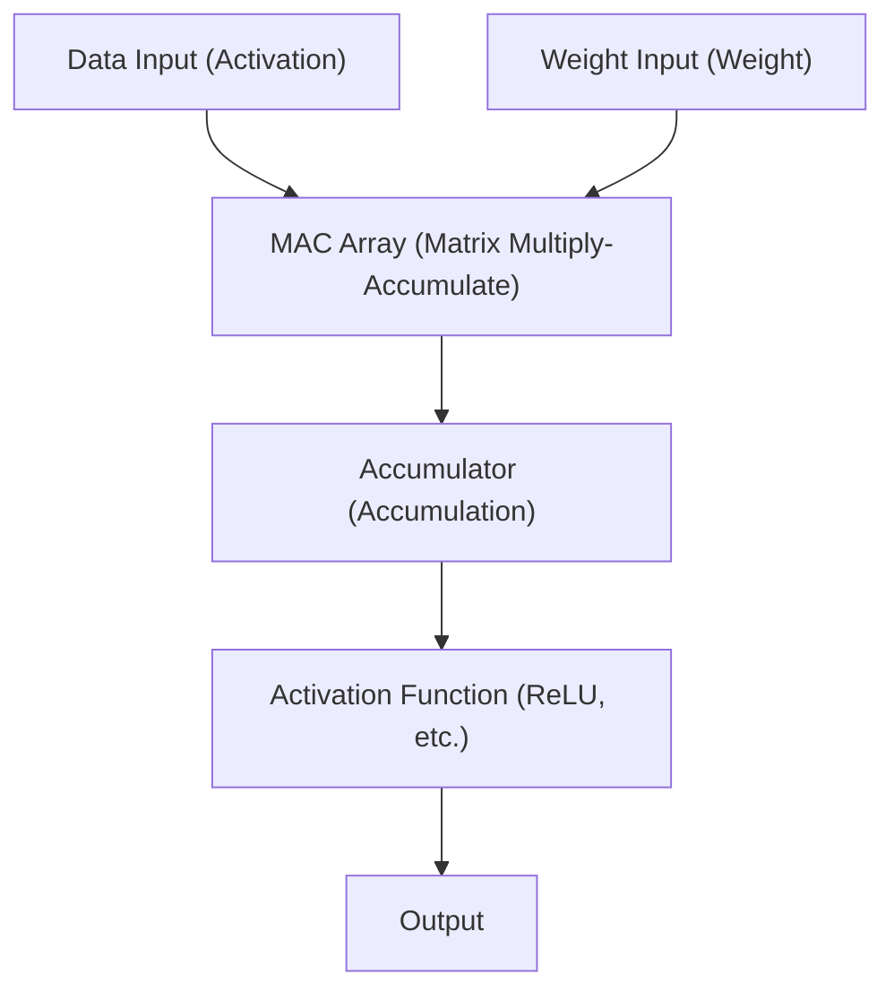

# Edge AI and NPU (Neural Processing Unit) Architecture

In recent years, with the rapid development of artificial intelligence (AI) technology, AI is now being utilized in every aspect of our lives. The initial AI boom was driven by the overwhelming computing resources of massive data centers in the cloud. However, that paradigm is currently reaching a major turning point: the rise of "Edge AI" and the dedicated hardware "NPU (Neural Processing Unit)" that supports it.

This article explains the tradeoffs between cloud and on-device inference, examples of NPU designs, and model optimization methods. Because effects on performance and privacy are not universal, it also describes how to evaluate them for a specific device and use case.

## 1. Limitations of Cloud AI and the Rise of Edge AI

The conventional approach of performing AI inference on the cloud side has several structural challenges.

### The Latency Problem
Cloud round-trip time varies with network route, distance, congestion, and server processing; tens to hundreds of milliseconds is not a universal value. On-device inference can avoid waiting for the network and may help when response deadlines are strict, but inference and input/output still take time. Measure end-to-end latency on the target device and model. Safety-critical systems such as vehicles also need safeguards beyond a single AI prediction.

### Privacy and Security
On-device inference can avoid sending raw images or audio off the device, reducing the data transmitted in some designs. It does not guarantee privacy or security: apps may still send outputs, logs, or diagnostics, and the device itself needs access controls, encryption, and updates. Check what each app and service stores and transmits.

### Communication Costs and Bandwidth
Sending all high-resolution video streams and massive amounts of sensor data to the cloud significantly strains network bandwidth and inflates communication costs. Pre-processing the data on the edge side and sending only necessary information to the cloud can drastically reduce the load on the network infrastructure.

Depending on the use case, inference can run in the cloud, on a device, or across both. On-device processing is one way to reduce network delay or traffic, but devices have power, thermal, and memory limits. Which compute units are used, including an NPU, depends on the model and runtime.

## 2. What is an NPU (Neural Processing Unit)?

NPU is a broad term for dedicated or integrated hardware that accelerates neural-network operations. Many products target inference, but support for training and specific operators varies by product. Actual capabilities also depend on the runtime, drivers, and model.

### Differences Between CPU, GPU, and NPU

A CPU is commonly used for general control and sequential work, a GPU for parallel workloads, and an NPU to accelerate the neural-network operations it supports. Capabilities differ by product and runtimes may distribute work across processors. An NPU is not always faster or more efficient than a GPU: results depend on the model, operators, precision, batch size, runtime, data transfers, and power or thermal limits. Benchmark the same end-to-end workload on the target device; peak TOPS alone does not predict application speed.

## 3. NPU Architecture and Factors Affecting Performance

NPU performance and efficiency depend not only on internal design but also on the model, software, data movement, and power or thermal limits. This section introduces some common design considerations.

### Integration of MAC (Multiply-Accumulate) Units
Neural networks often use multiply-accumulate (MAC) operations, so some NPUs include specialized arithmetic units and dataflows. Designs vary: a systolic array is one approach, while “Tensor Core” is a product-specific name. Not every NPU uses the same structure or exposes a comparable unit count. The diagram below is a simplified concept, not a description of every NPU.

### Memory Hierarchy Optimization (Minimization of Data Movement)
Data movement can affect accelerator power and performance, but there is no single energy ratio that applies to every chip and workload. On-chip memory capacity, reuse, model shape, and runtime all matter. Weights and intermediate results do not always fit on-chip, and transfers to DRAM may still occur between layers. Profile the model on the target hardware and measure data movement as part of end-to-end performance.

## 4. Real-World NPU Architecture Examples

Currently, various NPUs are being developed and installed in smartphones and PCs.

### Apple Neural Engine (ANE)
Apple Core ML can use compute units such as the CPU, GPU, and Neural Engine depending on the model and device. Placement and performance are workload-specific; use Xcode performance analysis and measurements on the target device. Peak TOPS for one chip generation does not establish the speed of another model or app. [Core ML performance analysis](https://developer.apple.com/documentation/coreml/analyzing-a-core-ml-model-s-performance-in-xcode) · [compute units](https://developer.apple.com/documentation/coreml/mlcomputeunits)

### Google Tensor (Pixel SoCs)
Google Tensor is a family of SoCs for Pixel devices. Google Cloud TPU and Edge TPU (the Coral product family) are separate product lines; their names alone do not establish a direct design lineage. On-device features vary by generation, model, operating system, and app, so check documentation for the specific device and feature. [Google's Pixel 11 announcement (Tensor G6)](https://blog.google/products-and-platforms/devices/pixel/google-pixel-11-pro-xl/) · [Coral Edge TPU documentation](https://coral.ai/docs/)

### Qualcomm Hexagon NPU
Qualcomm describes Hexagon as an NPU with scalar, vector, and tensor accelerators and shared memory. The Qualcomm AI Engine combines it with other processors, including CPUs and GPUs. Supported operations and actual performance vary by SoC, software stack, and model; compare measurements on the target configuration rather than product names or peak TOPS. [Hexagon NPU](https://www.qualcomm.com/processors/hexagon) · [Qualcomm AI Engine](https://www.qualcomm.com/processors/ai-engine)

## 5. Software and Optimization Technologies Supporting Edge AI

Large models may exceed a device's memory or power budget. Quantization, pruning, and distillation are options to evaluate, but their hardware support, effect on accuracy, and measured performance must be checked.

### Quantization
Quantization changes the numerical representation of weights or operations, for example from FP32 to FP16 or INT8. It can reduce weight storage and data transfer, but model size and inference speed do not necessarily improve by the same ratio. Results depend on supported formats, operators, runtime, and hardware, and accuracy can change. After PTQ or QAT, measure accuracy on representative inputs and end-to-end performance on the target device. [Core ML model compression](https://developer.apple.com/documentation/coreml/reducing-the-size-of-your-core-ml-app) · [ONNX Runtime quantization](https://onnxruntime.ai/docs/performance/model-optimizations/quantization.html)

### Pruning
Pruning removes or zeros selected weights to create a sparse model. Dense kernels may still compute with zero-valued weights, so sparsity alone does not guarantee a smaller file or faster inference. Storage savings require a suitable sparse representation; speedups require compatible sparse operators, runtime, and hardware. Evaluate accuracy and measured performance together.

### Knowledge Distillation
Knowledge distillation trains a student model using outputs or other signals from a teacher model. It can help a smaller model under size or accuracy constraints, but does not guarantee higher accuracy than training that small model independently. Compare methods on the task and data that matter.

## 6. The Future and Prospects of Edge AI

Some large language models run in the cloud because of their compute and memory requirements, while smaller quantized or distilled models can run on some devices. Feasibility, latency, accuracy, and power use depend on the model and device, so evaluate the intended workload.

Looking ahead, we can expect the following trends:

*   **Hybrid AI**:
    A design can choose between on-device and cloud processing based on response deadlines, connectivity, data handling, cost, and model capability. Avoid assuming every task belongs on one side; make the choice from requirements and measurements.
*   **Use Across Different Edge Devices**:
    Cameras, vehicles, wearables, and sensors may use small models or accelerators for selected tasks. Whether deployment makes sense depends on power, cost, connectivity, model, and update requirements; not every IoT device needs an NPU.
*   **Execution Providers and Portability**:
    Frameworks such as ONNX Runtime use execution providers to assign supported operators or subgraphs to hardware. Unsupported operations may run elsewhere, so check which parts execute on the accelerator and test accuracy and end-to-end speed for each model. “Write once, run optimally on any NPU” is not guaranteed. [ONNX Runtime Execution Providers](https://onnxruntime.ai/docs/execution-providers/)

## Conclusion

Edge AI and NPUs expand the option to run inference on a device. Avoiding a network round trip, sending less raw data, or changing power and bandwidth use can be useful, but improvements in latency, privacy, and energy efficiency are not automatic. Measure the complete setup—use case, model, device, and software—and weigh it against cloud inference.

For software engineers and AI developers, not only the skills to handle massive models in the cloud, but also the knowledge of "how to implement and optimize AI within limited resources by leveraging hardware (NPU) characteristics," will become increasingly important in the future.
