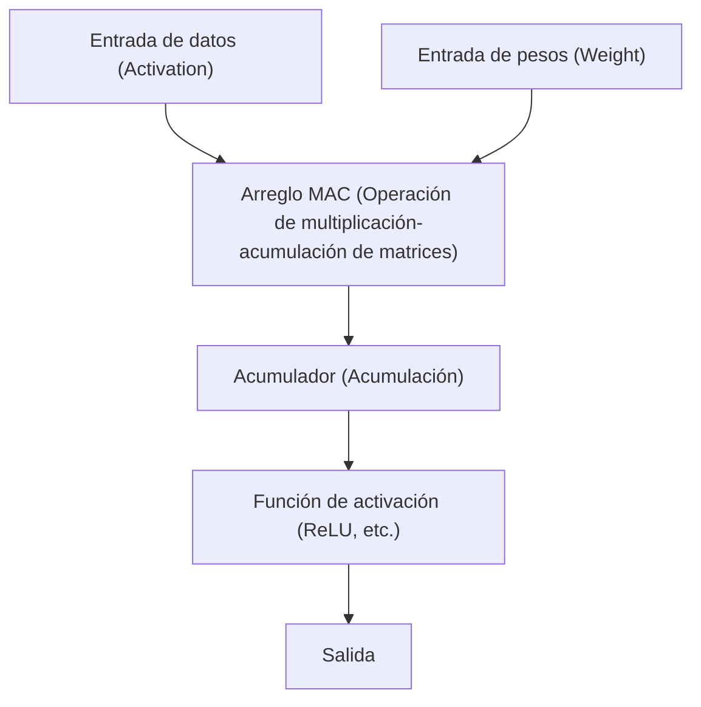

# Edge AI y la arquitectura NPU (Neural Processing Unit)

En los últimos años, con el rápido desarrollo de la tecnología de Inteligencia Artificial (IA), esta se ha comenzado a utilizar en todos los aspectos de nuestra vida. Lo que impulsó el auge inicial de la IA fueron los abrumadores recursos informáticos de los enormes centros de datos en la nube. Sin embargo, en la actualidad, ese paradigma se encuentra en un gran punto de inflexión con el surgimiento de "Edge AI" (IA en el borde) y el hardware dedicado que lo soporta, la "NPU" (Unidad de Procesamiento Neuronal).

Este artículo explica las ventajas y limitaciones de la inferencia en la nube y en el dispositivo, algunos diseños de NPU y métodos de optimización. Como los efectos sobre el rendimiento y la privacidad no son universales, también describe cómo evaluarlos según el dispositivo y el uso.

## 1. Los límites de la IA en la nube y el surgimiento del Edge AI

El enfoque tradicional de realizar la inferencia de IA en el lado de la nube presenta varios desafíos estructurales.

### El problema de la latencia (retraso)
El tiempo de ida y vuelta a la nube depende de la ruta y la distancia de red, la congestión y el procesamiento del servidor; decenas o cientos de milisegundos no es un valor universal. La inferencia en el dispositivo puede evitar la espera de la red y ayudar cuando hay plazos estrictos, pero la inferencia y la entrada/salida locales también consumen tiempo. Mida la latencia de extremo a extremo con el modelo y el dispositivo objetivo. Los sistemas críticos para la seguridad, como los vehículos, necesitan protecciones adicionales a una sola predicción de IA.

### Privacidad y seguridad
La inferencia local puede evitar enviar imágenes o audio sin procesar fuera del dispositivo y reducir los datos transmitidos en algunos diseños. No garantiza privacidad ni seguridad: las aplicaciones aún pueden enviar resultados, registros o diagnósticos, y el dispositivo necesita controles de acceso, cifrado y actualizaciones. Compruebe qué guarda y transmite cada aplicación y servicio.

### Costos de comunicación y ancho de banda
Enviar transmisiones de video de alta resolución y enormes cantidades de datos de sensores a la nube satura significativamente el ancho de banda de la red y dispara los costos de comunicación. Al preprocesar los datos en el borde y enviar solo la información necesaria a la nube, se puede reducir drásticamente la carga sobre la infraestructura de red.

Según el caso de uso, la inferencia puede ejecutarse en la nube, en el dispositivo o en ambos. El procesamiento local es una opción para reducir la latencia de red o el tráfico, pero los dispositivos tienen límites de energía, temperatura y memoria. Las unidades de cómputo usadas, incluida la NPU, dependen del modelo y del entorno de ejecución.

## 2. ¿Qué es una NPU (Neural Processing Unit)?

NPU es un término general para el hardware dedicado o integrado que acelera operaciones de redes neuronales. Muchos productos se orientan a la inferencia, pero la compatibilidad con el entrenamiento y con operadores concretos varía. Las capacidades reales también dependen del entorno de ejecución, los controladores y el modelo.

### Diferencias entre CPU, GPU y NPU

La CPU suele encargarse del control general y el trabajo secuencial; la GPU, de cargas paralelas; y la NPU, de acelerar las operaciones de redes neuronales que admite. Las capacidades varían según el producto y el entorno de ejecución puede repartir el trabajo entre procesadores. Una NPU no siempre es más rápida ni eficiente que una GPU: depende del modelo, los operadores, la precisión, el tamaño del lote, el entorno de ejecución, las transferencias y los límites de potencia o temperatura. Compare la misma carga completa en el dispositivo objetivo; el TOPS máximo no predice por sí solo la velocidad de la aplicación.

## 3. Arquitectura de las NPU y factores que afectan al rendimiento

El rendimiento y la eficiencia de una NPU dependen de su diseño interno, pero también del modelo, el software, el movimiento de datos y los límites de potencia y temperatura. Esta sección presenta algunos factores de diseño comunes.

### Integración de unidades MAC (Multiply-Accumulate)
Las redes neuronales suelen usar operaciones de multiplicación-acumulación (MAC), por lo que algunas NPU incluyen unidades aritméticas y flujos de datos especializados. Los diseños varían: un arreglo sistólico es una opción y «Tensor Core» es un nombre específico de ciertos productos. No todas las NPU tienen la misma estructura ni una cantidad de unidades comparable. El diagrama siguiente es un concepto simplificado, no una descripción de todas las NPU.

### Optimización de la jerarquía de memoria (minimización del movimiento de datos)
El movimiento de datos puede afectar al consumo y al rendimiento del acelerador, pero no hay una proporción energética única válida para todos los chips y cargas de trabajo. Influyen la memoria integrada, la reutilización de datos, el modelo y el entorno de ejecución. Los pesos y resultados intermedios no siempre caben en el chip, y puede haber transferencias a DRAM entre capas. Analice el modelo en el hardware objetivo y mida también esos movimientos como parte del rendimiento total.

## 4. Ejemplos de arquitecturas NPU en el mundo real

Actualmente, se desarrollan e integran diversas NPU en teléfonos inteligentes y computadoras personales.

### Apple Neural Engine (ANE)
Apple Core ML puede usar unidades de cómputo como CPU, GPU y Neural Engine según el modelo y el dispositivo. La asignación y el rendimiento dependen de la carga; analícelos con Xcode y mida en el dispositivo objetivo. El TOPS máximo de una generación de chips no determina la velocidad de otra aplicación o modelo. [Análisis de rendimiento de Core ML](https://developer.apple.com/documentation/coreml/analyzing-a-core-ml-model-s-performance-in-xcode) · [unidades de cómputo](https://developer.apple.com/documentation/coreml/mlcomputeunits)

### Google Tensor (SoC de Pixel)
Google Tensor es una familia de SoC para dispositivos Pixel. Google Cloud TPU y Edge TPU (la familia de productos Coral) son líneas de producto distintas; sus nombres no demuestran por sí solos una relación directa de diseño. Las funciones locales varían según la generación, el modelo, el sistema operativo y la aplicación. Consulte la documentación del dispositivo y la función concretos. [Anuncio de Pixel 11 de Google (Tensor G6)](https://blog.google/products-and-platforms/devices/pixel/google-pixel-11-pro-xl/) · [Documentación de Coral Edge TPU](https://coral.ai/docs/)

### Qualcomm Hexagon NPU
Qualcomm describe Hexagon como una NPU con aceleradores escalares, vectoriales y tensoriales, y memoria compartida. Qualcomm AI Engine la combina con otros procesadores, incluidas CPU y GPU. Las operaciones compatibles y el rendimiento real varían según el SoC, el software y el modelo; compare mediciones en la configuración objetivo, no solo el nombre del producto o los TOPS máximos. [Hexagon NPU](https://www.qualcomm.com/processors/hexagon) · [Qualcomm AI Engine](https://www.qualcomm.com/processors/ai-engine)

## 5. Software y tecnologías de optimización que sostienen Edge AI

Los modelos grandes pueden superar la memoria o el presupuesto energético de un dispositivo. La cuantización, la poda y la destilación son opciones que se deben evaluar, comprobando la compatibilidad del hardware, el efecto en la precisión y el rendimiento medido.

### Cuantización (Quantization)
La cuantización cambia la representación numérica de los pesos o las operaciones, por ejemplo de FP32 a FP16 o INT8. Puede reducir el almacenamiento de pesos y las transferencias, pero el tamaño del modelo y la velocidad de inferencia no mejoran necesariamente en la misma proporción. El resultado depende de los formatos, operadores, entorno de ejecución y hardware compatibles, y puede cambiar la precisión. Tras aplicar PTQ o QAT, mida la precisión con entradas representativas y el rendimiento completo en el dispositivo objetivo. [Compresión de modelos Core ML](https://developer.apple.com/documentation/coreml/reducing-the-size-of-your-core-ml-app) · [cuantización de ONNX Runtime](https://onnxruntime.ai/docs/performance/model-optimizations/quantization.html)

### Poda (Pruning)
La poda elimina o pone a cero ciertos pesos para crear un modelo disperso. Los kernels densos pueden seguir calculando con pesos cuyo valor es cero, por lo que la dispersión por sí sola no garantiza un archivo menor ni una inferencia más rápida. Para ahorrar almacenamiento se necesita una representación dispersa adecuada; para acelerar, operadores, entorno de ejecución y hardware compatibles. Evalúe conjuntamente la precisión y el rendimiento medido.

### Destilación de conocimiento (Knowledge Distillation)
La destilación de conocimiento entrena un modelo alumno con salidas u otras señales de un modelo profesor. Puede ayudar a un modelo pequeño sujeto a límites de tamaño o precisión, pero no garantiza superar la precisión de entrenarlo de forma independiente. Compare los métodos con los datos y la tarea relevantes.

## 6. El futuro de Edge AI y perspectivas

Algunos modelos de lenguaje grandes se ejecutan en la nube por sus necesidades de cálculo y memoria, mientras que ciertos dispositivos pueden ejecutar modelos más pequeños cuantizados o destilados. La viabilidad, latencia, precisión y consumo dependen del modelo y del dispositivo; evalúe la carga prevista.

En el futuro, se esperan las siguientes tendencias:

*   **IA híbrida (Hybrid AI)**:
    El diseño puede elegir entre el dispositivo y la nube según los plazos de respuesta, la conectividad, el tratamiento de datos, el coste y la capacidad del modelo. No presuponga que todas las tareas deban ejecutarse en un solo lugar; decídalo según los requisitos y las mediciones.
*   **Uso en distintos dispositivos de borde**:
    Cámaras, vehículos, wearables y sensores pueden usar modelos pequeños o aceleradores para tareas concretas. La conveniencia depende de la energía, el coste, la conectividad, el modelo y los requisitos de actualización; no todos los dispositivos IoT necesitan una NPU.
*   **Proveedores de ejecución y portabilidad**:
    Entornos como ONNX Runtime usan proveedores de ejecución para asignar operadores o subgrafos compatibles al hardware. Las operaciones no compatibles pueden ejecutarse en otro procesador; compruebe qué partes usan el acelerador y mida la precisión y el rendimiento completo de cada modelo. No se garantiza «escribir una vez y ejecutar de forma óptima en cualquier NPU». [Proveedores de ejecución de ONNX Runtime](https://onnxruntime.ai/docs/execution-providers/)

## Conclusión

Edge AI y las NPU amplían la posibilidad de ejecutar inferencias en el dispositivo. Evitar una ida y vuelta por la red, enviar menos datos sin procesar o ajustar el consumo de energía y ancho de banda puede ser útil, pero las mejoras de latencia, privacidad y eficiencia energética no son automáticas. Mida la configuración completa —uso, modelo, dispositivo y software— y compárela con la inferencia en la nube.

Para los ingenieros de software y los desarrolladores de IA, además de las habilidades para manejar modelos masivos en la nube, el conocimiento sobre "cómo implementar y optimizar la IA aprovechando las características del hardware (NPU) con recursos limitados" será cada vez más importante en el futuro.
