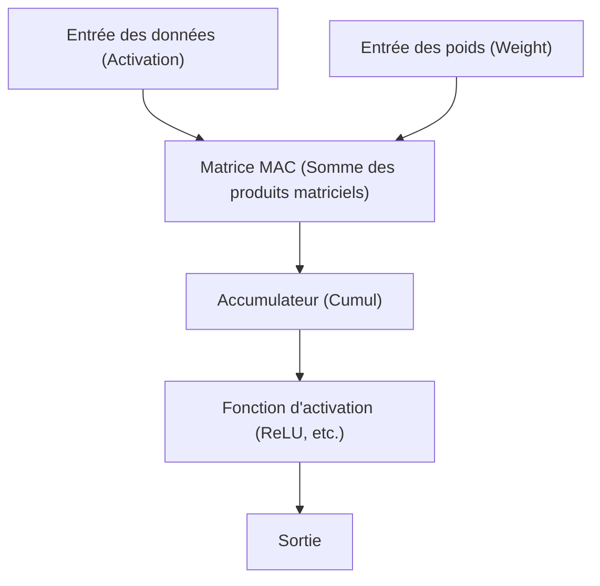

# Edge AI et architecture NPU (Neural Processing Unit)

Ces dernières années, avec le développement rapide des technologies d'intelligence artificielle (IA), l'IA est désormais utilisée dans tous les aspects de notre vie. Le premier boom de l'IA a été stimulé par les ressources de calcul écrasantes des immenses centres de données situés dans le cloud. Cependant, aujourd'hui, ce paradigme a atteint un point d'inflexion majeur. Il s'agit de l'émergence de l'« Edge AI » (l'IA en périphérie) et du matériel dédié qui la soutient, le « NPU (Neural Processing Unit) ».

Cet article présente les avantages et limites de l'inférence dans le cloud et sur l'appareil, des exemples d'architectures NPU et des méthodes d'optimisation. Leurs effets sur les performances et la confidentialité n'étant pas universels, il explique aussi comment les évaluer selon l'appareil et l'usage.

## 1. Les limites de l'IA cloud et l'essor de l'Edge AI

L'approche traditionnelle consistant à effectuer l'inférence de l'IA du côté du cloud présente plusieurs défis structurels.

### Le problème de latence (délai)
Le temps aller-retour vers le cloud varie selon le trajet et la distance réseau, la congestion et le traitement côté serveur ; quelques dizaines ou centaines de millisecondes ne constituent pas une valeur universelle. L'inférence sur l'appareil peut éviter l'attente du réseau lorsque le délai est strict, mais l'inférence et les entrées/sorties locales prennent aussi du temps. Mesurez le délai de bout en bout avec le modèle et l'appareil visés. Les systèmes critiques pour la sécurité, comme les véhicules, exigent aussi des protections qui ne reposent pas sur une seule prédiction d'IA.

### Confidentialité et sécurité
L'inférence locale peut éviter d'envoyer des images ou des sons bruts hors de l'appareil et réduire les données transmises dans certains cas. Elle ne garantit ni confidentialité ni sécurité : une application peut encore transmettre des résultats, des journaux ou des diagnostics, et l'appareil doit lui-même être protégé par des contrôles d'accès, du chiffrement et des mises à jour. Vérifiez ce que chaque application et service stocke et envoie.

### Coût de communication et bande passante
L'envoi de flux vidéo en haute résolution ou de quantités massives de données de capteurs vers le cloud pèse lourdement sur la bande passante du réseau et fait exploser les coûts de communication. En prétraitant les données du côté de l'edge et en n'envoyant que les informations nécessaires au cloud, la charge sur l'infrastructure réseau peut être considérablement réduite.

Selon le cas d'usage, l'inférence peut se faire dans le cloud, sur l'appareil ou des deux façons. Le traitement local permet parfois de réduire la latence réseau ou le trafic, mais les appareils ont des limites de puissance, de température et de mémoire. Les unités de calcul utilisées, dont le NPU, dépendent du modèle et du runtime.

## 2. Qu'est-ce qu'un NPU (Neural Processing Unit) ?

NPU est un terme générique désignant un matériel dédié ou intégré qui accélère certaines opérations de réseaux neuronaux. De nombreux produits ciblent l'inférence, mais la prise en charge de l'entraînement et des opérateurs varie. Les capacités réelles dépendent aussi du runtime, des pilotes et du modèle.

### Différences entre CPU, GPU et NPU

Le CPU sert souvent au contrôle général et au traitement séquentiel, le GPU aux tâches parallèles, et le NPU à accélérer les opérations de réseau neuronal qu'il prend en charge. Les capacités varient selon les produits et les environnements d'exécution peuvent répartir le travail entre processeurs. Un NPU n'est pas toujours plus rapide ou plus efficace qu'un GPU : cela dépend du modèle, des opérateurs, de la précision, de la taille de lot, du runtime, des transferts de données et des limites de puissance ou de température. Mesurez la même charge de bout en bout sur l'appareil cible ; le TOPS maximal ne prédit pas à lui seul la vitesse de l'application.

## 3. Architecture des NPU et facteurs de performance

Les performances et l'efficacité d'un NPU dépendent non seulement de sa conception interne, mais aussi du modèle, du logiciel, des déplacements de données et des limites de puissance ou de température. Cette section présente quelques considérations courantes.

### Intégration des unités MAC (Multiply-Accumulate)
Les réseaux neuronaux utilisent souvent des opérations de multiplication-accumulation (MAC) ; certains NPU disposent donc d'unités de calcul et de flux de données spécialisés. Les conceptions varient : une matrice systolique est une approche possible et « Tensor Core » est un nom propre à certains produits. Tous les NPU n'ont ni la même structure ni un nombre d'unités comparable. Le schéma ci-dessous est un concept simplifié, pas la description de chaque NPU.

### Optimisation de la hiérarchie de la mémoire (minimisation du déplacement des données)
Le déplacement des données peut influer sur la consommation et les performances de l'accélérateur, mais aucun rapport énergétique unique ne s'applique à toutes les puces et charges. La mémoire sur puce, la réutilisation des données, le modèle et le runtime comptent. Les poids et résultats intermédiaires ne tiennent pas toujours sur la puce ; des transferts DRAM peuvent encore avoir lieu entre les couches. Profilez le modèle sur le matériel visé et mesurez les transferts dans les performances de bout en bout.

## 4. Exemples réels d'architectures NPU

Aujourd'hui, divers NPU sont développés et intégrés dans les smartphones et les PC.

### Apple Neural Engine (ANE)
Core ML d'Apple peut utiliser des unités de calcul telles que le CPU, le GPU et le Neural Engine selon le modèle et l'appareil. Le placement et les performances dépendent de la charge ; analysez-les avec Xcode et mesurez-les sur l'appareil cible. Le TOPS maximal d'une génération ne détermine pas la vitesse d'une autre application ou d'un autre modèle. [Analyse des performances Core ML](https://developer.apple.com/documentation/coreml/analyzing-a-core-ml-model-s-performance-in-xcode) · [unités de calcul](https://developer.apple.com/documentation/coreml/mlcomputeunits)

### Google Tensor (SoC Pixel)
Google Tensor est une famille de SoC destinée aux appareils Pixel. Google Cloud TPU et Edge TPU (la gamme Coral) sont des gammes de produits distinctes ; leurs noms ne prouvent pas une filiation directe de conception. Les fonctions sur l'appareil varient selon la génération, le modèle, le système et l'application. Consultez la documentation de l'appareil et de la fonction concernés. [Annonce Pixel 11 de Google (Tensor G6)](https://blog.google/products-and-platforms/devices/pixel/google-pixel-11-pro-xl/) · [Documentation Coral Edge TPU](https://coral.ai/docs/)

### Qualcomm Hexagon NPU
Qualcomm décrit Hexagon comme un NPU réunissant des accélérateurs scalaires, vectoriels et tensoriels ainsi qu'une mémoire partagée. Qualcomm AI Engine le combine avec d'autres processeurs, dont les CPU et GPU. Les opérations prises en charge et les performances réelles varient selon le SoC, le logiciel et le modèle ; comparez les mesures sur la configuration cible plutôt que les noms de produits ou les TOPS maximaux. [Hexagon NPU](https://www.qualcomm.com/processors/hexagon) · [Qualcomm AI Engine](https://www.qualcomm.com/processors/ai-engine)

## 5. Logiciels et techniques d'optimisation soutenant l'Edge AI

Les grands modèles peuvent dépasser la mémoire ou le budget énergétique d'un appareil. Quantification, élagage et distillation sont des pistes à évaluer, en vérifiant la prise en charge matérielle, l'effet sur la précision et les performances mesurées.

### Quantification (Quantization)
La quantification modifie la représentation numérique des poids ou des opérations, par exemple de FP32 à FP16 ou INT8. Elle peut réduire le stockage des poids et les transferts, mais la taille du modèle et la vitesse d'inférence ne s'améliorent pas nécessairement dans la même proportion. Les résultats dépendent des formats, opérateurs, runtimes et matériels pris en charge, et la précision peut changer. Après PTQ ou QAT, mesurez la précision sur des entrées représentatives et les performances de bout en bout sur l'appareil cible. [Compression des modèles Core ML](https://developer.apple.com/documentation/coreml/reducing-the-size-of-your-core-ml-app) · [quantification ONNX Runtime](https://onnxruntime.ai/docs/performance/model-optimizations/quantization.html)

### Élagage (Pruning)
L'élagage supprime ou met à zéro certains poids afin de créer un modèle creux. Les noyaux denses peuvent continuer à calculer avec des poids nuls ; la parcimonie seule ne garantit donc ni un fichier plus petit ni une inférence plus rapide. Le gain de stockage exige une représentation creuse adaptée ; l'accélération exige des opérateurs, un runtime et un matériel compatibles. Évaluez ensemble la précision et les performances mesurées.

### Distillation des connaissances (Knowledge Distillation)
La distillation des connaissances entraîne un modèle élève à partir des sorties ou d'autres signaux d'un modèle enseignant. Elle peut aider un petit modèle soumis à des contraintes de taille ou de précision, mais ne garantit pas une meilleure précision qu'un apprentissage indépendant de ce modèle. Comparez les méthodes sur la tâche et les données visées.

## 6. L'avenir et les perspectives de l'Edge AI

Certains grands modèles de langage sont exécutés dans le cloud en raison de leurs besoins en calcul et en mémoire, tandis que certains appareils peuvent faire fonctionner des modèles plus petits, quantifiés ou distillés. La faisabilité, la latence, la précision et la consommation dépendent du modèle et de l'appareil ; évaluez la charge visée.

À l'avenir, les tendances suivantes sont attendues :

*   **IA hybride (Hybrid AI)** :
    L'architecture peut choisir entre l'appareil et le cloud selon le délai de réponse, la connectivité, le traitement des données, le coût et les capacités du modèle. Ne supposez pas que toutes les tâches doivent être exécutées au même endroit ; fondez le choix sur les exigences et les mesures.
*   **Usage sur différents appareils edge** :
    Des caméras, véhicules, appareils portables et capteurs peuvent utiliser de petits modèles ou des accélérateurs pour certaines tâches. La pertinence dépend de l'énergie, du coût, de la connectivité, du modèle et des mises à jour ; tous les appareils IoT n'ont pas besoin d'un NPU.
*   **Fournisseurs d’exécution et portabilité**:
    Des frameworks comme ONNX Runtime utilisent des fournisseurs d'exécution pour affecter au matériel les opérateurs ou sous-graphes pris en charge. Les opérations non prises en charge peuvent s'exécuter ailleurs ; vérifiez les parties réellement accélérées et mesurez précision et vitesse de bout en bout pour chaque modèle. « Écrire une fois et fonctionner de façon optimale sur n'importe quel NPU » n'est pas garanti. [Fournisseurs d'exécution ONNX Runtime](https://onnxruntime.ai/docs/execution-providers/)

## Conclusion

Edge AI et les NPU multiplient les possibilités d'inférence sur l'appareil. Éviter un aller-retour réseau, transmettre moins de données brutes ou ajuster l'énergie et la bande passante peut être utile, mais les gains de latence, de confidentialité et d'efficacité énergétique ne sont pas automatiques. Mesurez la configuration complète — usage, modèle, appareil et logiciel — et comparez-la à l'inférence dans le cloud.

Pour les ingénieurs logiciels et les développeurs en IA, l'acquisition des compétences permettant non seulement de manipuler des modèles massifs dans le cloud, mais aussi de savoir « comment implémenter et optimiser l'IA dans un environnement aux ressources limitées, en tirant parti des caractéristiques du matériel (NPU) », deviendra de plus en plus cruciale à l'avenir.
