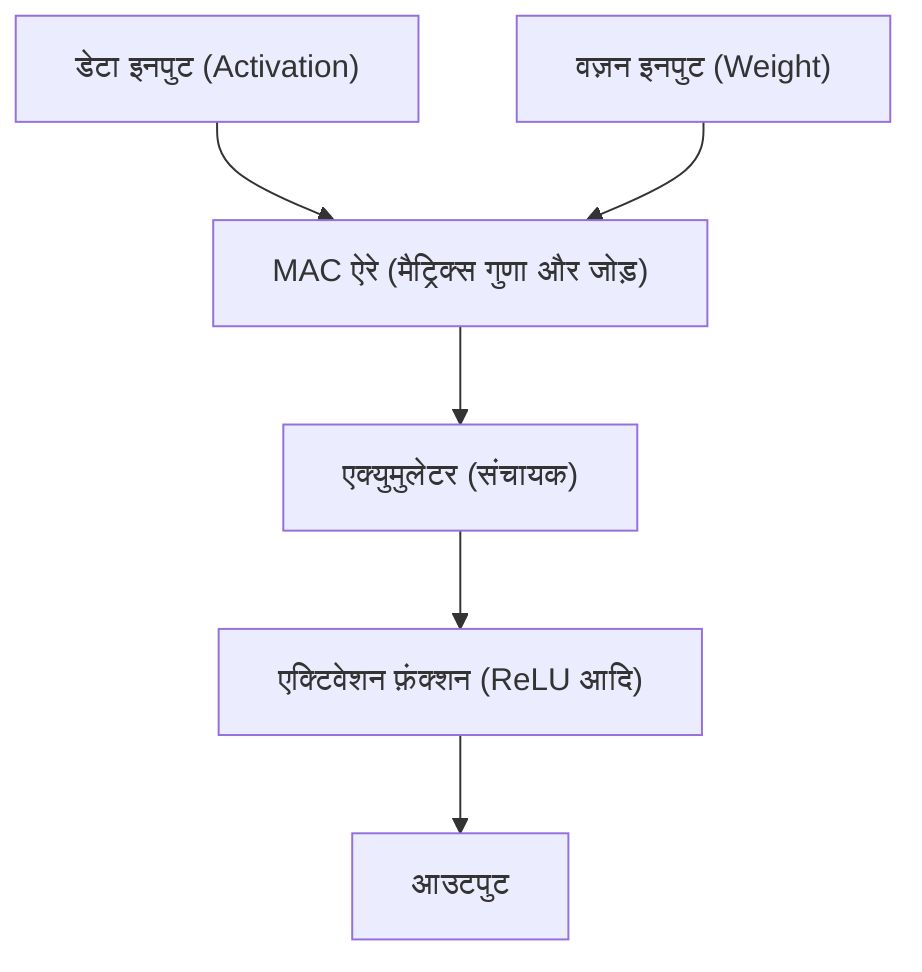

# Edge AI और NPU (Neural Processing Unit) आर्किटेक्चर

हाल के वर्षों में, आर्टिफिशियल इंटेलिजेंस (AI) तकनीक के तेजी से विकास के साथ, AI का उपयोग हमारे जीवन के हर पहलू में किया जाने लगा है। प्रारंभिक AI बूम को क्लाउड में मौजूद विशाल डेटा सेंटर्स के जबरदस्त कंप्यूटिंग संसाधनों ने संचालित किया था। लेकिन अब, यह प्रतिमान (paradigm) एक बड़े टर्निंग पॉइंट पर पहुंच गया है। वह है "Edge AI (एज AI)" और इसका समर्थन करने वाले विशेष हार्डवेयर "NPU (Neural Processing Unit)" का उदय।

यह लेख क्लाउड और डिवाइस पर इन्फरेंस के लाभ व सीमाएँ, NPU डिज़ाइन के उदाहरण और मॉडल अनुकूलन विधियाँ बताता है। प्रदर्शन और गोपनीयता पर असर सार्वभौमिक नहीं है, इसलिए किसी खास डिवाइस और उपयोग के लिए उनका मूल्यांकन कैसे करें, यह भी समझाता है।

## 1. क्लाउड AI की सीमाएं और Edge AI का उदय

क्लाउड साइड पर AI इन्फ्रेंस (अनुमान) करने के पारंपरिक दृष्टिकोण में कुछ संरचनात्मक चुनौतियाँ मौजूद हैं।

### लेटेंसी (विलंब) की समस्या
क्लाउड तक आने-जाने का समय नेटवर्क के मार्ग और दूरी, भीड़ तथा सर्वर पर होने वाली प्रोसेसिंग के अनुसार बदलता है; दसियों या सैकड़ों मिलीसेकंड कोई सार्वभौमिक मान नहीं है। डिवाइस पर इन्फरेंस नेटवर्क की प्रतीक्षा से बचा सकता है और सख्त समय-सीमा में मदद कर सकता है, लेकिन स्थानीय इन्फरेंस तथा इनपुट/आउटपुट में भी समय लगता है। लक्षित डिवाइस और मॉडल पर पूरा एंड-टू-एंड समय मापें। वाहन जैसे सुरक्षा-महत्वपूर्ण सिस्टम में एक AI अनुमान के अलावा भी सुरक्षा उपाय जरूरी हैं।

### प्राइवेसी (गोपनीयता) और सिक्योरिटी
डिवाइस पर इन्फरेंस कुछ डिज़ाइनों में कच्ची तस्वीरें या ऑडियो बाहर भेजने से बचा सकता है और भेजे जाने वाले डेटा को घटा सकता है। इससे गोपनीयता या सुरक्षा की गारंटी नहीं मिलती: ऐप परिणाम, लॉग या निदान-सूचना फिर भी भेज सकते हैं, और डिवाइस को भी एक्सेस नियंत्रण, एन्क्रिप्शन तथा अपडेट चाहिए। हर ऐप और सेवा क्या सहेजती और भेजती है, इसकी जाँच करें।

### कम्यूनिकेशन लागत और बैंडविड्थ
सभी हाई-रिज़ॉल्यूशन वीडियो स्ट्रीम और भारी मात्रा में सेंसर डेटा को क्लाउड पर भेजने से नेटवर्क बैंडविड्थ पर गंभीर दबाव पड़ता है और कम्यूनिकेशन लागत बढ़ जाती है। डेटा को एज साइड पर प्री-प्रोसेस करने और केवल आवश्यक जानकारी को क्लाउड पर भेजने से, नेटवर्क इन्फ्रास्ट्रक्चर पर लोड को काफी कम किया जा सकता है।

उपयोग के अनुसार इन्फरेंस क्लाउड, डिवाइस या दोनों जगह चल सकता है। स्थानीय प्रोसेसिंग नेटवर्क विलंब या ट्रैफिक घटाने का एक तरीका है, लेकिन डिवाइस पर बिजली, ताप और मेमोरी की सीमाएँ होती हैं। NPU सहित कौन-सी गणना इकाइयाँ इस्तेमाल होंगी, यह मॉडल और रनटाइम पर निर्भर है।

## 2. NPU (Neural Processing Unit) क्या है?

NPU ऐसा सामान्य नाम है जो न्यूरल-नेटवर्क ऑपरेशनों को तेज करने वाले समर्पित या एकीकृत हार्डवेयर के लिए इस्तेमाल होता है। कई उत्पाद इन्फरेंस के लिए बने हैं, लेकिन प्रशिक्षण और विशिष्ट ऑपरेटरों का समर्थन उत्पाद के अनुसार बदलता है। वास्तविक क्षमता रनटाइम, ड्राइवर और मॉडल पर भी निर्भर करती है।

### CPU, GPU और NPU के बीच अंतर

CPU का उपयोग अक्सर सामान्य नियंत्रण और क्रमिक काम के लिए, GPU का समानांतर काम के लिए, और NPU का उसके द्वारा समर्थित न्यूरल-नेटवर्क ऑपरेशनों को तेज करने के लिए होता है। क्षमताएँ उत्पाद के अनुसार बदलती हैं और रनटाइम काम को कई प्रोसेसर में बाँट सकता है। NPU हमेशा GPU से तेज या अधिक दक्ष नहीं होता: परिणाम मॉडल, ऑपरेटर, सटीकता, बैच आकार, रनटाइम, डेटा स्थानांतरण और बिजली या तापमान सीमा पर निर्भर करते हैं। लक्षित डिवाइस पर पूरा समान कार्य मापें; केवल अधिकतम TOPS से ऐप की गति का अनुमान नहीं लगाया जा सकता।

## 3. NPU आर्किटेक्चर और प्रदर्शन को प्रभावित करने वाले कारक

NPU का प्रदर्शन और दक्षता केवल आंतरिक डिज़ाइन पर नहीं, बल्कि मॉडल, सॉफ्टवेयर, डेटा स्थानांतरण और बिजली या तापमान की सीमाओं पर भी निर्भर करती है। इस खंड में कुछ सामान्य डिज़ाइन पहलू बताए गए हैं।

### MAC (Multiply-Accumulate) यूनिट्स का एकीकरण
न्यूरल नेटवर्क में MAC ऑपरेशन आम हैं, इसलिए कुछ NPU विशेष गणना इकाइयाँ और डेटा-फ्लो रखते हैं। डिज़ाइन अलग होते हैं; सिस्टोलिक ऐरे एक तरीका है और “Tensor Core” कुछ उत्पादों का नाम है। सभी NPU की संरचना या इकाइयों की संख्या समान नहीं। नीचे का चित्र सरल अवधारणा है।

### मेमोरी पदानुक्रम (Hierarchy) का अनुकूलन (डेटा मूवमेंट को कम करना)
डेटा स्थानांतरण बिजली और प्रदर्शन को प्रभावित कर सकता है, पर सभी चिप व कार्यभार के लिए एक ऊर्जा अनुपात लागू नहीं होता। ऑन-चिप मेमोरी, मॉडल और रनटाइम मायने रखते हैं; मध्यवर्ती डेटा DRAM में जा सकता है। लक्षित हार्डवेयर पर प्रोफाइल करें और स्थानांतरण समेत पूरा प्रदर्शन मापें।

## 4. वास्तविक दुनिया में NPU आर्किटेक्चर के उदाहरण

वर्तमान में, स्मार्टफोन और पीसी के लिए विभिन्न NPU विकसित और उपयोग किए जा रहे हैं।

### Apple Neural Engine (ANE)
Apple Core ML मॉडल और डिवाइस के अनुसार CPU, GPU तथा Neural Engine का उपयोग कर सकता है। Xcode से कार्य-वितरण देखें और लक्षित डिवाइस पर मापें; किसी चिप का अधिकतम TOPS दूसरे ऐप की गति नहीं बताता। [Core ML प्रदर्शन विश्लेषण](https://developer.apple.com/documentation/coreml/analyzing-a-core-ml-model-s-performance-in-xcode) · [गणना इकाइयाँ](https://developer.apple.com/documentation/coreml/mlcomputeunits)

### Google Tensor (Pixel SoC)
Google Tensor, Pixel SoC उत्पाद-परिवार है। Google Cloud TPU और Edge TPU (Coral) अलग उत्पाद-श्रृंखलाएँ हैं; नाम से सीधे डिज़ाइन वंश का निष्कर्ष नहीं निकलता। सुविधाएँ पीढ़ी, मॉडल, OS और ऐप पर निर्भर हैं। [Google की Pixel 11 घोषणा (Tensor G6)](https://blog.google/products-and-platforms/devices/pixel/google-pixel-11-pro-xl/) · [Coral Edge TPU दस्तावेज़](https://coral.ai/docs/)

### Qualcomm Hexagon NPU
Qualcomm Hexagon में scalar, vector, tensor accelerators और shared memory हैं; Qualcomm AI Engine इसे CPU व GPU समेत अन्य प्रोसेसरों के साथ जोड़ता है। समर्थित ऑपरेशन और गति SoC, सॉफ्टवेयर और मॉडल पर निर्भर हैं। लक्षित विन्यास पर मापें। [Hexagon](https://www.qualcomm.com/processors/hexagon) · [AI Engine](https://www.qualcomm.com/processors/ai-engine)

## 5. Edge AI का समर्थन करने वाले सॉफ्टवेयर और अनुकूलन तकनीकें

बड़े मॉडल डिवाइस की मेमोरी या बिजली सीमा से अधिक मांग कर सकते हैं। Quantization, pruning और distillation विकल्प हैं, लेकिन हार्डवेयर समर्थन, सटीकता पर असर और मापा गया प्रदर्शन जाँचना चाहिए।

### क्वांटाइजेशन (Quantization)
Quantization FP32 से FP16 या INT8 जैसे संख्यात्मक प्रारूपों में बदलाव है। इससे वज़न संग्रह घट सकता है, पर मॉडल आकार या गति उसी अनुपात में सुधरे, यह निश्चित नहीं; समर्थन और सटीकता बदलते हैं। PTQ/QAT के बाद प्रतिनिधि इनपुट व लक्षित डिवाइस पर जाँचें। [Core ML संपीड़न](https://developer.apple.com/documentation/coreml/reducing-the-size-of-your-core-ml-app) · [ONNX Runtime](https://onnxruntime.ai/docs/performance/model-optimizations/quantization.html)

### प्रूनिंग (Pruning - छंटाई)
Pruning चुने वज़न हटाता या शून्य करता है। Dense kernel शून्य वज़न पर भी गणना कर सकता है, इसलिए sparsity अकेले छोटी फ़ाइल या तेज़ इन्फरेंस की गारंटी नहीं देती। उपयुक्त sparse format, operator, runtime और hardware चाहिए। सटीकता और गति दोनों मापें।

### नॉलेज डिस्टिलेशन (Knowledge Distillation - ज्ञान आसवन)
Knowledge distillation में student को teacher के outputs या संकेतों से प्रशिक्षित किया जाता है। यह छोटा मॉडल सुधार सकता है, लेकिन स्वतंत्र प्रशिक्षण से अधिक सटीकता की गारंटी नहीं। वास्तविक काम और डेटा पर तुलना करें।

## 6. Edge AI का भविष्य और आगे की संभावनाएं

कुछ बड़े भाषा मॉडल अपनी गणना और मेमोरी आवश्यकताओं के कारण क्लाउड पर चलते हैं, जबकि कुछ डिवाइस छोटे quantized या distilled मॉडल चला सकते हैं। व्यवहार्यता, विलंब, सटीकता और बिजली का उपयोग मॉडल व डिवाइस पर निर्भर है; लक्षित काम का मूल्यांकन करें।

भविष्य में निम्नलिखित प्रवृत्तियों की उम्मीद की जा सकती है:

*   **Hybrid AI (हाइब्रिड AI)**:
    प्रतिक्रिया-समय, कनेक्टिविटी, डेटा प्रबंधन, लागत और मॉडल क्षमता के अनुसार डिवाइस या क्लाउड में से चुना जा सकता है। यह न मानें कि हर काम एक ही जगह होना चाहिए; आवश्यकताओं और माप के आधार पर निर्णय लें।
*   **विभिन्न एज डिवाइसों में उपयोग**:
    कैमरे, वाहन, पहनने योग्य उपकरण और सेंसर चुनिंदा कामों के लिए छोटे मॉडल या एक्सेलरेटर इस्तेमाल कर सकते हैं। उपयोगिता बिजली, लागत, कनेक्टिविटी, मॉडल और अपडेट की जरूरत पर निर्भर है; हर IoT डिवाइस को NPU की आवश्यकता नहीं होती।
*   **Execution Provider और पोर्टेबिलिटी**:
    ONNX Runtime execution providers समर्थित operators या subgraphs को हार्डवेयर पर चलाते हैं; असमर्थित भाग अन्य प्रोसेसर पर चल सकते हैं। हर मॉडल में वास्तविक acceleration और पूरी गति जाँचें। किसी भी NPU पर सर्वोत्तम चलने की गारंटी नहीं। [Execution Providers](https://onnxruntime.ai/docs/execution-providers/)

## निष्कर्ष

Edge AI और NPU डिवाइस पर इन्फरेंस का विकल्प बढ़ाते हैं। नेटवर्क प्रतीक्षा, डेटा ट्रांसफर या ऊर्जा उपयोग घट सकता है, पर विलंब, गोपनीयता और दक्षता में सुधार स्वतः सुनिश्चित नहीं। उपयोग, मॉडल, डिवाइस और सॉफ्टवेयर का पूरा सेटअप मापकर क्लाउड से तुलना करें।

सॉफ्टवेयर इंजीनियर्स और AI डेवलपर्स के लिए, न केवल क्लाउड पर विशाल मॉडल को संभालने का कौशल, बल्कि "सीमित संसाधनों के भीतर, हार्डवेयर (NPU) की विशेषताओं का उपयोग करते हुए AI को कैसे लागू और अनुकूलित करें" का ज्ञान भविष्य में और भी महत्वपूर्ण हो जाएगा।
