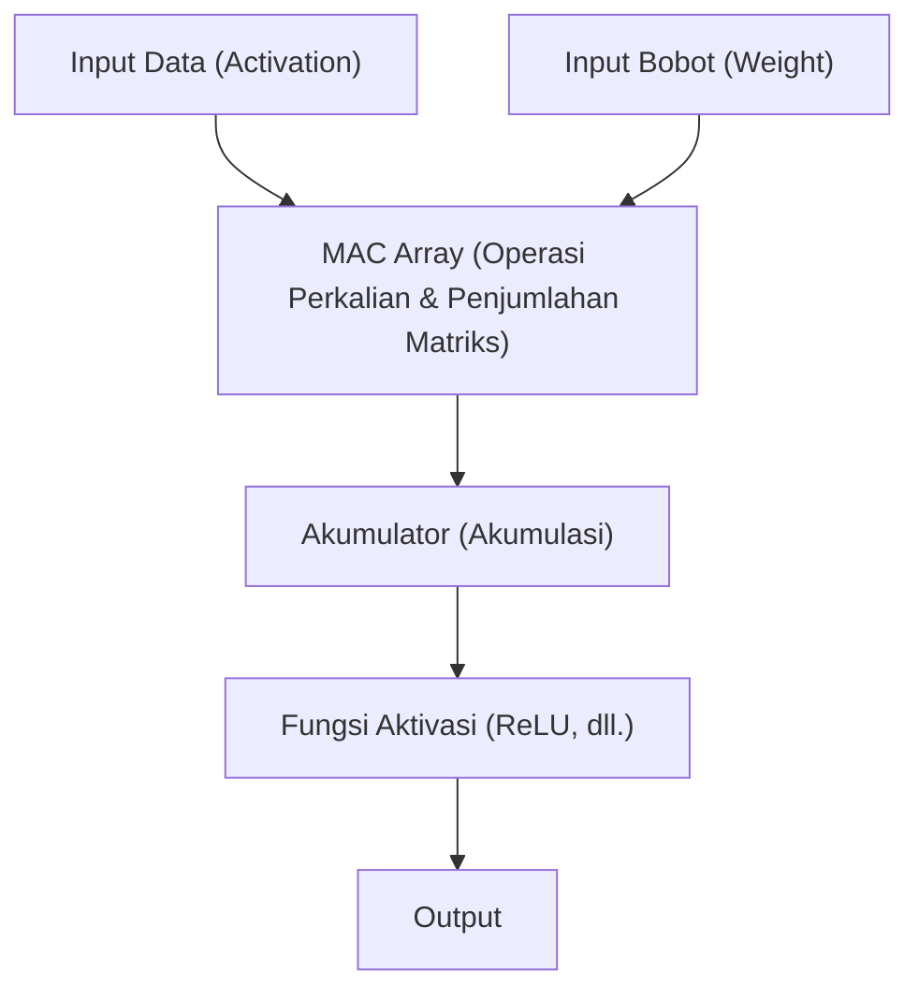

# Arsitektur Edge AI dan NPU (Neural Processing Unit)

Dalam beberapa tahun terakhir, dengan perkembangan pesat teknologi kecerdasan buatan (AI), AI telah dimanfaatkan di setiap aspek kehidupan kita. Yang mendorong ledakan AI awal adalah sumber daya komputasi yang luar biasa dari pusat data raksasa yang berada di komputasi awan (cloud). Namun saat ini, paradigma tersebut sedang menghadapi titik balik yang besar. Yaitu munculnya "Edge AI" dan perangkat keras khusus yang mendukungnya, "NPU (Neural Processing Unit)".

Artikel ini menjelaskan kelebihan dan batasan inferensi cloud dan di perangkat, contoh desain NPU, serta metode optimasi model. Dampaknya pada kinerja dan privasi tidak selalu sama, jadi artikel ini juga membahas cara mengevaluasinya untuk perangkat dan penggunaan tertentu.

## 1. Batasan Cloud AI dan Munculnya Edge AI

Pendekatan konvensional yang melakukan inferensi AI di sisi cloud memiliki beberapa tantangan struktural.

### Masalah Latensi (Keterlambatan)
Waktu pulang-pergi ke cloud bergantung pada rute dan jarak jaringan, kepadatan lalu lintas, serta pemrosesan server; puluhan hingga ratusan milidetik bukan nilai universal. Inferensi di perangkat dapat menghindari menunggu jaringan dan membantu saat tenggat respons ketat, tetapi inferensi lokal serta input/output tetap memerlukan waktu. Ukur latensi end-to-end dengan model dan perangkat sasaran. Sistem yang kritis terhadap keselamatan, seperti kendaraan, juga memerlukan pengamanan di luar satu prediksi AI.

### Privasi dan Keamanan
Inferensi lokal dapat mencegah gambar atau audio mentah dikirim keluar perangkat dan mengurangi data yang dikirim pada beberapa desain. Namun, hal ini tidak menjamin privasi atau keamanan: aplikasi masih dapat mengirim keluaran, log, atau diagnostik, dan perangkat tetap memerlukan kontrol akses, enkripsi, serta pembaruan. Periksa apa yang disimpan dan dikirim oleh setiap aplikasi dan layanan.

### Biaya Komunikasi dan Bandwidth
Mengirimkan semua streaming video beresolusi tinggi dan data sensor yang sangat besar ke cloud akan sangat menekan bandwidth jaringan dan membuat biaya komunikasi membengkak. Dengan melakukan pra-pemrosesan data di sisi edge dan hanya mengirimkan informasi yang diperlukan ke cloud, beban pada infrastruktur jaringan dapat dikurangi secara signifikan.

Bergantung pada kasus penggunaan, inferensi dapat berjalan di cloud, di perangkat, atau di keduanya. Pemrosesan lokal dapat mengurangi latensi jaringan atau lalu lintas, tetapi perangkat memiliki batas daya, panas, dan memori. Unit komputasi yang digunakan, termasuk NPU, bergantung pada model dan runtime.

## 2. Apa itu NPU (Neural Processing Unit)?

NPU adalah istilah umum untuk perangkat keras khusus atau terintegrasi yang mempercepat operasi jaringan saraf. Banyak produk ditujukan untuk inferensi, tetapi dukungan pelatihan dan operator tertentu berbeda-beda. Kemampuan nyata juga bergantung pada runtime, driver, dan model.

### Perbedaan CPU, GPU, dan NPU

CPU umumnya menangani kendali umum dan pekerjaan berurutan, GPU untuk beban paralel, dan NPU untuk mempercepat operasi jaringan saraf yang didukungnya. Kemampuan berbeda antarproduk dan runtime dapat membagi pekerjaan ke beberapa prosesor. NPU tidak selalu lebih cepat atau efisien daripada GPU; hasilnya bergantung pada model, operator, presisi, ukuran batch, runtime, pemindahan data, serta batas daya atau suhu. Ukur beban kerja end-to-end yang sama pada perangkat sasaran; TOPS puncak saja tidak menunjukkan kecepatan aplikasi.

## 3. Arsitektur NPU dan Faktor yang Memengaruhi Kinerja

Kinerja dan efisiensi NPU tidak hanya bergantung pada desain internal, tetapi juga pada model, perangkat lunak, perpindahan data, serta batas daya dan suhu. Bagian ini memperkenalkan beberapa pertimbangan desain umum.

### Akumulasi Unit MAC (Multiply-Accumulate)
Jaringan saraf sering memakai operasi MAC, sehingga sebagian NPU memiliki unit aritmetika dan alur data khusus. Desain berbeda-beda; array sistolik adalah salah satu pendekatan, sedangkan “Tensor Core” nama produk tertentu. Tidak semua NPU memiliki struktur atau jumlah unit sama. Diagram ini hanya konsep sederhana.

### Optimasi Hierarki Memori (Meminimalkan Perpindahan Data)
Perpindahan data dapat memengaruhi daya dan kinerja, tetapi tidak ada rasio energi yang berlaku untuk semua chip dan beban kerja. Memori on-chip, model, serta runtime berpengaruh; data antara dapat dikirim ke DRAM. Profilkan pada perangkat sasaran dan ukur kinerja lengkap termasuk transfer.

## 4. Contoh Nyata Arsitektur NPU di Dunia Nyata

Saat ini, berbagai NPU sedang dikembangkan dan dipasang pada ponsel pintar dan PC.

### Apple Neural Engine (ANE)
Apple Core ML dapat memakai CPU, GPU, atau Neural Engine menurut model dan perangkat. Periksa pembagian kerja dengan Xcode dan ukur di perangkat sasaran; TOPS puncak satu chip tidak menunjukkan kecepatan aplikasi lain. [Analisis kinerja Core ML](https://developer.apple.com/documentation/coreml/analyzing-a-core-ml-model-s-performance-in-xcode) · [unit komputasi](https://developer.apple.com/documentation/coreml/mlcomputeunits)

### Google Tensor (SoC Pixel)
Google Tensor adalah keluarga SoC untuk Pixel. Google Cloud TPU dan Edge TPU (Coral) merupakan lini produk terpisah; namanya tidak membuktikan hubungan desain langsung. Fitur bergantung pada generasi, model, OS, dan aplikasi. [Pengumuman Pixel 11 Google (Tensor G6)](https://blog.google/products-and-platforms/devices/pixel/google-pixel-11-pro-xl/) · [Dokumentasi Coral Edge TPU](https://coral.ai/docs/)

### Qualcomm Hexagon NPU
Qualcomm Hexagon memiliki akselerator skalar, vektor, dan tensor serta memori bersama; Qualcomm AI Engine memadukannya dengan prosesor lain seperti CPU dan GPU. Dukungan operasi dan kinerja berbeda menurut SoC, perangkat lunak, dan model. Ukur konfigurasi sasaran. [Hexagon](https://www.qualcomm.com/processors/hexagon) · [AI Engine](https://www.qualcomm.com/processors/ai-engine)

## 5. Perangkat Lunak dan Teknologi Optimasi yang Mendukung Edge AI

Model besar dapat melampaui batas memori atau daya perangkat. Kuantisasi, pruning, dan distilasi dapat dipertimbangkan, tetapi dukungan perangkat keras, dampak akurasi, dan kinerja terukur perlu diperiksa.

### Kuantisasi (Quantization)
Kuantisasi mengubah representasi numerik, misalnya FP32 ke FP16 atau INT8. Penyimpanan bobot dapat berkurang, tetapi ukuran model dan kecepatan tidak selalu membaik dengan rasio sama; dukungan dan akurasi berpengaruh. Setelah PTQ/QAT, ukur masukan representatif pada perangkat sasaran. [Kompresi Core ML](https://developer.apple.com/documentation/coreml/reducing-the-size-of-your-core-ml-app) · [ONNX Runtime](https://onnxruntime.ai/docs/performance/model-optimizations/quantization.html)

### Pemangkasan (Pruning)
Pruning menghapus atau menolkan bobot tertentu. Kernel dense dapat tetap menghitung bobot nol, sehingga sparsity tidak menjamin berkas lebih kecil atau inferensi lebih cepat. Diperlukan format sparse, operator, runtime, dan hardware yang sesuai. Ukur akurasi dan kinerja.

### Penyulingan Pengetahuan (Knowledge Distillation)
Knowledge distillation melatih student menggunakan keluaran atau sinyal teacher. Ini dapat membantu model kecil, tetapi tidak menjamin akurasi lebih baik daripada pelatihan mandiri. Bandingkan pada tugas dan data sebenarnya.

## 6. Masa Depan dan Prospek Edge AI

Sebagian model bahasa besar berjalan di cloud karena kebutuhan komputasi dan memorinya, sedangkan beberapa perangkat dapat menjalankan model lebih kecil yang dikuantisasi atau didistilasi. Kelayakan, latensi, akurasi, dan daya bergantung pada model serta perangkat; evaluasi beban kerja yang dituju.

Ke depannya, tren berikut ini dapat diperkirakan:

*   **Hybrid AI**:
    Pemrosesan di perangkat atau cloud dapat dipilih berdasarkan tenggat respons, konektivitas, pengelolaan data, biaya, dan kemampuan model. Jangan menganggap semua tugas harus berada di satu sisi; tentukan pilihan dari kebutuhan dan hasil pengukuran.
*   **Penggunaan pada beragam perangkat edge**:
    Kamera, kendaraan, perangkat wearable, dan sensor dapat memakai model kecil atau akselerator untuk tugas tertentu. Kelayakannya bergantung pada daya, biaya, konektivitas, model, dan kebutuhan pembaruan; tidak semua perangkat IoT memerlukan NPU.
*   **Execution Provider dan portabilitas**:
    Execution provider ONNX Runtime menempatkan operator atau subgraf yang didukung pada hardware; bagian yang tidak didukung dapat berjalan di prosesor lain. Periksa akselerasi dan kinerja lengkap tiap model. Tidak ada jaminan optimal pada semua NPU. [Execution Providers](https://onnxruntime.ai/docs/execution-providers/)

## Penutup

Edge AI dan NPU memperluas pilihan inferensi di perangkat. Mengurangi waktu tunggu jaringan, data mentah, atau energi mungkin berguna, tetapi manfaat latensi, privasi, dan efisiensi tidak otomatis. Ukur penggunaan, model, perangkat, dan perangkat lunak secara menyeluruh lalu bandingkan dengan cloud.

Bagi insinyur perangkat lunak dan pengembang AI, tidak hanya keterampilan menangani model raksasa di cloud, tetapi pengetahuan tentang "bagaimana mengimplementasikan dan mengoptimalkan AI dalam sumber daya yang terbatas dengan memanfaatkan karakteristik perangkat keras (NPU)" akan menjadi semakin penting di masa mendatang.
