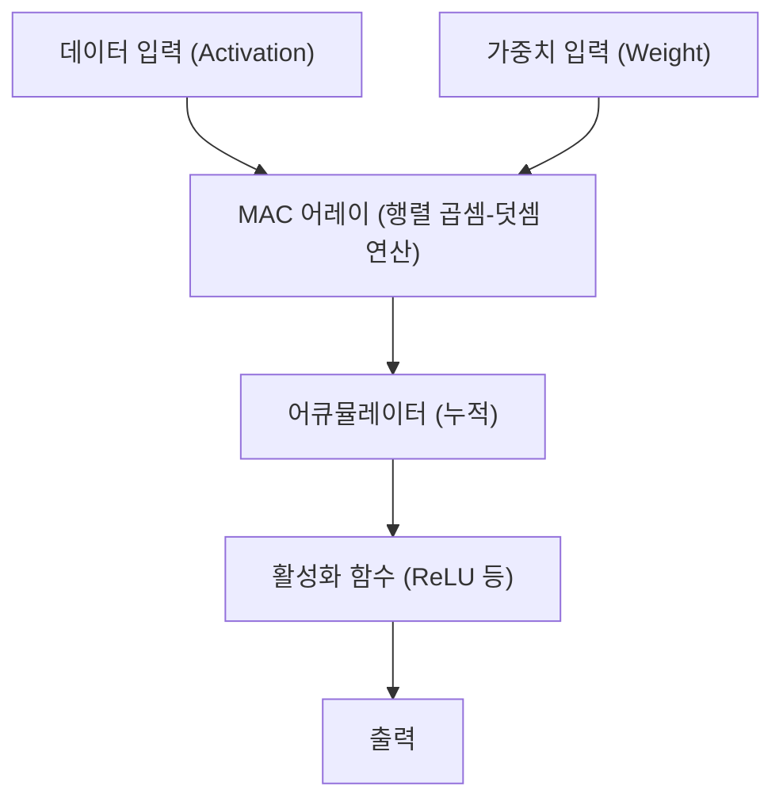

# Edge AI와 NPU(Neural Processing Unit) 아키텍처

최근 인공지능(AI) 기술의 급속한 발전으로 인해, 우리 생활의 모든 분야에서 AI가 활용되고 있습니다. 초기 AI 붐을 견인한 것은 클라우드에 있는 거대한 데이터 센터의 압도적인 컴퓨팅 리소스였습니다. 하지만 현재 그 패러다임은 큰 전환점을 맞이하고 있습니다. 'Edge AI(엣지 AI)'와 이를 뒷받침하는 전용 하드웨어 'NPU(Neural Processing Unit)'의 대두입니다.

이 글은 클라우드와 기기 내 추론의 장단점, NPU 설계 사례, 모델 최적화 방법을 설명합니다. 성능과 개인정보에 미치는 영향은 일률적이지 않으므로 특정 기기와 사용 사례에서 평가하는 방법도 다룹니다.

## 1. 클라우드 AI의 한계와 Edge AI의 대두

AI 추론을 클라우드 측에서 수행하는 기존의 접근 방식에는 몇 가지 구조적인 과제가 존재합니다.

### 레이턴시(지연) 문제
클라우드 왕복 시간은 네트워크 경로와 거리, 혼잡도, 서버 처리에 따라 달라지므로 수십~수백 밀리초를 보편적인 값으로 볼 수 없습니다. 온디바이스 추론은 네트워크 응답을 기다리지 않아도 되어 엄격한 응답 기한에 도움이 될 수 있지만, 기기 내 추론과 입출력에도 시간이 듭니다. 대상 모델과 기기에서 전체 지연 시간을 측정해야 합니다. 차량처럼 안전이 중요한 시스템은 단일 AI 예측 외의 안전 장치도 갖춰야 합니다.

### 프라이버시와 보안
온디바이스 추론은 설계에 따라 원본 이미지나 오디오를 기기 밖으로 보내지 않아 전송 데이터를 줄일 수 있습니다. 그렇다고 개인정보 보호나 보안이 보장되는 것은 아닙니다. 앱이 결과, 로그, 진단 정보를 전송할 수 있고 기기 자체에도 접근 제어, 암호화, 업데이트가 필요합니다. 각 앱과 서비스가 무엇을 저장하고 전송하는지 확인하세요.

### 통신 비용과 대역폭
고해상도 비디오 스트림이나 방대한 센서 데이터를 모두 클라우드로 전송하면 네트워크 대역폭을 심하게 압박하여 통신 비용이 부풀어 오릅니다. 엣지 측에서 데이터를 사전 처리하고 필요한 정보만 클라우드로 보냄으로써 네트워크 인프라에 대한 부하를 크게 줄일 수 있습니다.

사용 사례에 따라 추론은 클라우드, 기기 또는 양쪽에서 실행할 수 있습니다. 온디바이스 처리는 네트워크 지연이나 트래픽을 줄이는 방법이지만 기기에는 전력·발열·메모리 한계가 있습니다. NPU를 포함해 어떤 연산 장치를 사용할지는 모델과 런타임에 따라 달라집니다.

## 2. NPU(Neural Processing Unit)란 무엇인가?

NPU는 신경망 연산을 가속하는 전용 또는 통합 하드웨어를 가리키는 포괄적 용어입니다. 많은 제품이 추론용이지만 학습과 특정 연산자의 지원 여부는 제품마다 다릅니다. 실제 기능은 런타임, 드라이버, 모델에도 좌우됩니다.

### CPU, GPU, NPU의 차이

CPU는 일반 제어와 순차 작업, GPU는 병렬 작업, NPU는 지원하는 신경망 연산의 가속에 주로 쓰입니다. 제품마다 기능이 다르며 런타임이 여러 프로세서에 작업을 나눌 수 있습니다. NPU가 GPU보다 항상 빠르거나 효율적인 것은 아닙니다. 결과는 모델, 연산자, 정밀도, 배치 크기, 런타임, 데이터 이동, 전력·온도 한계에 따라 달라집니다. 대상 기기에서 같은 전체 작업을 측정하세요. 최대 TOPS만으로 앱의 속도를 예측할 수 없습니다.

## 3. NPU 아키텍처와 성능에 영향을 주는 요소

NPU의 성능과 효율은 내부 설계뿐 아니라 모델, 소프트웨어, 데이터 이동, 전력·온도 한계에도 영향을 받습니다. 이 절에서는 일반적인 설계 고려사항을 살펴봅니다.

### MAC(Multiply-Accumulate) 유닛의 집적
신경망은 MAC 연산을 자주 사용해 일부 NPU에 전용 연산 유닛과 데이터 흐름이 있습니다. 설계는 제품마다 다릅니다. 시스톨릭 어레이는 한 방식이고 ‘Tensor Core’는 일부 제품의 명칭입니다. 모든 NPU의 구조와 유닛 수가 같지는 않습니다. 아래 그림은 간략한 개념도입니다.

### 메모리 계층 최적화(데이터 이동의 최소화)
데이터 이동은 전력과 성능에 영향을 줄 수 있지만 모든 칩과 작업에 적용되는 단일 비율은 없습니다. 온칩 메모리, 모델, 런타임에 따라 다르고 중간 데이터가 DRAM으로 이동할 수 있습니다. 대상 하드웨어에서 전송을 포함한 전체 성능을 측정하세요.

## 4. 현실 세계의 NPU 아키텍처 실제 사례

현재 스마트폰이나 PC를 위해 다양한 NPU가 개발 및 탑재되고 있습니다.

### Apple Neural Engine (ANE)
Apple Core ML은 모델과 기기에 따라 CPU, GPU, Neural Engine을 사용할 수 있습니다. Xcode에서 실행 위치를 분석하고 대상 기기에서 측정하세요. 한 칩 세대의 최대 TOPS가 다른 앱의 속도를 뜻하지 않습니다. [Core ML 성능 분석](https://developer.apple.com/documentation/coreml/analyzing-a-core-ml-model-s-performance-in-xcode) · [연산 장치](https://developer.apple.com/documentation/coreml/mlcomputeunits)

### Google Tensor (Pixel SoC)
Google Tensor는 Pixel용 SoC 제품군입니다. Google Cloud TPU와 Edge TPU(Coral)는 별개의 제품군이며 이름만으로 설계 계승을 단정할 수 없습니다. 기능은 세대, 모델, OS, 앱에 따라 달라집니다. [Google Pixel 11 발표(Tensor G6)](https://blog.google/products-and-platforms/devices/pixel/google-pixel-11-pro-xl/) · [Coral Edge TPU 문서](https://coral.ai/docs/)

### Qualcomm Hexagon NPU
Qualcomm Hexagon은 스칼라·벡터·텐서 가속기와 공유 메모리를 갖추며 Qualcomm AI Engine은 이를 CPU·GPU 등과 함께 사용합니다. 지원 연산과 실제 성능은 SoC, 소프트웨어, 모델마다 다르므로 대상 구성에서 측정하세요. [Hexagon](https://www.qualcomm.com/processors/hexagon) · [AI Engine](https://www.qualcomm.com/processors/ai-engine)

## 5. 엣지 AI를 뒷받침하는 소프트웨어・최적화 기술

대형 모델은 기기의 메모리나 전력 한계를 넘을 수 있습니다. 양자화, 가지치기, 지식 증류를 고려할 수 있지만 하드웨어 지원, 정확도 영향, 실측 성능을 확인해야 합니다.

### 양자화 (Quantization)
양자화는 FP32를 FP16 또는 INT8 등으로 바꾸는 방법입니다. 가중치 저장 공간을 줄일 수 있지만 모델 크기나 속도가 같은 비율로 개선되지는 않으며 정확도와 지원 여부가 영향을 줍니다. PTQ/QAT 후 대표 입력과 대상 기기에서 측정하세요. [Core ML 압축](https://developer.apple.com/documentation/coreml/reducing-the-size-of-your-core-ml-app) · [ONNX Runtime](https://onnxruntime.ai/docs/performance/model-optimizations/quantization.html)

### 가지치기 (Pruning)
가지치기는 선택한 가중치를 제거하거나 0으로 만듭니다. 밀집 커널은 0도 계산할 수 있어 희소성만으로 파일 크기나 속도가 개선된다고 보장할 수 없습니다. 적합한 희소 형식·연산자·런타임·하드웨어가 필요합니다. 정확도와 성능을 함께 측정하세요.

### 지식 증류 (Knowledge Distillation)
지식 증류는 교사 모델의 출력이나 신호로 학생 모델을 학습합니다. 작은 모델에 도움이 될 수 있지만 독립 학습보다 항상 정확하다고 보장하지는 않습니다. 실제 과제와 데이터에서 비교하세요.

## 6. Edge AI의 미래와 향후 전망

일부 대규모 언어 모델은 계산량과 메모리 요구 때문에 클라우드에서 실행되지만, 일부 기기는 양자화·증류된 소형 모델을 실행할 수 있습니다. 실행 가능성, 지연 시간, 정확도, 전력 사용은 모델과 기기에 따라 다르므로 실제 작업으로 평가해야 합니다.

앞으로는 다음과 같은 트렌드가 예상됩니다.

*   **Hybrid AI(하이브리드 AI)**:
    응답 기한, 연결 상태, 데이터 처리, 비용, 모델 성능에 따라 기기와 클라우드 중에서 처리 위치를 선택할 수 있습니다. 모든 작업을 한쪽에 고정하지 말고 요구사항과 측정 결과에 따라 설계하세요.
*   **다양한 엣지 기기에서의 활용**:
    카메라, 차량, 웨어러블, 센서에서 특정 작업을 위해 소형 모델이나 가속기를 사용할 수 있습니다. 도입 여부는 전력, 비용, 연결성, 모델, 업데이트 요건에 따라 달라지며 모든 IoT 기기에 NPU가 필요한 것은 아닙니다.
*   **실행 제공자와 이식성**:
    ONNX Runtime 실행 제공자는 지원 연산자나 하위 그래프를 하드웨어에 할당합니다. 미지원 부분은 다른 프로세서에서 실행될 수 있으니 모델마다 가속 범위와 전체 성능을 확인하세요. 모든 NPU에서 최적 실행을 보장하지 않습니다. [Execution Providers](https://onnxruntime.ai/docs/execution-providers/)

## 맺음말

Edge AI와 NPU는 기기 내 추론의 선택지를 넓힙니다. 네트워크 대기나 원본 데이터 전송, 에너지 사용을 줄일 수 있지만 지연 시간·개인정보·효율이 자동으로 개선되지는 않습니다. 사용 사례, 모델, 기기, 소프트웨어 전체를 측정해 클라우드와 비교하세요.

소프트웨어 엔지니어나 AI 개발자에게 있어, 클라우드의 거대한 모델을 다루는 기술뿐만 아니라 '어떻게 제한된 리소스 안에서 하드웨어(NPU)의 특성을 살려 AI를 구현하고 최적화할 것인가'라는 지식이 앞으로 점점 더 중요해질 것입니다.
