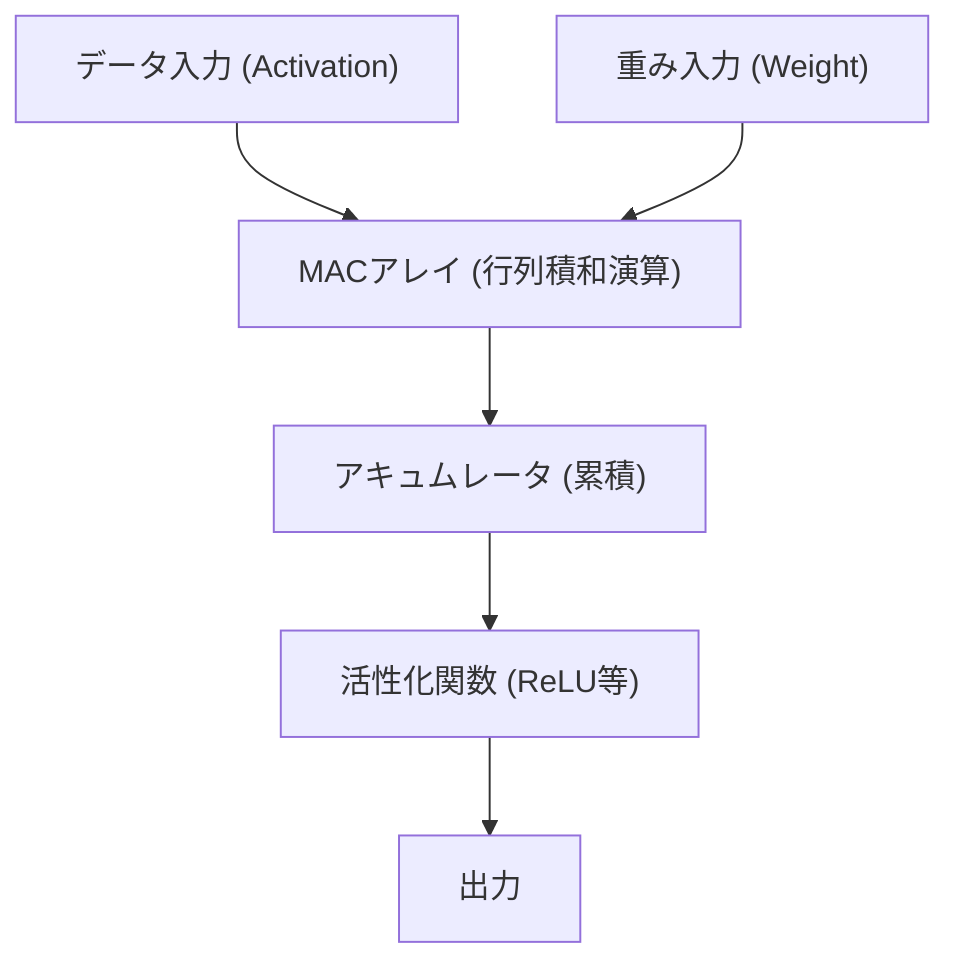

# Edge AIとNPU（Neural Processing Unit）アーキテクチャ

近年、人工知能（AI）技術の急速な発展により、私たちの生活のあらゆる場面でAIが活用されるようになりました。初期のAIブームを牽引したのは、クラウド上にある巨大なデータセンターの圧倒的なコンピューティングリソースでした。しかし現在、そのパラダイムは大きな転換点を迎えています。「Edge AI（エッジAI）」と、それを支える専用ハードウェア「NPU（Neural Processing Unit）」の台頭です。

本記事では、クラウド推論と端末内推論の利点・制約、NPUの設計例、最適化手法を説明します。性能やプライバシーへの効果は一律ではないため、実機と用途に応じて評価する方法も紹介します。

## 1. クラウドAIの限界とEdge AIの台頭

AIの推論をクラウド側で行う従来のアプローチには、いくつかの構造的な課題が存在します。

### レイテンシ（遅延）の問題
クラウド推論では、ネットワーク経路や距離、混雑、サーバー側の処理によって往復時間が変わります。数十〜数百ミリ秒を一律の値として扱うことはできません。厳しい応答期限がある処理では、通信を待たずに端末で推論することで遅延や通信断への依存を減らせる場合があります。ただし端末内の推論や入出力にも時間がかかるため、実際のモデルと端末でエンドツーエンドの時間を測る必要があります。自動車など安全が重要なシステムでは、AI推論だけに安全制御を委ねない設計も必要です。

### プライバシーとセキュリティ
端末内で推論すれば、画像や音声などの生データを外部へ送らずに済む場合があり、送信するデータを減らせます。ただし、Edge AIを使うだけでプライバシーやセキュリティが保証されるわけではありません。アプリが推論結果、ログ、診断情報を送信する場合があり、端末自体にもアクセス制御、暗号化、更新などの対策が必要です。実際に何が保存・送信されるかをアプリとサービスごとに確認してください。

### 通信コストと帯域幅
高解像度のビデオストリームや膨大なセンサーデータをすべてクラウドに送信すると、ネットワーク帯域を著しく圧迫し、通信コストが膨れ上がります。エッジ側でデータを事前処理し、必要な情報のみをクラウドに送ることで、ネットワークインフラへの負荷を大幅に削減できます。

用途によっては、推論をクラウド、端末、または両方で行う構成を選べます。端末内処理は遅延や通信量を減らす選択肢ですが、端末には電力・熱・メモリの制約があります。NPUを含むどの計算資源を使うかは、モデルと実行環境を含めて決まります。

## 2. NPU（Neural Processing Unit）とは何か？

NPUはニューラルネットワークの演算を加速する専用または組み込みのハードウェアを指す総称です。一般に推論向けの製品が多い一方、学習への対応や対応演算は製品ごとに異なります。実際の能力はチップだけでなく、ランタイム、ドライバー、モデルにも依存します。

### CPU、GPU、NPUの違い

CPUは汎用的な制御や逐次処理、GPUは並列処理、NPUは対応するニューラルネットワーク演算の加速に使われることが多い設計です。ただし、製品ごとに機能や対応演算は異なり、実行時に複数のプロセッサが協調する場合もあります。NPUがGPUより速い、またはTOPS/Wが高いとは限りません。モデル、演算子、数値精度、バッチサイズ、実行ランタイム、データ転送、電力・温度条件をそろえて、対象端末で測定してください。公称TOPSだけではアプリ全体の速度は分かりません。

*   **CPU（Central Processing Unit）**:
    汎用的な演算処理を得意とします。複雑な条件分岐やOSの制御など、多様なタスクを柔軟にこなせますが、コア数が限られているため、ニューラルネットワークのような膨大な並列計算には不向きです。
*   **GPU（Graphics Processing Unit）**:
    多数の演算を並列に処理する設計が多く、画像処理やAIの推論・学習に使われます。コア構成や消費電力は製品によって大きく異なるため、モバイル端末での適性も含め、対象の処理と機器で評価します。
*   **NPU（Neural Processing Unit）**:
    ニューラルネットワークの一部の演算を加速するプロセッサです。対応する演算や精度、利用できるモデルは製品とソフトウェアによって異なり、GPUより常に速い・省電力とは限りません。
## 3. NPUのアーキテクチャと性能を左右する要素

NPUの性能や効率は、内部構造だけでなく、モデル、ソフトウェア、データ移動、電力や温度の制約によって変わります。ここでは代表的な設計要素を見ます。

### MAC（Multiply-Accumulate）ユニットの集積
ニューラルネットワークでは積和演算（MAC）が多用されるため、専用の演算器やデータフローを備えるNPUがあります。ただし、構成は製品ごとに異なります。シストリック・アレイは一つの設計例で、「Tensor Core」は特定製品で使われる名称です。すべてのNPUが同じ構造やMAC数を持つわけではなく、ユニット数から実アプリの性能を直接推定することもできません。下図は処理の概念を示す簡略図です。

### メモリ階層の最適化（データ移動の最小化）
データ移動は多くのAIアクセラレータで電力・性能に影響する要素ですが、計算に対する消費電力の比率を一律に示すことはできません。オンチップメモリの容量、データ再利用、モデルや実行ランタイムによって結果が変わります。重みや中間データをすべてチップ内に保持できるとは限らず、層の間でDRAMとの転送が発生する場合もあります。モデルを対象ハードウェア上でプロファイルし、転送を含めた実測で判断します。

## 4. 現実世界のNPUアーキテクチャ実例

現在、スマートフォンやPC向けに様々なNPUが開発・搭載されています。

### Apple Neural Engine (ANE)
AppleのCore MLは、モデルやデバイスに応じてCPU、GPU、Neural Engineなどの計算資源を使います。どの演算がどこで実行されるか、どの程度速いかはモデルと実行環境によって変わるため、Xcodeのパフォーマンス分析と対象端末での測定を使って確認してください。特定世代の公称TOPSは、別のモデルやアプリの性能を示すものではありません。[Core MLの性能分析](https://developer.apple.com/documentation/coreml/analyzing-a-core-ml-model-s-performance-in-xcode)・[計算ユニット](https://developer.apple.com/documentation/coreml/mlcomputeunits)

### Google Tensor（Pixel向けSoC）
Google TensorはPixel端末向けのSoC製品群です。Google Cloud TPUやEdge TPU（Coral製品群）とは別の製品系列であり、名称だけから同じ設計の継承関係を推定するのは適切ではありません。端末上の機能は世代、モデル、OS、アプリによって異なります。製品固有の機能や対応状況は、該当する端末・開発者向け資料で確認してください。 [GoogleのPixel 11発表（Tensor G6）](https://blog.google/products-and-platforms/devices/pixel/google-pixel-11-pro-xl/)・[Coral Edge TPU資料](https://coral.ai/docs/)

### Qualcomm Hexagon NPU
Qualcommの説明では、Hexagonはスカラー、ベクター、テンソルのアクセラレータと共有メモリを組み合わせたNPUで、同社のAI EngineではCPUやGPUなどと協調して処理します。利用可能な演算や実際の速度はSoC、ソフトウェアスタック、モデルによって異なります。製品のTOPS値やブランド名だけで他機種との性能を比較せず、対象構成で測定してください。[Hexagon NPU](https://www.qualcomm.com/processors/hexagon)・[Qualcomm AI Engine](https://www.qualcomm.com/processors/ai-engine)

## 5. エッジAIを支えるソフトウェア・最適化技術

大規模モデルは端末のメモリや電力の制約を超えることがあります。量子化、枝刈り、知識蒸留は選択肢ですが、対応ハードウェア、精度への影響、実測性能を確認して使います。

### 量子化 (Quantization)
量子化は、重みや演算の数値表現をFP32からFP16、INT8などに変換する手法です。重みデータの容量や転送量を減らせる場合がありますが、モデル全体のサイズや推論速度が必ず同じ比率で改善するわけではありません。効果は対応する数値形式・演算子・ランタイム・ハードウェアに依存し、精度にも影響します。PTQやQATを試した後、代表的な入力で精度と端末上のエンドツーエンド性能を測定してください。[Core MLのモデル圧縮](https://developer.apple.com/documentation/coreml/reducing-the-size-of-your-core-ml-app)・[ONNX Runtimeの量子化](https://onnxruntime.ai/docs/performance/model-optimizations/quantization.html)

### 枝刈り (Pruning)
枝刈りは重要度の低い重みをゼロ化・削除して疎なモデルを作る手法です。ただし、通常の密行列カーネルはゼロを含む重みも計算することがあり、疎性だけでファイルサイズや実行時間が減るとは限りません。圧縮には疎行列形式などの保存方法が、速度向上には対応する疎演算とハードウェア・ランタイムが必要です。精度と実測性能を併せて評価してください。

### 知識蒸留 (Knowledge Distillation)
知識蒸留では、教師モデルの出力などを利用して生徒モデルを学習させます。小型モデルの精度やサイズの制約下での性能を改善できることがありますが、単独で学習した小型モデルを常に上回るわけではありません。データ、蒸留方法、評価対象に合わせて比較する必要があります。

## 6. Edge AIの未来と今後の展望

大規模言語モデルの一部は計算量やメモリの要件からクラウドで実行されますが、量子化・蒸留した小型モデルを端末で実行できる場合もあります。実行可能性や応答時間、精度、電力消費はモデルと端末によって異なるため、実用途で評価します。

今後は、以下のようなトレンドが予想されます。

*   **Hybrid AI（ハイブリッドAI）**:
    端末とクラウドのどちらで処理するかを、応答期限、通信状況、データの扱い、費用、モデルの能力に応じて選ぶ構成が考えられます。すべての処理を端末またはクラウドに固定せず、必要な保護と実測結果に基づいて設計します。
*   **多様なエッジデバイスへの展開**:
    カメラ、車載機器、ウェアラブル、センサーなどで、用途に合う小規模モデルやアクセラレータが使われる場合があります。導入の可否は電力、費用、通信、モデル、更新要件によって異なり、すべてのIoT機器にNPUが必要なわけではありません。
*   **実行環境と移植性**:
    ONNX RuntimeなどはExecution Provider（実行プロバイダー）を通じて対応する演算や部分グラフを各ハードウェアへ割り当てます。未対応の演算が別のプロセッサへフォールバックする場合もあり、モデルごとに実行範囲・精度・速度を確認する必要があります。「一度書けば、どのNPUでも最適に動く」ことが保証されるわけではありません。[ONNX Runtime Execution Providers](https://onnxruntime.ai/docs/execution-providers/)

## おわりに

Edge AIとNPUは、端末内で推論する選択肢を広げています。ネットワーク往復を省けること、送信する生データを減らせること、電力や通信の使い方を調整できることは利点になり得ますが、遅延・プライバシー・電力効率の改善は自動的には保証されません。用途、モデル、端末、ソフトウェアを含む構成を実測して、クラウド推論とのトレードオフを判断します。

ソフトウェアエンジニアやAI開発者にとって、クラウド上の巨大モデルを扱うスキルだけでなく、「いかに限られたリソースの中で、ハードウェア（NPU）の特性を生かしてAIを実装・最適化するか」という知識が、今後ますます重要になってくるでしょう。
