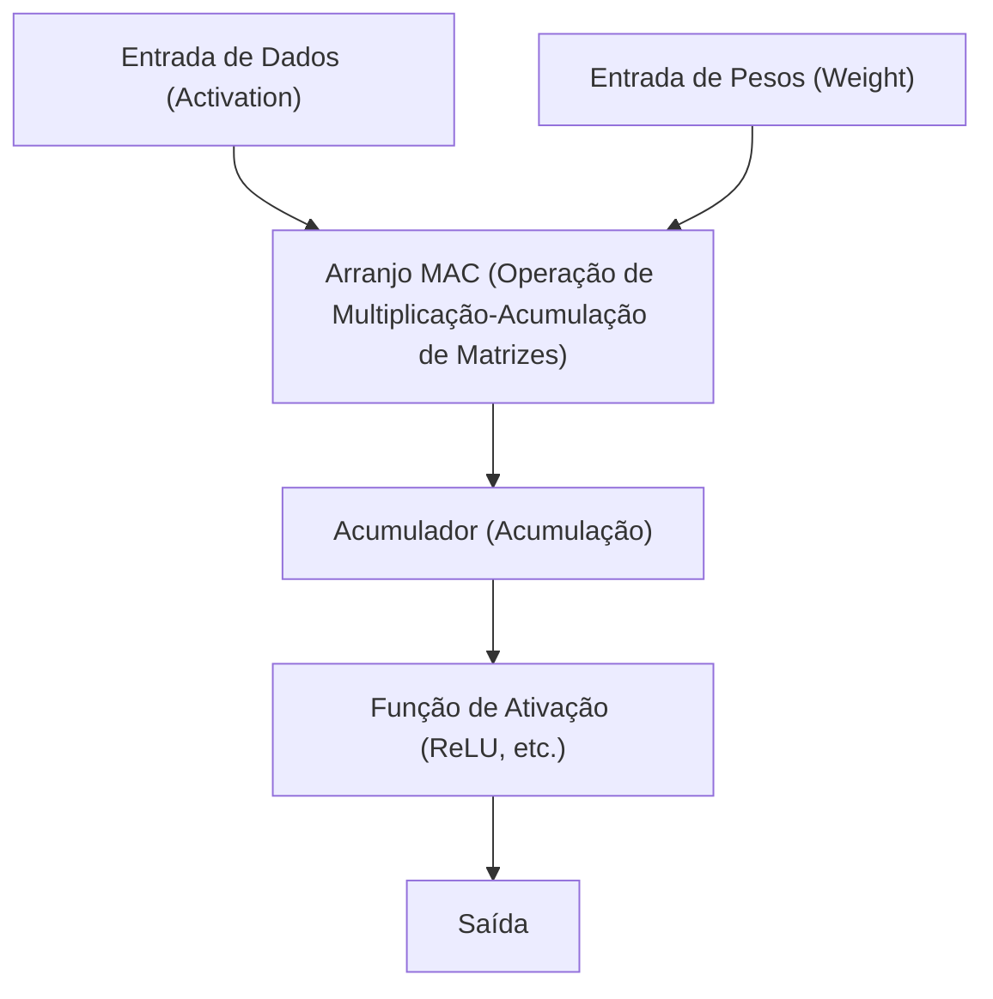

# Edge AI e Arquitetura NPU (Neural Processing Unit)

Nos últimos anos, com o rápido desenvolvimento da tecnologia de Inteligência Artificial (IA), a IA passou a ser utilizada em todas as situações das nossas vidas. O que impulsionou o boom inicial da IA foram os esmagadores recursos de computação de enormes data centers na nuvem. No entanto, atualmente, esse paradigma está chegando a um grande ponto de virada: a ascensão da "Edge AI (IA de Borda)" e do hardware dedicado "NPU (Neural Processing Unit)" que a sustenta.

Este artigo explica as vantagens e limitações da inferência na nuvem e no dispositivo, exemplos de projetos de NPU e métodos de otimização. Como os efeitos no desempenho e na privacidade não são universais, também mostra como avaliá-los para um dispositivo e uso específicos.

## 1. Os Limites da IA na Nuvem e a Ascensão da Edge AI

A abordagem tradicional de realizar a inferência de IA na nuvem apresenta vários desafios estruturais.

### O Problema da Latência (Atraso)
O tempo de ida e volta à nuvem varia conforme a rota e a distância da rede, o congestionamento e o processamento no servidor; dezenas ou centenas de milissegundos não são um valor universal. A inferência no dispositivo pode evitar a espera pela rede e ajudar quando há prazos de resposta rigorosos, mas a inferência local e a entrada/saída também levam tempo. Meça a latência de ponta a ponta no dispositivo e modelo-alvo. Sistemas críticos para a segurança, como veículos, também precisam de proteções além de uma única previsão de IA.

### Privacidade e Segurança
A inferência local pode evitar que imagens ou áudio brutos saiam do dispositivo e reduzir os dados transmitidos em alguns projetos. Isso não garante privacidade nem segurança: aplicativos ainda podem enviar resultados, registros ou diagnósticos, e o próprio dispositivo precisa de controles de acesso, criptografia e atualizações. Confira o que cada aplicativo e serviço armazena e transmite.

### Custos de Comunicação e Largura de Banda
Enviar todos os fluxos de vídeo de alta resolução e as imensas quantidades de dados de sensores para a nuvem pressiona severamente a largura de banda da rede e aumenta os custos de comunicação. Ao pré-processar os dados na borda e enviar apenas as informações necessárias para a nuvem, a carga na infraestrutura de rede pode ser significativamente reduzida.

Conforme o caso de uso, a inferência pode ocorrer na nuvem, no dispositivo ou nos dois. O processamento local é uma forma de reduzir latência de rede ou tráfego, mas os dispositivos têm limites de energia, temperatura e memória. As unidades de computação utilizadas, incluindo a NPU, dependem do modelo e do runtime.

## 2. O Que é uma NPU (Neural Processing Unit)?

NPU é um termo amplo para hardware dedicado ou integrado que acelera operações de redes neurais. Muitos produtos são voltados à inferência, mas o suporte a treinamento e a operadores específicos varia. As capacidades reais também dependem do runtime, dos drivers e do modelo.

### Diferenças entre CPU, GPU e NPU

A CPU costuma cuidar do controle geral e do trabalho sequencial, a GPU de cargas paralelas e a NPU de acelerar as operações de redes neurais que suporta. As capacidades variam por produto e o runtime pode distribuir o trabalho entre processadores. A NPU nem sempre é mais rápida ou eficiente que a GPU: o resultado depende do modelo, operadores, precisão, tamanho do lote, runtime, transferências e limites de energia ou temperatura. Meça a mesma carga completa no dispositivo-alvo; o TOPS máximo não prevê, por si só, a velocidade do aplicativo.

## 3. Arquitetura de NPU e fatores que afetam o desempenho

O desempenho e a eficiência de uma NPU dependem não só do projeto interno, mas também do modelo, do software, da movimentação de dados e dos limites de energia e temperatura. Esta seção apresenta alguns fatores de projeto comuns.

### Integração de Unidades MAC (Multiply-Accumulate)
Redes neurais usam muitas operações MAC, por isso algumas NPUs incluem unidades aritméticas e fluxos de dados especializados. Os projetos variam: matriz sistólica é uma abordagem e “Tensor Core” é nome de certos produtos. Nem toda NPU tem a mesma estrutura ou quantidade de unidades. O diagrama é apenas um conceito simplificado.

### Otimização da Hierarquia de Memória (Minimização da Movimentação de Dados)
A movimentação de dados pode afetar energia e desempenho, mas não há uma proporção única para todos os chips e cargas. Memória no chip, modelo e runtime fazem diferença; dados intermediários podem ir para a DRAM. Analise o modelo no hardware-alvo e meça o desempenho completo, incluindo transferências.

## 4. Exemplos Reais de Arquitetura de NPU

Atualmente, várias NPUs estão sendo desenvolvidas e integradas em smartphones e PCs.

### Apple Neural Engine (ANE)
O Apple Core ML pode usar CPU, GPU ou Neural Engine conforme modelo e dispositivo. Analise a distribuição no Xcode e meça no dispositivo-alvo; o TOPS máximo de um chip não indica a velocidade de outro aplicativo. [Análise do Core ML](https://developer.apple.com/documentation/coreml/analyzing-a-core-ml-model-s-performance-in-xcode) · [unidades de computação](https://developer.apple.com/documentation/coreml/mlcomputeunits)

### Google Tensor (SoCs Pixel)
Google Tensor é uma família de SoCs para Pixel. Google Cloud TPU e Edge TPU (Coral) são linhas de produtos distintas; os nomes não provam uma relação direta de projeto. Os recursos variam conforme geração, modelo, sistema e aplicativo. [Anúncio do Pixel 11 do Google (Tensor G6)](https://blog.google/products-and-platforms/devices/pixel/google-pixel-11-pro-xl/) · [Documentação Coral Edge TPU](https://coral.ai/docs/)

### Qualcomm Hexagon NPU
A Qualcomm descreve Hexagon com aceleradores escalares, vetoriais e tensoriais e memória compartilhada; Qualcomm AI Engine combina-o com CPU, GPU e outros processadores. Operações e desempenho variam por SoC, software e modelo. Meça na configuração-alvo. [Hexagon](https://www.qualcomm.com/processors/hexagon) · [AI Engine](https://www.qualcomm.com/processors/ai-engine)

## 5. Software e Técnicas de Otimização que Sustentam a Edge AI

Modelos grandes podem exceder os limites de memória ou energia de um dispositivo. Quantização, poda e destilação são opções a avaliar, verificando o suporte de hardware, o impacto na precisão e o desempenho medido.

### Quantização (Quantization)
Quantização altera a representação numérica, por exemplo de FP32 para FP16 ou INT8. Pode reduzir o armazenamento dos pesos, mas tamanho e velocidade não melhoram necessariamente na mesma proporção; suporte e precisão importam. Após PTQ/QAT, meça com entradas representativas no dispositivo-alvo. [Compressão Core ML](https://developer.apple.com/documentation/coreml/reducing-the-size-of-your-core-ml-app) · [ONNX Runtime](https://onnxruntime.ai/docs/performance/model-optimizations/quantization.html)

### Poda (Pruning)
A poda remove ou zera determinados pesos. Kernels densos podem continuar calculando pesos zerados, então a esparsidade não garante arquivo menor nem inferência mais rápida. São necessárias representações esparsas e operações, runtimes e hardware compatíveis. Meça precisão e desempenho.

### Destilação de Conhecimento (Knowledge Distillation)
A destilação treina o modelo aluno com saídas ou outros sinais do professor. Pode ajudar um modelo pequeno, mas não garante precisão superior ao treinamento independente. Compare na tarefa e nos dados relevantes.

## 6. O Futuro da Edge AI e Perspectivas

Alguns modelos de linguagem grandes rodam na nuvem por causa dos requisitos de computação e memória; certos dispositivos podem executar modelos menores quantizados ou destilados. Viabilidade, latência, precisão e consumo de energia dependem do modelo e do dispositivo, portanto avalie a carga pretendida.

No futuro, são esperadas as seguintes tendências:

*   **IA híbrida (Hybrid AI)**:
    A execução no dispositivo ou na nuvem pode ser escolhida conforme prazo de resposta, conectividade, tratamento de dados, custo e capacidade do modelo. Não presuma que toda tarefa deva ficar em um único lado; decida com base nos requisitos e nas medições.
*   **Uso em diferentes dispositivos de borda**:
    Câmeras, veículos, wearables e sensores podem usar modelos pequenos ou aceleradores em tarefas específicas. A viabilidade depende de energia, custo, conectividade, modelo e requisitos de atualização; nem todo dispositivo IoT precisa de uma NPU.
*   **Provedores de execução e portabilidade**:
    Execution Providers do ONNX Runtime atribuem operadores ou subgrafos compatíveis ao hardware; operações não suportadas podem rodar em outro processador. Verifique a aceleração real e o desempenho completo de cada modelo. Não há garantia de execução ideal em qualquer NPU. [Execution Providers](https://onnxruntime.ai/docs/execution-providers/)

## Conclusão

Edge AI e NPUs ampliam a opção de inferência no dispositivo. Evitar espera de rede, enviar menos dados brutos ou ajustar energia pode ajudar, mas melhorias de latência, privacidade e eficiência não são automáticas. Meça uso, modelo, dispositivo e software juntos e compare com a nuvem.

Para engenheiros de software e desenvolvedores de IA, não bastará apenas a habilidade de lidar com enormes modelos na nuvem. O conhecimento de "como implementar e otimizar IA dentro de recursos limitados, aproveitando as características do hardware (NPU)" será cada vez mais crucial no futuro.
