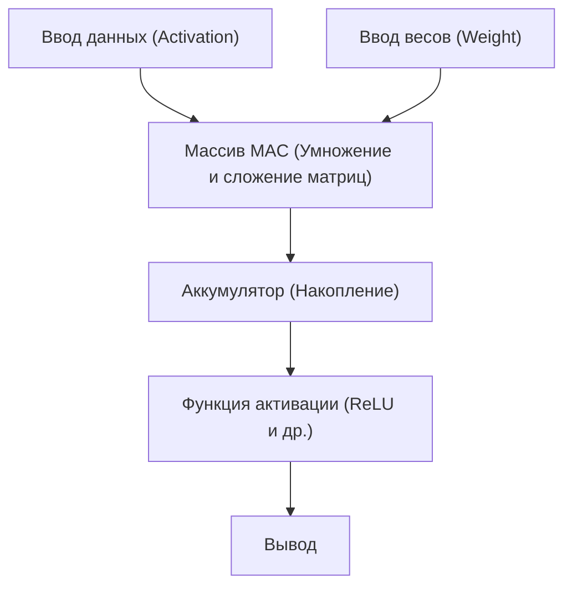

# Edge AI и архитектура NPU (Neural Processing Unit)

В последние годы, благодаря стремительному развитию технологий искусственного интеллекта (ИИ), ИИ стал использоваться во всех сферах нашей жизни. Первоначальный бум ИИ был обусловлен подавляющими вычислительными ресурсами гигантских центров обработки данных, расположенных в облаке. Однако сейчас эта парадигма переживает серьезный поворотный момент. Это появление «Edge AI (Граничный ИИ)» и поддерживающего его специализированного аппаратного обеспечения «NPU (Neural Processing Unit)».

В статье рассматриваются преимущества и ограничения облачного и локального инференса, примеры архитектур NPU и методы оптимизации моделей. Поскольку влияние на производительность и конфиденциальность не универсально, также объясняется, как оценивать его для конкретного устройства и задачи.

## 1. Ограничения облачного ИИ и появление Edge AI

Традиционный подход, при котором вычисления ИИ выполняются на стороне облака, имеет несколько структурных проблем.

### Проблема задержки (Latency)
Время полного обмена с облаком зависит от маршрута и расстояния в сети, загруженности и обработки на сервере; десятки или сотни миллисекунд не являются универсальным значением. Локальный инференс может исключить ожидание сети и помочь при строгих сроках ответа, но сам инференс и ввод-вывод на устройстве тоже занимают время. Измеряйте задержку всего процесса на целевой модели и устройстве. Для критически важных систем, например автомобилей, нужны меры безопасности помимо одного прогноза ИИ.

### Конфиденциальность и безопасность
Локальный инференс в некоторых архитектурах позволяет не отправлять исходные изображения или аудио с устройства и уменьшить объем передаваемых данных. Это не гарантирует конфиденциальность или безопасность: приложения могут отправлять результаты, журналы или диагностику, а самому устройству нужны контроль доступа, шифрование и обновления. Проверяйте, что сохраняет и передает каждое приложение и сервис.

### Затраты на связь и пропускная способность
Отправка всех видеопотоков высокого разрешения и огромных объемов данных с датчиков в облако сильно нагружает пропускную способность сети и приводит к резкому росту затрат на связь. Предварительная обработка данных на стороне устройства и отправка в облако только необходимой информации может значительно снизить нагрузку на сетевую инфраструктуру.

В зависимости от задачи инференс может выполняться в облаке, на устройстве или распределяться между ними. Локальная обработка может уменьшить сетевую задержку или трафик, но у устройств есть ограничения по питанию, нагреву и памяти. Используемые вычислительные блоки, включая NPU, зависят от модели и runtime.

## 2. Что такое NPU (Neural Processing Unit)?

NPU — общее название специализированного или встроенного оборудования для ускорения операций нейросетей. Многие продукты ориентированы на инференс, но поддержка обучения и конкретных операций зависит от модели устройства. Реальные возможности также зависят от runtime, драйверов и модели.

### Различия между CPU, GPU и NPU

CPU обычно используется для общего управления и последовательных задач, GPU — для параллельных нагрузок, а NPU — для ускорения поддерживаемых операций нейросетей. Возможности зависят от продукта, а среда выполнения может распределять работу между процессорами. NPU не всегда быстрее или эффективнее GPU: результат зависит от модели, операторов, точности, размера пакета, runtime, передачи данных и ограничений мощности или температуры. Измеряйте одну и ту же сквозную нагрузку на целевом устройстве; пиковое значение TOPS само по себе не предсказывает скорость приложения.

## 3. Архитектура NPU и факторы производительности

Производительность и эффективность NPU зависят не только от внутренней архитектуры, но и от модели, ПО, перемещения данных, ограничений питания и температуры. В этом разделе рассмотрены некоторые типичные аспекты конструкции.

### Интеграция блоков MAC (Multiply-Accumulate)
Нейросети часто используют операции MAC, поэтому в некоторых NPU есть специализированные блоки вычислений и схемы передачи данных. Архитектуры различаются: систолический массив — один из вариантов, а «Tensor Core» — название конкретных продуктов. У всех NPU нет одинаковой структуры и числа блоков. Схема ниже показывает упрощенную концепцию.

### Оптимизация иерархии памяти (минимизация перемещения данных)
Перемещение данных влияет на энергопотребление и производительность ускорителя, но единого соотношения для всех чипов и нагрузок нет. Важны встроенная память, повторное использование данных, модель и runtime; промежуточные данные могут передаваться в DRAM. Профилируйте модель на целевом оборудовании и измеряйте полную производительность с учетом передач.

## 4. Примеры архитектуры NPU в реальном мире

В настоящее время разрабатываются и устанавливаются различные NPU для смартфонов и ПК.

### Apple Neural Engine (ANE)
Apple Core ML может использовать CPU, GPU и Neural Engine в зависимости от модели и устройства. Анализируйте распределение вычислений в Xcode и измеряйте работу на целевом устройстве; пиковое значение TOPS одного поколения чипа не показывает скорость другого приложения. [Анализ Core ML](https://developer.apple.com/documentation/coreml/analyzing-a-core-ml-model-s-performance-in-xcode) · [вычислительные блоки](https://developer.apple.com/documentation/coreml/mlcomputeunits)

### Google Tensor (SoC для Pixel)
Google Tensor — семейство SoC для устройств Pixel. Google Cloud TPU и Edge TPU (Coral) — отдельные линейки продуктов; названия не доказывают прямую преемственность конструкции. Функции устройства зависят от поколения, модели, ОС и приложения. [Анонс Google Pixel 11 (Tensor G6)](https://blog.google/products-and-platforms/devices/pixel/google-pixel-11-pro-xl/) · [Документация Coral Edge TPU](https://coral.ai/docs/)

### Qualcomm Hexagon NPU
По описанию Qualcomm, Hexagon включает скалярные, векторные и тензорные ускорители и общую память; Qualcomm AI Engine сочетает их с CPU, GPU и другими процессорами. Поддерживаемые операции и производительность зависят от SoC, ПО и модели. Измеряйте целевую конфигурацию. [Hexagon](https://www.qualcomm.com/processors/hexagon) · [AI Engine](https://www.qualcomm.com/processors/ai-engine)

## 5. Программное обеспечение и технологии оптимизации, поддерживающие Edge AI

Большие модели могут превышать ограничения устройства по памяти и энергопотреблению. Квантование, pruning и дистилляция — возможные варианты, но нужно проверять поддержку оборудования, влияние на точность и измеренную производительность.

### Квантование (Quantization)
Квантование меняет числовое представление весов или операций, например FP32 на FP16 или INT8. Оно может сократить хранение весов, но размер модели и скорость не обязательно меняются в той же пропорции; важны поддержка форматов и точность. После PTQ/QAT проверьте точность на типичных входных данных и измерьте работу на целевом устройстве. [Сжатие Core ML](https://developer.apple.com/documentation/coreml/reducing-the-size-of-your-core-ml-app) · [ONNX Runtime](https://onnxruntime.ai/docs/performance/model-optimizations/quantization.html)

### Обрезка (Pruning)
Pruning удаляет или обнуляет выбранные веса. Плотные ядра могут по-прежнему вычислять нулевые веса, поэтому разреженность не гарантирует уменьшения файла или ускорения инференса. Нужны подходящий разреженный формат, совместимые операции, runtime и оборудование. Оценивайте и точность, и измеренную производительность.

### Дистилляция знаний (Knowledge Distillation)
При дистилляции знаний студенческую модель обучают на выходах или других сигналах учительской модели. Это может помочь уменьшить модель, но не гарантирует точность выше, чем при самостоятельном обучении небольшой модели. Сравнивайте методы на нужной задаче и данных.

## 6. Будущее Edge AI и дальнейшие перспективы

Некоторые большие языковые модели работают в облаке из-за требований к вычислениям и памяти, тогда как отдельные устройства могут запускать меньшие квантованные или дистиллированные модели. Возможность запуска, задержка, точность и энергопотребление зависят от модели и устройства; оценивайте целевую нагрузку.

В будущем ожидаются следующие тенденции:

*   **Гибридный ИИ (Hybrid AI)**:
    Место выполнения — на устройстве или в облаке — можно выбирать с учетом срока ответа, связи, обработки данных, стоимости и возможностей модели. Не следует заранее закреплять все задачи за одной стороной; принимайте решение по требованиям и измерениям.
*   **Применение на разных периферийных устройствах**:
    Камеры, автомобили, носимые устройства и датчики могут использовать небольшие модели или ускорители для отдельных задач. Целесообразность зависит от питания, стоимости, связи, модели и требований к обновлениям; не каждому IoT-устройству нужен NPU.
*   **Провайдеры выполнения и переносимость**:
    Execution Providers в ONNX Runtime направляют поддерживаемые операции или подграфы на оборудование; неподдерживаемые части могут выполняться на другом процессоре. Для каждой модели проверяйте фактическое ускорение и сквозную производительность. Оптимальная работа на любом NPU не гарантируется. [Execution Providers](https://onnxruntime.ai/docs/execution-providers/)

## Заключение

Edge AI и NPU расширяют возможности инференса на устройстве. Сокращение ожидания сети, передачи исходных данных или энергопотребления может быть полезным, но улучшение задержки, конфиденциальности и эффективности не происходит автоматически. Измеряйте всю конфигурацию — задачу, модель, устройство и ПО — и сравнивайте с облачным инференсом.

Для инженеров-программистов и разработчиков ИИ в будущем будут все более важными не только навыки работы с гигантскими моделями в облаке, но и знания о том, «как реализовывать и оптимизировать ИИ в условиях ограниченных ресурсов, используя характеристики аппаратного обеспечения (NPU)».
