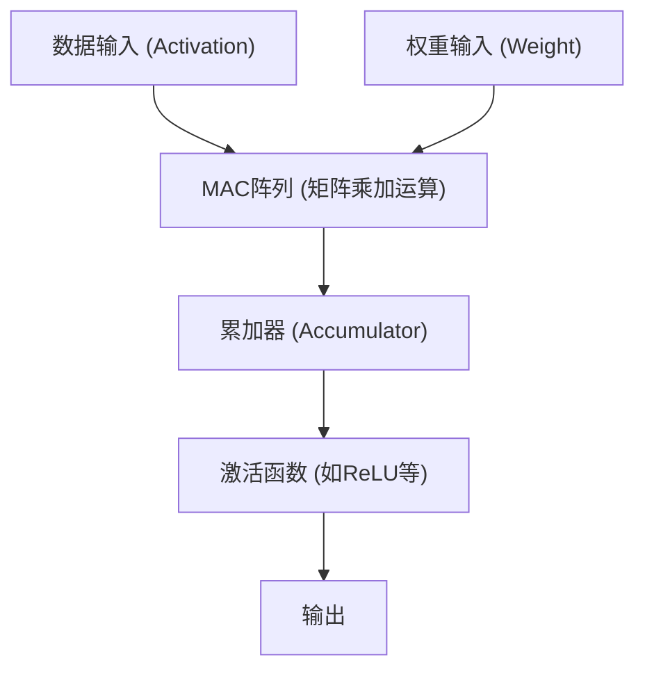

# 边缘AI与NPU（神经网络处理单元）架构

近年来，随着人工智能（AI）技术的飞速发展，AI已经渗透到我们生活的方方面面。引领初期AI热潮的，是云端庞大数据中心所提供的压倒性计算资源。然而，如今这一范式正迎来重大转折点，那就是“边缘AI（Edge AI）”以及支撑它的专用硬件“NPU（神经网络处理单元）”的崛起。

本文介绍云端与端侧推理的利弊、NPU设计示例和模型优化方法。由于它们对性能和隐私的影响并非固定不变，文中也说明如何针对具体设备和用途进行评估。

## 1. 云端AI的局限性与边缘AI的崛起

传统上在云端进行AI推理的方法，存在一些结构性的问题。

### 延迟（Latency）问题
云端往返时间会受到网络路径与距离、拥塞程度和服务器处理时间影响，数十至数百毫秒并非普遍适用的固定值。端侧推理可以免去等待网络的环节，在响应时限严格时可能有帮助；但设备本地推理以及输入输出同样需要时间。应在目标设备和模型上测量端到端延迟。汽车等安全关键系统还需要单次AI预测之外的安全保护设计。

### 隐私与安全
端侧推理在某些设计中可以不把原始图像或音频发送到设备之外，从而减少传输的数据，但这并不自动保证隐私或安全：应用仍可能发送推理结果、日志或诊断信息，设备本身也需要访问控制、加密和安全更新。请确认各应用和服务实际保存、传输了哪些数据。

### 通信成本与带宽
将高分辨率视频流或庞大的传感器数据全部发送到云端，会严重挤压网络带宽，导致通信成本急剧膨胀。在边缘侧对数据进行预处理，仅将必要的信息发送到云端，可以大幅减轻网络基础设施的负担。

根据具体用途，推理可以在云端、设备端或两者之间执行。端侧处理可能减少网络延迟或流量，但设备受功耗、散热和内存限制。实际使用哪些计算单元（包括NPU）取决于模型和运行时。

## 2. 什么是NPU（神经网络处理单元）？

NPU是对用于加速神经网络运算的专用或集成硬件的统称。许多产品主要面向推理，但是否支持训练及具体算子因产品而异。实际能力还取决于运行时、驱动和模型。

### CPU、GPU、NPU的区别

CPU通常用于通用控制和顺序任务，GPU用于并行负载，NPU则用于加速其支持的神经网络运算。不同产品的能力不同，运行时也可能把任务分配给多个处理器。NPU并不总是比GPU更快或更高效；结果取决于模型、算子、精度、批大小、运行时、数据传输以及功耗和温度限制。请在目标设备上测量相同的端到端工作负载；峰值TOPS本身无法预测应用速度。

## 3. NPU架构与影响性能的因素

NPU的性能和能效不仅取决于内部设计，也受到模型、软件、数据移动以及功耗和温度限制的影响。本节介绍一些常见的设计考量。

### MAC（乘加）单元的密集集成
神经网络常使用乘加（MAC）运算，因此部分NPU会采用专用计算单元和数据流设计。架构各不相同：脉动阵列只是其中一种方式，“Tensor Core”则是特定产品使用的名称。并非所有NPU都具有相同结构或可比较的单元数量。下图只是简化概念示意。

### 存储层次结构的优化（数据移动最小化）
数据移动会影响加速器的功耗和性能，但不存在适用于所有芯片和工作负载的统一能耗比例。片上内存、数据复用、模型和运行时都会产生影响；中间数据也可能需要传输到DRAM。请在目标硬件上分析模型，并将数据传输纳入端到端性能测量。

## 4. 现实世界中的NPU架构实例

目前，针对智能手机和PC，厂商们开发并搭载了各种各样的NPU。

### Apple Neural Engine (ANE)
Apple Core ML会根据模型和设备使用CPU、GPU、Neural Engine等计算单元。执行位置和性能取决于具体工作负载，可用Xcode分析并在目标设备上测量。某一代芯片的峰值TOPS不能说明其他应用或模型的速度。[Core ML性能分析](https://developer.apple.com/documentation/coreml/analyzing-a-core-ml-model-s-performance-in-xcode) · [计算单元](https://developer.apple.com/documentation/coreml/mlcomputeunits)

### Google Tensor（Pixel SoC）
Google Tensor是面向Pixel设备的SoC产品系列。Google Cloud TPU与Edge TPU（Coral产品系列）是不同的产品线，仅凭名称不能推断它们存在直接的设计继承关系。端侧功能会因芯片代际、模型、操作系统和应用而异。 [Google Pixel 11公告（Tensor G6）](https://blog.google/products-and-platforms/devices/pixel/google-pixel-11-pro-xl/) · [Coral Edge TPU文档](https://coral.ai/docs/)

### Qualcomm Hexagon NPU
Qualcomm介绍称，Hexagon NPU由标量、向量和张量加速器及共享内存组成；Qualcomm AI Engine会让它与CPU、GPU等其他处理器协同工作。支持的运算和实际性能取决于SoC、软件栈和模型。请在目标配置上实测比较，而不是只看产品名称或峰值TOPS。[Hexagon](https://www.qualcomm.com/processors/hexagon) · [Qualcomm AI Engine](https://www.qualcomm.com/processors/ai-engine)

## 5. 支撑边缘AI的软件与优化技术

大型模型可能超出设备的内存或功耗预算。量化、剪枝和蒸馏可以作为选择，但需要确认硬件支持、对精度的影响以及实测性能。

### 量化 (Quantization)
量化会改变权重或运算的数值表示，例如从FP32变为FP16或INT8。它可能减少权重存储和数据传输，但模型整体大小与推理速度不一定按相同比例改善。效果取决于支持的格式、算子、运行时和硬件，精度也可能变化。采用PTQ或QAT后，请用有代表性的输入检查精度，并在目标设备上测量端到端性能。[Core ML模型压缩](https://developer.apple.com/documentation/coreml/reducing-the-size-of-your-core-ml-app) · [ONNX Runtime量化](https://onnxruntime.ai/docs/performance/model-optimizations/quantization.html)

### 剪枝 (Pruning)
剪枝会移除或将选定权重置零，以形成稀疏模型。密集计算内核仍可能对零值权重执行计算，因此稀疏性本身不能保证文件更小或推理更快。节省存储需要合适的稀疏表示；加速则需要兼容的稀疏算子、运行时和硬件。请同时评估精度和实测性能。

### 知识蒸馏 (Knowledge Distillation)
知识蒸馏利用教师模型的输出或其他信号训练学生模型。它可能帮助受大小或精度限制的小模型，但不能保证精度高于独立训练的小模型。应在目标任务和数据上比较效果。

## 6. 边缘AI的未来与展望

部分大型语言模型因计算和内存需求在云端运行，而一些设备也能运行经过量化或蒸馏的小型模型。能否运行、延迟、精度和功耗取决于模型与设备，应针对预期工作负载进行评估。

未来预计将出现以下趋势：

*   **混合AI（Hybrid AI）**：
    可根据响应时限、网络连接、数据处理要求、成本和模型能力，选择在设备端或云端执行。不要预设所有任务都应放在同一侧，应根据需求和实测结果设计。
*   **在不同边缘设备上的应用**：
    摄像头、车辆、可穿戴设备和传感器可能会针对特定任务使用小型模型或加速器。是否适用取决于功耗、成本、网络、模型和更新要求；并非所有IoT设备都需要NPU。
*   **执行提供程序与可移植性**:
    ONNX Runtime通过Execution Provider将受支持的算子或子图分配给硬件；不支持的部分可能由其他处理器执行。请检查每个模型实际获得加速的部分，并测量端到端精度和速度。“一次编写即可在任何NPU上最优运行”并无保证。[ONNX Runtime Execution Providers](https://onnxruntime.ai/docs/execution-providers/)

## 结语

Edge AI和NPU扩大了在设备端运行推理的选择。减少网络往返、降低原始数据传输或调整能耗可能有益，但延迟、隐私和能效不会自动改善。请测量包括用途、模型、设备和软件在内的完整配置，并与云端推理比较。

对于软件工程师和AI开发者而言，不仅需要掌握处理云端庞大模型的技能，未来“如何在有限的资源下，发挥硬件（NPU）特性来实现和优化AI”的知识也将变得越来越重要。
