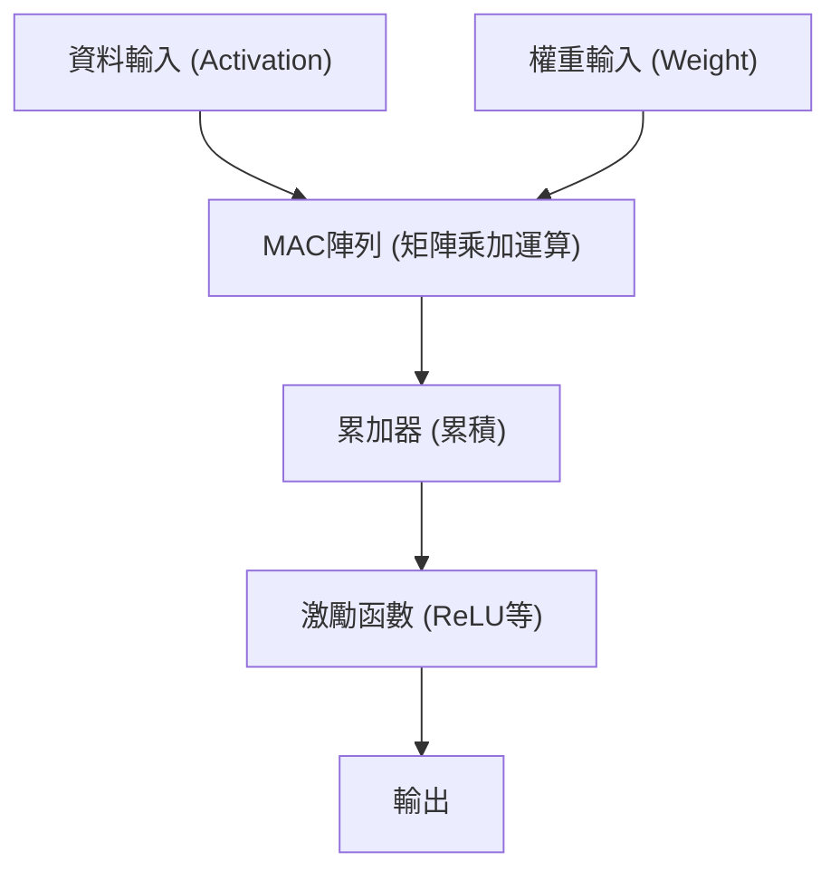

# Edge AI與NPU（Neural Processing Unit）架構

近年來，隨著人工智慧（AI）技術的快速發展，我們的生活各個層面都開始應用AI。引領早期AI熱潮的，是位於雲端的巨大資料中心所擁有的壓倒性運算資源。然而，現在這個典範正面臨著重大的轉捩點，那就是「Edge AI（邊緣AI）」以及支撐它的專用硬體「NPU（Neural Processing Unit）」的崛起。

本文介紹雲端與裝置端推論的優缺點、NPU 設計範例及模型最佳化方法。由於對效能和隱私的影響並非一概而論，文中也說明如何針對特定裝置與用途進行評估。

## 1. 雲端AI的極限與Edge AI的崛起

將AI推論放在雲端進行的傳統方法，存在著幾個結構性的課題。

### 延遲（Latency）的問題
雲端往返時間會受到網路路徑與距離、壅塞程度及伺服器處理時間影響，數十至數百毫秒並非通用的固定值。裝置端推論可以免去等待網路，在回應時限嚴格時可能有幫助；但裝置本地推論與輸入輸出同樣需要時間。請在目標裝置和模型上測量端到端延遲。汽車等安全關鍵系統也需要單次 AI 預測以外的安全防護設計。

### 隱私與安全性
裝置端推論在某些設計中可以不把原始影像或音訊傳出裝置，因而減少傳輸資料，但這不會自動保障隱私或安全：應用程式仍可能傳送推論結果、記錄檔或診斷資訊，裝置本身也需要存取控制、加密及安全更新。請確認各應用程式與服務實際儲存及傳送了哪些資料。

### 通訊成本與頻寬
如果將高解析度的影片串流或龐大的感測器資料全部傳送到雲端，將會顯著壓迫網路頻寬，並使通訊成本暴增。透過在邊緣端預先處理資料，只將必要的資訊傳送到雲端，可以大幅減少網路基礎設施的負載。

依照用途，推論可在雲端、裝置端或兩者之間執行。裝置端處理可能降低網路延遲或流量，但裝置受功耗、散熱和記憶體限制。實際使用哪些運算單元（包括 NPU），取決於模型與執行階段。

## 2. 什麼是NPU（Neural Processing Unit）？

NPU 是用來泛稱加速神經網路運算的專用或整合式硬體。許多產品以推論為主，但是否支援訓練與特定運算子會因產品而異。實際能力也取決於執行階段、驅動程式和模型。

### CPU、GPU、NPU的差異

CPU 通常用於一般控制與循序工作，GPU 用於平行負載，NPU 則用來加速其支援的神經網路運算。各產品能力不同，執行階段也可能將工作分配給多個處理器。NPU 並非總是比 GPU 更快或更有效率；結果取決於模型、運算子、精度、批次大小、執行階段、資料傳輸，以及功耗或溫度限制。請在目標裝置上測量相同的端到端工作負載；峰值 TOPS 本身無法預測應用程式速度。

## 3. NPU 架構與影響效能的因素

NPU 的效能和效率不只取決於內部設計，也會受到模型、軟體、資料移動及功耗和溫度限制影響。本節介紹一些常見的設計考量。

### MAC（Multiply-Accumulate）單元的整合
神經網路常使用乘加（MAC）運算，因此部分 NPU 會採用專用運算單元與資料流設計。架構各有不同：脈動陣列只是其中一種方式，「Tensor Core」則是特定產品使用的名稱。並非所有 NPU 都有相同結構或可比較的單元數量。下圖只是簡化的概念示意。

### 記憶體階層的最佳化（資料移動的最小化）
資料移動會影響加速器的功耗與效能，但不存在適用於所有晶片和工作負載的統一能耗比例。晶片內記憶體、資料重用、模型及執行階段都會造成影響；中間資料也可能需要傳送至 DRAM。請在目標硬體上分析模型，並將資料傳輸納入端到端效能測量。

## 4. 現實世界中的NPU架構實例

目前，已經有各種NPU被開發並搭載於智慧型手機與PC中。

### Apple Neural Engine (ANE)
Apple Core ML 會依模型和裝置使用 CPU、GPU、Neural Engine 等運算單元。執行位置與效能取決於工作負載，可用 Xcode 分析並在目標裝置上測量。某一代晶片的峰值 TOPS 無法說明其他應用程式或模型的速度。[Core ML 效能分析](https://developer.apple.com/documentation/coreml/analyzing-a-core-ml-model-s-performance-in-xcode) · [運算單元](https://developer.apple.com/documentation/coreml/mlcomputeunits)

### Google Tensor（Pixel SoC）
Google Tensor 是 Pixel 裝置的 SoC 產品系列。Google Cloud TPU 與 Edge TPU（Coral 產品系列）是不同產品線，不能僅憑名稱推斷有直接的設計承襲關係。裝置端功能會因世代、模型、作業系統和應用程式而異。 [Google Pixel 11 公告（Tensor G6）](https://blog.google/products-and-platforms/devices/pixel/google-pixel-11-pro-xl/) · [Coral Edge TPU 文件](https://coral.ai/docs/)

### Qualcomm Hexagon NPU
Qualcomm 表示 Hexagon NPU 結合純量、向量、張量加速器與共享記憶體；Qualcomm AI Engine 會讓它與 CPU、GPU 等其他處理器協同工作。支援的運算與實際效能取決於 SoC、軟體堆疊和模型。請在目標組態上實測比較，而非只看產品名稱或峰值 TOPS。[Hexagon](https://www.qualcomm.com/processors/hexagon) · [Qualcomm AI Engine](https://www.qualcomm.com/processors/ai-engine)

## 5. 支撐邊緣AI的軟體與最佳化技術

大型模型可能超出裝置的記憶體或功耗預算。量化、剪枝與蒸餾可作為選項，但需要確認硬體支援、精度影響及實測效能。

### 量化 (Quantization)
量化會改變權重或運算的數值表示方式，例如從 FP32 改為 FP16 或 INT8。這可能減少權重儲存與資料傳輸，但模型整體大小和推論速度不一定按相同比例改善。效果取決於支援的格式、運算子、執行階段及硬體，精度也可能改變。採用 PTQ 或 QAT 後，請用具代表性的輸入檢查精度，並在目標裝置測量端到端效能。[Core ML 模型壓縮](https://developer.apple.com/documentation/coreml/reducing-the-size-of-your-core-ml-app) · [ONNX Runtime 量化](https://onnxruntime.ai/docs/performance/model-optimizations/quantization.html)

### 剪枝 (Pruning)
剪枝會移除或將選定權重設為零，以形成稀疏模型。密集核心仍可能計算零值權重，因此稀疏性本身無法保證檔案較小或推論較快。節省儲存需要適當的稀疏表示；加速則需要相容的稀疏運算子、執行階段和硬體。請一併評估精度與實測效能。

### 知識蒸餾 (Knowledge Distillation)
知識蒸餾利用教師模型的輸出或其他訊號訓練學生模型。這可能有助於受大小或精度限制的小型模型，但無法保證精度高於獨立訓練的小型模型。請在目標任務與資料上比較效果。

## 6. Edge AI的未來與後續展望

部分大型語言模型因運算和記憶體需求而在雲端執行；有些裝置則可執行經量化或蒸餾的小型模型。能否執行、延遲、精度與耗電量取決於模型和裝置，應針對預期工作負載評估。

未來，預期會有以下幾種趨勢：

*   **混合式 AI（Hybrid AI）**：
    可依回應時限、網路連線、資料處理要求、成本及模型能力，選擇在裝置端或雲端執行。不要預設所有工作都應放在同一側，請根據需求與實測結果設計。
*   **應用於不同邊緣裝置**：
    攝影機、車輛、穿戴裝置和感測器可能針對特定工作使用小型模型或加速器。是否適用取決於功耗、成本、連線、模型及更新需求；並非每種 IoT 裝置都需要 NPU。
*   **執行提供者與可攜性**:
    ONNX Runtime 透過 Execution Provider 將支援的運算子或子圖交由硬體執行；未支援的部分可能改由其他處理器執行。請檢查每個模型實際加速的部分，並測量端到端精度與速度。「一次編寫即可在任何 NPU 上最佳執行」並無保證。[ONNX Runtime Execution Providers](https://onnxruntime.ai/docs/execution-providers/)

## 結語

Edge AI 和 NPU 擴大了在裝置端執行推論的選擇。減少網路往返、降低原始資料傳輸或調整能耗可能有益，但延遲、隱私與能源效率不會自動改善。請測量包含用途、模型、裝置和軟體的完整組態，並與雲端推論比較。

對於軟體工程師或AI開發者來說，不僅僅是處理雲端上巨大模型的技能，未來「如何在有限的資源中，活用硬體（NPU）特性來實作並最佳化AI」的知識將變得越來越重要。
