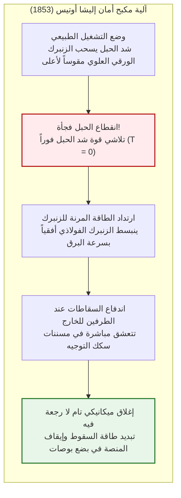
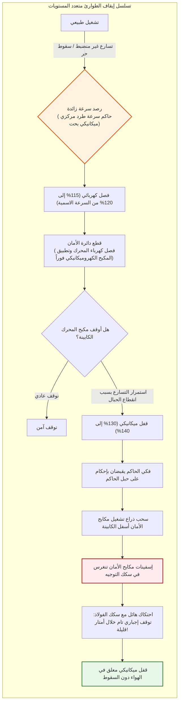
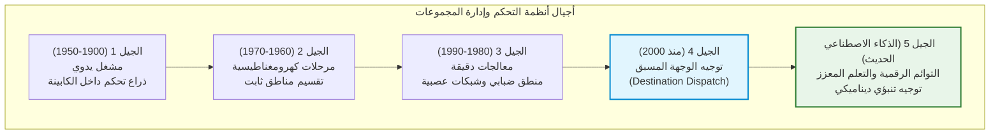
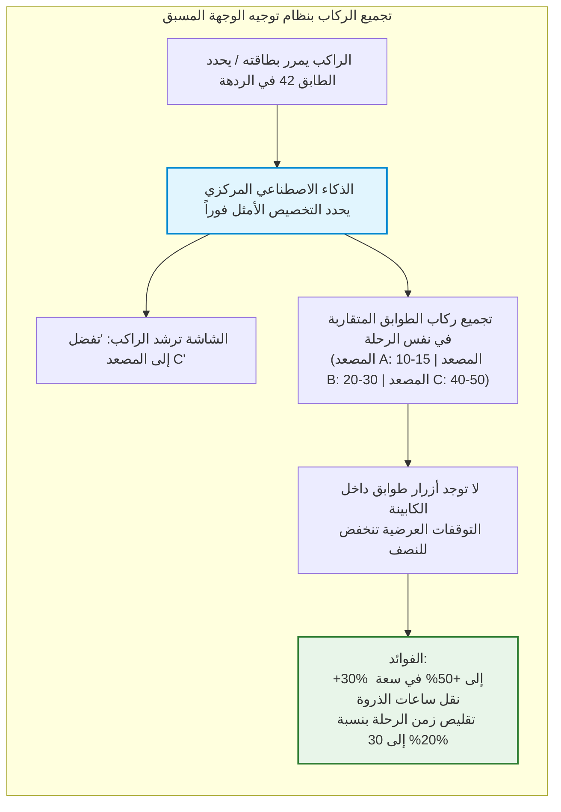
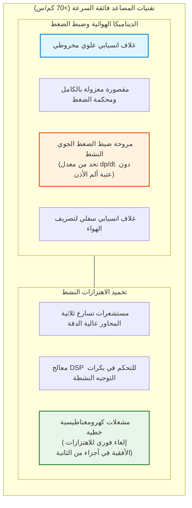
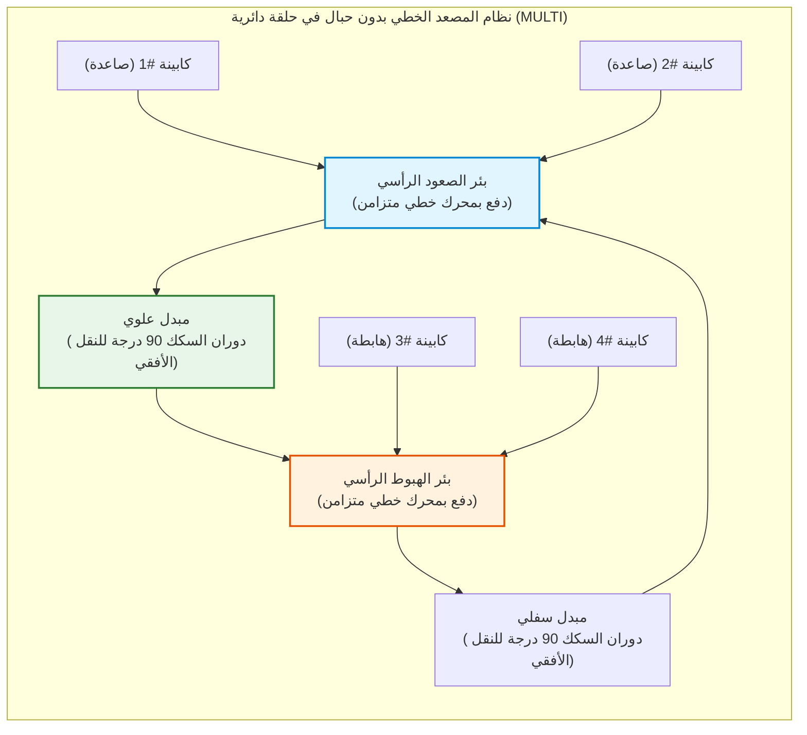

## مقدمة: الآلة التي حررت الحضارة البشرية في البعد الرأسي

في كل صباح، وفي ردهات ناطحات السحاب السكنية والتجارية في شتى أنحاء الكوكب، يضغط مئات الملايين من البشر على زر الاستدعاء ويدخلون بثقة تامة بمجرد انزلاق الأبواب. وخلال بضع عشرات من الثواني داخل كابينة معدنية مغلقة وهم يطالعون شاشات هواتفهم الذكية، يتحدون الجاذبية الأرضية ويصعدون لعشرات أو مئات الأمتار في السماء.

في الحياة اليومية المعاصرة، لا تكاد توجد آلة أخرى نعهد إليها بأرواحنا وسلامتنا الجسدية بهذا القدر من الطمأنينة المطلقة. قلما يخطر ببال أحد كابوس انهيار أرضية الكابينة أو انقطاع كافة الحبال الفولاذية المعلقة معاً. ففي الحضارة الحالية، ترسخ المصعد باعتباره **"وسيلة النقل التي يستحيل أن تسقط"**.

إحصائياً، يُعد المصعد **أكثر وسائل نقل الركاب أماناً في العالم على الإطلاق**. وعلى الرغم من أنه ينقل يومياً أعداداً فلكية تفوق الطيران التجاري وقطارات الفائق السرعة مجتمعين، فإن معدل الوفيات الناجم عن السقوط الحر الميكانيكي يكاد يلامس الصفر تماماً.

لكن قبل 170 عاماً فقط، كانت هذه الآلات عبارة عن منصات رفع خطيرة قد تنقطع حبالها في أي لحظة لتهوي بركابها وتسحقهم. وكان ارتفاع مباني المدن متوقفاً عند خمسة أو ستة طوابق (الحد الأقصى لقدرة الإنسان على صعود الدرج). ولم يكن العائق الأكبر بناء ناطحات السحاب هو نقص الفولاذ الإنشائي، بل **غياب وسيلة آمنة لنقل البشر رأسياً**.

وكان اختراع مكبح الأمان على يد أوتيس هو الشرارة التي حررت المدن من التمدد الأفقي المسطح إلى المدن العمودية ثلاثية الأبعاد، مؤسساً لنهضة ناطحات السحاب في نيويورك وهونغ كونغ وطوكيو ودبي.

```mermaid
flowchart TD
    subgraph ElevatorStructure["الهيكل الميكانيكي الأساسي لمصعد الجر"]
        direction TB
        MachineRoom["غرفة المحركات / أعلى بئر المصعد<br/>محرك متزامن بالمغناطيس الدائم (PMSM) ومكبح كهرومغناطيسي مغلق بالزنبرك"]
        TractionSheave["طارة الجر الرئيسية (Traction Sheave)"]
        Governor["حاكم السرعة الميكانيكي (Speed Governor)"]
        
        MachineRoom --> TractionSheave
        MachineRoom -.-> Governor
        
        TractionSheave -->|حبال الجر الرئيسية (مجموعة حبال فولاذية متوازية)| Car["كابينة المصعد (Car)<br/>هيكل الكابينة، المقصورة، محرك الأبواب ومستشعرات الوزن"]
        TractionSheave -->|الجانب المقابل للحبال| CWT["ثقل الموازنة (Counterweight)<br/>وزن الكابينة فارغة ＋ 45% من الحمولة الاسمية"]
        
        Governor -.->|حبل حاكم السرعة الفولاذي| SafetyGear["مكابح الأمان (Safety Gear)<br/>آلية الإسفين لإحكام الإمساك بسكك التوجيه"]
        SafetyGear -.-> Car
        
        GuideRail["سكك التوجيه الرأسية (قضبان فولاذية على شكل حرف T)"]
        Car --- GuideRail
        CWT --- GuideRail
        
        Buffer["مخمدات قاع البئر (مخمدات زيتية هيدروليكية)"]
        Car -.->|حماية تجاوز المسار السفلي| Buffer
        CWT -.->|حماية تجاوز المسار السفلي| Buffer
    end
    
    style MachineRoom fill:#e1f5fe,stroke:#0288d1,stroke-width:2px
    style SafetyGear fill:#ffebee,stroke:#b71c1c,stroke-width:2px
    style CWT fill:#fff3e0,stroke:#e65100,stroke-width:2px
```

---

## الفصل الأول: النقلة التاريخية – تجربة إليشا أوتيس الاستعراضية الجريئة

يعود رفع الأحمال رأسياً إلى أرخميدس في القرن الثالث قبل الميلاد. وخلال الثورة الصناعية، استُخدمت رافعات البخار في مناجم الفحم. لكنها كانت معلقة بحبال قنب أو سلاسل حديدية، وحين ينقطع الحبل تهوي المنصة بتسارع الجاذبية $g$.

### 1.1 المعرض العالمي بنيويورك عام 1853

الرجل الذي بدد هذا الخوف القاتل هو المخترع الأمريكي **إليشا غريفز أوتيس (Elisha Graves Otis)**.

في عام 1853، داخل قصر الكريستال بنيويورك، شيد أوتيس برجاً مفتوحاً بارتفاع نحو 12 متراً. واعتلى أوتيس بنفسه المنصة الخشبية مرتدياً المعطف الرسمي وقبعة السيلند.

رُفعت المنصة أمام آلاف المتفرجين المشدوهين. وفي القمة، أشار أوتيس لمساعده وأصدر أمره الصارم:

**"اقطع الحبل!"**

هوى المساعد بفأسه فقطع الحبل الوحيد السميك. انطلقت صرخات الرعب من الحشد. لكن المنصة لم تسقط سوى بضع بوصات، ثم **توقفت في الهواء فجأة بفرقعة معدنية مدوية**.

رفع أوتيس قبعته وخاطب الجمهور بهدوء:
> **"All safe, gentlemen, all safe!" (الجميع في أمان تام يا سادة!)**



### 1.2 الزنبرك والسقاطة: ولادة مبدأ الأمان الإيجابي (Fail-Safe)

ثُبت زنبرك ورقي من الفولاذ المقسى أعلى منصة الكابينة:
1. **أثناء الشد**: حبل الرفع يشد الزنبرك مقوساً لأعلى فتبقى السقاطات منكمشة بعيداً عن السكك.
2. **عند الانقطاع**: تلاشي الشد ($T = 0$) يحرر الزنبرك فوراً ليبسط ذراعيه أفقياً.
3. **التعشيق**: تبرز السقاطات الفولاذية في الطرفين لتنغرس في مسننات القضبان الجانبية.

كان غياب قوة الرفع بحد ذاته هو المشغل الفيزيائي المباشر للمكبح، مؤسساً لأهم قاعدة هندسية: **الأمان عند الإخفاق (Fail-Safe)**.

---

## الفصل الثاني: ميكانيكا مصاعد الجر وتوازن القوى

في مصاعد الجر الحديثة، **لا يقوم المحرك برفع كامل وزن الكابينة**.

### 2.1 سحر ثقل الموازنة (Counterweight)

كما في بئر الماء ذي الدلوين المتوازنين، تتصل الكابينة عبر طارة الجر بـ**ثقل موازنة (Counterweight)**.

يُضبط وزن ثقل الموازنة $M_{\text{cwt}}$ ليعادل **وزن الكابينة فارغة $M_{\text{car}}$ مضافاً إليه 40% إلى 50% من الحمولة القصوى $Q$** (معامل الموازنة الفائضة $\alpha$):

$$M_{\text{cwt}} = M_{\text{car}} + \alpha \cdot Q \quad (\alpha \approx 0{,}40 \sim 0{,}50)$$

```
[حالات توازن الأحمال في نظام الجر]
1. كابينة فارغة (حمولة 0%):
   [الكابينة: Mcar] < [ثقل الموازنة: Mcar + 0,45Q]  ==> ثقل الموازنة أثقل (المحرك يولد كهرباء عند الصعود)
2. حمولة التوازن التصميمي (حمولة 45%):
   [الكابينة: Mcar + 0,45Q] == [ثقل الموازنة: Mcar + 0,45Q]  ==> توازن مثالي (عزم الرفع الصافي للمحرك يقارب الصفر!)
3. كابينة ممتلئة بالكامل (حمولة 100%):
   [الكابينة: Mcar + Q] > [ثقل الموازنة: Mcar + 0,45Q]  ==> الكابينة أثقل (المحرك يولد كهرباء عند الهبوط)
```

بذلك لا يستهلك المحرك طاقة إلا للتغلب على الفارق في عدد الركاب والقصور الذاتي أثناء التسارع والاحتكاك الميكانيكي الضئيل.

### 2.2 معادلة احتكاك الأحزمة لأويلر

تستند الحبال في مجارٍ محفورة بدقة على طارة الجر. ويخضع الاحتكاك لمعادلة أويلر:

$$\frac{T_1}{T_2} \le e^{\mu' \theta}$$

حيث $\mu'$ هو **معامل الاحتكاك الظاهري الموزون** بهندسة المجرى (شبه دائري مفرغ من الأسفل Undercut أو شكل V):

$$\mu' = \mu \cdot \frac{4 \left(\cos\frac{\gamma}{2} - \sin\frac{\beta}{2}\right)}{\pi - \beta - \sin\beta + \sin\gamma}$$

يرفع تأثير الإسفين معامل الاحتكاك من $0{,}10$ إلى $0{,}40 \sim 0{,}60$، مانعاً الانزلاق منعاً باتاً.

### 2.3 تعدد الحبال وعامل أمان يتجاوز 10 أضعاف

تُعلق الكابينة بـ **3 إلى 10 حبال فولاذية متوازية أو أكثر**، مع عامل أمان لا يقل عن **10 إلى 12**. حتى لو انقطعت 9 حبال في لحظة واحدة، فإن حبلاً واحداً كفيل بتعليق الكابينة الممتلئة بالكامل بأمان.

---

## الفصل الثالث: الحصن المنيع لأنظمة التوقف في الطوارئ



1. **المكبح الكهرومغناطيسي المغلق بالزنبرك**: زنبركات هائلة تضغط لقم المكبح على الطنبور باستمرار؛ والكهرباء هي ما يفتحه. وعند انقطاع التيار يغلق فوراً.
2. **حاكم السرعة المركزي (Governor)**: جهاز ميكانيكي مستقل يفصل الكهرباء عند 115% ويقفل حبله ميكانيكياً عند 130–140%.
3. **مكابح الأمان التدريجية (Safety Gear)**: إسفينات من سبائك الفولاذ تعصر قضبان التوجيه بمرونة زنبركية مدروسة لتحصر التباطؤ بين **$0{,}2g$ و $1{,}0g$** دون إيذاء الركاب:

$$M \cdot a_{\text{stop}} = F_{\text{friction}} - M g \implies a_{\text{stop}} = \frac{F_{\text{friction}}}{M} - g$$

4. **مخمدات قاع البئر الهيدروليكية**: مكابس زيتية تمتص طاقة الحركة المتبقية:

$$E_k = \frac{1}{2} M v^2 = \int_0^S F_{\text{hydraulic}}(x) \, dx$$

---

## الفصل الرابع: تطور منظومات التحكم والذكاء الاصطناعي



يقوم نظام **التوجيه المسبق للوجهة (Destination Dispatch)** بفرز الركاب حسب وجهاتهم من البوابات الإلكترونية، ليجمع أصحاب الطوابق المتقاربة في نفس الكابينة، مما يرفع الطاقة الاستيعابية بنسبة تصل إلى 50%.



---

## الفصل الخامس: تخطي سرعة 70 كم/ساعة في ناطحات السحاب العملاقة

| المبنى (المدينة) | سنة التدشين | السرعة الاسمية | كم/س | مسافة الرفع |
| :--- | :--- | :--- | :--- | :--- |
| **سانشاين 60 (طوكيو)** | 1978 | 600 م/د | 36,0 كم/س | ~240 م |
| **برج يوكوهاما لاند مارك** | 1993 | 750 م/د | 45,0 كم/س | ~290 م |
| **تايبيه 101 (تايبيه)** | 2004 | 1,010 م/د | 60,6 كم/س | ~382 م |
| **برج شنغهاي (شنغهاي)** | 2016 | 1,230 م/د | 73,8 كم/س | ~578 م |
| **مركز غوانغتشو المالي (CTF)** | 2019 | 1,260 م/د | **75,6 كم/س** | ~500 م |

تتم السيطرة على تأثير الكبس الهوائي عبر أغلفة انسيابية هوائية تحد من قوة الإعاقة $F_{\text{aero}} \propto v^2$.



تحافظ مضخات الكابينة على تغير ضغط الهواء بمعدل يقل عن **1,5 هكتوباسكال/ثانية** لمنع آلام الأذن، وبكرات التوجيه الكهرومغناطيسية النشطة تعوض تموجات السكك لدرجة بقاء عملة معدنية واقفة على حافتها طوال الرحلة.

---

## الفصل السادس: المستقبل – مصاعد MULTI الخطية والمصعد الفضائي

يستبدل نظام **MULTI** الحبال بمحركات خطية مغناطيسية، مما يتيح تدوير كبائن متعددة في حلقة مغلقة في نفس البئر.



---

## خاتمة: سمو الهندسة الميكانيكية الرافعة للحضارة

المصعد الحديث نتاج ألفي عام من النضج الهندسي. ودونه ما كان للمدن الرأسية أن ترى النور. وفي صمته واعتصامه التام بالأمان، تتجلى أعظم فضائل الهندسة الميكانيكية التي تخدم الإنسانية كل يوم.
