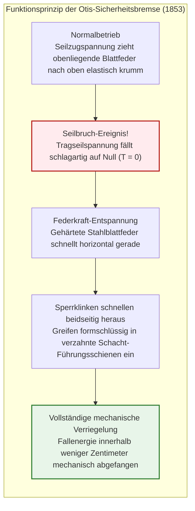
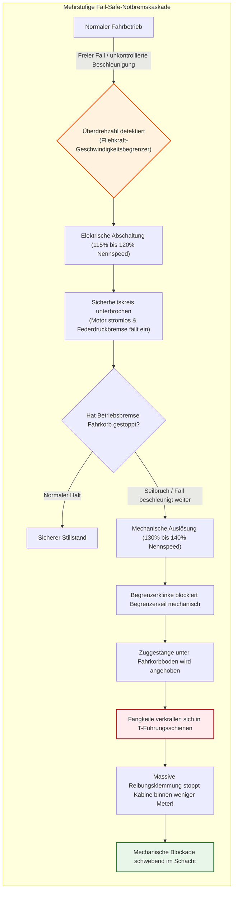
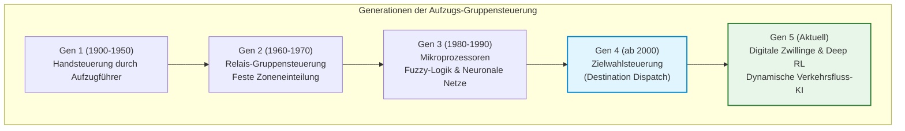
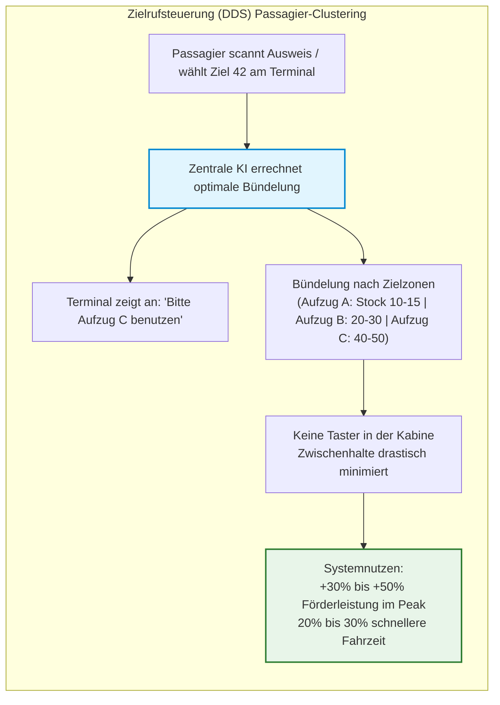
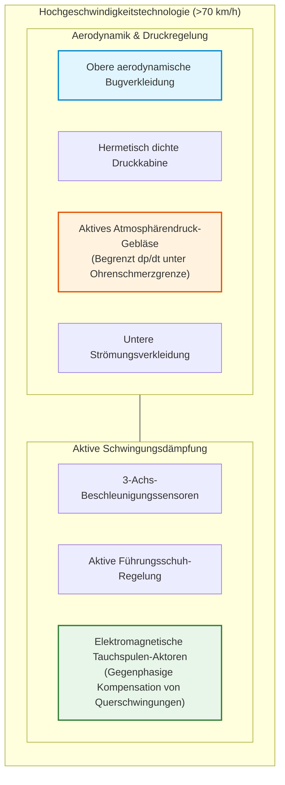
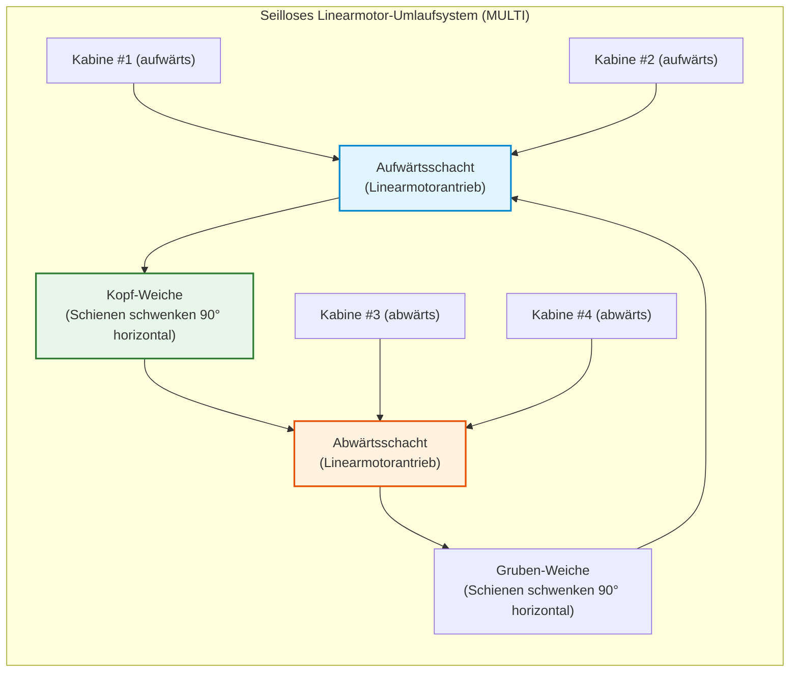

## Einleitung: Die Maschine, die den Menschen in die Vertikale befreite

Jeden Morgen drücken hunderte Millionen Menschen in den Foyers moderner Bürokomplexe und Wohntürme auf der ganzen Welt auf einen Ruftaster. Wenn die Schachttüren lautlos aufgleiten, steigen sie ohne das geringste Zögern ein. Während sie für einige Dutzend Sekunden in der geschlossenen Metallkabine auf ihr Smartphone blicken, trotzen sie der Erdanziehung und werden dutzende oder hunderte Meter in den Himmel befördert.

Im modernen Alltag gibt es kaum eine andere Maschine, der Menschen ihre physische Unversehrtheit mit einem derart bedingungslosen Urvertrauen anvertrauen. Kaum jemand verschwendet einen Gedanken an das Schreckensszenario, dass der Kabinenboden wegbricht oder alle tragenden Stahlseile gleichzeitig reißen könnten. In der heutigen Zivilisation gilt der Aufzug als **„das Verkehrsmittel, das niemals abstürzt“**.

Statistisch betrachtet ist der Aufzug **das sicherste Passagiertransportmittel der Welt**. Obwohl er täglich astronomische Passagierzahlen befördert – weit mehr als die Zivilluftfahrt und der Hochgeschwindigkeits-Schienenverkehr zusammen –, liegt die Todesrate durch mechanischen freien Fall praktisch bei Null (statistisch seltener als ein mehrfacher Hauptgewinn im Lotto).

Dreht man das Rad der Geschichte jedoch um nur 170 Jahre zurück, galt diese Maschine als lebensgefährliches Hebezeug, dessen Seile jederzeit reißen und die Insassen zerschmettern konnten. Die historische Bauhöhe städtischer Gebäude verharrte damals bei maximal fünf bis sechs Stockwerken – der physischen Grenze des Treppensteigens zu Fuß. Das Haupthindernis für Wolkenkratzer war nicht der Mangel an Baustahl, sondern **das Fehlen jeglicher Technologie für den sicheren vertikalen Personentransport**.

Erst die Erfindung der Absturzsicherung befreite die menschlichen Städte aus ihrer zweidimensionalen Flächenausdehnung und ermöglichte die vertikale Metropole – die Skylines von New York, Hongkong, Tokio und Dubai.

In dieser Abhandlung untersuchen wir lückenlos die mechanischen, dynamischen und regelungstechnischen Grundlagen des Aufzugbaus: wie Gegengewichte die Schwerkraft austricksen, wie Eulers Seilreibungsgleichung Treibscheiben beherrscht, wie rein mechanische Fliehkraftbegrenzer abstürzende Kabinen ohne Strom abfangen und wie aerodynamische Druckkapseln bei über 70 km/h das Barotrauma der Passagiere verhindern.

```mermaid
flowchart TD
    subgraph ElevatorStructure["Grundlegende mechanische Architektur eines Treibscheibenaufzugs"]
        direction TB
        MachineRoom["Maschinenraum / Schachtkopf<br/>Permanentmagnet-Synchronmotor (PMSM) & elektromagnetische Federdruckbremse"]
        TractionSheave["Treibscheibe (Antriebsscheibe)"]
        Governor["Mechanischer Geschwindigkeitsbegrenzer (Governor)"]
        
        MachineRoom --> TractionSheave
        MachineRoom -.-> Governor
        
        TractionSheave -->|Tragseile (Mehrere hochfeste Stahldrahtseile)| Car["Fahrkorb (Kabine)<br/>Fahrkorbrahmen, Kabinenkörper, Türantrieb & Lastwiegeeinrichtung"]
        TractionSheave -->|Gegenseite der Tragseile| CWT["Gegengewicht (Counterweight)<br/>Eigengewicht Kabine ＋ 45% Nennlast"]
        
        Governor -.->|Begrenzerseil| SafetyGear["Fangvorrichtung (Safety Gear)<br/>Keil-Klemmsystem an den Führungsschienen"]
        SafetyGear -.-> Car
        
        GuideRail["Vertikale Führungsschienen (T-Profil-Präzisionsstahl)"]
        Car --- GuideRail
        CWT --- GuideRail
        
        Buffer["Schachtgrubenpuffer (Hydraulische Ölpuffer)"]
        Car -.->|Endüberlaufschutz unten| Buffer
        CWT -.->|Endüberlaufschutz unten| Buffer
    end
    
    style MachineRoom fill:#e1f5fe,stroke:#0288d1,stroke-width:2px
    style SafetyGear fill:#ffebee,stroke:#b71c1c,stroke-width:2px
    style CWT fill:#fff3e0,stroke:#e65100,stroke-width:2px
```

---

## Kapitel 1: Der historische Wendepunkt – Elisha Otis’ todesmutiges Experiment

Die Idee, Lasten vertikal zu heben, reicht bis in die Antike zurück: Archimedes konstruierte bereits im 3. Jahrhundert v. Chr. Flaschenzüge und Seilwinden. Im Mittelalter nutzten Bergwerke und Festungen wasser- oder dampfbetriebene Hebebühnen.

All diese frühen Konstruktionen waren jedoch hochriskante Güteraufzüge, die an einfachen Hanfseilen oder groben Ketten hingen. Riss ein Seil, stürzte die Plattform mit Erdbeschleunigung $g$ in die Tiefe. Bergleute sprachen Stoßgebete, bevor sie einen Förderschacht betraten.

### 1.1 Die New Yorker Weltausstellung 1853: Das legendäre Kappungsexperiment

Der Mann, der dieser Todesangst ein Ende setzte und das Zeitalter der Wolkenkratzer einläutete, war der amerikanische Erfinder **Elisha Graves Otis**.

Auf der Industrieausstellung im New Yorker Crystal Palace ließ Otis 1853 ein offenes Schachtgerüst von fast 12 Metern Höhe errichten. Vor Tausenden Schaulustigen bestieg Otis selbst im Zylinder und Gehrock die hölzerne Hebebühne.

Die Plattform wurde von einer Dampfmaschine bis unter das Hallendach gezogen. Am höchsten Punkt angekommen, gab Otis seinem Assistenten ein Zeichen und rief mit lauter Stimme:

**„Kappen Sie das Seil!“**

Der Assistent schwang eine Breitaxt und durchtrennte das einzige tragende Hauptseil mit einem einzigen Hieb. Ein Schrei gellte durch die Menge. Nach den Gesetzen der Schwerkraft hätte die Plattform augenblicklich zerschellen müssen.

Doch die Plattform sackte nur wenige Zentimeter ab und verharrte **mit einem scharfen metallischen Krachen regungslos in der Luft**.

Otis lüftete gelassen seinen Zylinder und rief der erstarrten Menge zu:
> **„All safe, gentlemen, all safe!“ (Alles sicher, meine Herren, alles sicher!)**

In diesem Moment war das fatale Stigma „Aufzug = tödlicher Absturz“ gebrochen.



### 1.2 Blattfeder und Klinke: Die Wiege des Fail-Safe-Prinzips

Das Geniale an Otis' Sicherheitsbremse war ihre radikale Schlichtheit und kompromisslose Ausrichtung auf das **Fail-Safe-Prinzip** (Ausfallsicherheit).

Am oberen Träger des Fahrkorbrahmens war eine gewölbte **Stahl-Blattfeder** montiert:
1. **Normalzustand**: Solange das Seil die Kabine zog, hielt die Seilspannung die Blattfeder gespannt nach oben gekrümmt. Die Sperrklinken an den Federenden blieben eingezogen.
2. **Seilriss**: Sobald das Seil riss und die Zugkraft erlosch ($T = 0$), entlud sich die gespeicherte Federenergie schlagartig. Die Feder schnellte horizontal flach.
3. **Formschlüssige Blockade**: Die Sperrklinken wurden nach außen getrieben und krallten sich unumkehrbar in die Zahnstangen der Führungsschienen.

Das System benötigte weder Strom noch Sensoren. **Der physische Verlust der Aufhängung war selbst die Triebkraft, die die Notbremse aktivierte.**

---

## Kapitel 2: Mechanik der Balance – Der Treibscheibenaufzug

Praktisch alle modernen Hochhausaufzüge arbeiten nach dem **Treibscheibenprinzip (Traction Elevator)**.

Dabei gilt es, ein weit verbreitetes Missverständnis aufzuklären: **Der Elektromotor hebt keineswegs das Gesamtgewicht der Kabine.**

### 2.1 Die Kunst des Gegengewichts (Counterweight)

Stellen Sie sich einen klassischen Ziehbrunnen vor. Wenn an beiden Enden eines Seils zwei gleich schwere Eimer hängen, halten sie sich im Gleichgewicht; ein minimaler Fingertipp genügt, um sie zu bewegen.

Beim Treibscheibenaufzug läuft das Tragseil über eine motorgetriebene Scheibe (Treibscheibe) und ist auf der Gegenseite mit einem schweren **Gegengewicht (Counterweight)** verbunden.

Das Gegengewicht $M_{\text{cwt}}$ ist jedoch nicht exakt gleich dem Leergewicht der Kabine $M_{\text{car}}$. Da die Kabine Passagiere transportiert, wird das Gegengewicht auf **das Kabinengewicht plus 40 % bis 50 % der Nennlast $Q$** ausgelegt. Dieser Faktor heißt **Überbalancegrad ($\alpha$)**:

$$M_{\text{cwt}} = M_{\text{car}} + \alpha \cdot Q \quad (\alpha \approx 0{,}40 \sim 0{,}50)$$

```
[Lastregime eines Treibscheibenaufzugs]
1. Leere Kabine (0 % Last):
   [Kabine: Mcar] < [Gegengewicht: Mcar + 0,45Q]  ==> Gegengewicht ist schwerer (Motor rekuperiert bei Aufwärtsfahrt)
2. Auslegungs-Gleichgewicht (45 % Last):
   [Kabine: Mcar + 0,45Q] == [Gegengewicht: Mcar + 0,45Q]  ==> Perfektes Gleichgewicht (Netto-Hublast nahezu null!)
3. Voll besetzte Kabine (100 % Last):
   [Kabine: Mcar + Q] > [Gegengewicht: Mcar + 0,45Q]  ==> Kabine ist schwerer (Motor rekuperiert bei Abwärtsfahrt)
```

Da ein Büroaufzug im Tagesdurchschnitt mit etwa 30 % bis 50 % Last betrieben wird, befindet sich das System meist in nahezu vollkommener Schwerkraftbalance. Der Antriebsmotor muss lediglich **die Lastdifferenz, die Trägheitskräfte beim Beschleunigen sowie minimale Reibungskräfte** überwinden.

### 2.2 Eulersche Seilreibungsformel und Treibscheibennuten

Die Stahlseile sind nicht mit Schrauben an der Treibscheibe fixiert; sie liegen lediglich kraftschlüssig in Rillen auf dem Scheibenkranz.

Dass Stahlseile unter tonnenschwerer Last nicht durchrutschen, liegt an der **Eulerschen Seilreibungsformel** (Capstan-Gleichung). Für ein Seil mit dem Umschlingungswinkel $\theta$ (im Bogenmaß) gilt für das Grenzverhältnis der Seilkräfte $T_1$ und $T_2$:

$$\frac{T_1}{T_2} \le e^{\mu' \theta}$$

Hierbei ist $e$ die Eulersche Zahl ($\approx 2{,}718$), $\theta$ der Umschlingungswinkel und $\mu'$ der **äquivalente (scheinbare) Reibungskoeffizient**, der durch die Rillengeometrie maßgeblich beeinflusst wird.

Auf ebener Fläche beträgt die Reibung $\mu$ zwischen gefettetem Stahlseil und Gusseisen nur etwa $0{,}09 \sim 0{,}15$. Um die Kraftübertragung zu vervielfachen, werden spezielle Rillenprofile in die Treibscheibe geschnitten:

```
[Geometrien der Treibscheibenrillen]
1. Halbrundrille:
   Seil liegt im Rillenboden. Geringe Reibung, aber seilschonend.
2. Unterschnittene Halbrundrille (Undercut):
   Der Rillenboden ist freigedreht; das Seil wird an zwei Flanken keilförmig eingeklemmt.
3. Keilrille (V-Groove):
   Spitze V-Form (Keilwinkel gamma = 35° bis 40°). Maximaler Keileffekt.
```

Bei einer unterschnittenen Rille berechnet sich der wirksame Reibungskoeffizient $\mu'$ wie folgt:

$$\mu' = \mu \cdot \frac{4 \left(\cos\frac{\gamma}{2} - \sin\frac{\beta}{2}\right)}{\pi - \beta - \sin\beta + \sin\gamma}$$

Durch den Keileffekt steigt der scheinbare Reibungskoeffizient $\mu'$ auf **das Drei- bis Fünffache ($\mu' \approx 0{,}40 \sim 0{,}60$)**. Damit steigt $e^{\mu' \theta}$ auf Werte von 5 bis über 10, wodurch ein Durchrutschen der Seile selbst bei extremen Verzögerungen ausgeschlossen ist.

### 2.3 Mehrfache Redundanz und Sicherheitsfaktoren

In Hollywoodfilmen reißen Aufzugseile nacheinander mit dramatischem Echo. Im realen Maschinenbau ist dies **physikalisch und regulatorisch ausgeschlossen**.

Moderne Aufzüge werden von **mindestens 3 bis 8, in Wolkenkratzern oft mehr als 10 parallelen Spezialdrahtseilen** getragen. Internationale Normen (wie EN 81 und ASME A17.1) schreiben einen **Sicherheitsfaktor von mindestens 10 bis 12** vor.

Ein Sicherheitsbeiwert von 10 bedeutet: Selbst wenn 9 von 10 Seilen gleichzeitig versagten, könnte **ein einziges verbleibendes Seil die vollbesetzte Kabine noch sicher halten**.

---

## Kapitel 3: Das mehrstufige Festungswerk der Sicherheitssysteme

Selbst wenn in einem extremen Katastrophenszenario sämtliche Tragseile durchtrennt würden: **Die Kabine kann niemals ungebremst abstürzen.**



### 3.1 Die elektromagnetische Federdruckbremse

Die Betriebsbremse des Aufzugs funktioniert nach dem Prinzip „stromlos geschlossen“. **Massive Druckfedern pressen die Bremsbacken permanent mit enormer Kraft gegen die Bremsscheibe.** Nur wenn Strom durch die Elektromagnete fließt, wird die Federkraft überwunden und die Bremse gelüftet. Fällt der Strom aus, fällt die Bremse sofort mechanisch ein.

### 3.2 Der mechanische Geschwindigkeitsbegrenzer (Governor)

Unabhängig von jeglicher Elektrik überwacht ein rein mechanischer **Fliehkraftbegrenzer** die Fahrgeschwindigkeit. Bei Überschreiten von 115 % schaltet er die Steuerung stromlos; bei 130–140 % blockiert er das mitlaufende Begrenzerseil formschlüssig.

### 3.3 Die progressive Fangvorrichtung (Safety Gear)

Das gestoppte Begrenzerseil zieht das Betätigungsgestänge der **Fangvorrichtung** unter der Kabine nach oben. Gehärtete Keile klemmen sich an den massiven Stahl-Führungsschienen fest.

Die Verzögerung wird durch Tellerfederpakete auf physiologisch unbedenkliche Werte von **$0{,}2g$ bis $1{,}0g$** begrenzt:

$$M \cdot a_{\text{stop}} = F_{\text{friction}} - M g \implies a_{\text{stop}} = \frac{F_{\text{friction}}}{M} - g$$

Die Passagiere spüren ein kräftiges Bremsen wie bei einer Vollbremsung im Auto, und die Kabine kommt nach wenigen Metern im Schacht sicher zum Stillstand.

### 3.4 Schachtgrubenpuffer (Buffer)

Als letzte strukturelle Schutzbarriere stehen am Schachtboden schwere **Hydraulikölpuffer**. Sie dämpfen einen Aufprall durch gesteuerte Flüssigkeitsdrosselung elastisch ab:

$$E_k = \frac{1}{2} M v^2 = \int_0^S F_{\text{hydraulic}}(x) \, dx$$

---

## Kapitel 4: Evolution des Gehirns – Von Relais zu KI-Gruppensteuerungen



### 4.1 Mathematische Optimierung moderner Gruppensteuerungen

In einer Gruppe von 8 Aufzügen minimiert ein zentraler Optimierungsalgorithmus in Echtzeit eine multikriterielle Bewertungsfunktion:

$$J(k) = \min_{k} \left[ w_1 \cdot T_{\text{wait}}(k) + w_2 \cdot T_{\text{ride}}(k) + w_3 \cdot P_{\text{long}}(k) + w_4 \cdot E_{\text{energy}}(k) \right]$$

### 4.2 Die Revolution der Zielwahlsteuerung (Destination Dispatch)

Bei der **Zielrufsteuerung** wählt der Fahrgast sein Zielstockwerk bereits am Terminal im Foyer aus, bevor er die Kabine betritt.



Passagiere mit ähnlichen Zielen werden in derselben Kabine gebündelt. Die Zwischenhalte halbieren sich, und die Förderkapazität steigt um 30 % bis 50 %.

---

## Kapitel 5: Physik jenseits von 70 km/h in Megatürmen

| Gebäude (Stadt) | Jahr | Nennspeed | km/h | Förderhöhe |
| :--- | :--- | :--- | :--- | :--- |
| **Sunshine 60 (Tokio)** | 1978 | 600 m/min | 36,0 km/h | ~240 m |
| **Yokohama Landmark Tower** | 1993 | 750 m/min | 45,0 km/h | ~290 m |
| **Taipei 101 (Taipeh)** | 2004 | 1.010 m/min | 60,6 km/h | ~382 m |
| **Shanghai Tower (Shanghai)** | 2016 | 1.230 m/min | 73,8 km/h | ~578 m |
| **Guangzhou CTF Finance Centre** | 2019 | 1.260 m/min | **75,6 km/h** | ~500 m |

### 5.1 Kolbeneffekt und aerodynamische Verkleidung

Bei 75 km/h erzeugt die Kabine im Schacht einen extremen Überdruck vor sich und ein Vakuum hinter sich. Aerodynamische Bug- und Heckverkleidungen reduzieren den Luftwiderstand $F_{\text{aero}} \propto v^2$ drastisch.



### 5.2 Aktive Luftdruckregelung und aktive Rollenführung

Ein Druckausgleichsgebläse regelt den Kabineninnendruck stufenlos mit maximal **1,5 hPa/s**, um Schmerzen am Trommelfell zu verhindern. Aktive elektromagnetische Führungsrollen kompensieren Schienenunebenheiten in Millisekunden, sodass eine aufrecht stehende Münze während der gesamten Fahrt nicht umfällt.

---

## Kapitel 6: Die Zukunft – MULTI und Weltraumlift

### 6.1 Maschinenraumlose Aufzüge (MRL)

Permanentmagnetmotoren ermöglichen kompakte Antriebe, die vollständig im Schachtkopf integriert werden können.

### 6.2 Seillose Linearmotor-Systeme (MULTI)

Das seillose System MULTI nutzt Linearmotoren und ermöglicht den Umlauf mehrerer Kabinen in einem Schachtkreislauf.



### 6.3 Der Weltraumlift (Space Elevator)

Ein Seil aus Kohlenstoffnanoröhren bis in den geostationären Orbit (36.000 km) bildet die logische Vollendung der vertikalen Transporttechnik.

---

## Fazit: Die ingenieurtechnische Würde des vertikalen Transports

Der Aufzug vereint 2000 Jahre Ingenieurskunst: von antiken Flaschenzügen über Elisha Otis' Fangbremse und Eulers Reibungslehre bis zu KI-Steuerungen und Raumfahrt-Aerodynamik.

Ohne Aufzüge gäbe es keine modernen Metropolen. Sie ermöglichen das vertikale Verdichten menschlichen Lebens und Wirtschaftens. In der unerschütterlichen Verlässlichkeit der Millionen täglichen Fahrten liegt der stolzeste Triumph des modernen Maschinenbaus.
