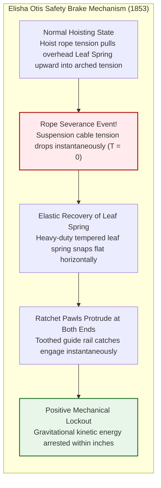
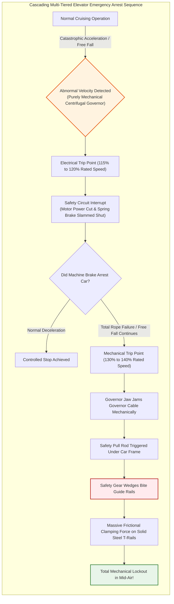
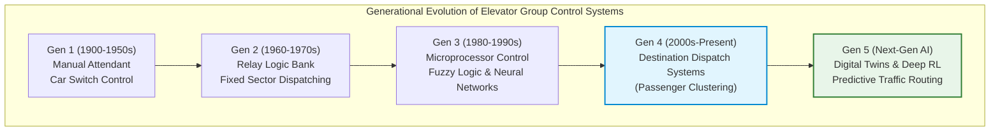
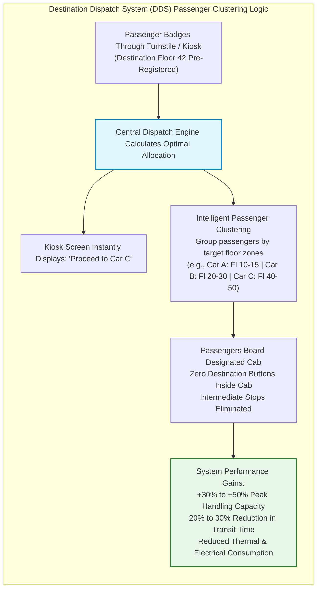
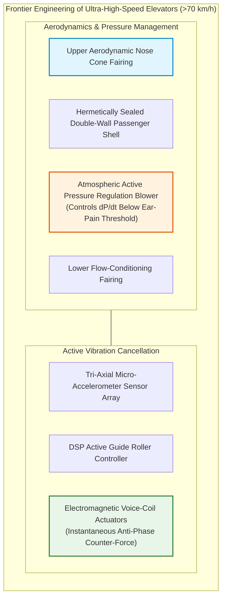
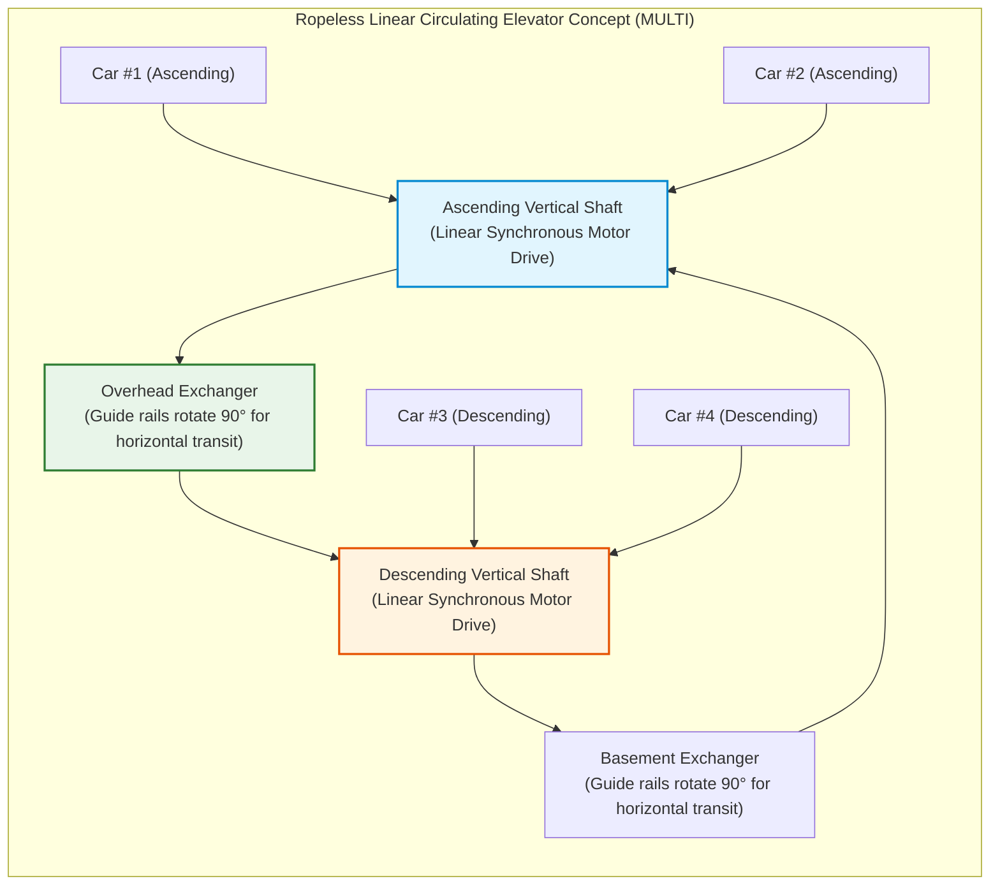

## Introduction: The Machine that Liberated Humanity Vertically

Every morning in office towers and high-rise residences around the globe, billions of people press a call button, step inside when the doors slide open, and surrender themselves without a second thought. For several dozen seconds, while casually glancing at their smartphones inside an enclosed metal cab, they defy gravity, transported hundreds of meters into the sky.

In everyday modern life, there is virtually no other machine to which humans entrust their physical existence with such unconditional faith. Almost nobody contemplates the nightmare of the floor dropping out from beneath their feet or every supporting cable snapping in unison. This unshakeable peace of mind exists because modern civilization views the elevator as an **"unfailable vessel that never drops."**

Statistically, elevators stand as the **safest mode of passenger transportation in the world**. Transporting an astronomical volume of passengers daily—dwarfing commercial aviation and high-speed rail combined—the fatality rate from free-fall mechanical failures is virtually zero (statistically rarer than winning the national lottery consecutive times).

Yet, rewinding history by merely 170 years reveals a dramatically different reality. Hoisting platforms were terrifying contraptions where ropes could snap at any second, dashing occupants to pieces. Riding one was considered suicidal folly. The historical ceiling of urban architecture was capped at five or six stories—the physical limit of human stair climbing—not because builders lacked structural steel, but because **humanity possessed no safe method for vertical human transit**.

The invention of the elevator safety brake was the true catalyst that liberated human civilization from two-dimensional sprawl into three-dimensional vertical metropolises, giving birth to the iconic skylines of New York, Hong Kong, Tokyo, and Dubai.

This treatise explores the foundational mechanics and modern masterworks of elevator engineering: how counterweights balance gravity, how Euler's friction equations govern traction sheaves, how purely mechanical governors arrest falling cars without external power, how AI algorithms orchestrate traffic, and how aerodynamic cabins conquer atmospheric pressure at over 70 km/h.

```mermaid
flowchart TD
    subgraph ElevatorStructure["Basic Mechanical Architecture of a Traction Elevator"]
        direction TB
        MachineRoom["Machine Room / Hoistway Overhead<br/>Permanent Magnet Synchronous Motor (PMSM) & Disc Brake"]
        TractionSheave["Traction Sheave (Drive Sheave)"]
        Governor["Mechanical Over-Speed Governor"]
        
        MachineRoom --> TractionSheave
        MachineRoom -.-> Governor
        
        TractionSheave -->|Hoist Ropes (Multiple Steel Wire Ropes)| Car["Car Frame & Enclosed Passenger Cab<br/>Door Operator & Load Weighing"]
        TractionSheave -->|Hoist Ropes (Counterbalance Side)| CWT["Counterweight Frame<br/>Self-Weight + 45% Rated Capacity"]
        
        Governor -.->|Governor Steel Wire Cable| SafetyGear["Safety Gear (Under-Car Safety Clamps)<br/>Wedge-Based Rail Braking System"]
        SafetyGear -.-> Car
        
        GuideRail["Vertical Structural Guide Rails (Machined Steel T-Rails)"]
        Car --- GuideRail
        CWT --- GuideRail
        
        Buffer["Pit Buffers (Hydraulic Oil Buffers)"]
        Car -.->|Bottom Terminal Runby| Buffer
        CWT -.->|Bottom Terminal Runby| Buffer
    end
    
    style MachineRoom fill:#e1f5fe,stroke:#0288d1,stroke-width:2px
    style SafetyGear fill:#ffebee,stroke:#b71c1c,stroke-width:2px
    style CWT fill:#fff3e0,stroke:#e65100,stroke-width:2px
```

---

## Chapter 1: The Historical Pivot from Terror to Trust—Elisha Otis's Daring Experiment

The concept of lifting heavy objects vertically traces back millennia to Archimedes' compound pulley and capstan windlasses in ancient Greece (circa 3rd century BCE). Throughout the Middle Ages, mining shafts, castle ramparts, and Industrial Revolution coal pits utilized waterwheels and steam winches to haul platforms.

However, all of these early hoists were perilous freight platforms suspended by hemp ropes or crude iron chains. When a rope frayed and snapped, the platform plunged under gravitational acceleration $g$, instantly killing or maiming anyone aboard. Miners routinely said their prayers before stepping onto a hoist cage.

### 1.1 The 1853 New York World's Fair: The Legendary Severance Demonstration

The man who shattered this perpetual fear and laid the foundation of modern high-rise civilization was an American inventor named **Elisha Graves Otis**.

In 1853, at the Exhibition of the Industry of All Nations hosted inside the Crystal Palace in New York, Otis constructed an open elevator hoistway frame rising nearly 12 meters into the air. Dressed in a frock coat and top hat, Otis stepped onto the elevated wooden hoisting platform himself.

The platform was hoisted toward the rafters by a steam engine before thousands of breathless onlookers. Reaching the peak of the tower, Otis signaled his assistant below and delivered a startling command:

**"Cut the rope!"**

With a swing of a broadaxe, the assistant severed the single heavy hemp rope suspending the platform. A collective gasp echoed through the pavilion. Under Isaac Newton's laws of universal gravitation, the platform should have instantly accelerated downward and smashed against the pavilion floor.

Instead, after falling just a few inches with a sharp metallic crack, **the platform froze solidly in mid-air**.

Unfazed and tipping his hat to the stunned assembly, Otis proclaimed:
> **"All safe, gentlemen, all safe!"**

In that singular demonstration, the fatal equation of "lift = plummeting terror" was broken forever.



### 1.2 Leaf Springs and Ratchets: The Birth of Fail-Safe Engineering

The brilliance of Otis's safety brake lay in its pure mechanical simplicity and uncompromising fail-safe design philosophy.

At the crown of the elevator car frame sat a curved, tempered **leaf spring**:
1. **Normal Operation**: As long as the hoisting cable pulled the car upward, the tension pulled the leaf spring into a flexed, bowed bow shape. In this taut condition, the heavy ratchet pawls attached to both spring tips were retracted inward, completely clear of the vertical wooden frame.
2. **Rope Severance**: The instant the hoisting cable severed, tension vanished ($T = 0$). The stored elastic potential energy inside the leaf spring was released in fractions of a second, causing it to snap straight horizontally.
3. **Instant Mechanical Lockout**: As the spring straightened, the steel pawls were forced outward into serrated iron ratchet racks lining both sides of the hoistway, locking the platform mechanically to the guide rails.

No electrical sensors, no external energy, and no human reaction were required. **The physical phenomenon of losing suspension was itself the mechanical trigger that engaged the brake.** This fail-to-safety principle remains the foundational dogma of vertical transportation engineering today.

---

## Chapter 2: A Symphony of Physics and Mechanics—The Traction Elevator

Almost all modern passenger and high-rise elevators operate on the **traction principle**.

To comprehend traction mechanics, one must confront a truth that runs counter to popular intuition: **the electric motor does not lift the weight of the elevator cab.**

### 2.1 Counterweight Mechanics: The Art of Perfect Equilibrium

Consider a traditional balanced well with two buckets. When two equal masses are suspended across a pulley, they counterbalance each other like a seesaw; a slight push from a child's finger is sufficient to move them up and down.

A traction elevator works identically. The steel wire ropes anchored to the car travel over an overhead traction drive sheave and connect on the opposite side to a **counterweight frame**.

Is the counterweight mass $M_{\text{cwt}}$ set identically to the empty car mass $M_{\text{car}}$? No. Elevators carry fluctuating passenger loads, ranging from empty to maximum capacity. In elevator design, the counterweight is sized to balance **the empty car mass plus 40% to 50% of the rated passenger payload $Q$**. This fraction is defined as the **overbalance factor ($\alpha$)**:

$$M_{\text{cwt}} = M_{\text{car}} + \alpha \cdot Q \quad (\alpha \approx 0.40 \sim 0.50)$$

```
[Load Balance Regimes in a Traction System]
1. Empty Car (0% Load):
   [Car: Mcar] < [CWT: Mcar + 0.45Q]  ==> Counterweight is heavier (Motor regenerates power on ascent)
2. Design Equilibrium Load (45% Load):
   [Car: Mcar + 0.45Q] == [CWT: Mcar + 0.45Q]  ==> Perfect balance (Net motor lifting torque is virtually zero!)
3. Fully Loaded Car (100% Load):
   [Car: Mcar + Q] > [CWT: Mcar + 0.45Q]  ==> Car is heavier (Motor regenerates power on descent)
```

In real-world commercial operations, average car occupancy hovers between 30% and 50%. Consequently, the elevator operates near perfect gravitational equilibrium most of the day.

The electric hoisting machine does not lift the dead weight of several tons. It merely overcomes **the net unbalance between car and counterweight, system inertia during acceleration, and minor mechanical friction**. Without a counterweight, a 2,000 kg car would require an enormous industrial motor; with counterweighting, an energy-efficient drive one-fifth that size achieves superior acceleration.

Furthermore, when the heavier side descends under gravity, modern traction systems employ **regenerative variable-frequency drives (VFDs)**, converting the kinetic descent energy back into clean AC electricity to power building lights and HVAC systems.

### 2.2 Euler's Belt Friction Equation and Traction Sheaves

The steel suspension ropes of an elevator are not bolted or pinned to the drive sheave. They simply rest within grooves on the rim of the spinning traction wheel.

Why do wire ropes bearing dozens of metric tons not slip freely over the steel wheel during aggressive acceleration and emergency braking?

The physics governing this grip is defined by **Euler's Belt Friction Equation** (the Capstan equation). For a rope wrapping around a sheave with an angle of contact $\theta$ (in radians), the maximum ratio between the tension on the tight side ($T_1$) and the slack side ($T_2$) before slip occurs is given by:

$$\frac{T_1}{T_2} \le e^{\mu' \theta}$$

Where:
- $e$ is Euler's constant ($\approx 2.718$),
- $\theta$ is the contact wrap angle ($\theta = \pi \approx 3.14\ \text{rad}$ for single wrap; up to $2\pi$ for double wrap systems),
- $\mu'$ is the **apparent (effective) coefficient of friction**, determined by groove geometry.

On a flat surface, the base friction coefficient $\mu$ between lubricated steel wire rope and cast iron is a modest $0.09 \sim 0.15$. Under this low grip, the maximum allowable tension ratio would barely reach $1.3 \sim 1.6$, leading to disastrous rope slippage whenever passenger loads shifted.

To multiply friction, the rim of the traction sheave is machined with engineered groove profiles:

```
[Evolution of Sheave Groove Profiles]
1. Round Groove:
   The rope sits snugly on a semicircular bottom. Low friction; minimal rope wear.
2. Undercut Groove:
   The bottom of the groove is relieved (undercut), pinching the rope against two lateral contact ridges.
3. V-Groove:
   A sharp V-shaped wedge (included angle gamma = 35° to 40°). Extreme wedging force multiplies grip.
```

In an undercut groove, the effective friction coefficient $\mu'$ is derived from the groove undercut angle $\beta$ and groove opening angle $\gamma$:

$$\mu' = \mu \cdot \frac{4 \left(\cos\frac{\gamma}{2} - \sin\frac{\beta}{2}\right)}{\pi - \beta - \sin\beta + \sin\gamma}$$

Through this mechanical wedging action, the apparent friction coefficient $\mu'$ is magnified **three to fivefold ($\mu' \approx 0.40 \sim 0.60$)**. As a result, the value of $e^{\mu' \theta}$ climbs to between $5$ and $10+$, guaranteeing that even under maximum passenger loads and high deceleration rates, the ropes adhere tenaciously to the sheave without slippage.

### 2.3 Multiple High-Tensile Steel Wire Ropes and Excessive Safety Factors

In cinematic thrillers, elevator cables snap one by one with twanging drama, sending the cab hurtling to the basement. In certified mechanical reality, this scenario is **an engineering impossibility**.

Modern elevators suspend the cab and counterweight using **a minimum of 3 to 8—and in high-rise towers, 10 or more—parallel high-carbon steel wire ropes**. Each rope consists of independent strands wound around an independent core, fabricated from ultra-high-tensile steel wires.

Under international safety standards (such as ASME A17.1, EN 81, and JIS A 4302), elevator suspension ropes must maintain a **minimum safety factor of 10 to 12**.

A safety factor of 10 means: **Even if 9 out of 10 parallel ropes were magically severed at the same millisecond, the single remaining steel wire rope possesses sufficient structural tensile strength to support the fully loaded elevator without snapping.**

To ensure no single rope bears disproportionate strain, equalizing springs or hydraulic tension equalizers are mounted at the rope terminations. In modern maintenance protocols, complete multi-rope severance is virtually unknown.

---

## Chapter 3: The Multi-Layered Fortress of Fail-Safe Safety Systems

Let us entertain an extreme hypothetical: what if an unprecedented disaster—such as structural structural collapse from a seismic event or an explosion—somehow severed all suspension ropes simultaneously?

What happens to the cab? The definitive answer: **It still cannot free-fall.** The elevator hoistway is designed as a cascading fortress of independent, purely mechanical safety systems.



### 3.1 The Electromagnetic Brake: The Epitome of Fail-to-Safety

The primary service brake on an elevator hoisting machine operates on the exact opposite principle of an automobile brake. In a car, you push the pedal to apply hydraulic pressure and force the brake pads against the rotor.

In an elevator hoisting machine: **heavy-duty compression coil springs permanently force brake shoes against the drum or disc with massive mechanical clamping pressure.**

Only when electric current energizes the electromagnetic coils does magnetic attraction pull the brake shoes back, compressing the springs and freeing the drive shaft to spin.

If electrical power is cut—whether by a citywide blackout, a severed cable, an earthquake sensor, or a tripped safety switch—the electromagnetic field collapses instantly. **The physical springs instantly slam the brake shoes against the drive shaft, locking it mechanically.** Power is required to move; loss of power guarantees an immediate mechanical halt.

### 3.2 The Centrifugal Speed Governor: The Independent Mechanical Eye

If the machine brake fails or all ropes part, how is over-speed detected? Not by microprocessors or software, but by an autonomous, unpowered mechanical device: the **centrifugal speed governor**.

Mounted at the top of the hoistway, the governor sheave is looped by a dedicated, continuous steel wire cable anchored to the elevator car frame. As the car ascends and descends, the governor wheel spins in exact synchronization.

Inside the governor, calibrated flyweights pivot against precision springs. As car speed accelerates beyond nominal limits, centrifugal force overcomes the spring resistance, swinging the flyweights radially outward:

1. **Electrical Overspeed Switch (115%–120% of rated speed)**:
   The flyweights tip an electrical limit switch, severing the building safety loop, cutting drive motor power, and dropping the machine brake.
2. **Mechanical Trip Jaws (130%–140% of rated speed)**:
   If the car continues to accelerate toward terminal velocity, the flyweights push further out, engaging hardened steel trip latches. A heavy clamping jaw locks the governor cable in place.

### 3.3 Safety Gear: Hardened Wedges Biting Solid Steel Rails

The moment the governor cable is locked by the overhead jaw, the falling car attempts to pull away from the frozen cable. This creates tremendous relative tension, pulling up a heavy activation linkage mounted beneath the car safety plank.

This linkage engages the **Safety Gear (Car Safeties)**:
- **Instantaneous Safeties**: Used in low-speed elevators (under 0.75 m/s or 45 m/min). Knurled rollers or steep wedges slam into the rails, locking the car almost instantly.
- **Progressive Safeties (Flexible Guide Clamps)**: Mandatory on medium- and high-speed elevators. Precision-machined alloy wedges slide upward along inclined housings, squeezing the thick web of the solid steel T-guide rails.

Progressive safeties are designed to **decelerate the car smoothly without subjecting human occupants to lethal gravitational forces**.

If a car plummeting at 50 km/h were halted instantaneously, the shock deceleration would exceed dozens of $g$'s, causing traumatic bodily injury or death.

Progressive safety wedges are spring-loaded with calibrated Belleville washer stacks. As the wedges squeeze the rail, they slide along the rail face under controlled mechanical yielding, generating a **constant frictional braking resistance $F_{\text{friction}}$**:

$$M \cdot a_{\text{stop}} = F_{\text{friction}} - M g \implies a_{\text{stop}} = \frac{F_{\text{friction}}}{M} - g$$

Under ASME A17.1 and EN 81 safety codes, the average arrest deceleration must fall strictly between **$0.2g$ and $1.0g$**. The experience feels like aggressive automotive braking, bringing the car to a safe, controlled standstill suspended securely in mid-air within a few meters.

### 3.4 Pit Buffers: The Ultimate Structural Shock Absorber

As the absolute final defensive barrier at the base of the elevator shaft, heavy-duty **buffers** stand anchored to the reinforced concrete pit floor.

Low-speed lifts employ heavy coil spring buffers. High-speed systems deploy **hydraulic oil buffers**, functioning like oversized aircraft landing gear shock struts.

When the car strikes the buffer piston, hydraulic oil is forced through variable metering orifices under extreme pressure, converting the car's kinetic energy $E_k$ into dissipated thermal energy:

$$E_k = \frac{1}{2} M v^2 = \int_0^S F_{\text{hydraulic}}(x) \, dx$$

Over the calibrated piston stroke length $S$, the buffer brings the cab to a survivable stop without structural collapse.

---

## Chapter 4: The Evolution of the Brain—From Relays to AI Group Supervisory Control

Elevator engineering is not limited to mechanical robustness. As skyscrapers grew taller and multi-car elevator banks became standard, optimizing passenger throughput and minimizing wait times evolved into a sophisticated discipline of **applied mathematics, control theory, and artificial intelligence**.



### 4.1 Mathematical Optimization of Group Supervisory Dispatching

Imagine an 8-car elevator bank in a 50-story commercial office building. Random hall calls (Up and Down buttons) are registered across dozens of floors. Which car should be dispatched to which call?

A naive "nearest car" assignment algorithm creates the **bunching phenomenon**: multiple cars cluster together on the same floors, leaving other floors suffering intolerable wait times ("long waits" exceeding 60–90 seconds).

Modern group supervisory controllers optimize multi-objective cost evaluation functions in real time (every few milliseconds):

$$J(k) = \min_{k} \left[ w_1 \cdot T_{\text{wait}}(k) + w_2 \cdot T_{\text{ride}}(k) + w_3 \cdot P_{\text{long}}(k) + w_4 \cdot E_{\text{energy}}(k) \right]$$

Where:
- $T_{\text{wait}}(k)$: Predicted waiting time for the passenger if assigned to car $k$
- $T_{\text{ride}}(k)$: Additional transit time imposed on passengers already aboard car $k$
- $P_{\text{long}}(k)$: Exponential penalty function for wait times exceeding acceptable thresholds (e.g., > 45 seconds)
- $E_{\text{energy}}(k)$: Power consumption incurred by the motor run
- $w_1, w_2, w_3, w_4$: Dynamically adjusted weighting coefficients reflecting prevailing building traffic patterns

During the morning up-peak, the system shifts priorities to maximize car filling at the ground lobby. During midday, it balances waiting time across all floors. During low-traffic periods, it parks surplus cars on standby to cut electrical consumption.

### 4.2 The Destination Dispatch System (DDS) Revolution

The most dramatic advancement in commercial elevator management over the past two decades is the **Destination Dispatch System (DDS)**.

In conventional elevators, a passenger presses "Up" at the landing, enters the car, and then selects their destination floor on the internal car operating panel. The central controller operates blind; it has no prior knowledge of where the waiting crowd intends to go.

In a Destination Dispatch architecture, passengers **enter their destination floor before boarding**, using touchscreen kiosks or RFID badge readers at turnstiles.



By knowing every passenger's final destination in advance, the control algorithm **clusters passengers bound for the same or contiguous floors into the same car**.

Instead of stopping at 10 consecutive floors, a car operates as an express shuttle to a specific upper zone. Total round-trip cycle times plummet, expanding peak transport capacity by 30% to 50% without adding a single physical hoistway.

---

## Chapter 5: Conquering the Physical Limits of Supertall Skyscrapers—The 75 km/h Realm

The era of mega-tall skyscrapers (exceeding 500 to 600 meters) pushed elevator engineering into the domain of aerospace technology.

| Building Name (City) | Year | Rated Velocity | Speed (km/h) | Vertical Travel |
| :--- | :--- | :--- | :--- | :--- |
| **Sunshine 60 (Tokyo)** | 1978 | 600 m/min | 36.0 km/h | ~240 m |
| **Yokohama Landmark Tower (Yokohama)** | 1993 | 750 m/min | 45.0 km/h | ~290 m |
| **Taipei 101 (Taipei)** | 2004 | 1,010 m/min | 60.6 km/h | ~382 m |
| **Shanghai Tower (Shanghai)** | 2016 | 1,230 m/min | 73.8 km/h | ~578 m |
| **Guangzhou CTF Finance Centre (Guangzhou)** | 2019 | 1,260 m/min | **75.6 km/h** | ~500 m |

At 1,260 meters per minute (21 m/s, or 75.6 km/h), elevators travel faster than urban vehicular traffic. Operating at such extreme vertical velocities introduced profound aerodynamic and physiological challenges.

### 5.1 The Piston Effect and Aerodynamic Shells

When a massive box travels at 75 km/h through a tight concrete shaft, it mimics a syringe piston: air ahead of the car is violently compressed, while a powerful vacuum forms behind it. This is the **piston effect**.

Aerodynamic drag force increases **with the square of velocity ($v^2$)**:

$$F_{\text{aero}} = \frac{1}{2} C_d \cdot \rho_{\text{air}} \cdot A_{\text{frontal}} \cdot v^2$$

Unmitigated, this creates deafening aerodynamic roar, rattles hoistway doors, and consumes immense motor wattage.

High-speed elevators resolve this by attaching **streamlined aerodynamic fairings (nose cones)** to the roof and underside of the car. Optimized via Computational Fluid Dynamics (CFD), these aerodynamic cowlings smoothly channel air currents around the cab, slashing drag coefficients and acoustic noise.



### 5.2 Active Atmospheric Pressure Regulation: Eliminating Ear Pain

Ascending 500 meters in 30 seconds causes external barometric pressure to drop by 50 to 60 hPa. Without intervention, this pressure differential forces the human eardrum outward, causing painful barotrauma (ear popping).

Ultra-high-speed cabs are constructed as **hermetically sealed pressurized shells**, similar to commercial aircraft. Integrated computer-controlled blowers dynamically pressurize and vent the cabin air, keeping the rate of cabin pressure change strictly below **1.5 hPa/sec**. Passengers ascend to observation decks without uncomfortable ear fullness.

### 5.3 Active Guide Rollers: Standing a Coin on Edge at 75 km/h

At 75 km/h, microscopic rail joint misalignments and wind turbulence induce subtle lateral vibrations.

Modern supertall elevators incorporate **active mass damping and active guide rollers**. Accelerometers detect millimetric horizontal deflections; digital signal processors instantly command electromagnetic voice-coil actuators to apply opposite forces in milliseconds, canceling out vibration. The ride is so astonishingly smooth that a coin stood upright on the cabin floor remains balanced throughout the high-speed run.

---

## Chapter 6: Future Horizons—From Ropeless Linear Systems to Space Elevators

Elevator engineering is currently undergoing its most transformative paradigm shift since 1853: the elimination of the suspension rope itself.

### 6.1 Machine-Room-Less (MRL) Elevators

Historically, elevators required bulky rooftop penthouses to house heavy traction machines. The invention of compact **Permanent Magnet Synchronous Motors (PMSMs)** in the late 1990s allowed hoisting machines to shrink dramatically.

In **Machine-Room-Less (MRL)** installations, the gearless drive and control cabinet fit directly inside the hoistway overhead or sidewall, eliminating unsightly rooftop structures and reducing architectural constraints.

### 6.2 The Ropeless Revolution: Linear Motors and MULTI

The fundamental bottleneck of conventional elevators is that **only one car can occupy a hoistway at any time**. In supertall skyscrapers, elevator shafts consume up to 40% of prime floor space.

To solve this, systems such as TK Elevator's **MULTI** eliminate cables entirely, adopting linear induction motors:



Operating like a vertical metro, multiple autonomous cars continuously loop up one shaft and down another, switching shafts via rotating track exchangers. Cars can even travel horizontally across skybridges connecting adjacent towers.

### 6.3 The Ultimate Frontier: The Orbital Space Elevator

The ultimate culmination of vertical transportation is the **Space Elevator**: a continuous tether anchored from Earth's equator to a counterweight past geostationary orbit (36,000 km altitude).

With the discovery of carbon nanotubes possessing sufficient theoretical tensile strength, space elevators moved from science fiction to genuine feasibility studies. Lifting payloads to orbit using electrical drive rollers at a fraction of rocket propulsion costs represents the grandest projection of elevator engineering.

---

## Conclusion: The Dignity of the Machine that Lifts Humanity

The modern elevator is a 2,000-year convergence of engineering triumphs: Archimedean pulleys, Industrial Revolution steam hoists, Elisha Otis's fail-safe spring, Euler's traction friction, AI supervisory dispatchers, and aerospace active damping.

Without the elevator, contemporary cities could not exist. Global metropolitan centers would sprawl outward horizontally, paving over farmland and natural habitats while trapping populations in grueling commutes. The vertical density that drives global commerce, culture, and environmental efficiency is entirely sustained by the quiet assurance that humanity can be lifted safely into the sky.

Every day, millions of elevators complete billions of trips without failure, silently defying gravity. In that absolute, unassuming reliability rests the profound dignity of mechanical engineering.
